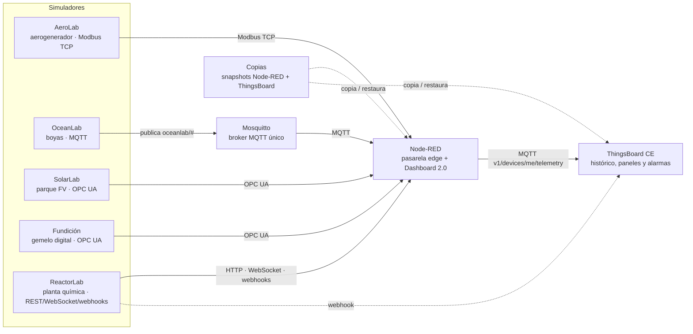

# LabMonitorizacion

Banco de prácticas de la asignatura **Monitorización de Máquinas** (especialización en Digitalización del Mantenimiento). Reúne en un único repositorio seis simuladores industriales, la plataforma IIoT con la que se trabaja en clase (**Node-RED**, **Mosquitto** y **ThingsBoard**) y las prácticas.



## Contenido

| Carpeta | Qué hay | Origen |
|---|---|---|
| [`simuladores/aerolab`](simuladores/aerolab) | Aerogenerador 5 MW, servidor Modbus TCP, escena 3D | repo `Aerogenerador` |
| [`simuladores/oceanlab`](simuladores/oceanlab) | Red mundial de boyas, broker MQTT integrado, globo 3D | repo `Clima-Oce-nico` |
| [`simuladores/solarlab`](simuladores/solarlab) | Parque fotovoltaico 5 MWp, servidor OPC UA, escena 3D | repo `ParqueSolar` |
| [`simuladores/reactorlab`](simuladores/reactorlab) | Reactor químico (Tennessee Eastman simplificado, portado de GRFICS) con API REST, WebSocket, SSE, webhooks y la vista 3D original de GRFICS | GRFICSv3 (GPL-3.0) |
| [`simuladores/atomlab`](simuladores/atomlab) | Central nuclear RBMK-1000 (tipo Chernóbil) con servidor OPC UA, sala de control web y vista 3D realista (Three.js); incluye el escenario del 26-04-1986 | nuevo |
| [`simuladores/fundicion`](simuladores/fundicion) | Gemelo digital 3D de una fundición con motor de proceso causal y trazabilidad, servidor OPC UA (alarmas, métodos, histórico), PLC S7 simulado y puente WebSocket | repo `Fundicion` |
| [`plataforma/node-red`](plataforma/node-red) | Imagen Node-RED con Modbus, OPC UA y Dashboard 2.0 + biblioteca de flujos | nuevo |
| [`plataforma/mosquitto`](plataforma/mosquitto) | Broker MQTT único del aula (OceanLab publica aquí) | nuevo |
| [`plataforma/thingsboard`](plataforma/thingsboard) | ThingsBoard CE 4.3.1 que se instala solo en el primer arranque | nuevo |
| [`plataforma/copias`](plataforma/copias) | Web de snapshots: crear, descargar, importar y restaurar Node-RED, ThingsBoard y la capa de IA | nuevo |
| [`plataforma/ia`](plataforma/ia) | Capa de IA: servicio REST para Node-RED, Jupyter con cuadernos y nodos **IA** de Node-RED | nuevo |
| [`practicas`](practicas) | Guiones, soluciones y flujos de las prácticas | repos anteriores y sesiones previas |
| [`docs/presentaciones`](docs/presentaciones) | Presentaciones (.pptx) de cada protocolo: OPC UA, Modbus TCP, MQTT, protocolos web y un panorama comparativo | nuevo |

El historial de commits de los cuatro repositorios originales se ha conservado (`git log -- simuladores/aerolab`).

## Puesta en marcha con Docker

Requisitos: Docker Desktop (o Docker Engine + Compose v2) y unos **10 GB de RAM** libres (ThingsBoard necesita ~4 GB; la capa de IA y Jupyter, ~1 GB).

```bash
cp .env.example .env              # opcional: IP pública, soluciones en Node-RED...
docker compose up -d --build      # Windows: doble clic en start_lab.cmd
```

No hay pasos previos: la primera vez que arranca, ThingsBoard crea su base de datos solo (tarda 1–3 minutos más que los arranques siguientes).

**Red durante la primera construcción.** `--build` descarga imágenes de Docker Hub, paquetes de **npm** y **PyPI**,
las fuentes de **Google Fonts** (web de la Fundición) y un paquete alojado en **`dl.cloudsmith.io`** (dependencia de
`node-red-contrib-modbus`). Si la red del centro filtra el tráfico, hay que permitir esos servidores o construir las
imágenes en otra red y llevarlas con `docker save` / `docker load`.

También se puede arrancar solo una parte, por ejemplo `docker compose up -d aerolab nodered` o `docker compose up -d solarlab nodered thingsboard`.

### Servicios y puertos

| Servicio | Navegador / cliente en el equipo anfitrión | Dentro de Docker (desde Node-RED) |
|---|---|---|
| AeroLab | http://localhost:8010 · Modbus `localhost:1502` | `aerolab:1502` |
| OceanLab | http://localhost:8020 (publica en Mosquitto) | `oceanlab:8020` |
| SolarLab | http://localhost:8000 · `opc.tcp://localhost:4840/solarlab/server/` | `opc.tcp://solarlab:4840/solarlab/server/` |
| Fundición | http://localhost:3000 · `opc.tcp://localhost:4841/UA/Fundicion` · PLC S7 `localhost:102` | `opc.tcp://fundicion-opcua:4841/UA/Fundicion` · S7 `fundicion-s7:102` |
| ReactorLab | http://localhost:8030 · vista 3D en `/3d/` · API en `/docs` | `http://reactorlab:8030` · `ws://reactorlab:8030/ws` |
| AtomLab | http://localhost:8040 · OPC UA `opc.tcp://localhost:4842/atomlab/` | `opc.tcp://atomlab:4842/atomlab/` |
| Node-RED | http://localhost:1880 · dashboard en `/dashboard` | `nodered:1880` |
| Mosquitto | MQTT `localhost:1883` · WS `localhost:9001` | `mosquitto:1883` |
| ThingsBoard | http://localhost:8080 | `thingsboard:8080` · MQTT de dispositivos `thingsboard:1883` |
| Copias | http://localhost:8090 (solo desde el propio equipo) | — |
| Servicio de IA | http://localhost:8100/docs | `http://ia:8000` |
| Jupyter | http://localhost:8888/?token=lab | — |

Cambios respecto a los repositorios originales, necesarios para que todo conviva en el mismo equipo:

- **Un solo broker MQTT: Mosquitto** (`1883`). OceanLab ya no arranca su broker integrado: publica sus topics `oceanlab/#` en Mosquitto (variable `BUOYLAB_MQTT_EXTERNAL_HOST`). Para el alumnado no cambia nada: el broker sigue en `localhost:1883`.
- ThingsBoard también habla MQTT, pero no es un broker general: es su API de dispositivos (solo acepta `v1/devices/me/...` con un *access token*). Por eso no se publica en el equipo anfitrión; Node-RED le envía la telemetría por `thingsboard:1883` dentro de Docker.
- El OPC UA de la **Fundición** pasa a `4841` porque `4840` es de SolarLab.

Para conectar desde otro PC del aula (UAExpert, Node-RED de un alumno...), sustituye `localhost` por la IP del equipo y pon esa IP en `LAB_PUBLIC_HOST` dentro de `.env`.

### Node-RED

La imagen ya trae instaladas las paletas que piden las prácticas:

- `node-red-contrib-modbus` (práctica 01)
- `node-red-contrib-opcua` (prácticas 03 y 04)
- `@flowfuse/node-red-dashboard` (Dashboard 2.0, práctica 04)

Los flujos iniciales están en **Menú → Import → Local → LabMonitorizacion**, con los hosts del compose ya configurados. Los flujos resueltos solo aparecen si `NODE_RED_INCLUIR_SOLUCIONES=true`. Si se modifica un flujo en `practicas/*/flows`, se regenera la biblioteca con:

```bash
python plataforma/node-red/generar_biblioteca.py
docker compose up -d --build nodered
```

El editor no tiene contraseña: en una red que no sea la del aula, configura `adminAuth` en `plataforma/node-red/settings.js`. Las credenciales de los flujos (tokens de ThingsBoard) se cifran con una clave fija (`NODE_RED_CREDENTIAL_SECRET`, por defecto `labmonitorizacion`) para que los snapshots funcionen en cualquier equipo.

### ThingsBoard

Se usa **ThingsBoard CE 4.3.1** (`thingsboard/tb-node:4.3.1.8`), envuelto en una imagen que **instala la base de datos automáticamente** en el primer arranque, con las cuentas de demostración (`tenant@thingsboard.org` / `tenant`). A partir de la 4.4 las ediciones CE y PE se unificaron y la plataforma exige una clave de licencia, por eso se fija la 4.3.1, que ya incluye las *Alarm rules* que usan las prácticas. Cuentas de demostración y detalles en [`plataforma/thingsboard`](plataforma/thingsboard/README.md).

### Copias de seguridad (snapshots)

http://localhost:8090 permite:

- **Crear** un snapshot de Node-RED (flujos, credenciales, biblioteca, contexto) ThingsBoard (dispositivos, tokens, paneles, alarmas, reglas, usuarios y, opcionalmente, el histórico de telemetría) y la capa de IA (datos recogidos, modelos y cuadernos de Jupyter).
- **Descargar** el snapshot como un único `.tar.gz` (entregar una práctica, llevarla a casa, pasarla a otro PC).
- **Importar** un `.tar.gz` y **restaurarlo**: se puede elegir qué partes (Node-RED, ThingsBoard, IA), y por defecto se guarda antes una copia automática del estado actual.

Detalles y limitaciones en [`plataforma/copias`](plataforma/copias/README.md).

## Prácticas

Cuatro series para los seis simuladores: AeroLab (Modbus TCP), OceanLab (MQTT), SolarLab (OPC UA), ReactorLab (protocolos web), AtomLab (central nuclear, OPC UA) y, en las series 1 y 2, la Fundición (planta con 11 activos, OPC UA):

| Serie | Contenido |
|---|---|
| [1 · Node-RED + Dashboard](practicas/README.md) | Adquisición con Node-RED y dashboard con alarmas en Dashboard 2.0 (guías paso a paso, con .docx) |
| [2 · Node-RED + ThingsBoard](practicas/README.md#serie-2--contenido-de-cada-práctica) | Node-RED como pasarela hacia ThingsBoard: telemetría, atributos, paneles, reglas de alarma, inactividad, órdenes RPC y API de gateway (guías paso a paso, con .docx, flujos y paneles resueltos) |
| [3 · Reto](practicas/README.md#retos-serie-3) | La misma integración, menos guiada, con flujo inicial, solución y rúbrica de evaluación (AeroLab, OceanLab, SolarLab, ReactorLab y AtomLab) |
| [4 · Analítica e IA](practicas/4-ia/README.md) | Capa de IA genérica y opcional: Node-RED registra datos, Jupyter entrena (red neuronal, anomalías), Node-RED predice en tiempo real y ThingsBoard alarma sobre los modelos; aprendizaje continuo y deriva |

Índice completo, valores para el entorno Docker y pruebas realizadas en [`practicas/README.md`](practicas/README.md).

## Desarrollo de un simulador por separado

Cada carpeta de `simuladores/` conserva su README, su `Dockerfile` y su compose propio, así que se puede seguir desarrollando o ejecutando de forma independiente (por ejemplo `start_aerolab.cmd` o `docker compose up` dentro de la carpeta).
