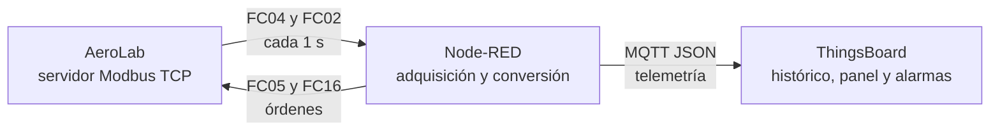

# Práctica: del aerogenerador Modbus TCP a ThingsBoard con Node-RED

## Ficha de la práctica

- **Módulo:** Monitorización de máquinas
- **Nivel:** Especialización en digitalización del mantenimiento
- **Duración orientativa:** 3 horas en parejas
- **Producto final:** flujo Node-RED, dispositivo y cuadro de mando en ThingsBoard, y diagnóstico de una avería

## Situación profesional

Una empresa de mantenimiento quiere incorporar un aerogenerador a su plataforma IIoT. El controlador de la máquina solo ofrece datos mediante Modbus TCP. Se debe utilizar Node-RED como pasarela de borde: leer los registros, convertir los datos a unidades de ingeniería y enviarlos por MQTT a ThingsBoard.



## Resultados de aprendizaje

Al terminar, el alumnado será capaz de:

1. Configurar un cliente Modbus TCP y distinguir referencia documental de dirección PDU base cero.
2. Leer input registers y discrete inputs con las funciones 04 y 02.
3. Reconstruir valores UInt32 con palabra alta primero, interpretar Int16 y aplicar factores de escala.
4. Transformar datos industriales a un objeto JSON con Node-RED.
5. Publicar telemetría mediante MQTT y visualizarla en ThingsBoard.
6. Crear una alarma de condición y relacionar una avería con sus síntomas.
7. Escribir una orden Modbus de forma controlada y comprobar su efecto en el proceso.

## Material necesario

- AeroLab en ejecución y accesible por red.
- Node-RED con el paquete `node-red-contrib-modbus` instalado.
- Una instancia de ThingsBoard y una cuenta con permiso para crear dispositivos y paneles.
- Flujo inicial: `integrations/node-red/aerolab-starter-flow.json`.

Anota antes de comenzar:

| Parámetro | Valor |
|---|---|
| IP o nombre del equipo AeroLab | ____________________ |
| Puerto Modbus TCP | `1502` |
| Unit ID | `1` |
| URL de ThingsBoard | ____________________ |
| Host MQTT de ThingsBoard | ____________________ |
| Puerto MQTT | `1883` o `8883` con TLS |

> Si Node-RED está instalado en el mismo Windows que AeroLab, el host Modbus será normalmente `127.0.0.1`. Si Node-RED está en un contenedor Docker y AeroLab se ejecuta en Windows, normalmente será `host.docker.internal`.

## Mapa de datos de trabajo

Las direcciones que se introducen en los nodos Modbus son **offsets PDU base cero**, no las referencias 30001/40001 impresas en algunos manuales.

### Input registers: FC04, offset 0, cantidad 16

| Offset | Referencia | Magnitud | Tipo | Conversión |
|---:|---:|---|---|---|
| 0 | 30001 | Viento | UInt16 | registro / 10 → m/s |
| 1 | 30002 | Rotor | UInt16 | registro / 100 → rpm |
| 2 | 30003 | Pitch | UInt16 | registro / 100 → ° |
| 3–4 | 30004–30005 | Potencia activa | UInt32 BE | alta × 65536 + baja → kW |
| 5 | 30006 | Dirección del viento | UInt16 | registro / 10 → ° |
| 6 | 30007 | Yaw de nacelle | UInt16 | registro / 10 → ° |
| 7 | 30008 | Vibración del multiplicador | UInt16 | registro / 100 → mm/s |
| 8 | 30009 | Temperatura del rodamiento | Int16 | valor con signo / 10 → °C |
| 9 | 30010 | Temperatura del multiplicador | Int16 | valor con signo / 10 → °C |
| 10 | 30011 | Generador | UInt16 | rpm |
| 11 | 30012 | Par mecánico | UInt16 | registro × 10 → N·m |
| 12–13 | 30013–30014 | Energía acumulada | UInt32 BE | (alta × 65536 + baja) / 10 → kWh |
| 14 | 30015 | Estado operativo | Enum | 0 parado, 1 arrancando, 2 marcha, 3 frenando, 4 avería |
| 15 | 30016 | Código de avería | Enum | 0 ninguna, 1 temperatura, 2 vibración, 3 red, 4 sobrevelocidad |

### Discrete inputs: FC02, offset 0, cantidad 5

| Offset | Referencia | Señal |
|---:|---:|---|
| 0 | 10001 | Preparado |
| 1 | 10002 | En marcha |
| 2 | 10003 | Alarma activa |
| 3 | 10004 | Conectado a red |
| 4 | 10005 | Viento válido |

## Desarrollo

### 1. Comprobar el proceso

1. Inicia AeroLab con `start_aerolab.cmd`.
2. Abre `http://IP_AEROLAB:8010` y confirma que el rotor gira.
3. Abre `http://IP_AEROLAB:8010/api/registers` para contrastar el mapa completo.
4. Cambia el viento desde la interfaz y observa la respuesta de RPM y potencia.

**Evidencia 1:** captura de AeroLab en marcha y valor actual de viento, RPM y potencia.

### 2. Importar el flujo inicial y leer Modbus

1. En Node-RED, instala `node-red-contrib-modbus` desde **Manage palette → Install** si todavía no aparece en la paleta.
2. Importa `aerolab-starter-flow.json` con **Menu → Import**.
3. Abre el nodo de configuración **AeroLab Modbus TCP** e introduce el host correcto; conserva puerto `1502` y Unit ID `1`.
4. Despliega el flujo.
5. Observa las dos salidas de depuración. Identifica el array de 16 registros y el array de 5 valores lógicos.

**Comprobación:** el estado de ambos nodos `Modbus Read` debe indicar conexión y los mensajes deben actualizarse una vez por segundo.

### 3. Convertir los registros a unidades de ingeniería

Crea un nodo `function` llamado **Decodificar telemetría**. Debe recibir el array de input registers y devolver en `msg.payload` un objeto con estas claves:

```text
wind_speed_mps, rotor_rpm, pitch_deg, active_power_kw,
wind_direction_deg, nacelle_yaw_deg, vibration_mms,
bearing_temperature_c, gearbox_temperature_c, generator_rpm,
torque_nm, energy_kwh, operating_state, operating_state_name,
fault_code, fault_name
```

Requisitos:

- No usar operaciones binarias de JavaScript para reconstruir el UInt32; pueden convertir el resultado a entero con signo de 32 bits. Utiliza `palabraAlta * 65536 + palabraBaja`.
- Crea una función auxiliar para convertir un registro UInt16 a Int16: si el valor es mayor o igual que `0x8000`, réstale `0x10000`.
- Redondea únicamente para presentación. No conviertas números a cadenas con unidades.
- Si la entrada no es un array de al menos 16 elementos, informa del error y no publiques.

Crea un segundo nodo `function` llamado **Decodificar estados** para convertir los cinco discrete inputs en:

```json
{
  "ready": true,
  "running": true,
  "alarm": false,
  "grid_connected": true,
  "wind_ok": true
}
```

**Evidencia 2:** objeto JSON decodificado y comparación de tres variables con la web de AeroLab.

### 4. Dar de alta el dispositivo en ThingsBoard

1. En ThingsBoard abre **Entities → Devices**.
2. Crea el dispositivo `Aerogenerador-Aula` con el perfil predeterminado.
3. Abre **Manage credentials** y conserva credenciales de tipo **Access token**.
4. Copia el token y guárdalo como secreto; no debe aparecer en capturas, exportaciones ni entregas.

### 5. Publicar por MQTT

1. Añade un nodo `mqtt out` conectado a cada objeto decodificado, usando antes un nodo `json` si necesitas serializarlo.
2. Configura el broker con el host de ThingsBoard.
3. Para una conexión sin TLS utiliza puerto `1883` y MQTT 3.1.1.
4. En **Security**, pega el access token en **Username** y deja **Password** vacío.
5. Publica con QoS 0 en el topic:

```text
v1/devices/me/telemetry
```

6. Despliega y comprueba en **Aerogenerador-Aula → Latest telemetry** que aparecen las 21 claves.

**Evidencia 3:** dispositivo activo y telemetría actualizándose en ThingsBoard.

### 6. Construir el cuadro de mando

Crea el dashboard `Monitorización Aerogenerador` y un alias fijo al dispositivo `Aerogenerador-Aula`. Debe incluir, como mínimo:

| Widget | Claves | Configuración recomendada |
|---|---|---|
| Serie temporal | `active_power_kw`, `wind_speed_mps` | dos ejes o dos gráficos si las escalas dificultan la lectura |
| Serie temporal | `rotor_rpm`, `generator_rpm` | ventana de 10 minutos |
| Serie temporal | `vibration_mms` | mostrar unidad mm/s |
| Serie temporal | `bearing_temperature_c`, `gearbox_temperature_c` | mostrar unidad °C |
| Último valor | `operating_state_name`, `fault_name` | texto visible |
| Indicador de estado | `alarm`, `grid_connected` | distinguir normal y alarma sin depender solo del color |
| Tabla de alarmas | alarmas del dispositivo | activas e históricas |

Organiza el panel en tres zonas: **producción**, **condición de máquina** y **estado/alarma**.

**Evidencia 4:** captura del dashboard completo con al menos cinco minutos de histórico.

### 7. Crear una alarma de mantenimiento

En ThingsBoard 4.3 o posterior, abre **Alarms → Alarm rules** y crea una regla sobre el dispositivo:

| Campo | Valor |
|---|---|
| Tipo de alarma | `Vibración elevada` |
| Argumento | latest telemetry `vibration_mms` |
| Severidad | Major |
| Disparo | `vibration_mms > 7` durante 5 segundos |
| Borrado automático | `vibration_mms < 6` durante 5 segundos |

Si el aula utiliza una versión anterior, crea la condición equivalente en **Device profile → Alarm rules**.

### 8. Ensayo de avería y diagnóstico

1. En AeroLab inyecta la avería **Vibración elevada**.
2. Registra la secuencia temporal: cambio de `fault_code`, `alarm`, estado operativo, vibración, RPM y potencia.
3. Comprueba que ThingsBoard crea la alarma.
4. Retira la avería y confirma que la condición vuelve a normal y la alarma se borra.
5. Repite el ensayo con **Pérdida de red** y compara los síntomas.

Completa:

| Ensayo | Primer indicador | Variables afectadas | Efecto sobre producción | Tiempo de detección |
|---|---|---|---|---|
| Vibración elevada | | | | |
| Pérdida de red | | | | |

### 9. Escritura Modbus controlada

Añade una pequeña sección de mando en Node-RED:

- **Arranque/parada:** Coil offset `0` mediante FC05.
- **Inyección de avería:** Holding Register offset `5` mediante FC16, valores `0…4`.

Antes de escribir, valida el rango. Comprueba la orden en la web 3D y vuelve siempre a valor seguro (`avería = 0`). Explica por qué una pasarela de monitorización no debería permitir escrituras sin autenticación, registro de auditoría y límites.

## Entrega

Cada pareja entregará:

1. Flujo Node-RED exportado en JSON **sin credenciales**.
2. Cuatro evidencias solicitadas.
3. Tabla de ensayos completada.
4. Respuesta breve a las preguntas finales.

### Preguntas finales

1. ¿Por qué la referencia 30001 se configura como dirección 0 en el nodo Modbus?
2. ¿Qué error aparecería al intercambiar las palabras alta y baja de la potencia?
3. ¿Qué diferencia funcional existe entre el sondeo Modbus y la publicación MQTT?
4. ¿Qué ocurre en ThingsBoard si Node-RED se detiene durante 30 segundos?
5. ¿Qué controles de ciberseguridad añadirías antes de permitir órdenes desde la nube?

## Criterios de evaluación

| Criterio | Peso |
|---|---:|
| Adquisición Modbus correcta y uso de direcciones PDU | 20 % |
| Conversión de tipos, escalas y UInt32/Int16 | 25 % |
| Publicación MQTT y gestión segura del token | 15 % |
| Dashboard legible y técnicamente coherente | 20 % |
| Alarma, ensayo de avería y diagnóstico | 15 % |
| Calidad de la entrega y respuestas finales | 5 % |

## Criterios de aceptación técnicos

- La telemetría se actualiza en ThingsBoard con un retraso habitual inferior a 3 segundos.
- La diferencia frente a AeroLab es menor de ±0,1 m/s en viento, ±0,02 rpm en rotor y ±1 kW en potencia.
- No hay números enviados como cadenas con unidades.
- El token de ThingsBoard no aparece en el JSON entregado.
- La alarma se dispara y se borra automáticamente con los umbrales definidos.
