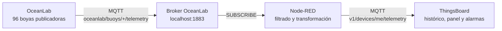

# Práctica: red de boyas MQTT con Node-RED y ThingsBoard

## Ficha de la práctica

- **Módulo:** Monitorización de máquinas
- **Nivel:** Especialización en Digitalización del Mantenimiento
- **Duración:** 3 horas en parejas
- **Producto final:** flujo Node-RED, dispositivo y dashboard en ThingsBoard, ensayo de una incidencia y memoria breve

## Situación profesional

Una organización oceanográfica dispone de boyas que publican telemetría en un broker MQTT local. El equipo de mantenimiento debe usar Node-RED como pasarela de borde para seleccionar, validar y transformar los mensajes antes de enviarlos a ThingsBoard.



## Resultados de aprendizaje

Al terminar, el alumnado será capaz de:

1. Identificar publicador, suscriptor, broker, topic y payload.
2. Configurar clientes MQTT 3.1.1 en Node-RED.
3. Utilizar los comodines `+` y `#` en una suscripción.
4. Validar y transformar un payload JSON sin convertir números en cadenas.
5. Comparar QoS 0 y QoS 1 y explicar el propósito de `retained`.
6. Publicar telemetría en ThingsBoard y construir un dashboard.
7. Detectar una condición meteorológica anómala y generar una alarma.
8. Analizar la pérdida de comunicación de una estación.

## Material necesario

- OceanLab en ejecución.
- Node-RED con los nodos MQTT incluidos de serie.
- Una instancia de ThingsBoard y permiso para crear dispositivos y dashboards.
- Flujo inicial `flows/oceanlab-starter-flow.json`.

Anota antes de comenzar:

| Parámetro | Valor |
|---|---|
| IP del equipo OceanLab | ____________________ |
| Puerto MQTT OceanLab | `1883` |
| URL de ThingsBoard | ____________________ |
| Host MQTT ThingsBoard | ____________________ |
| Puerto ThingsBoard | `1883` o `8883` con TLS |
| Boya asignada | `BOY-_____` |

> Si Node-RED se ejecuta en otro equipo, sustituye `localhost` por la IP de OceanLab. Si está en Docker sobre el mismo ordenador, puede ser necesario usar `host.docker.internal`.

## Topics disponibles

| Topic | Emisor | Contenido |
|---|---|---|
| `oceanlab/buoys/{id}/telemetry` | Simulador | Telemetría periódica de una boya |
| `oceanlab/buoys/{id}/alerts` | Simulador | Incidencia inyectada desde la web |

Suscripciones útiles:

- `oceanlab/buoys/BOY-001/telemetry`: una única estación.
- `oceanlab/buoys/+/telemetry`: todas las estaciones, solo telemetría.
- `oceanlab/buoys/BOY-001/#`: todos los mensajes de una estación.
- `oceanlab/#`: toda la red del laboratorio.

## Payload de entrada

Cada mensaje de telemetría tiene esta estructura:

```json
{
  "buoy_id": "BOY-001",
  "timestamp": "2026-07-13T15:40:20.125Z",
  "sequence": 148,
  "location": {
    "latitude": 38.12,
    "longitude": -37.45,
    "ocean": "Atlántico Norte"
  },
  "weather": {
    "water_temperature_c": 15.2,
    "air_temperature_c": 16.8,
    "wave_height_m": 1.46,
    "wind_speed_mps": 8.3,
    "wind_direction_deg": 224,
    "pressure_hpa": 1012.4,
    "humidity_pct": 78
  },
  "device": {
    "battery_pct": 91.5,
    "signal_rssi_dbm": -62,
    "status": "online"
  }
}
```

## Desarrollo

### 1. Reconocer la arquitectura

1. Inicia OceanLab y abre `http://IP_OCEANLAB:8020`.
2. Selecciona la boya asignada y anota temperatura del agua, altura de ola y batería.
3. Localiza en la interfaz el publicador, el broker y el suscriptor.
4. Explica por qué una boya no necesita conocer la dirección de ThingsBoard.

**Evidencia 1:** captura de OceanLab con la boya asignada y un esquema propio del flujo de datos.

### 2. Suscribirse desde Node-RED

1. Importa `oceanlab-starter-flow.json` mediante **Menu → Import**.
2. Abre el nodo de configuración **OceanLab MQTT**.
3. Introduce la IP de OceanLab y el puerto `1883`.
4. Mantén MQTT 3.1.1, sesión limpia y sin usuario ni contraseña.
5. Despliega el flujo y abre el panel **Debug**.
6. Comprueba que llegan mensajes de distintas boyas.

El nodo `mqtt in` utiliza:

```text
oceanlab/buoys/+/telemetry
```

**Comprobación:** identifica qué parte del topic ha sustituido el comodín `+`.

### 3. Seleccionar y validar una boya

Añade un nodo `function` llamado **Validar y transformar**. Debe:

1. Rechazar mensajes que no sean objetos JSON.
2. Dejar pasar únicamente la boya asignada.
3. Comprobar que existen `weather`, `device` y `location`.
4. Comprobar que `wave_height_m`, `wind_speed_mps` y `battery_pct` son números.
5. Producir un objeto plano con estas claves:

```text
water_temperature_c, air_temperature_c, wave_height_m,
wind_speed_mps, wind_direction_deg, pressure_hpa, humidity_pct,
battery_pct, signal_rssi_dbm, status, latitude, longitude,
ocean, sequence
```

No añadas unidades a los valores. `"8.3 m/s"` es una cadena y ThingsBoard no podrá tratarla como serie numérica.

**Evidencia 2:** objeto transformado en Debug y comparación de tres valores con OceanLab.

### 4. Comparar QoS

1. En OceanLab cambia el QoS de publicación a `0`.
2. Observa la traza del broker e identifica el `PUBLISH`.
3. Repite con QoS `1`.
4. Explica qué confirmación añade QoS 1 y por qué puede duplicar un mensaje.
5. Anota qué QoS elegirías para telemetría periódica y cuál para una alarma crítica.

> QoS no corrige datos erróneos ni garantiza que el sensor mida correctamente. Solo regula la entrega MQTT entre cada cliente y el broker.

### 5. Dar de alta el dispositivo en ThingsBoard

1. En ThingsBoard abre **Entities → Devices**.
2. Crea el dispositivo `Boya-Aula-XX`, sustituyendo `XX` por el número asignado.
3. Abre sus credenciales y conserva el tipo **Access token**.
4. Copia el token sin incluirlo en capturas, documentos o flujos exportados.

### 6. Publicar telemetría en ThingsBoard

1. Añade un nodo `json` para serializar el objeto transformado.
2. Añade un nodo `mqtt out` con un segundo broker llamado **ThingsBoard MQTT**.
3. Configura el host de ThingsBoard y MQTT 3.1.1.
4. Usa el access token como **Username** y deja **Password** vacío.
5. Publica con QoS 0 y `retain` desactivado en:

```text
v1/devices/me/telemetry
```

6. Comprueba en **Latest telemetry** que aparecen las 14 claves.

ThingsBoard admite un objeto simple o un objeto con `ts` y `values`. En esta práctica se utiliza el objeto simple y ThingsBoard asigna el instante de recepción.

**Evidencia 3:** telemetría actualizándose en ThingsBoard sin mostrar el token.

### 7. Construir el dashboard

Crea el dashboard `Monitorización Boya XX` con un alias al dispositivo. Incluye:

| Widget | Claves | Recomendación |
|---|---|---|
| Serie temporal | `wave_height_m`, `wind_speed_mps` | ventana de 15 minutos |
| Serie temporal | `water_temperature_c`, `air_temperature_c` | unidad °C |
| Último valor | `pressure_hpa`, `humidity_pct` | unidades visibles |
| Indicador | `battery_pct` | rango 0–100 % |
| Último valor | `signal_rssi_dbm`, `status` | estado de comunicaciones |
| Mapa | `latitude`, `longitude` | posición de la boya |
| Tabla de alarmas | alarmas del dispositivo | activas e históricas |

Organiza el panel en tres zonas: **mar**, **atmósfera** y **estado del equipo**.

**Evidencia 4:** dashboard con un mínimo de cinco minutos de histórico.

### 8. Crear una alarma meteorológica

Crea una regla de alarma equivalente a:

| Campo | Valor |
|---|---|
| Tipo | `Oleaje peligroso` |
| Variable | latest telemetry `wave_height_m` |
| Severidad | Major |
| Disparo | `wave_height_m > 6` durante 5 s |
| Borrado | `wave_height_m < 4` durante 10 s |

Según la versión de ThingsBoard, la regla se encontrará en **Alarms → Alarm rules** o en las reglas del perfil de dispositivo.

### 9. Ensayar una tormenta y una desconexión

1. En OceanLab pulsa **Simular tormenta** para la boya asignada.
2. Registra la evolución de ola, viento y presión.
3. Comprueba la creación de la alarma.
4. Pulsa **Restablecer** y comprueba el borrado automático.
5. Pulsa **Desconectar** y observa que deja de publicarse telemetría.
6. Explica por qué el último valor de ThingsBoard no cambia automáticamente a `offline`.
7. Propón una solución con Last Will and Testament o una regla de inactividad.

Completa:

| Ensayo | Primer indicador | Variables afectadas | Tiempo de detección | Estado final |
|---|---|---|---:|---|
| Tormenta | | | | |
| Desconexión | | | | |

### 10. Ampliación: incorporar toda la flota como gateway

Para representar muchas boyas como dispositivos independientes, crea un dispositivo gateway en ThingsBoard y publica en `v1/gateway/telemetry`:

```json
{
  "BOY-001": [
    {
      "ts": 1783957220125,
      "values": {
        "wave_height_m": 1.46,
        "battery_pct": 91.5
      }
    }
  ]
}
```

Modifica el nodo function para usar `buoy_id` como nombre de dispositivo y el timestamp de la boya convertido a milisegundos.

## Entrega

Cada pareja entregará:

1. Flujo Node-RED exportado en JSON, sin credenciales.
2. Las cuatro evidencias solicitadas.
3. Tabla de ensayos completada.
4. Respuestas a las preguntas finales.

### Preguntas finales

1. ¿Qué diferencia existe entre `+` y `#`?
2. ¿Qué cambia entre QoS 0 y QoS 1?
3. ¿Por qué no debe publicarse telemetría con `retain` de forma indiscriminada?
4. ¿Qué función de desacoplamiento realiza el broker?
5. ¿Por qué ThingsBoard conserva el último valor cuando la boya se desconecta?
6. ¿Qué riesgos presenta un broker anónimo expuesto a Internet?

## Criterios de evaluación

| Criterio | Peso |
|---|---:|
| Suscripción MQTT y uso correcto de comodines | 15 % |
| Validación y transformación del JSON | 20 % |
| Publicación segura en ThingsBoard | 15 % |
| Dashboard legible y coherente | 20 % |
| Alarma y diagnóstico de incidencias | 20 % |
| Evidencias y respuestas finales | 10 % |

## Criterios de aceptación

- El flujo recibe exclusivamente la boya asignada después del filtro.
- Los valores numéricos llegan a ThingsBoard como números.
- El dashboard se actualiza con un retraso habitual inferior a 5 segundos.
- La alarma se dispara y se borra con los umbrales definidos.
- El JSON entregado no contiene el access token.
- La desconexión se distingue de una medición meteorológica estable.

## Referencias oficiales

- [API MQTT de telemetría de ThingsBoard](https://thingsboard.io/docs/reference/mqtt-api/telemetry/)
- [API de telemetría para gateways de ThingsBoard](https://thingsboard.io/docs/reference/gateway-api/telemetry/)
- [Nodos principales de Node-RED](https://nodered.org/docs/user-guide/nodes)
