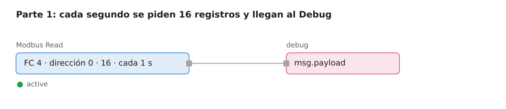
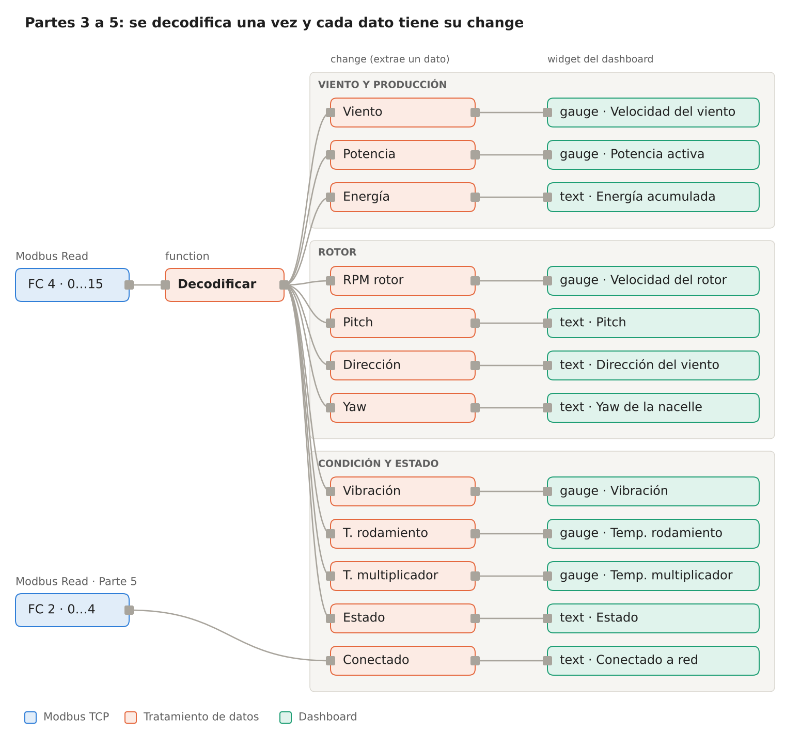
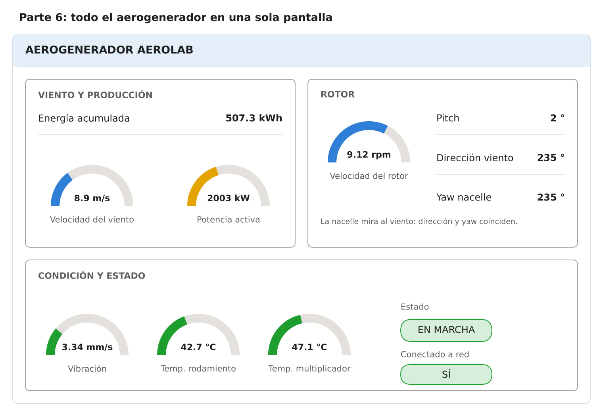
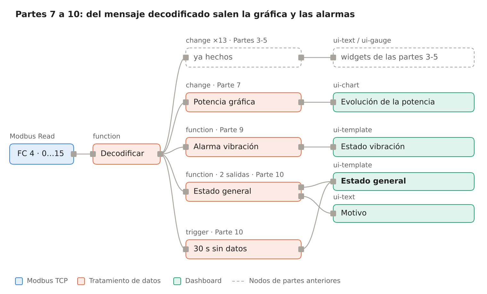
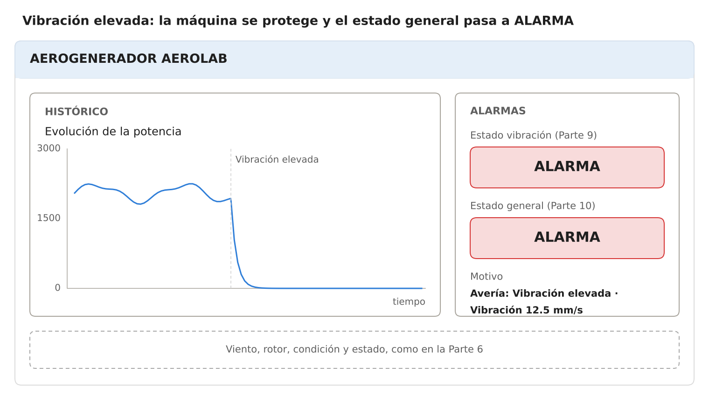
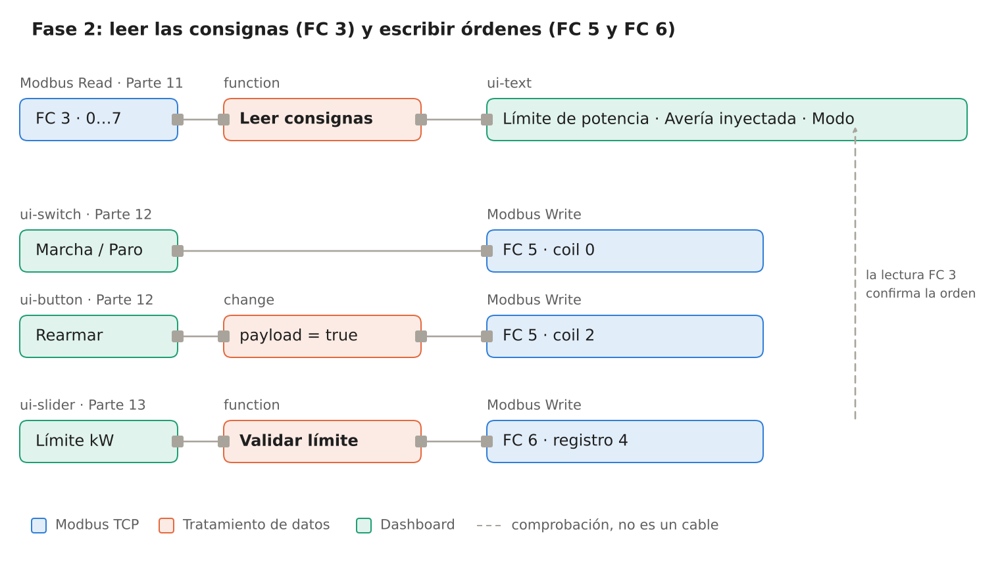
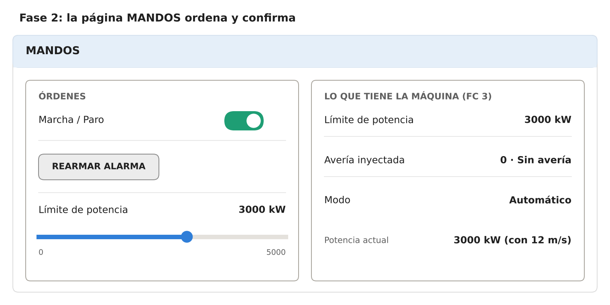

# Práctica: AeroLab con Node-RED (Modbus TCP → Dashboard 2.0)

> Serie **1 · Node-RED + Dashboard**. Versión Markdown de [Practica_AeroLab_NodeRED_ES.docx](Practica_AeroLab_NodeRED_ES.docx). La continuación con ThingsBoard está en [2-thingsboard/aerolab](../../2-thingsboard/aerolab/README.md).
>
> Si trabajas con el `docker-compose.yml` del repositorio, donde la guía dice *IP del equipo* usa estos valores:

| Dónde | Valor en el entorno Docker del laboratorio |
|---|---|
| Servidor Modbus (**Host**, **Port**, **Unit-Id**) | `aerolab`, `1502`, `1` |
| Web de AeroLab | `http://localhost:8010` |
| Dashboard de Node-RED | `http://localhost:1880/dashboard` |

## Introducción

Al terminar esta práctica tendrás un dashboard en Node-RED que te dice,
de un vistazo, si el aerogenerador AeroLab funciona bien o si hay que
intervenir, y una página desde la que podrás darle órdenes. No vas a
programar desde cero: cuando haga falta código, lo tienes preparado en
esta guía y solo tendrás que pegarlo y, como mucho, cambiar un umbral.

**La cadena que vas a construir:**

1.  **AeroLab** simula un aerogenerador de 5 MW.
2.  **Modbus TCP** (servidor en el puerto `1502`, Unit ID `1`) ofrece
    sus datos como registros numerados.
3.  **Node-RED** pregunta por esos registros cada segundo y los
    convierte a unidades reales.
4.  **Dashboard** muestra los datos de forma clara.
5.  **Alarma** convierte muchos datos en un estado sencillo: NORMAL /
    ATENCIÓN / ALARMA.
6.  **Técnico de mantenimiento** decide si hay que intervenir y, en la
    Fase 2, envía órdenes a la máquina.

**Antes de empezar, comprueba que tienes:**

- [ ] Node-RED funcionando en Docker y accesible desde el navegador
  (normalmente `http://<IP>:1880`).
- [ ] El dashboard instalado: paleta `@flowfuse/node-red-dashboard`
  (Dashboard 2.0). El panel se abre en `http://<IP>:1880/dashboard`.
- [ ] Los nodos Modbus instalados: paleta `node-red-contrib-modbus`.
  Deben aparecer los nodos **Modbus Read** y **Modbus Write**.
- [ ] AeroLab funcionando. Su web se abre en `http://<IP_AEROLAB>:8010`
  y el rotor debe girar.
- [ ] La IP del equipo de AeroLab (te la da el profesor).

**Cómo da los datos un equipo Modbus.** Un equipo Modbus no envía
mensajes con nombres ni JSON. Guarda sus datos en **tablas de casillas
numeradas** y es el cliente (Node-RED) quien **pregunta** cada cierto
tiempo: *“dame 16 casillas a partir de la 0”*. Hay cuatro tablas:

| **Tabla**         | **Contiene**                  | **Acceso**          | **Función para leer / escribir** |
|-------------------|-------------------------------|---------------------|----------------------------------|
| Coils             | bits (sí / no)                | Lectura y escritura | FC 1 / FC 5                      |
| Discrete inputs   | bits (sí / no)                | Solo lectura        | FC 2                             |
| Input registers   | números enteros de 0 a 65 535 | Solo lectura        | FC 4                             |
| Holding registers | números enteros de 0 a 65 535 | Lectura y escritura | FC 3 / FC 6                      |

Cada casilla guarda un número entero. Para los decimales se usa una
**escala**: el registro de viento vale `89` y significa `8.9 m/s` (hay
que dividir entre 10). Para saber qué hay en cada casilla y qué escala
lleva hace falta el **mapa de registros** del fabricante.

> Los manuales numeran los registros desde 30001 (input registers) o
> 40001 (holding registers), pero en Node-RED se escribe la **dirección
> empezando en 0**. La referencia 30001 es la dirección `0`, la 30002 es
> la `1`, etc.

La práctica tiene dos fases. En la **Fase 1** solo lees datos y
construyes el dashboard y las alarmas. En la **Fase 2**, solo cuando la
Fase 1 esté clara, escribes órdenes en la máquina.

## Fase 1 — Leer el aerogenerador (partes 1 a 6)

En toda la Fase 1 solo lees. Todavía no escribes nada en la máquina.

### Parte 1 — Leer registros Modbus

Objetivo: comprobar que los registros del aerogenerador llegan a
Node-RED.

1.  Arrastra al área de trabajo un nodo **Modbus Read** y un nodo
    **debug**. Únelos con la **primera** salida del Modbus Read.
2.  Abre el nodo **Modbus Read** y pulsa el lápiz junto a *Server* para
    crear la conexión:
    - **Type:** `TCP`
    - **Host:** la IP del equipo de AeroLab. Si Node-RED y AeroLab están
      en Docker en el mismo ordenador, prueba `host.docker.internal`.
    - **Port:** `1502`. **Unit-Id:** `1`.
3.  En el nodo **Modbus Read** configura:
    - **Name:** `Input registers`
    - **FC:** `FC 4: Read Input Registers`
    - **Address:** `0` y **Quantity:** `16`
    - **Poll Rate:** cada `1` segundo.
4.  Pulsa **Deploy**. Debajo del nodo debe aparecer un estado en verde y
    en la pestaña **Debug** debe llegar un mensaje cada segundo.

*Flujo de la Parte 1 (esquema).* El **Modbus Read** pregunta cada
segundo y entrega la respuesta por su primera salida.

Cada mensaje es una lista de 16 números enteros, sin nombres ni
unidades:

    msg.payload = [89, 912, 200, 0, 2003, 2350, 2350, 334, 427, 471, 884, 2163, 0, 5073, 2, 0]

**Comprueba.** Anota el valor crudo de cada casilla y calcula el valor
real con la escala. Compara tres de ellos con la web de AeroLab.

| **Dirección** | **Referencia** | **Dato**                        | **Conversión**                                            | **Valor crudo** | **Valor real** |
|---------------|----------------|---------------------------------|-----------------------------------------------------------|-----------------|----------------|
| 0             | 30001          | Velocidad del viento            | ÷ 10 → m/s                                                |                 |                |
| 1             | 30002          | Velocidad del rotor             | ÷ 100 → rpm                                               |                 |                |
| 2             | 30003          | Pitch (ángulo de pala)          | ÷ 100 → °                                                 |                 |                |
| 3 y 4         | 30004–30005    | Potencia activa                 | alta × 65 536 + baja → kW                                 |                 |                |
| 5             | 30006          | Dirección del viento            | ÷ 10 → °                                                  |                 |                |
| 6             | 30007          | Yaw (orientación de la nacelle) | ÷ 10 → °                                                  |                 |                |
| 7             | 30008          | Vibración del multiplicador     | ÷ 100 → mm/s                                              |                 |                |
| 8             | 30009          | Temperatura del rodamiento      | ÷ 10 → °C                                                 |                 |                |
| 9             | 30010          | Temperatura del multiplicador   | ÷ 10 → °C                                                 |                 |                |
| 10            | 30011          | Velocidad del generador         | rpm                                                       |                 |                |
| 11            | 30012          | Par mecánico                    | × 10 → N·m                                                |                 |                |
| 12 y 13       | 30013–30014    | Energía acumulada               | (alta × 65 536 + baja) ÷ 10 → kWh                         |                 |                |
| 14            | 30015          | Estado operativo                | 0 parado, 1 arrancando, 2 en marcha, 3 frenando, 4 avería |                 |                |
| 15            | 30016          | Código de avería                | 0 ninguna … 4 (ver Parte 3)                               |                 |                |

> Truco: la web de AeroLab tiene una sección *Qué está ocurriendo en el
> bus*. En la pestaña **Mapa de registros** ves el valor de cada casilla
> y en **Tramas Modbus** ves, en hexadecimal, las preguntas que hace tu
> Node-RED y las respuestas del aerogenerador.

### Parte 2 — Mostrar un único dato

Objetivo: entender el camino **Modbus → dato → widget**. Como llega una
lista de números, hay que elegir la casilla y aplicar la escala.

1.  Conecta a la primera salida del **Modbus Read** un nodo **change**
    llamado `Viento`. Regla: **Set** `msg.payload` **to the value**
    `payload[0] / 10` (elige el tipo **J: expression** en el
    desplegable).
2.  Conecta la salida a un nodo **text** del dashboard (`ui-text`). La
    primera vez tendrás que crear:
    - una **página** (`ui-page`) llamada `Aerogenerador AeroLab`,
    - un **grupo** (`ui-group`) llamado `Pruebas`.
3.  En el nodo **text**: *Label* = `Velocidad del viento`, *Format* =
    `{{msg.payload}} m/s`.
4.  **Deploy** y abre `http://<IP>:1880/dashboard`.

Debes ver algo así: **Velocidad del viento 8.9 m/s**, y el valor debe
cambiar cada segundo.

**Comprueba.** Pon un nodo **debug** a la salida del nodo **change**.
¿Qué diferencia hay entre lo que sale del **Modbus Read** y lo que sale
del **change**? ¿Qué verías si pusieras `payload[1] / 10`?

### Parte 3 — Decodificar todos los registros

Con un **change** y una fórmula por dato es fácil equivocarse de casilla
o de escala. Es mejor convertir la lista entera **una sola vez** en un
mensaje con nombres y unidades reales, y trabajar después con ese
mensaje.

1.  Conecta a la primera salida del **Modbus Read** un nodo **function**
    llamado `Decodificar` y pega este código. **No hace falta tocar
    nada.**

<!-- -->

    // ENTRADA: msg.payload = los 16 input registers (enteros de 0 a 65535)
    // SALIDA:  msg.payload = los datos en unidades reales, agrupados por bloque

    const r = msg.payload;
    if (!Array.isArray(r) || r.length < 16) {
        return null;                      // respuesta incompleta: no seguimos
    }

    const int16  = (v) => v >= 32768 ? v - 65536 : v;  // registros con signo
    const uint32 = (alta, baja) => alta * 65536 + baja; // datos que ocupan 2 registros

    const ESTADOS = ["PARADO", "ARRANCANDO", "EN MARCHA", "FRENANDO", "AVERÍA"];
    const AVERIAS = ["Sin avería", "Sobretemperatura de rodamiento",
                     "Vibración elevada", "Pérdida de red", "Sobrevelocidad"];

    msg.payload = {
        viento: {
            velocidad_mps: r[0] / 10,
            direccion_deg: r[5] / 10
        },
        rotor: {
            rpm:           r[1] / 100,
            pitch_deg:     r[2] / 100,
            yaw_deg:       r[6] / 10,
            generador_rpm: r[10]
        },
        produccion: {
            potencia_kw:   uint32(r[3], r[4]),
            par_nm:        r[11] * 10,
            energia_kwh:   uint32(r[12], r[13]) / 10
        },
        condicion: {
            vibracion_mms:        r[7] / 100,
            temp_rodamiento_c:    int16(r[8]) / 10,
            temp_multiplicador_c: int16(r[9]) / 10
        },
        estado: {
            codigo:        r[14],
            nombre:        ESTADOS[r[14]] ?? "DESCONOCIDO",
            averia_codigo: r[15],
            averia:        AVERIAS[r[15]] ?? "Desconocida"
        }
    };
    return msg;

2.  Pon un **debug** a la salida del **Decodificar** y haz **Deploy**.

En el panel Debug verás un mensaje como este:

    {
      "viento":     { "velocidad_mps": 8.9, "direccion_deg": 235 },
      "rotor":      { "rpm": 9.12, "pitch_deg": 2, "yaw_deg": 235, "generador_rpm": 884 },
      "produccion": { "potencia_kw": 2003, "par_nm": 21630, "energia_kwh": 507.3 },
      "condicion":  { "vibracion_mms": 3.34, "temp_rodamiento_c": 42.7, "temp_multiplicador_c": 47.1 },
      "estado":     { "codigo": 2, "nombre": "EN MARCHA", "averia_codigo": 0, "averia": "Sin avería" }
    }

Ahora sí hay rutas con nombre: `msg.payload.produccion.potencia_kw`
significa *del mensaje → su contenido → bloque producción → potencia en
kW*.

> **¿Por qué la potencia ocupa dos registros?** Un registro solo llega
> hasta 65 535. Con la energía acumulada (en décimas de kWh) ese límite
> se supera enseguida, así que se usan dos casillas: la **alta** cuenta
> “paquetes” de 65 536 y la **baja** el resto. Las temperaturas usan
> `int16` porque pueden ser negativas: un registro no tiene signo, así
> que −5.0 °C llega como 65 486.

**Comprueba.** Con la tabla de la Parte 1, ¿coincide cada valor del
mensaje decodificado con el que calculaste a mano? A diferencia de un
equipo que publica por MQTT u OPC UA, aquí no hace falta limitar
mensajes: ¿por qué llega exactamente uno por segundo?

### Parte 4 — Viento, producción y rotor

A partir de aquí, todos los nodos **change** cuelgan del **Decodificar**
de la Parte 3. Ya puedes borrar el **change** y el grupo `Pruebas` de la
Parte 2.

1.  Crea un grupo llamado `VIENTO Y PRODUCCIÓN` y, como en la Parte 2,
    un nodo **change** por dato: **Set** `msg.payload` **to the value**
    de la ruta (tipo `msg.`).

| **Dato**             | **Ruta**                             | **Unidad** | **Widget sugerido** |
|----------------------|--------------------------------------|------------|---------------------|
| Velocidad del viento | `msg.payload.viento.velocidad_mps`   | m/s        | gauge (0–30)        |
| Potencia activa      | `msg.payload.produccion.potencia_kw` | kW         | gauge (0–5000)      |
| Energía acumulada    | `msg.payload.produccion.energia_kwh` | kWh        | text                |

2.  Crea el grupo `ROTOR` y muestra:

| **Dato**             | **Ruta**                           | **Unidad** | **Widget sugerido** |
|----------------------|------------------------------------|------------|---------------------|
| Velocidad del rotor  | `msg.payload.rotor.rpm`            | rpm        | gauge (0–14)        |
| Pitch                | `msg.payload.rotor.pitch_deg`      | °          | text                |
| Dirección del viento | `msg.payload.viento.direccion_deg` | °          | text                |
| Yaw de la nacelle    | `msg.payload.rotor.yaw_deg`        | °          | text                |

Puedes usar el widget que prefieras. En un **gauge** (`ui-gauge`)
rellena *Min*, *Max* y *Units*.

> El aerogenerador empieza a producir con **3 m/s** (*cut-in*), llega a
> su potencia nominal hacia **12 m/s** y se para por seguridad a partir
> de **25 m/s** (*cut-out*). El **pitch** es el giro de las palas: con
> 2° aprovechan todo el viento; a unos 86° quedan “en bandera” y el
> rotor se frena. El **yaw** es hacia dónde mira la nacelle: debe
> coincidir con la dirección del viento.

### Parte 5 — Condición y estado de la máquina

1.  Crea el grupo `CONDICIÓN Y ESTADO` y muestra:

| **Dato**                      | **Ruta**                                     | **Unidad** | **Widget sugerido** |
|-------------------------------|----------------------------------------------|------------|---------------------|
| Vibración del multiplicador   | `msg.payload.condicion.vibracion_mms`        | mm/s       | gauge (0–15)        |
| Temperatura del rodamiento    | `msg.payload.condicion.temp_rodamiento_c`    | °C         | gauge (0–110)       |
| Temperatura del multiplicador | `msg.payload.condicion.temp_multiplicador_c` | °C         | gauge (0–110)       |
| Estado                        | `msg.payload.estado.nombre`                  | —          | text                |
| Avería                        | `msg.payload.estado.averia`                  | —          | text                |

2.  **Señales sí / no (FC 2).** Algunas señales son bits. Añade un
    segundo nodo **Modbus Read** con el mismo servidor:
    - **FC:** `FC 2: Read Input Status`, **Address:** `0`, **Quantity:**
      `5`, **Poll Rate:** `1` segundo.
    - Recibirás una lista de 5 valores `true` / `false`:

| **Dirección** | **Referencia** | **Señal**       |
|---------------|----------------|-----------------|
| 0             | 10001          | Preparado       |
| 1             | 10002          | En marcha       |
| 2             | 10003          | Alarma activa   |
| 3             | 10004          | Conectado a red |
| 4             | 10005          | Viento válido   |

3.  Muestra *Conectado a red* con un **change** de tipo **J:
    expression** `payload[3] ? "SÍ" : "NO"` y un **text** en el grupo
    `CONDICIÓN Y ESTADO`.

> La **vibración** se mide en mm/s. Es normal que **aumente con la
> carga**: con más viento y más rpm la máquina vibra más aunque esté
> sana. Lo que preocupa es una vibración alta que no se explica por la
> carga.

Así queda el flujo al terminar la Parte 5. Casi todos los nodos
**change** cuelgan del **Decodificar**; *Conectado* cuelga de la lectura
FC 2.

*Flujo tras las partes 3 a 5 (esquema).*

### Parte 6 — Organizar el dashboard

Todo debe caber en una sola pantalla y leerse en pocos segundos.

1.  Borra el grupo `Pruebas` si ya no lo usas.
2.  En la pestaña del dashboard (a la derecha del editor) ordena los
    grupos y ajusta su **anchura** (el ancho total es 12 columnas):
    - `VIENTO Y PRODUCCIÓN`: 6
    - `ROTOR`: 6
    - `CONDICIÓN Y ESTADO`: 12
3.  Pon como título de la página `AEROGENERADOR AEROLAB`.

Layout orientativo (no hace falta copiarlo exactamente):

*Dashboard de la Parte 6 (maqueta con los valores del mensaje de
ejemplo).*

**Comprueba.** Pide a un compañero que mire tu dashboard 5 segundos.
¿Sabe decir cuánto produce el aerogenerador y si está en marcha?

## Fase 1 — Histórico, incidencia y alarmas (partes 7 a 10)

### Parte 7 — Añadir un histórico

Objetivo: diferenciar **valor actual** (el gauge) y **evolución en el
tiempo** (la gráfica).

1.  Crea un grupo `HISTÓRICO` de anchura 12.
2.  Añade un nodo **change** `Potencia gráfica` con dos reglas:
    - **Set** `msg.payload` to `msg.payload.produccion.potencia_kw`
    - **Set** `msg.topic` to the string `Potencia activa` (es el nombre
      de la línea en la gráfica).
3.  Conéctalo a un nodo **chart** (`ui-chart`):
    - *Label:* `Evolución de la potencia`
    - *Type:* **Line**, eje X de tipo **Timescale**
    - *Y-axis label:* `kW`
    - Conservar datos: los últimos **15 minutos**.
4.  **Deploy** y deja el sistema funcionando al menos **5 minutos**.
5.  En la web de AeroLab, mueve la **Velocidad del viento** a 5 m/s,
    después a 12 m/s y después a 15 m/s, dejando cada valor un minuto.
    Vuelve a 9 m/s.

**Comprueba.** Con el gauge, ¿puedes saber cómo ha respondido la
potencia a cada cambio de viento? ¿Y con la gráfica? ¿Cuántos segundos
tarda el rotor en adaptarse? ¿Qué hace el pitch cuando el viento pasa de
12 m/s?

### Parte 8 — Simular una incidencia

1.  En la web de AeroLab (`http://<IP_AEROLAB>:8010`), panel *Control de
    operación*, localiza el desplegable **Inyección de avería**.
2.  Anota los valores **antes** de la avería.
3.  Elige **Vibración elevada**.
4.  Observa el dashboard durante 1–2 minutos y anota los valores
    **durante** la avería.
5.  Vuelve a elegir **Sin avería** y observa cómo arranca de nuevo la
    máquina.

| **Variable**              | **Antes** | **Durante la avería** | **¿Ha cambiado mucho?** |
|---------------------------|-----------|-----------------------|-------------------------|
| Vibración (mm/s)          |           |                       |                         |
| Velocidad del rotor (rpm) |           |                       |                         |
| Pitch (°)                 |           |                       |                         |
| Potencia activa (kW)      |           |                       |                         |
| Estado                    |           |                       |                         |

**Preguntas:**

1.  ¿Qué variable fue la primera en avisarte de que algo pasaba?
2.  El viento no ha cambiado. ¿Por qué la potencia cae a 0? ¿Qué hace el
    pitch?
3.  ¿Qué ves en la gráfica que no veías en el gauge?

### Parte 9 — Primera alarma

Objetivo: entender la idea **ENTRA UN VALOR → SE COMPARA CON UN LÍMITE →
NORMAL / ALARMA**.

1.  Añade un nodo **function** llamado `Alarma vibración` conectado al
    **Decodificar**.
2.  Pega este código. **Solo debes tocar el número** `7` si quieres
    cambiar el límite.

<!-- -->

    // ENTRADA: el mensaje decodificado (msg.payload)
    // SALIDA:  msg.payload = "NORMAL" o "ALARMA"

    const LIMITE_VIBRACION = 7;   // mm/s. Puedes cambiar este valor.

    const vibracion = msg.payload.condicion.vibracion_mms;

    if (vibracion > LIMITE_VIBRACION) {
        msg.payload = "ALARMA";
    } else {
        msg.payload = "NORMAL";
    }

    return msg;

3.  Crea un grupo `ALARMAS` y conecta la salida a un nodo **template**
    (`ui-template`) con este código. Pinta el estado con color: verde,
    amarillo o rojo.

<!-- -->

    <template>
      

        {{ msg?.payload || 'SIN DATOS' }}
      

    </template>

    

4.  **Deploy**. En AeroLab elige la avería **Vibración elevada** y
    espera a que la vibración pase de 7 mm/s.

**Comprueba.** ¿Cuánto tarda en aparecer ALARMA desde que eliges la
avería? Cambia el límite a `3` y mira qué pasa. ¿Por qué un límite
demasiado bajo es un problema para el técnico? Vuelve a `7`, quita la
avería y sube el viento a 12 m/s: ¿cuánto vibra ahora? ¿Saltaría la
alarma con un límite de `5`? ¿Sería una avería?

### Parte 10 — Estado general del aerogenerador (ampliación)

Un técnico no puede vigilar 14 datos a la vez. Este nodo los resume en
**una sola palabra**: NORMAL, ATENCIÓN o ALARMA, y además dice el
**motivo**.

1.  Añade un nodo **function** `Estado general` conectado al
    **Decodificar**. En la pestaña *Setup* pon **Outputs: 2**.
2.  Pega este código. Solo cambia los números del bloque de umbrales.

<!-- -->

    // ENTRADA: el mensaje decodificado (msg.payload)
    // SALIDA 1: "NORMAL", "ATENCIÓN" o "ALARMA"
    // SALIDA 2: el motivo, en texto

    // ---- UMBRALES (puedes cambiarlos) ----
    const VIB_ATENCION   = 4.5;  // mm/s
    const VIB_ALARMA     = 7;    // mm/s
    const TROD_ATENCION  = 70;   // °C rodamiento
    const TROD_ALARMA    = 85;   // °C rodamiento
    const TMULT_ATENCION = 75;   // °C multiplicador
    const TMULT_ALARMA   = 90;   // °C multiplicador
    const DESALINEACION  = 20;   // ° entre el viento y la nacelle
    // --------------------------------------

    const p = msg.payload;
    const c = p.condicion;

    let nivel = 0;            // 0 = NORMAL, 1 = ATENCIÓN, 2 = ALARMA
    const motivos = [];

    function avisar(n, texto) {
        if (n > nivel) nivel = n;
        motivos.push(texto);
    }

    if (p.estado.codigo === 4)      avisar(2, "Avería: " + p.estado.averia);
    else if (p.estado.codigo === 3) avisar(1, "Frenando");
    else if (p.estado.codigo === 0) avisar(1, "Aerogenerador parado");

    const vib = "Vibración " + c.vibracion_mms + " mm/s";
    if (c.vibracion_mms > VIB_ALARMA)        avisar(2, vib);
    else if (c.vibracion_mms > VIB_ATENCION) avisar(1, vib);

    const trod = "Rodamiento " + c.temp_rodamiento_c + " °C";
    if (c.temp_rodamiento_c > TROD_ALARMA)        avisar(2, trod);
    else if (c.temp_rodamiento_c > TROD_ATENCION) avisar(1, trod);

    const tmult = "Multiplicador " + c.temp_multiplicador_c + " °C";
    if (c.temp_multiplicador_c > TMULT_ALARMA)        avisar(2, tmult);
    else if (c.temp_multiplicador_c > TMULT_ATENCION) avisar(1, tmult);

    // diferencia de ángulo entre -180° y 180° (359° y 1° solo se diferencian 2°)
    const error = ((p.viento.direccion_deg - p.rotor.yaw_deg + 540) % 360) - 180;
    if (Math.abs(error) > DESALINEACION) avisar(1, "Desalineado " + Math.round(error) + "°");

    const estados = ["NORMAL", "ATENCIÓN", "ALARMA"];
    return [
        { payload: estados[nivel] },
        { payload: motivos.length ? motivos.join(" · ") : "Sin incidencias" }
    ];

3.  Salida 1 → un **template** como el de la Parte 9 (puedes copiarlo).
    Salida 2 → un **text** con *Label* `Motivo`.
4.  Ensayo: en AeroLab prueba **Sobretemperatura de rodamiento** (espera
    2 minutos), **Pérdida de red** y **Vibración elevada**, volviendo a
    **Sin avería** entre una y otra. Prueba también, sin avería, a
    cambiar la **Dirección del viento** de 235° a 300° y a pulsar
    **Parar aerogenerador**. Anota qué estado y qué motivo aparecen.

**Detectar que el aerogenerador ha dejado de responder (sin código).**
Si se pierde la comunicación Modbus, no llegan respuestas y el dashboard
se queda congelado con el último valor, aunque parezca normal. Para
detectarlo:

1.  Añade un nodo **trigger** conectado al **Decodificar**:
    - *Send:* **nothing**
    - *then:* **wait for** `30` seconds
    - *then send:* el texto `ALARMA`
    - Marca **extend delay if new message arrives**.
2.  Conecta su salida al mismo **template** del estado general.
3.  Pide al profesor que detenga AeroLab (o detenlo tú si lo tienes en
    tu equipo) y espera 30 s.

Mientras lleguen respuestas, el temporizador se reinicia. Si dejan de
llegar durante 30 s, salta ALARMA.

Así queda el flujo al final de la Fase 1. La salida 1 del **Estado
general** y el **trigger** llegan al mismo template: cualquiera de los
dos puede ponerlo en ALARMA.

*Flujo completo de la Fase 1 (esquema).*

**Comprueba.** ¿Por qué es peligroso un dashboard que sigue mostrando
“EN MARCHA” cuando el aerogenerador ya no responde? Con la
sobretemperatura de rodamiento, la máquina se para enseguida, pero la
temperatura sube durante varios minutos: ¿qué te dice esto sobre cuándo
es seguro volver a arrancarla?

Así debería verse el dashboard con la avería de vibración: la potencia
cae a 0 y los dos indicadores pasan a rojo.

*Dashboard al final de la Fase 1, durante una avería de vibración
(maqueta; la curva es ilustrativa).*

## Fase 2 — Dar órdenes a la máquina (partes 11 a 13)

Empieza esta fase solo cuando tu dashboard funcione bien. Antes de tocar
nada, **exporta tu flujo** (*Menu → Export*) y guárdalo como copia de
seguridad.

**Leer y escribir.** Hasta ahora has leído *input registers* y *discrete
inputs*, que son **medidas**: la máquina las calcula y no se pueden
cambiar. Las **órdenes y consignas** están en las otras dos tablas, que
sí se pueden escribir:

| **Dirección** | **Tabla**                | **Qué es**                                   | **Cómo se escribe** |
|---------------|--------------------------|----------------------------------------------|---------------------|
| 0             | Coil (00001)             | Orden de marcha: `true` marcha, `false` paro | FC 5                |
| 2             | Coil (00003)             | Rearme de alarma: escribir `true`            | FC 5                |
| 4             | Holding register (40005) | Límite de potencia, en kW (0–5000)           | FC 6                |
| 5             | Holding register (40006) | Inyección de avería (0–4)                    | FC 6                |

> En una máquina real, una orden enviada desde un dashboard puede parar
> una instalación o poner en riesgo a una persona que esté trabajando en
> ella. Antes de permitirlo hacen falta usuarios, confirmación y
> registro de quién hizo qué. Aquí trabajamos con un simulador.

### Parte 11 — Leer las consignas (FC 3)

Antes de escribir, conviene saber **qué tiene guardado** la máquina.

1.  Añade un tercer nodo **Modbus Read** con el mismo servidor: **FC:**
    `FC 3: Read Holding Registers`, **Address:** `0`, **Quantity:** `8`,
    **Poll Rate:** `2` segundos.
2.  Conecta a su primera salida un nodo **function** `Leer consignas` y
    pega este código:

<!-- -->

    // ENTRADA: los 8 holding registers (consignas guardadas en la máquina)
    // SALIDA:  msg.payload = las consignas en unidades reales

    const h = msg.payload;
    if (!Array.isArray(h) || h.length < 8) {
        return null;
    }

    const AVERIAS = ["Sin avería", "Sobretemperatura de rodamiento",
                     "Vibración elevada", "Pérdida de red", "Sobrevelocidad"];

    msg.payload = {
        modo:                h[0] === 1 ? "Manual" : "Automático",
        viento_simulado_mps: h[1] / 10,
        limite_kw:           h[4],
        averia_codigo:       h[5],
        averia:              AVERIAS[h[5]] ?? "Desconocida",
        turbulencia_pct:     h[6] / 10
    };
    return msg;

3.  Crea una página nueva `MANDOS` y en ella un grupo
    `LO QUE TIENE LA MÁQUINA (FC 3)` con un **text** para
    `msg.payload.limite_kw`, otro para `msg.payload.averia` y otro para
    `msg.payload.modo`.
4.  **Deploy** y, en la web de AeroLab, mueve la velocidad del viento y
    elige una avería.

**Comprueba.** Compara `viento_simulado_mps` (holding register 1) con la
velocidad del viento medida (input register 0). ¿Por qué una no se mueve
y la otra oscila? ¿Cuál es la **consigna** y cuál la **medida**?

### Parte 12 — Marcha, paro y rearme (FC 5)

1.  En la página `MANDOS` crea un grupo `ÓRDENES`.
2.  **Marcha / paro.** Añade un nodo **switch** del dashboard
    (`ui-switch`) con *Label* `Marcha / Paro`, valor *On* = `true`
    (boolean) y valor *Off* = `false` (boolean). Conéctalo a un nodo
    **Modbus Write** con el mismo servidor:
    - **FC:** `FC 5: Force Single Coil`, **Address:** `0`, **Quantity:**
      `1`.
3.  **Rearme.** Añade un nodo **button** (`ui-button`) con *Label*
    `REARMAR ALARMA`, un **change** que haga **Set** `msg.payload` to
    `true` (boolean) y otro **Modbus Write** con **FC 5**, **Address:**
    `2`.
4.  **Deploy** y prueba:
    - Pon el interruptor en paro. En la web de AeroLab el botón debe
      pasar a *Arrancar aerogenerador*. Mira en tu dashboard cómo
      cambian el estado, el pitch y las rpm.
    - Vuelve a marcha.
    - Inyecta desde la web **Sobretemperatura de rodamiento** y pulsa
      **REARMAR ALARMA** en tu dashboard.

**Comprueba.** Después del rearme, ¿qué indica `averia` en el grupo de
la Parte 11? ¿Arranca de nuevo la máquina? Mira la temperatura del
rodamiento en ese momento: ¿era buena idea rearmar sin mirarla?

### Parte 13 — Limitar la potencia (FC 6) (ampliación final)

A veces el operador de la red pide a un parque eólico que **no supere
cierta potencia**. Vas a enviar ese límite desde el dashboard.

1.  En el grupo `ÓRDENES` añade un nodo **slider** (`ui-slider`) con
    *Label* `Límite de potencia`, *Min* `0`, *Max* `5000`, *Step* `500`.
2.  Conecta el slider a un nodo **function** `Validar límite` con este
    código:

<!-- -->

    // ENTRADA: el valor del slider (kW)
    // SALIDA:  el mismo valor, solo si está dentro del rango permitido

    const MIN = 0, MAX = 5000;   // kW

    const kw = Math.round(Number(msg.payload));
    if (!Number.isFinite(kw) || kw < MIN || kw > MAX) {
        node.warn("Límite fuera de rango: " + msg.payload);
        return null;             // no se escribe nada en la máquina
    }
    msg.payload = kw;
    return msg;

3.  Conecta la salida a un **Modbus Write**: **FC:**
    `FC 6: Preset Single Register`, **Address:** `4`, **Quantity:** `1`.
4.  **Deploy**. En la web de AeroLab sube el viento a 12 m/s y espera a
    que la potencia se estabilice. Después mueve el slider y completa la
    tabla.

| **Límite enviado (kW)** | **Límite leído por FC 3 (kW)** | **Potencia (kW)** | **Rotor (rpm)** |
|-------------------------|--------------------------------|-------------------|-----------------|
| 5000                    |                                |                   |                 |
| 3000                    |                                |                   |                 |
| 1000                    |                                |                   |                 |

Al terminar, deja el límite en **5000** y el viento en 9 m/s.

Así queda el flujo de la Fase 2. Cada orden va a un **Modbus Write** y
la lectura FC 3 confirma que la máquina la ha guardado.

*Flujo de la Fase 2 (esquema).*

Resultado esperado:

*Página MANDOS (maqueta con valores de ejemplo).*

**Comprueba.** Si el slider ya solo permite valores de 0 a 5000, ¿para
qué sirve el **Validar límite**? ¿Por qué es buena práctica comprobar
con una **lectura** que la máquina ha aceptado la orden, en vez de
fiarse de haberla enviado?

No se trata de construir un SCADA completo, sino de ver la idea de
**supervisión y mando**: leer el estado, decidir, ordenar y comprobar
que la orden se ha cumplido.

## Cierre y entrega

> Un sistema de monitorización no sirve solamente para mostrar datos.
> Debe ayudar al técnico a detectar rápidamente si un equipo funciona
> correctamente y si es necesario intervenir. Y cuando se interviene a
> distancia, hay que comprobar que la orden se ha cumplido.

**Qué entregar:**

- [ ] Flujo de Node-RED exportado en JSON (*Menu → Export → all flows*).
- [ ] Tabla de la Parte 1 completada.
- [ ] Captura del dashboard en estado NORMAL.
- [ ] Captura del dashboard durante una avería, con la gráfica y la
  ALARMA visibles.
- [ ] Tabla de la Parte 8 completada.
- [ ] Captura de la página MANDOS y tabla de la Parte 13 (si has hecho
  la Fase 2).
- [ ] Respuestas a las preguntas finales.

**Preguntas finales:**

1.  Explica con tus palabras el camino de un dato desde el aerogenerador
    hasta tu pantalla.
2.  ¿Por qué la referencia 30001 se configura como dirección `0` en el
    nodo Modbus?
3.  Si intercambias las dos palabras de la potencia
    (`baja × 65 536 + alta`), ¿qué valor saldría con los registros
    `[0, 2003]`? ¿Lo detectarías en el dashboard?
4.  ¿Qué límites de vibración elegirías para ATENCIÓN y para ALARMA?
    ¿Por qué hay que tener en cuenta la carga de la máquina?
5.  ¿Qué diferencia hay entre un input register y un holding register?
    Pon un ejemplo de cada uno en el aerogenerador.
6.  ¿Qué controles añadirías antes de permitir órdenes desde un
    dashboard en una máquina real?

**Si algo no funciona:**

| **Síntoma**                                                         | **Causa probable**                                     | **Qué hacer**                                                                                                           |
|---------------------------------------------------------------------|--------------------------------------------------------|-------------------------------------------------------------------------------------------------------------------------|
| El **Modbus Read** no se pone en verde                              | Host o puerto incorrectos                              | Revisa la IP y el puerto `1502`; desde Docker prueba `host.docker.internal`; el firewall debe permitir el puerto `1502` |
| Conecta, pero da error o *timeout*                                  | Unit-Id distinto de 1                                  | Pon **Unit-Id** `1` en el servidor y en el nodo                                                                         |
| Todos los datos parecen desplazados (el viento vale lo que las rpm) | Dirección `1` en lugar de `0`                          | Pon **Address** `0`: la referencia 30001 es la dirección 0                                                              |
| Los números no se parecen a la tabla                                | FC equivocada                                          | Para medidas usa `FC 4` (input registers), no `FC 3`                                                                    |
| Potencia o energía enormes                                          | Palabras alta y baja intercambiadas                    | Usa el código de la Parte 3 sin cambiar el orden de `uint32`                                                            |
| Temperaturas de cientos o miles de °C                               | Falta la escala o la conversión `int16`                | Revisa que la temperatura use `int16(...) / 10`                                                                         |
| El widget muestra `[object Object]`                                 | Llega el mensaje entero, no un dato                    | Revisa la regla del **change**: tiene que apuntar a un dato concreto                                                    |
| El widget sale vacío                                                | Ruta mal escrita                                       | Usa el botón de copiar ruta del panel Debug                                                                             |
| La gráfica no dibuja                                                | Falta `msg.topic` o el valor no es un número           | Revisa las dos reglas del **change** de la Parte 7                                                                      |
| La escritura no hace nada                                           | FC o dirección equivocadas, o valor de tipo incorrecto | Coil con **FC 5** y `true`/`false`; registro con **FC 6** y un número; comprueba la dirección                           |
| No veo el dashboard                                                 | Falta la paleta o la página                            | Instala `@flowfuse/node-red-dashboard` y abre `/dashboard`                                                              |

Referencia: [repositorio
AeroLab](https://github.com/gbellido-dev/aerogenerador).
