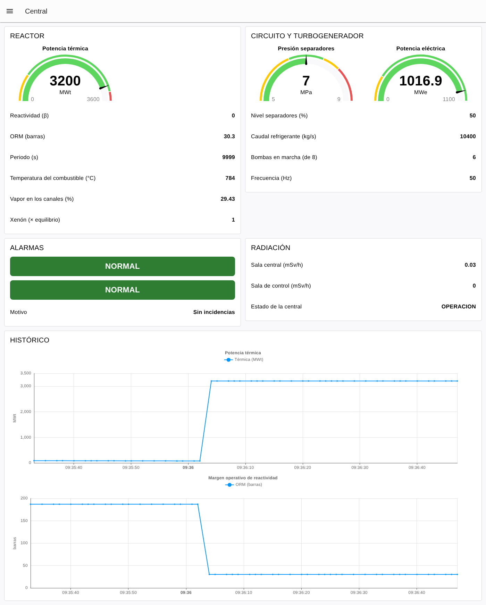
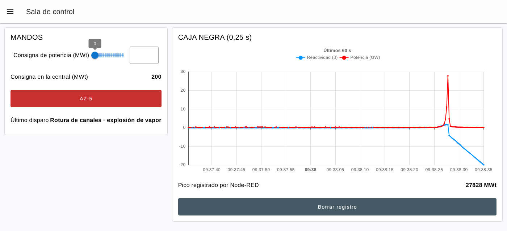
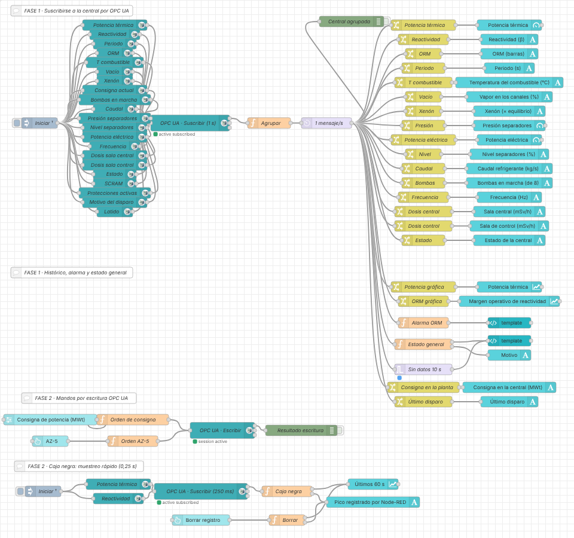

# Práctica: AtomLab con Node-RED (OPC UA → Dashboard 2.0)

> Serie **1 · Node-RED + Dashboard**. La continuación con ThingsBoard está
> en [2-thingsboard/atomlab](../../2-thingsboard/atomlab/README.md).
> Flujo resuelto para el profesorado:
> [flows/atomlab-dashboard-solucion.json](flows/atomlab-dashboard-solucion.json).

## Introducción

Al terminar esta práctica tendrás en Node-RED el panel de vigilancia de
una central nuclear: verás de un vistazo si el reactor funciona con
margen de seguridad o si se está metiendo en una zona peligrosa, y desde
una segunda página podrás darle órdenes. Al final reconstruirás, con tus
propios datos, lo que pasó en Chernóbil la madrugada del 26 de abril de
1986. No vas a programar desde cero: cuando haga falta código, lo tienes
preparado en esta guía.

**La cadena que vas a construir:**

1.  **AtomLab** simula una central RBMK-1000 de 3200 MWt / 1000 MWe, el
    mismo tipo que la unidad 4 de Chernóbil.
2.  **OPC UA** (servidor, puerto `4842`) ofrece las variables de la
    central ordenadas por sistemas.
3.  **Node-RED** se suscribe a esas variables y las junta en un solo
    mensaje.
4.  **Dashboard** muestra los datos de forma clara.
5.  **Alarma** convierte muchos datos en un estado sencillo: NORMAL /
    ATENCIÓN / ALARMA.
6.  **Operador** decide si hay que intervenir y, en la Fase 2, manda
    órdenes por OPC UA.

**Antes de empezar, comprueba que tienes:**

- [ ] El laboratorio arrancado (`docker compose up -d` o `start_lab.cmd`).
- [ ] Node-RED en `http://localhost:1880`, con las paletas
  `node-red-contrib-opcua` (nodos **OpcUa-Item** y **OpcUa-Client**) y
  `@flowfuse/node-red-dashboard` (Dashboard 2.0). Las dos vienen
  instaladas. El panel se abre en `http://localhost:1880/dashboard`.
- [ ] AtomLab en `http://localhost:8040`: debe verse la central en 3D y
  el estado **OPERACION** con 3200 MWt.

> Dentro del entorno Docker, Node-RED llega a AtomLab con el endpoint
> `opc.tcp://atomlab:4842/atomlab/`. Desde otro programa de tu ordenador
> (UaExpert, por ejemplo) es `opc.tcp://localhost:4842/atomlab/`.

**Una central RBMK en un minuto.** El combustible (uranio) está en 1661
canales que atraviesan un gran bloque de **grafito**. El agua sube por
los canales, **hierve** y el vapor va **directo** a las turbinas (no hay
generador de vapor: es un *circuito único*). La potencia se regula con
211 **barras de control** que absorben neutrones. Tres ideas que usarás
en toda la práctica:

| **Concepto** | **Qué es** | **Valor normal** |
|---|---|---|
| **Reactividad** (ρ, en β) | Cuánto «sobra» o «falta» para que el reactor esté estable. 0 = estable, negativo = baja, positivo = sube. Con **1 β** la potencia se dispara en milisegundos | 0 |
| **ORM** (margen operativo de reactividad) | Barras de control equivalentes que quedan dentro del núcleo para poder frenarlo. El reglamento exigía **15 como mínimo** | ≈ 30 |
| **Coeficiente de vacío positivo** | En el RBMK, cuanto **más vapor** hay en los canales, **más** potencia. Es el punto débil del diseño, sobre todo a baja potencia | — |

**Cómo están organizados los datos.** Igual que en SolarLab, el servidor
OPC UA tiene un **espacio de direcciones** con forma de árbol y cada
variable tiene un nombre único, el **NodeId**:

    Objects
    └── AtomLab
        ├── Reactor           PotenciaTermica, Reactividad, ORM, Periodo...
        │   └── Barras        RR, AR, USP, AZ (inserción %)
        ├── CircuitoPrimario  Caudal, Presion, NivelSeparadores, BombasEnMarcha...
        ├── Turbina · Generador · Condensador · Refrigeracion
        ├── Radiacion         SalaCentral, SalaControl, SalaTurbinas, Exterior
        ├── Proteccion        Estado, Scram, Motivo, ProteccionesActivas...
        ├── Servidor          Latido
        └── Mandos            variables que se pueden ESCRIBIR y métodos

`ns=2;s=Reactor.PotenciaTermica` significa *espacio de nombres 2 →
identificador de texto → sistema Reactor → potencia térmica*.

> En AtomLab, la tarjeta **Servidor OPC UA** muestra el espacio de
> direcciones completo, con el tipo y la unidad de cada variable.

La práctica tiene dos fases. En la **Fase 1** solo lees datos y
construyes el dashboard y las alarmas. En la **Fase 2** escribes en la
central (órdenes), aprendes a muestrear deprisa y reconstruyes el
accidente.

## Fase 1 — Vigilar la central (partes 1 a 6)

### Parte 1 — Suscribirse por OPC UA

Objetivo: comprobar que las variables de la central llegan a Node-RED.

1.  Arrastra un nodo **inject**, un nodo **OpcUa-Item**, un nodo
    **OpcUa-Client** y un nodo **debug**. Únelos en ese orden.
2.  En el **inject**: *Name* `Iniciar` y marca **Inject once after** `2`
    seconds. Así la suscripción se crea sola en cada Deploy.
3.  En el **OpcUa-Item**: **Item** `ns=2;s=Reactor.PotenciaTermica`,
    **Type** `Double`, **Name** `Potencia térmica`.
4.  En el **OpcUa-Client** pulsa el lápiz junto a *Endpoint*:
    - **Endpoint:** `opc.tcp://atomlab:4842/atomlab/`
    - **Security policy:** `None`, **Security mode:** `None`, sin usuario.
5.  En el **OpcUa-Client**: **Action** `SUBSCRIBE`, intervalo `1`
    segundo. *Name* `OPC UA · Suscribir (1 s)`.
6.  En el **debug** elige *Output:* **complete msg object**.
7.  **Deploy**. Bajo el cliente debe aparecer *active subscribed* en
    verde y en el panel **Debug** llegan mensajes.

Cada mensaje trae **una sola variable**:

    msg.topic   = "ns=2;s=Reactor.PotenciaTermica"
    msg.payload = 3200

**Ahora suscríbete al resto.** Copia y pega el **OpcUa-Item** (Ctrl+C,
Ctrl+V) una vez por cada fila. Todos cuelgan del mismo **inject** y van
al mismo **OpcUa-Client**.

| **Dato** | **Item (NodeId)** | **Type** | **Valor que ves** |
|---|---|---|---|
| Potencia térmica (MWt) | `ns=2;s=Reactor.PotenciaTermica` | Double | |
| Reactividad (β) | `ns=2;s=Reactor.Reactividad` | Double | |
| Periodo (s) | `ns=2;s=Reactor.Periodo` | Double | |
| ORM (barras) | `ns=2;s=Reactor.ORM` | Double | |
| T combustible (°C) | `ns=2;s=Reactor.TempCombustible` | Double | |
| Vapor en canales (%) | `ns=2;s=Reactor.Vacio` | Double | |
| Xenón (× equilibrio) | `ns=2;s=Reactor.Xenon` | Double | |
| Consigna actual (MWt) | `ns=2;s=Reactor.ConsignaActual` | Double | |
| Bombas en marcha | `ns=2;s=CircuitoPrimario.BombasEnMarcha` | Int32 | |
| Caudal (kg/s) | `ns=2;s=CircuitoPrimario.Caudal` | Double | |
| Presión separadores (MPa) | `ns=2;s=CircuitoPrimario.Presion` | Double | |
| Nivel separadores (%) | `ns=2;s=CircuitoPrimario.NivelSeparadores` | Double | |
| Potencia eléctrica (MWe) | `ns=2;s=Generador.PotenciaElectrica` | Double | |
| Frecuencia (Hz) | `ns=2;s=Generador.Frecuencia` | Double | |
| Dosis sala central (mSv/h) | `ns=2;s=Radiacion.SalaCentral` | Double | |
| Dosis sala de control (mSv/h) | `ns=2;s=Radiacion.SalaControl` | Double | |
| Estado | `ns=2;s=Proteccion.Estado` | String | |
| SCRAM | `ns=2;s=Proteccion.Scram` | Boolean | |
| Protecciones activas | `ns=2;s=Proteccion.ProteccionesActivas` | Boolean | |
| Motivo del disparo | `ns=2;s=Proteccion.Motivo` | String | |
| Latido | `ns=2;s=Servidor.Latido` | Int32 | |

**Comprueba.** Deja el debug 10 segundos. ¿Qué variables llegan muchas
veces y cuáles casi nunca? ¿Por qué el **Latido** llega siempre?

> **OPC UA solo avisa de los cambios.** Con la central estable, la
> potencia vale 3200 todo el rato y el servidor no la vuelve a enviar.
> Por eso AtomLab publica un **latido**: un contador que cambia sin
> parar. Si deja de llegar, la comunicación se ha cortado.

### Parte 2 — Mostrar un único dato

1.  Conecta al **OpcUa-Client** un **switch** `Potencia`:
    *Property* `msg.topic`, regla **==** `ns=2;s=Reactor.PotenciaTermica`.
2.  Después, un **text** (`ui-text`). Crea la **página** `Central` y un
    **grupo** `Pruebas`. *Label* `Potencia térmica (MWt)`.
3.  **Deploy** y abre `http://localhost:1880/dashboard`.

> En Dashboard 2.0 (versión 1.36) el nodo **text** no tiene campo
> *Format*: pon la unidad en la etiqueta.

**Comprueba.** En la web de AtomLab, en *Consigna de potencia*, pon
`3000` y pulsa **Fijar**. ¿Cuánto tarda en cambiar tu dato? ¿Cambia de
golpe o en rampa?

### Parte 3 — Juntar todas las variables en un mensaje

1.  Conecta al **OpcUa-Client** un **function** `Agrupar` con este
    código. **No hace falta tocar nada.**

<!-- -->

    // ENTRADA: un mensaje por variable (msg.topic = NodeId, msg.payload = valor)
    // SALIDA:  msg.payload = todas las variables recibidas, agrupadas por sistema

    if (!String(msg.topic).startsWith("ns=")) {
        return null;          // avisos del propio cliente (p. ej. subscriptionId): no son datos
    }
    let valor = msg.payload;
    // algunas versiones envían el valor dentro de { value: ... }
    while (valor !== null && typeof valor === "object" && "value" in valor) {
        valor = valor.value;
    }
    if (typeof valor === "number") {
        valor = Math.round(valor * 1000) / 1000;      // 3 decimales
    }

    // "ns=2;s=Reactor.PotenciaTermica"  →  ["Reactor", "PotenciaTermica"]
    const partes = String(msg.topic).split("s=").pop().split(".");
    const variable = partes.pop();

    const central = flow.get("central") || {};
    let sitio = central;
    for (const p of partes) {                         // crea Reactor, CircuitoPrimario...
        sitio[p] = sitio[p] || {};
        sitio = sitio[p];
    }
    sitio[variable] = valor;
    central.timestamp = new Date().toISOString();
    flow.set("central", central);

    msg.payload = central;
    return msg;

2.  Después del **Agrupar**, un **delay** en modo **Rate Limit**: `1`
    mensaje por segundo, marcando **drop intermediate messages**.
3.  Un **debug** a la salida del **delay** y **Deploy**.

Verás un mensaje con la misma forma que el árbol de OPC UA:

    {
      "Reactor": { "PotenciaTermica": 3200, "Reactividad": 0, "ORM": 30.3, … },
      "CircuitoPrimario": { "Presion": 7, "NivelSeparadores": 50, … },
      "Generador": { "PotenciaElectrica": 1016.9, "Frecuencia": 50 },
      "Radiacion": { "SalaCentral": 0.03, "SalaControl": 0 },
      "Proteccion": { "Estado": "OPERACION", "Scram": false, … },
      "Servidor": { "Latido": 18342 },
      "timestamp": "2026-11-10T09:40:20.125Z"
    }

**Comprueba.** ¿Por qué el código descarta los mensajes cuyo `msg.topic`
no empieza por `ns=`? (Pista: mira en el debug del Parte 1 si llega algún
mensaje con `subscriptionId`.)

### Parte 4 — El reactor

A partir de aquí, todos los **change** cuelgan del **delay**. Ya puedes
borrar el **switch** y el grupo `Pruebas`.

Crea el grupo `REACTOR` y un **change** + widget por dato:

| **Dato** | **Ruta** | **Widget** |
|---|---|---|
| Potencia térmica | `msg.payload.Reactor.PotenciaTermica` | gauge 0–3600 MWt |
| Reactividad | `msg.payload.Reactor.Reactividad` | text `Reactividad (β)` |
| ORM | `msg.payload.Reactor.ORM` | text `ORM (barras)` |
| Periodo | `msg.payload.Reactor.Periodo` | text `Periodo (s)` |
| T combustible | `msg.payload.Reactor.TempCombustible` | text |
| Vapor en canales | `msg.payload.Reactor.Vacio` | text |
| Xenón | `msg.payload.Reactor.Xenon` | text |

En el gauge de potencia, *Segments*: amarillo desde 0, verde desde
**700** y rojo desde **3360** (105 %).

> ¿Por qué amarillo por debajo de 700 MWt? A baja potencia el
> coeficiente de vacío positivo domina y el RBMK es inestable: el
> reglamento prohibía operar mucho tiempo por debajo de 700 MWt.
> El **periodo** es el tiempo que tarda la potencia en multiplicarse por
> 2,7. AtomLab envía `9999` cuando está estable.

### Parte 5 — Circuito, turbogenerador y radiación

1.  Grupo `CIRCUITO Y TURBOGENERADOR`: gauge **Presión separadores**
    (5–9 MPa; verde desde 6,5, amarillo desde 7,5, rojo desde 8), gauge
    **Potencia eléctrica** (0–1100 MWe) y text para nivel, caudal, bombas
    y frecuencia (rutas `msg.payload.CircuitoPrimario.…` y
    `msg.payload.Generador.…`).
2.  Grupo `RADIACIÓN`: text `Sala central (mSv/h)`, `Sala de control
    (mSv/h)` y `Estado de la central`
    (`msg.payload.Proteccion.Estado`).

> Una persona recibe del fondo natural unos 0,0003 mSv/h. La sala
> central está encima del reactor y, en funcionamiento normal, ronda
> 0,03 mSv/h.

### Parte 6 — Organizar el dashboard

Anchos (12 columnas): `REACTOR` 6, `CIRCUITO Y TURBOGENERADOR` 6,
`ALARMAS` 6, `RADIACIÓN` 6. Título de la página: `Central`.

**Comprueba.** Pide a un compañero que mire tu dashboard 5 segundos.
¿Sabe decir cuánta electricidad produce la central y si tiene margen
de barras?

## Fase 1 — Histórico, incidencias y alarmas (partes 7 a 10)

### Parte 7 — Histórico

1.  Grupo `HISTÓRICO` (ancho 12).
2.  **change** `Potencia gráfica`: **Set** `msg.payload` to
    `msg.payload.Reactor.PotenciaTermica` y **Set** `msg.topic` to la
    cadena `Térmica (MWt)`. Conéctalo a un **chart** *Line*, eje X
    *Timescale*, últimos **15 minutos**.
2.  Repite con el ORM (`ORM (barras)`) en otra gráfica.
3.  En la web de AtomLab baja la consigna a `1600` MWt y pulsa **Fijar**.
    Después, en *Escala de tiempo*, elige **×60** (1 s = 1 minuto).

**Comprueba.** Durante los 3-4 minutos siguientes, ¿qué le pasa al ORM
aunque la potencia ya no cambie? Mira el **xenón**. ¿Qué tiene que hacer
el regulador para mantener los 1600 MWt?

> **Intoxicación por xenón.** Al bajar la potencia, el xenón-135 (un
> veneno que absorbe neutrones) se acumula durante horas. Para
> compensarlo hay que **sacar barras**, y el ORM baja. Eso es lo que
> pasó en Chernóbil tras horas a media potencia.

Al acabar, vuelve a **×1** y a **3200 MWt**.

### Parte 8 — Simular una incidencia

1.  Anota los valores de la tabla **antes**.
2.  En AtomLab pulsa **−** en *Bombas de circulación* dos veces (de 6 a
    4 bombas). Observa 1 minuto.
3.  Después, pulsa **Disparar** en la turbina. Observa 1 minuto.

| **Variable** | **Antes** | **4 bombas** | **Turbina disparada** |
|---|---|---|---|
| Potencia térmica (MWt) | | | |
| Vapor en canales (%) | | | |
| Caudal (kg/s) | | | |
| Presión (MPa) | | | |
| Potencia eléctrica (MWe) | | | |
| Estado | | | |

**Preguntas:**

1.  Con menos caudal, ¿sube o baja el vapor en los canales? ¿Y la
    reactividad un momento después?
2.  ¿Qué protección ha disparado el reactor? ¿Dónde lo has visto?
3.  ¿Por qué la potencia eléctrica cae a 0 aunque el reactor aún dé
    calor (calor residual)?

Para volver a empezar: en AtomLab, *Escenario* → **Plena potencia**.

### Parte 9 — Primera alarma: el margen de barras

Objetivo: entender la idea **VALOR → LÍMITE → NORMAL / ALARMA**.

1.  **function** `Alarma ORM` conectado al **delay**. **Solo debes tocar
    el número.**

<!-- -->

    // ENTRADA: el estado de la central (msg.payload)
    // SALIDA:  msg.payload = "NORMAL" o "ALARMA"

    const ORM_MINIMO = 15;   // barras. El reglamento del RBMK exigía al menos 15.

    const orm = msg.payload.Reactor.ORM;

    if (orm < ORM_MINIMO) {
        msg.payload = "ALARMA";
    } else {
        msg.payload = "NORMAL";
    }
    return msg;

2.  Grupo `ALARMAS` y un **template** (`ui-template`) con este código:

<!-- -->

    <template>
      

        {{ msg?.payload || 'SIN DATOS' }}
      

    </template>

    

3.  **Deploy**. A plena potencia el ORM ronda 30 barras: la alarma debe
    estar en NORMAL. Para probarla **sin poner en peligro la central**,
    cambia `ORM_MINIMO` a `31` y haz Deploy. Después vuelve a `15`.

**Comprueba.** ¿Por qué no se prueba la alarma sacando barras de verdad?
Inténtalo una vez: en AtomLab mueve las **RR** a `15` % (pulsa **Mover**).
¿Qué ocurre en pocos segundos y qué protección actúa? Vuelve a *Escenario
→ Plena potencia*. (En la Parte 13 verás la alarma saltar «de verdad».)

### Parte 10 — Estado general y pérdida de comunicación (ampliación)

1.  **function** `Estado general`, con **Outputs: 2**:

<!-- -->

    // ENTRADA: el estado de la central (msg.payload)
    // SALIDA 1: "NORMAL", "ATENCIÓN" o "ALARMA"
    // SALIDA 2: el motivo, en texto

    // ---- UMBRALES (puedes cambiarlos) ----
    const ORM_ATENCION = 15, ORM_ALARMA = 8;        // barras
    const POTENCIA_MINIMA = 700;                    // MWt: por debajo, zona inestable
    const PERIODO_MINIMO = 60;                      // s: la potencia crece demasiado deprisa
    const PRESION_MAXIMA = 7.5;                     // MPa en los separadores
    const NIVEL_MINIMO = 30;                        // %
    const DOSIS_MAXIMA = 1;                         // mSv/h en la sala central
    // --------------------------------------

    const r = msg.payload.Reactor || {};
    const c = msg.payload.CircuitoPrimario || {};
    const rad = msg.payload.Radiacion || {};
    const pr = msg.payload.Proteccion || {};

    let nivel = 0;            // 0 = NORMAL, 1 = ATENCIÓN, 2 = ALARMA
    const motivos = [];
    function avisar(n, texto) {
        if (n > nivel) nivel = n;
        motivos.push(texto);
    }

    if (pr.Estado === "ACCIDENTE") avisar(2, "ACCIDENTE: rotura de canales");
    else if (pr.Scram) avisar(2, "SCRAM: " + pr.Motivo);
    if (pr.ProteccionesActivas === false) avisar(2, "Protecciones anuladas");

    const enMarcha = pr.Estado === "OPERACION";
    if (enMarcha && r.ORM < ORM_ALARMA) avisar(2, "ORM " + r.ORM + " barras");
    else if (enMarcha && r.ORM < ORM_ATENCION) avisar(1, "ORM " + r.ORM + " barras");
    if (enMarcha && r.PotenciaTermica < POTENCIA_MINIMA) avisar(1, "Potencia baja (" + Math.round(r.PotenciaTermica) + " MWt)");
    if (r.Periodo > 0 && r.Periodo < PERIODO_MINIMO) avisar(2, "Periodo " + r.Periodo + " s");
    if (c.Presion > PRESION_MAXIMA) avisar(1, "Presión " + c.Presion + " MPa");
    if (c.NivelSeparadores < NIVEL_MINIMO) avisar(1, "Nivel " + c.NivelSeparadores + " %");
    if (rad.SalaCentral > DOSIS_MAXIMA) avisar(2, "Radiación " + rad.SalaCentral + " mSv/h");

    const estados = ["NORMAL", "ATENCIÓN", "ALARMA"];
    return [
        { payload: estados[nivel] },
        { payload: motivos.length ? motivos.join(" · ") : "Sin incidencias" }
    ];

2.  Salida 1 → otro **template** como el de la Parte 9. Salida 2 → un
    **text** `Motivo`.
3.  **Detectar que AtomLab no responde (sin código).** Un **trigger**
    conectado al **delay**: *Send* **nothing**, *then* **wait for** `10`
    seconds, *then send* el texto `ALARMA`, marcando **extend delay if
    new message arrives**. Conéctalo al template del estado general.

**Comprueba.**

1.  Desconecta las **protecciones** en AtomLab: ¿qué estado y motivo
    aparecen?
2.  Pide al profesor que pare AtomLab 15 segundos. ¿Funciona el trigger?
    ¿Funcionaría si no te hubieras suscrito al **Latido**? ¿Por qué?

Así queda la página `Central`:

*Dashboard resuelto (captura real del laboratorio).*

## Fase 2 — Mandar y registrar (partes 11 a 13)

Empieza esta fase solo cuando la Fase 1 funcione. Antes, **exporta tu
flujo** (*Menu → Export*) o haz un snapshot en `http://localhost:8090`.

### Parte 11 — Órdenes por escritura OPC UA

En OPC UA, mandar es **escribir** en una variable de la carpeta
`Mandos`. El servidor comprueba el valor: si no es válido, lo rechaza y
la variable vuelve a su valor real.

| **Orden** | **NodeId** | **Tipo** | **Valores** |
|---|---|---|---|
| Consigna de potencia | `ns=2;s=Mandos.ConsignaPotencia` | Double | 0–3200 MWt |
| Bombas en marcha | `ns=2;s=Mandos.Bombas` | Int32 | 0–8 |
| Pulsador AZ-5 | `ns=2;s=Mandos.AZ5` | Boolean | escribir `true` |

1.  Página `Sala de control`, grupo `MANDOS` (ancho 4).
2.  **slider** `Consigna de potencia (MWt)`: 0–3200, paso 100, *Output*
    **only on release** → **function** `Orden de consigna`:

<!-- -->

    // ENTRADA: el valor del slider (MWt)
    // SALIDA:  una escritura OPC UA en Mandos.ConsignaPotencia

    const MIN = 0, MAX = 3200;               // MWt

    const mwt = Math.round(Number(msg.payload));
    if (!Number.isFinite(mwt) || mwt < MIN || mwt > MAX) {
        node.warn("Consigna fuera de rango: " + msg.payload);
        return null;                         // no se escribe nada en la central
    }
    msg.topic    = "ns=2;s=Mandos.ConsignaPotencia";
    msg.datatype = "Double";
    msg.payload  = mwt;
    return msg;

3.  **button** `AZ-5` (color rojo, payload **boolean** `true`) →
    **function** `Orden AZ-5`:

<!-- -->

    // ENTRADA: el botón AZ-5 (msg.payload = true)
    // SALIDA:  una escritura OPC UA en el pulsador Mandos.AZ5

    msg.topic    = "ns=2;s=Mandos.AZ5";
    msg.datatype = "Boolean";
    msg.payload  = true;
    return msg;

4.  Las dos funciones van a un **OpcUa-Client** nuevo con **Action**
    `WRITE` y el mismo endpoint. Su salida, a un **debug**.
5.  Dos **text** que cuelguen del **delay** de la Fase 1: `Consigna en
    la central (MWt)` (`msg.payload.Reactor.ConsignaActual`) y `Último
    disparo` (`msg.payload.Proteccion.Motivo`).
6.  **Deploy**. Mueve el slider a 2400 y espera; después pulsa **AZ-5**.

**Comprueba.**

1.  En AtomLab, tarjeta **Servidor OPC UA → Accesos de clientes**: ¿aparece
    tu escritura?
2.  Quita el límite del código y escribe `5000`. ¿Qué responde AtomLab
    (mira *Accesos de clientes*)? ¿Qué muestra ahora *Consigna en la
    central*? ¿Quién te ha protegido?
3.  ¿Por qué se muestra la consigna **leída de la central** y no la del
    slider?

Tras el AZ-5, la central queda en **SCRAM**. Para volver: *Escenario* →
**Plena potencia** en AtomLab.

### Parte 12 — Caja negra: muestrear deprisa

Tu suscripción de la Fase 1 manda como mucho 1 mensaje por segundo. Un
accidente de reactividad dura **menos de un segundo**. Vas a montar una
«caja negra» que muestrea cuatro veces más rápido.

1.  Grupo `CAJA NEGRA (0,25 s)` (ancho 8) en la página `Sala de control`.
2.  Un **inject** `Iniciar` (once after 2 s) → dos **OpcUa-Item**
    (`Reactor.PotenciaTermica` y `Reactor.Reactividad`, Double) → un
    **OpcUa-Client** nuevo **SUBSCRIBE** con intervalo **250 ms**
    (*Name* `OPC UA · Suscribir (250 ms)`).
3.  Su salida → **function** `Caja negra` con **Outputs: 2**:

<!-- -->

    // ENTRADA: PotenciaTermica o Reactividad, suscritas cada 0,25 s
    // SALIDA 1: un punto para la gráfica (msg.topic = serie)
    // SALIDA 2: el pico registrado, en texto

    if (!String(msg.topic).startsWith("ns=")) return [null, null];   // no es un dato
    let valor = msg.payload;
    while (valor !== null && typeof valor === "object" && "value" in valor) valor = valor.value;
    const variable = String(msg.topic).split(".").pop();     // PotenciaTermica o Reactividad

    if (variable === "Reactividad") {
        return [{ topic: "Reactividad (β)", payload: valor }, null];
    }

    // Potencia: guardar el máximo
    const pico = Math.max(flow.get("pico") || 0, valor);
    flow.set("pico", pico);

    return [
        { topic: "Potencia (GW)", payload: Math.round(valor) / 1000 },
        { payload: Math.round(pico) + " MWt" }
    ];

4.  Salida 1 → un **chart** `Últimos 60 s` (conservar **1 minuto**).
    Salida 2 → un **text** `Pico registrado por Node-RED`.
5.  Un **button** `Borrar registro` → **function** `Borrar` (Outputs: 2)
    conectado al chart y al text:

<!-- -->

    // ENTRADA: el botón "Borrar registro"
    // SALIDA 1: vacía la gráfica · SALIDA 2: pone el pico a cero

    flow.set("pico", 0);
    return [{ payload: [] }, { payload: "0 MWt" }];

**Comprueba.** Cambia la consigna de 3200 a 2000 MWt. ¿Ves la rampa con
más detalle que en el histórico de la Fase 1?

### Parte 13 — Reconstruir el 26-04-1986 (ampliación final)

Vas a reproducir en AtomLab la secuencia de aquella noche y a registrar
con tu caja negra lo que pasó.

1.  Pulsa **Borrar registro** en tu dashboard.
2.  En AtomLab: *Escenario* → **26-04-1986 · 01:22**. La central está a
    200 MWt, con mucho xenón, casi todas las barras fuera y las
    protecciones anuladas. Mira tu dashboard: ¿qué alarmas tienes ya?
3.  Espera **1 minuto**. Pulsa **Prueba de inercia** en AtomLab (la
    turbina se desconecta y 4 bombas se frenan con ella).
4.  Unos **35 segundos** después, pulsa **AZ-5** en **tu dashboard**.
5.  Mira la vista 3D de AtomLab y tu caja negra.

*Caja negra tras el AZ-5 (captura real del laboratorio).*

**Preguntas:**

1.  Completa la tabla:

| | **Antes de la prueba** | **Justo antes del AZ-5** | **Pico** |
|---|---|---|---|
| Potencia térmica (MWt) | | | |
| Reactividad (β) | | | |
| Vapor en canales (%) | | | |
| Caudal (kg/s) | | | |
| ORM (barras) | | | |

2.  Compara el **pico registrado por Node-RED** con `Reactor.PicoPotencia`
    (en AtomLab, tarjeta *Sistemas → Núcleo → Pico potencia*). ¿Por qué
    tu caja negra se queda corta? ¿Cuánto más rápido tendrías que
    muestrear? ¿Qué limita la velocidad de muestreo en OPC UA?
3.  Justo después de pulsar AZ-5, ¿la reactividad bajó o subió? Explica
    por qué con el **desplazador de grafito** de las barras.
4.  ¿Qué tres alarmas de tu dashboard habrían avisado al operador
    **antes** de la prueba?

Para volver a la normalidad: *Escenario* → **Plena potencia**.

Y el flujo completo:

*Flujo resuelto en Node-RED (captura real del laboratorio).*

## Cierre y entrega

> En una central real la vigilancia es redundante y el registro de
> sucesos va a una caja negra con muestreo de milisegundos. Aun así, lo
> que causó Chernóbil no fue falta de datos, sino operar fuera de los
> límites con las protecciones anuladas.

**Qué entregar:**

- [ ] Flujo de Node-RED exportado en JSON (*Menu → Export → all flows*).
- [ ] Tabla de la Parte 1 completada.
- [ ] Tablas de las partes 8 y 13 completadas.
- [ ] Captura del dashboard en estado NORMAL y durante la incidencia.
- [ ] Captura de la caja negra tras el AZ-5.
- [ ] Respuestas a las preguntas finales.

**Preguntas finales:**

1.  ¿Qué diferencia hay entre **leer** una variable OPC UA y
    **suscribirse** a ella? ¿Por qué hace falta un latido?
2.  ¿Por qué una alarma de ORM es más útil para prevenir un accidente
    que una alarma de potencia alta?
3.  ¿Qué riesgo tiene permitir escribir `Mandos.AZ5` o
    `Mandos.Bombas` sin usuario ni cifrado (*Security policy None*)? ¿Qué
    ofrece OPC UA para evitarlo?
4.  Explica con tus palabras la cadena de la Parte 13: xenón → ORM →
    caudal → vapor → reactividad → AZ-5 → explosión.

**Si algo no funciona:**

| **Síntoma** | **Causa probable** | **Qué hacer** |
|---|---|---|
| El cliente se queda en *connecting* o *invalid endpoint* | Endpoint mal escrito o AtomLab parado | `opc.tcp://atomlab:4842/atomlab/` (con la barra final), *Security* None |
| Llegan mensajes pero el dato no aparece | NodeId mal escrito (mayúsculas, puntos) | Cópialo de la tarjeta *Servidor OPC UA* de AtomLab |
| `BadNodeIdUnknown` | El `ns` no es 2 | Mira el `ns` en la tarjeta de AtomLab |
| El widget sale vacío | Ruta mal escrita | Usa el botón de copiar ruta del panel Debug |
| La potencia «no se mueve» | OPC UA solo envía cambios | Es normal con la central estable |
| El trigger da ALARMA con todo bien | Falta el item del **Latido** | Suscríbete a `ns=2;s=Servidor.Latido` |
| La escritura no hace nada | Tipo mal puesto | `msg.datatype` debe ser `Double`, `Int32` o `Boolean` |
| La orden se rechaza | Fuera de rango o central en SCRAM / ACCIDENTE | Mira *Accesos de clientes* en AtomLab |
| El dashboard dice *multiple ui-base* | Has importado dos flujos con su propio `ui-base` | Borra uno en el menú *config* y haz Deploy |
