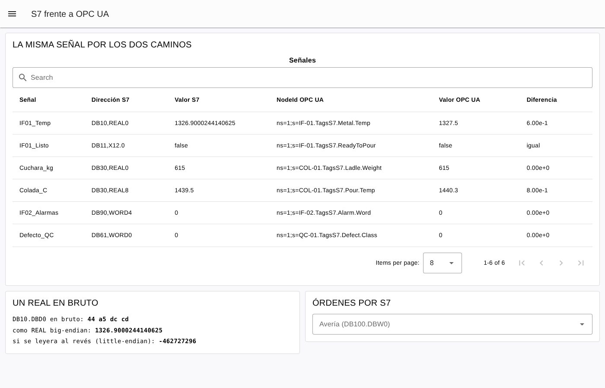

# Práctica: la misma máquina por dos protocolos (S7 frente a OPC UA)

> Serie **1 · Node-RED + Dashboard**, ampliación de [1-dashboard/fundicion](../fundicion/README.md).
> Flujo resuelto para el profesorado:
> [flows/fundicion-s7-opcua-solucion.json](flows/fundicion-s7-opcua-solucion.json).

## Introducción

En una planta real los datos de una máquina suelen estar en su **PLC**. A un PLC Siemens se le puede preguntar de dos
maneras:

- por **S7** (S7comm), su protocolo propio: se leen **bytes** en una **dirección** de un bloque de datos (`DB10.DBD0`);
- por **OPC UA**, si el PLC o una pasarela lo ofrece: se leen **variables con nombre, tipo y unidad**
  (`ns=1;s=IF-01.TemperaturaMetal`).

La Fundición del laboratorio ofrece las dos cosas: un servidor OPC UA y un **PLC S7 simulado** (`fundicion-s7`, puerto
102) con las mismas señales en sus bloques de datos. En esta práctica vas a leer **la misma señal por los dos
caminos**, a decodificar un número a mano a partir de sus bytes y a dar una orden por S7.

**Lo que vas a construir:**



*La página resuelta (captura real del laboratorio).*

**Antes de empezar:**

- [ ] La práctica [1-dashboard/fundicion](../fundicion/README.md) (OPC UA, suscripción, Dashboard 2.0).
- [ ] La paleta **node-red-contrib-s7** ya está instalada en el Node-RED del laboratorio (nodos `s7 in`, `s7 out`).
- [ ] El mapa de señales S7 de cada activo está en la pestaña **TAGS S7** del gemelo 3D (`http://localhost:3000`) y en
  [docs/S7_INTEGRATION.md](../../../simuladores/fundicion/docs/S7_INTEGRATION.md).

| Señal | Dirección S7 | Tipo S7 | NodeId OPC UA |
|---|---|---|---|
| Temperatura del metal IF-01 | `DB10.DBD0` | `REAL` (4 bytes) | `ns=1;s=IF-01.TagsS7.Metal.Temp` |
| IF-01 listo para colar | `DB11.DBX12.0` | `BOOL` (bit 0 del byte 12) | `ns=1;s=IF-01.TagsS7.ReadyToPour` |
| Peso de la cuchara | `DB30.DBD0` | `REAL` | `ns=1;s=COL-01.TagsS7.Ladle.Weight` |
| Temperatura de colada | `DB30.DBD8` | `REAL` | `ns=1;s=COL-01.TagsS7.Pour.Temp` |
| Palabra de alarmas IF-02 | `DB90.DBW4` | `WORD` (2 bytes) | `ns=1;s=IF-02.TagsS7.Alarm.Word` |
| Clase de defecto QC-01 | `DB61.DBW0` | `WORD` | `ns=1;s=QC-01.TagsS7.Defect.Class` |

## Desarrollo

### Parte 1 — Las señales por OPC UA

Ya sabes hacerlo: **inject** `Iniciar` → *function* `Suscribir por OPC UA` → **OpcUa-Client** `SUBSCRIBE` (endpoint
`opc.tcp://fundicion-opcua:4841/UA/Fundicion`) → *function* `Guardar OPC UA`.

```javascript
// ENTRADA: el inject "Iniciar"
// SALIDA:  las mismas señales por OPC UA (en las carpetas TagsS7 de cada activo)

const SENALES = [
    ["IF01_Temp", "DB10,REAL0", "IF-01.TagsS7.Metal.Temp", "Double"],
    ["IF01_Listo", "DB11,X12.0", "IF-01.TagsS7.ReadyToPour", "Boolean"],
    ["Cuchara_kg", "DB30,REAL0", "COL-01.TagsS7.Ladle.Weight", "Double"],
    ["Colada_C", "DB30,REAL8", "COL-01.TagsS7.Pour.Temp", "Double"],
    ["IF02_Alarmas", "DB90,WORD4", "IF-02.TagsS7.Alarm.Word", "UInt16"],
    ["Defecto_QC", "DB61,WORD0", "QC-01.TagsS7.Defect.Class", "UInt16"]
];
node.status({ text: SENALES.length + " señales" });
return [SENALES.map(([nombre, s7, nodo, tipo]) => ({ topic: "ns=1;s=" + nodo, datatype: tipo, nombre }))];
```

```javascript
// ENTRADA: un mensaje por señal OPC UA (msg.topic = NodeId)
// SALIDA:  nada; guarda el valor para compararlo

if (!String(msg.topic).startsWith("ns=")) return null;
let v = msg.payload;
while (v !== null && typeof v === "object" && "value" in v) v = v.value;
const opc = flow.get("opcua") || {};
opc[String(msg.topic).split("s=").pop()] = { v, t: Date.now() };
flow.set("opcua", opc);
return null;
```

### Parte 2 — Conectar con el PLC

Añade un nodo **s7 in** y crea su **s7 endpoint**:

| Campo | Valor |
|---|---|
| Transport | Ethernet (ISO-on-TCP) |
| Address · Port | `fundicion-s7` · `102` |
| Mode | Rack/Slot · rack `0` · slot `1` |
| Cycle time | 1000 ms |

En la pestaña **Variables** del endpoint, una línea por señal, con un **nombre** y la dirección en la sintaxis de la
paleta:

| Nombre | Dirección (paleta) | Equivale a |
|---|---|---|
| `IF01_Temp` | `DB10,REAL0` | `DB10.DBD0` |
| `IF01_Listo` | `DB11,X12.0` | `DB11.DBX12.0` |
| `Cuchara_kg` | `DB30,REAL0` | `DB30.DBD0` |
| `Colada_C` | `DB30,REAL8` | `DB30.DBD8` |
| `IF02_Alarmas` | `DB90,WORD4` | `DB90.DBW4` |
| `Defecto_QC` | `DB61,WORD0` | `DB61.DBW0` |
| `IF01_bytes` | `DB10,BYTE0.4` | los 4 bytes de `DB10.DBD0`, en bruto |
| `Orden_Averia` | `DB100,INT0` | `DB100.DBW0` (para la Parte 5) |

El nodo **s7 in** en modo **all variables** entrega cada segundo `msg.payload` con todas, por su nombre.

**Comprueba.** Con un **debug**: ¿qué valor tiene `IF01_Temp`? ¿Cuántos decimales tiene? ¿Y el mismo dato por OPC UA?

### Parte 3 — Comparar

*function* `Comparar` → **table** `Señales` (grupo `LA MISMA SEÑAL POR LOS DOS CAMINOS`, página `S7 frente a OPC UA`):

```javascript
// ENTRADA: las variables leídas por S7 (msg.payload = { IF01_Temp: 1475.80004…, … })
// SALIDA:  una fila por señal: valor S7, valor OPC UA, diferencia y qué hace falta saber para leerla

const SENALES = [
    ["IF01_Temp", "DB10,REAL0", "IF-01.TagsS7.Metal.Temp", "Double"],
    ["IF01_Listo", "DB11,X12.0", "IF-01.TagsS7.ReadyToPour", "Boolean"],
    ["Cuchara_kg", "DB30,REAL0", "COL-01.TagsS7.Ladle.Weight", "Double"],
    ["Colada_C", "DB30,REAL8", "COL-01.TagsS7.Pour.Temp", "Double"],
    ["IF02_Alarmas", "DB90,WORD4", "IF-02.TagsS7.Alarm.Word", "UInt16"],
    ["Defecto_QC", "DB61,WORD0", "QC-01.TagsS7.Defect.Class", "UInt16"]
];
const opc = flow.get("opcua") || {};
const fila = ([nombre, s7, nodo, tipo]) => {
    const vs7 = msg.payload[nombre];
    const vopc = opc[nodo] ? opc[nodo].v : undefined;
    const dif = typeof vs7 === "number" && typeof vopc === "number" ? Math.abs(vs7 - vopc) : null;
    return {
        Señal: nombre,
        "Dirección S7": s7,
        "Valor S7": typeof vs7 === "number" ? vs7 : String(vs7),
        "NodeId OPC UA": "ns=1;s=" + nodo,
        "Valor OPC UA": vopc === undefined ? "—" : vopc,
        Diferencia: dif === null ? (String(vs7) === String(vopc) ? "igual" : "distinto") : dif.toExponential(2)
    };
};
msg.payload = SENALES.map(fila);
return msg;
```

**Comprueba.** Rellena la tabla:

| Pregunta | S7 | OPC UA |
|---|---|---|
| ¿Qué tienes que saber para leer la temperatura? | | |
| ¿Cómo sabes la unidad? | | |
| ¿Qué tipo de dato llega? ¿Cuántos decimales «de más»? | | |
| ¿Cómo sabes si el dato es bueno o es viejo? | | |
| ¿Quién te avisa de un cambio? | | |
| ¿Qué pasa si el programador del PLC mueve la variable a otra dirección? | | |

> ¿Por qué `1326.9000244140625`? Un `REAL` de S7 es un número de **32 bits** (IEEE 754): 1326,9 no se puede
> representar exactamente y el más cercano es ese. Por OPC UA la variable es un `Double` (64 bits).
> ¿Y por qué a veces difieren en unas décimas? Cada camino toma la muestra en un instante distinto.

### Parte 4 — Un REAL en bruto

Lee los 4 bytes de `DB10.DBD0` sin interpretar (`IF01_bytes`) y decodifícalos tú:

```javascript
// ENTRADA: los 4 bytes en bruto de DB10.DBD0 (msg.payload.IF01_bytes = [68, 184, 153, 154])
// SALIDA:  el REAL decodificado a mano (IEEE 754, big-endian), igual que hace el nodo S7

const b = msg.payload.IF01_bytes;
if (!Array.isArray(b) && !(b instanceof Buffer)) return null;
const buf = Buffer.from(b);
msg.payload = {
    bytes: Array.from(buf).map(x => x.toString(16).padStart(2, "0")).join(" "),
    real: buf.readFloatBE(0),              // así lo guarda un S7: el byte más significativo primero
    si_fuera_little_endian: buf.readFloatLE(0)
};
return msg;
```

Muéstralo en un **template** (grupo `UN REAL EN BRUTO`).

**Comprueba.** ¿Coincide tu decodificación con `IF01_Temp`? ¿Qué sale si lees los bytes al revés (*little-endian*)?
¿Qué le pasaría a un sistema que se equivoca de orden de bytes?

### Parte 5 — Dar una orden por S7

El PLC tiene un bloque de **órdenes**, `DB100`: si escribes un `INT` en `DB100.DBW0`, el PLC lo pasa a
`Mantenimiento.Averia` de la planta (como hacía el inyector de la práctica anterior por OPC UA).

**dropdown** `Avería (DB100.DBW0)` (0–7) → *function* `Orden de avería` → **s7 out** con la variable `Orden_Averia`:

```javascript
// ENTRADA: el código elegido en el desplegable (0-7)
// SALIDA:  escritura S7 en DB100.DBW0 (INT): el PLC la pasa a Mantenimiento.Averia

msg.payload = Number(msg.payload);
return msg;
```

> El nodo **s7 out** escribe una variable **por su nombre** de la tabla del endpoint, no por su dirección.

**Comprueba.** Inyecta la avería 4 (escáner) por S7 y mírala en el gemelo 3D. Ahora escribe `9`: ¿qué ocurre? Compáralo
con lo que pasaba al escribir `9` por OPC UA. ¿Quién comprueba el valor en cada caso?

## Cierre y entrega

> S7 es rápido y está en todas las plantas Siemens, pero obliga a conocer el programa del PLC: direcciones, tipos y
> orden de bytes, y no tiene ni autenticación ni cifrado. OPC UA describe los datos (nombre, tipo, unidad, calidad,
> marca de tiempo), avisa de los cambios y tiene seguridad. Por eso lo habitual es leer S7 **dentro** de la red de
> planta y publicar hacia arriba por OPC UA (o MQTT).

**Qué entregar:**

- [ ] Flujo exportado.
- [ ] Captura de la página `S7 frente a OPC UA`.
- [ ] La tabla de la Parte 3 y las respuestas de las partes 4 y 5.

**Preguntas finales:**

1. Cualquiera en la red puede escribir en `DB100.DBW0`. ¿Cómo protegerías un PLC real?
2. ¿Qué ventaja tiene que el bit `ReadyToPour` esté en `DB11.DBX12.0` y no ocupe un byte entero?
3. Tienes que integrar 40 PLC distintos en un MES. ¿Leerías S7 o pedirías OPC UA? ¿Por qué?

**Si algo no funciona:**

| **Síntoma** | **Causa probable** | **Qué hacer** |
|---|---|---|
| El endpoint S7 no conecta | Slot o puerto equivocados | `fundicion-s7`, puerto `102`, rack `0`, slot `1` |
| `Unknown variable` en el s7 out | Se ha puesto la dirección en vez del nombre | Usa el nombre de la tabla del endpoint (`Orden_Averia`) |
| Valores absurdos (`-462727296`) | Orden de bytes o tipo equivocados | `REAL` es *big-endian* de 4 bytes: `readFloatBE` |
| La tabla de OPC UA sale con «—» | La suscripción aún no ha enviado el dato | Espera unos segundos tras desplegar |
