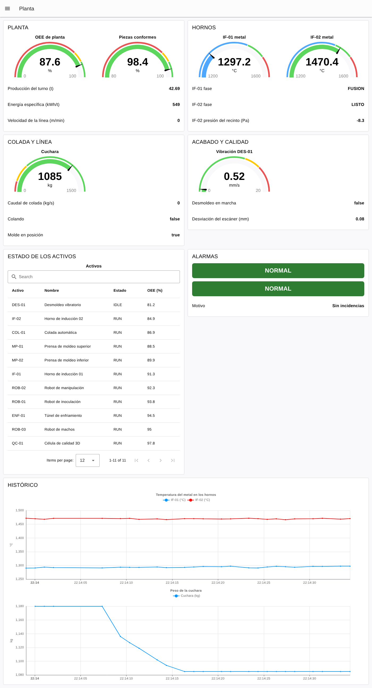
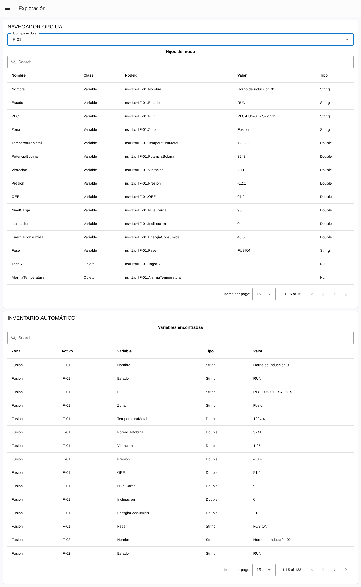
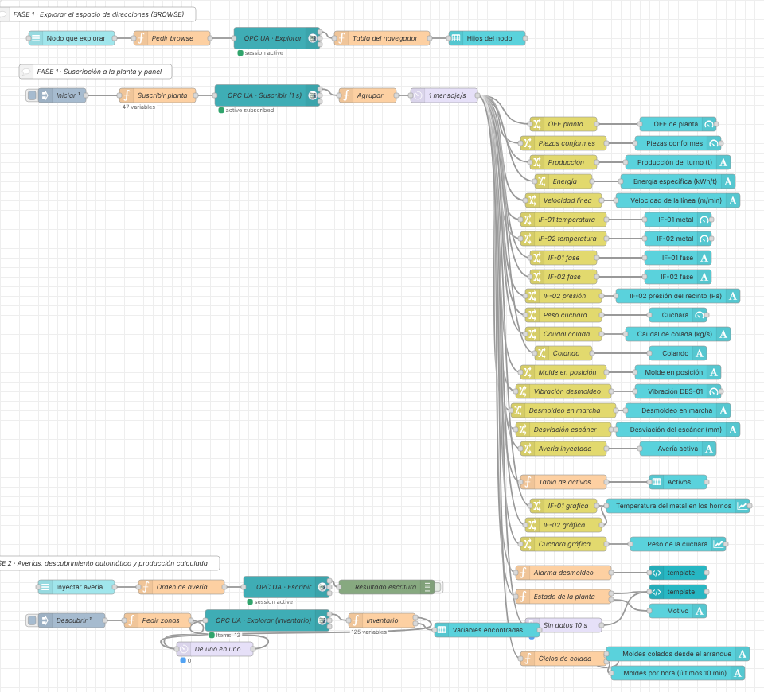

# Práctica: la Fundición con Node-RED (OPC UA → Dashboard 2.0)

> Serie **1 · Node-RED + Dashboard**. La continuación con ThingsBoard está
> en [2-thingsboard/fundicion](../../2-thingsboard/fundicion/README.md).
> Flujo resuelto para el profesorado:
> [flows/fundicion-dashboard-solucion.json](flows/fundicion-dashboard-solucion.json).

## Introducción

Hasta ahora cada práctica vigilaba **una máquina**. Aquí vas a vigilar
**una planta entera**: la Planta Norte de una fundición de hierro, con 11
activos (hornos, prensas, robots, colada, túnel, desmoldeo y control de
calidad) y unas 170 variables, con **trazabilidad pieza a pieza**. Al terminar tendrás un panel de planta, una
tabla con el estado de todos los activos y un explorador que **descubre
solo** qué variables tiene cada máquina.

**La cadena que vas a construir:**

1.  **La Fundición** simula la planta y su gemelo digital 3D.
2.  **OPC UA** (servidor, puerto `4841`) ofrece las variables, ordenadas
    por zonas y activos.
3.  **Node-RED** explora el servidor, se suscribe a las variables que
    interesan y las agrupa por activo.
4.  **Dashboard** muestra la planta, los activos y las alarmas.
5.  **Responsable de mantenimiento** decide dónde hay que intervenir.

**Antes de empezar, comprueba que tienes:**

- [ ] El laboratorio arrancado (`docker compose up -d` o `start_lab.cmd`).
- [ ] Node-RED en `http://localhost:1880`, con `node-red-contrib-opcua` y
  Dashboard 2.0 (ya instalados). El panel se abre en
  `http://localhost:1880/dashboard`.
- [ ] El gemelo digital 3D en `http://localhost:3000`: deben moverse la
  línea de moldes y la cuchara.

> Dentro de Docker, Node-RED llega al servidor con el endpoint
> `opc.tcp://fundicion-opcua:4841/UA/Fundicion`. Desde un cliente de tu
> ordenador (UaExpert) es `opc.tcp://localhost:4841/UA/Fundicion`.

**El proceso en un minuto.** Los **hornos** funden la chatarra en ciclos
(`CARGA` → `FUSION` → `AFINO` → `LISTO`) y, cuando la cuchara se vacía,
uno de ellos se **inclina** y la **grúa** trae una cuchara llena
(`CambioCuchara`). La **línea** lleva los moldes hasta la **cuchara**, que
cuela cuando hay un molde debajo (`MoldeEnPosicion`) y le queda metal
(`PesoCuchara`). Cada molde recorre el **túnel de enfriamiento** (unos
47 min), pasa por el **desmoldeo** vibratorio y la **célula de calidad**
lo inspecciona con un escáner 3D. Todo sale de un modelo físico: el metal
se enfría, la arena puede humedecerse y un rodamiento puede desgastarse.

**Cómo están organizados los datos:**

    Objects
    ├── PlantaNorte
    │   ├── KPIs            OEEPlanta, ProduccionTurno, PiezasConformes…
    │   ├── Fusion          IF-01, IF-02
    │   ├── Moldeo          MP-01, MP-02, ROB-03
    │   ├── Colada          COL-01, ROB-01
    │   ├── Enfriamiento    ENF-01
    │   ├── Acabado         DES-01, ROB-02
    │   └── Calidad         QC-01
    ├── Trazabilidad        UltimaPieza (molde, colada, condiciones, resultado)
    ├── Mantenimiento       Averia (para el profesor)
    └── Simulacion          Velocidad (para acelerar la planta)

El NodeId de cada variable es `ns=1;s=<ACTIVO>.<Variable>`, por ejemplo
`ns=1;s=IF-01.TemperaturaMetal`. Fíjate en que aquí el espacio de nombres
es **1** (en SolarLab y AtomLab era 2): depende del servidor.

## Fase 1 — Explorar y vigilar la planta (partes 1 a 6)

### Parte 1 — Explorar el servidor (BROWSE)

En SolarLab te daban la lista de NodeId. Aquí vas a **descubrirla**.

1.  Crea una página `Exploración` con un grupo `NAVEGADOR OPC UA`
    (ancho 12).
2.  Añade un **dropdown** (`ui-dropdown`) `Nodo que explorar` con estas
    opciones (valor = etiqueta): `PlantaNorte`, `KPIs`, `Zona.Fusion`,
    `Zona.Colada`, `IF-01`, `COL-01`, `DES-01`, `Mantenimiento`.
3.  Conéctalo a un **function** `Pedir browse`:

<!-- -->

    // ENTRADA: el nodo elegido en el desplegable (por ejemplo "PlantaNorte" o "IF-01")
    // SALIDA:  una petición BROWSE para el OpcUa-Client

    msg.topic = "ns=1;s=" + msg.payload;
    return msg;

4.  Después, un **OpcUa-Client** con **Action** `BROWSE` y el endpoint
    `opc.tcp://fundicion-opcua:4841/UA/Fundicion` (*Security* `None`).
5.  Su salida a un **function** `Tabla del navegador` y este a un
    **table** (`ui-table`) `Hijos del nodo`:

<!-- -->

    // ENTRADA: la respuesta del BROWSE (msg.payload = lista de referencias)
    // SALIDA:  filas para la tabla del dashboard

    const CLASES = { 1: "Objeto", 2: "Variable", 4: "Método", 8: "Tipo de objeto" };
    const refs = (msg.payload || []).map(r => r.item || r);     // cada referencia llega como { item: … }
    msg.payload = refs.map(r => ({
        Nombre: r.browseName && r.browseName.name || String(r.browseName),
        Clase:  CLASES[r.nodeClass] || r.nodeClass,
        NodeId: String(r.nodeId),
        Valor:  r.value === undefined || r.value === null ? "" : (typeof r.value === "object" ? "…" : r.value),
        Tipo:   r.dataType || ""
    }));
    return msg;

6.  **Deploy**, abre la página `Exploración` y elige nodos.

**Comprueba.** Rellena la tabla explorando:

| **Nodo** | **¿Cuántos hijos?** | **¿De qué clase?** |
|---|---|---|
| `PlantaNorte` | | |
| `Zona.Colada` | | |
| `COL-01` | | |
| `KPIs` | | |

¿Qué es `TagsS7`? Explóralo: ¿a qué crees que corresponden las
direcciones `DB10.DBD0`?

### Parte 2 — Suscribirse a la planta

Con casi 50 variables, poner un **OpcUa-Item** por variable sería enorme. Un
**function** puede crear las suscripciones en bloque.

1.  **inject** `Iniciar` (once after 2 s) → **function** `Suscribir
    planta` → **OpcUa-Client** `SUBSCRIBE` cada 1 s.

<!-- -->

    // ENTRADA: el inject "Iniciar"
    // SALIDA:  un mensaje por cada variable a suscribir (msg.topic = NodeId, msg.datatype = tipo)

    const KPIS = ["OEEPlanta", "ProduccionTurno", "PiezasConformes", "EnergiaEspecifica", "CO2Estimado", "VelocidadLinea"];
    const VARIABLES = {
        "IF-01":  ["TemperaturaMetal", "PotenciaBobina", "Presion"],
        "IF-02":  ["TemperaturaMetal", "PotenciaBobina", "Presion"],
        "COL-01": ["PesoCuchara", "CaudalColada", "NivelLlenado"],
        "DES-01": ["Vibracion", "Temperatura"],
        "QC-01":  ["DesviacionEscaneo", "PiezasConformes"]
    };
    const SENALES = { "IF-01.Fase": "String", "IF-02.Fase": "String", "COL-01.Colando": "Boolean",
                      "COL-01.MoldeEnPosicion": "Boolean", "DES-01.Marcha": "Boolean",
                      "Mantenimiento.AveriaNombre": "String" };
    const ACTIVOS = ["IF-01", "IF-02", "MP-01", "MP-02", "ROB-03", "COL-01", "ROB-01", "ENF-01", "DES-01", "ROB-02", "QC-01"];

    const m = [];
    for (const k of KPIS) m.push({ topic: "ns=1;s=KPIs." + k, datatype: "Double" });
    for (const [activo, vars] of Object.entries(VARIABLES))
        for (const v of vars) m.push({ topic: "ns=1;s=" + activo + "." + v, datatype: "Double" });
    for (const [nodo, tipo] of Object.entries(SENALES)) m.push({ topic: "ns=1;s=" + nodo, datatype: tipo });
    for (const a of ACTIVOS) {                        // estado y OEE de los 11 activos
        m.push({ topic: "ns=1;s=" + a + ".Estado", datatype: "String" });
        m.push({ topic: "ns=1;s=" + a + ".OEE", datatype: "Double" });
    }
    node.status({ text: m.length + " variables" });
    return [m];

2.  A la salida del cliente, el **Agrupar** de AtomLab (agrupa por la
    primera parte del NodeId) y un **delay** de 1 mensaje/s:

<!-- -->

    // ENTRADA: un mensaje por variable (msg.topic = NodeId, msg.payload = valor)
    // SALIDA:  msg.payload = todas las variables recibidas, agrupadas por activo

    if (!String(msg.topic).startsWith("ns=")) {
        return null;          // avisos del propio cliente (p. ej. subscriptionId): no son datos
    }
    let valor = msg.payload;
    // algunas versiones envían el valor dentro de { value: ... }
    while (valor !== null && typeof valor === "object" && "value" in valor) {
        valor = valor.value;
    }
    if (typeof valor === "number") {
        valor = Math.round(valor * 1000) / 1000;      // 3 decimales
    }

    // "ns=1;s=IF-01.TemperaturaMetal"  →  ["IF-01", "TemperaturaMetal"]
    const partes = String(msg.topic).split("s=").pop().split(".");
    const variable = partes.pop();

    const central = flow.get("planta") || {};
    let sitio = central;
    for (const p of partes) {                         // crea IF-01, COL-01, KPIs...
        sitio[p] = sitio[p] || {};
        sitio = sitio[p];
    }
    sitio[variable] = valor;
    central.timestamp = new Date().toISOString();
    flow.set("planta", central);

    msg.payload = central;
    return msg;

3.  **Deploy** y mira un mensaje en el **debug**:

<!-- -->

    {
      "KPIs":   { "OEEPlanta": 87.4, "ProduccionTurno": 186.5, … },
      "IF-01":  { "TemperaturaMetal": 1487.2, "Fase": "FUSION", "Estado": "RUN", "OEE": 91.2, … },
      "COL-01": { "PesoCuchara": 1009, "Colando": false, … },
      …
    }

**Comprueba.** ¿Cuántas variables suscribe el código? (lo pone en el
estado del nodo). ¿Por qué las rutas con guiones se escriben
`msg.payload['IF-01']` y no `msg.payload.IF-01`?

### Parte 3 — Indicadores de planta

Página `Planta`, grupo `PLANTA`: gauge **OEE de planta** (0–100, rojo
hasta 75, amarillo hasta 85), gauge **Piezas conformes** (80–100) y text
para producción del turno (t), energía específica (kWh/t) y velocidad de
la línea (m/min). Rutas: `msg.payload.KPIs.OEEPlanta`, etc.

> El **OEE** (*Overall Equipment Effectiveness*) multiplica
> disponibilidad × rendimiento × calidad. Un 85 % se considera de clase
> mundial.

### Parte 4 — Hornos, colada y acabado

| Grupo | Dato | Ruta | Widget |
|---|---|---|---|
| `HORNOS` | Temperatura IF-01 / IF-02 | `msg.payload['IF-01'].TemperaturaMetal` | gauge 1200–1600 °C |
| | Fase IF-01 / IF-02 | `msg.payload['IF-01'].Fase` | text |
| | Presión del recinto IF-02 | `msg.payload['IF-02'].Presion` | text (Pa) |
| `COLADA Y LÍNEA` | Peso de la cuchara | `msg.payload['COL-01'].PesoCuchara` | gauge 0–1500 kg |
| | Caudal, colando, molde en posición | `msg.payload['COL-01'].…` | text |
| `ACABADO Y CALIDAD` | Vibración del desmoldeo | `msg.payload['DES-01'].Vibracion` | gauge 0–20 mm/s |
| | Desmoldeo en marcha | `msg.payload['DES-01'].Marcha` | text |
| | Desviación del escáner | `msg.payload['QC-01'].DesviacionEscaneo` | text (mm) |

**Comprueba.** Observa 2 minutos la colada junto al gemelo 3D: ¿cuándo
se pone `Colando` a `true`? ¿Qué le pasa al peso de la cuchara mientras
cuela? ¿Cuándo sube de golpe?

### Parte 5 — El estado de todos los activos

Grupo `ESTADO DE LOS ACTIVOS`: un **function** `Tabla de activos`
conectado al **delay** y un **table** con hasta 12 filas.

    // ENTRADA: la planta agrupada · SALIDA: filas para la tabla, los activos con problemas primero

    const NOMBRES = { "IF-01": "Horno de inducción 01", "IF-02": "Horno de inducción 02", "MP-01": "Prensa de moldeo superior",
        "MP-02": "Prensa de moldeo inferior", "ROB-03": "Robot de machos", "COL-01": "Colada automática",
        "ROB-01": "Robot de inoculación", "ENF-01": "Túnel de enfriamiento", "DES-01": "Desmoldeo vibratorio",
        "ROB-02": "Robot de manipulación", "QC-01": "Célula de calidad 3D" };
    const ORDEN = { ALARM: 0, WARN: 1, IDLE: 2, RUN: 3 };
    const p = msg.payload;
    const filas = Object.keys(NOMBRES).filter(a => p[a]).map(a => ({
        Activo: a, Nombre: NOMBRES[a], Estado: p[a].Estado || "?", "OEE (%)": p[a].OEE
    }));
    filas.sort((x, y) => (ORDEN[x.Estado] ?? 9) - (ORDEN[y.Estado] ?? 9) || x["OEE (%)"] - y["OEE (%)"]);
    msg.payload = filas;
    return msg;

**Comprueba.** ¿Qué activo sale primero y por qué? ¿Cuál tiene peor
OEE?

### Parte 6 — Organizar el dashboard

Grupos de ancho 6 y `HISTÓRICO` de ancho 12. Título de la página
`Planta`.

**Comprueba.** En 10 segundos, ¿sabe un compañero decir si la planta va
bien y qué activo mirar primero?

## Fase 1 — Histórico, incidencias y alarmas (partes 7 a 10)

### Parte 7 — Histórico

Grupo `HISTÓRICO`: una gráfica con la temperatura de los dos hornos (dos
**change** con `msg.topic` `IF-01 (°C)` e `IF-02 (°C)` hacia el mismo
**chart**) y otra con el peso de la cuchara.

**Comprueba.** ¿Cuánto dura un ciclo completo de un horno? ¿Cuánta
temperatura pierde en la fase `CARGA`? ¿Cada cuánto repone la grúa la
cuchara?

### Parte 8 — Incidencias

Las averías las inyecta el profesor (página `Mantenimiento`, Parte 11).
Para cada una, anota qué ves **antes** de mirar el gemelo 3D:

> Algunas averías tardan en notarse: el rodamiento se desgasta durante
> ~15 min antes de dar aviso, y las de moldeo y colada (5, 6 y 7) solo se
> ven en calidad cuando las piezas afectadas salen del túnel, ~47 min
> después. Para verlas en clase, el profesor puede acelerar la planta
> escribiendo `5` en `ns=1;s=Simulacion.Velocidad` (o desde el gemelo 3D).

| **Avería** | **Primer síntoma** | **Variables afectadas** | **Activo** |
|---|---|---|---|
| A | | | |
| B | | | |
| C | | | |

### Parte 9 — Alarma con contexto

El desmoldeo vibra **mucho** cuando trabaja (≈ 8,6 mm/s) y casi nada
parado. Un límite fijo no sirve: depende del estado.

1.  Grupo `ALARMAS`. **function** `Alarma desmoldeo`:

<!-- -->

    // ENTRADA: la planta agrupada · SALIDA: "NORMAL" o "ALARMA"
    // En marcha el desmoldeo vibra MUCHO (≈ 8,6 mm/s): el límite depende del estado.

    const LIMITE_MARCHA = 12;   // mm/s con el desmoldeo en marcha
    const LIMITE_PARO = 3;      // mm/s con el desmoldeo parado

    const d = msg.payload["DES-01"] || {};
    const limite = d.Marcha ? LIMITE_MARCHA : LIMITE_PARO;
    msg.payload = d.Vibracion > limite ? "ALARMA" : "NORMAL";
    return msg;

2.  Su salida a un **template** con el código de las prácticas anteriores:

<!-- -->

    <template>
      

        {{ msg?.payload || 'SIN DATOS' }}
      

    </template>

    

**Comprueba.** ¿Qué pasaría con un único límite de 10 mm/s? ¿Y con uno
de 3?

### Parte 10 — Estado de la planta y comunicación

1.  **function** `Estado de la planta` (**Outputs: 2**) → template y text
    `Motivo`:

<!-- -->

    // ENTRADA: la planta agrupada · SALIDA 1: NORMAL / ATENCIÓN / ALARMA · SALIDA 2: motivo

    // ---- UMBRALES ----
    const OEE_MIN = 75;            // % de planta
    const CONFORMES_MIN = 95;      // % de piezas conformes
    const PRESION_HORNO_MAX = 0;   // Pa: los hornos trabajan en depresión
    // -------------------

    const p = msg.payload;
    let nivel = 0; const motivos = [];
    const avisar = (n, t) => { if (n > nivel) nivel = n; motivos.push(t); };

    const ACTIVOS = ["IF-01", "IF-02", "MP-01", "MP-02", "ROB-03", "COL-01", "ROB-01", "ENF-01", "DES-01", "ROB-02", "QC-01"];
    for (const a of ACTIVOS) {
        const e = p[a] && p[a].Estado;
        if (e === "ALARM") avisar(2, a + " en ALARMA");
    }
    const k = p.KPIs || {};
    if (k.OEEPlanta < OEE_MIN) avisar(1, "OEE de planta " + k.OEEPlanta + " %");
    if (k.PiezasConformes < CONFORMES_MIN) avisar(1, "Piezas conformes " + k.PiezasConformes + " %");
    for (const h of ["IF-01", "IF-02"]) if (p[h] && p[h].Presion > PRESION_HORNO_MAX) avisar(2, h + ": sobrepresión " + p[h].Presion + " Pa");
    const d = p["DES-01"] || {};
    if (d.Vibracion > (d.Marcha ? 12 : 3)) avisar(1, "Vibración del desmoldeo " + d.Vibracion + " mm/s");

    const estados = ["NORMAL", "ATENCIÓN", "ALARMA"];
    return [{ payload: estados[nivel] }, { payload: motivos.length ? motivos.join(" · ") : "Sin incidencias" }];

2.  Un **trigger** de 10 s (*extend delay*) que envíe `ALARMA` al
    template si dejan de llegar datos. En la Fundición siempre hay
    variables cambiando, así que no hace falta latido.

Así queda la página `Planta`:

*Dashboard resuelto (captura real del laboratorio).*

## Fase 2 — Mantenimiento, descubrimiento y producción (partes 11 a 13)

### Parte 11 — Inyector de averías (profesorado)

Página `Mantenimiento`, grupo `AVERÍAS (PROFESORADO)`:

1.  **dropdown** `Inyectar avería` con valores **numéricos** 0–7
    (`0 · Sin avería`, `1 · Rodamiento del desmoldeo`, `2 · Extracción de
    humos IF-02`, `3 · Retraso de la grúa de cuchara`, `4 · Deriva del
    escáner 3D`, `5 · Humedad de arena alta`, `6 · Inoculación
    intermitente`, `7 · Termopar de IF-01 descalibrado`).
2.  **function** `Orden de avería` → **OpcUa-Client** `WRITE`:

<!-- -->

    // ENTRADA: el código elegido en el desplegable (0-7)
    // SALIDA:  una escritura OPC UA en Mantenimiento.Averia

    msg.topic    = "ns=1;s=Mantenimiento.Averia";
    msg.datatype = "Int32";
    msg.payload  = Number(msg.payload);
    return msg;

3.  Un text `Avería activa` con `msg.payload.Mantenimiento.AveriaNombre`
    (ya está en la suscripción de la Parte 2).

> El servidor también ofrece el **método** OPC UA
> `Mantenimiento.InyectarAveria(Codigo)`: hace lo mismo y devuelve el
> nombre de la avería. Es otra forma de «dar órdenes» por OPC UA.

**Comprueba.** Escribe `9` cambiando el código: ¿qué responde el
servidor (mira el debug del cliente)? ¿Por qué es mejor que lo rechace el
servidor y no solo el dashboard?

### Parte 12 — Descubrimiento automático

Un sistema que integra muchas plantas no puede escribir los NodeId a
mano. Vas a recorrer el árbol: zonas → activos → variables.

1.  Grupo `INVENTARIO AUTOMÁTICO` (página `Exploración`).
2.  **inject** `Descubrir` (once after 10 s) → **function** `Pedir
    zonas` → **delay** `De uno en uno` (*Rate Limit* 2 msg/s, **sin**
    descartar) → **OpcUa-Client** `BROWSE` (un cliente nuevo).

<!-- -->

    // ENTRADA: el inject "Descubrir"
    // SALIDA:  una petición BROWSE por cada zona de la planta

    const ZONAS = ["Fusion", "Moldeo", "Colada", "Enfriamiento", "Acabado", "Calidad"];
    flow.set("inventario", []);
    return [ZONAS.map(z => ({ topic: "ns=1;s=Zona." + z, nivel: "zona", zona: z }))];

3.  La salida del cliente → **function** `Inventario` (**Outputs: 2**).
    Salida 1 de vuelta al **delay** (las peticiones de los activos);
    salida 2 a un **table** `Variables encontradas`:

<!-- -->

    // ENTRADA: respuestas del BROWSE (de una zona o de un activo)
    // SALIDA 1: nuevas peticiones BROWSE (los activos de la zona)
    // SALIDA 2: el inventario completo, para la tabla

    const refs = (msg.payload || []).map(r => r.item || r);     // cada referencia llega como { item: … }
    const nombre = r => (r.browseName && r.browseName.name) || String(r.browseName);
    if (msg.nivel === "zona") {                       // en una zona: cada objeto es un activo
        const activos = refs.filter(r => r.nodeClass === 1);
        return [activos.map(r => ({ topic: "ns=1;s=" + nombre(r), nivel: "activo", zona: msg.zona, activo: nombre(r) })), null];
    }
    // en un activo: sus variables (las carpetas como TagsS7 se ignoran)
    const inv = flow.get("inventario") || [];
    for (const r of refs.filter(r => r.nodeClass === 2)) {
        inv.push({ Zona: msg.zona, Activo: msg.activo, Variable: nombre(r), Tipo: r.dataType || "",
                   Valor: typeof r.value === "number" ? Math.round(r.value * 100) / 100 : r.value });
    }
    flow.set("inventario", inv);
    node.status({ text: inv.length + " variables" });
    return [null, { payload: inv }];

**Comprueba.** ¿Cuántas variables encuentra? ¿Por qué hace falta el
**delay** «de uno en uno»? (Pruébalo sin él.) ¿Cómo usarías el
inventario para suscribirte a **todas** las variables `OEE` sin
escribir ningún NodeId?

*Exploración y descubrimiento automático (captura real del laboratorio).*

### Parte 13 — Producción calculada (ampliación final)

El servidor no publica cuántos moldes se cuelan por hora, pero se puede
**calcular** a partir de una señal: cada vez que `Colando` pasa de `true`
a `false`, se ha llenado un molde.

    // ENTRADA: la planta agrupada (1 mensaje/s)
    // SALIDA:  moldes colados y moldes por hora (últimos 10 min), calculados en Node-RED

    const colando = (msg.payload["COL-01"] || {}).Colando;
    const antes = context.get("colando");
    const fin = context.get("fines") || [];
    const ahora = Date.now();
    if (antes === true && colando === false) fin.push(ahora);       // termina el llenado de un molde
    context.set("colando", colando);
    const recientes = fin.filter(t => ahora - t < 600000);
    context.set("fines", recientes);
    const total = (context.get("total") || 0) + (antes === true && colando === false ? 1 : 0);
    context.set("total", total);
    const minutos = Math.min(10, (ahora - (context.get("inicio") || (context.set("inicio", ahora), ahora))) / 60000);
    return [{ payload: total }, { payload: minutos > 1 ? Math.round(recientes.length / minutos * 60) : 0 }];

Grupo `PRODUCCIÓN CALCULADA` con dos text: `Moldes colados desde el
arranque` y `Moldes por hora (últimos 10 min)`.

**Comprueba.** Pide al profesor la avería 3 (grúa): ¿qué le pasa a los
moldes por hora? ¿Y al OEE de planta? ¿Cuál de los dos lo detecta antes?

Y el flujo completo:

*Flujo resuelto en Node-RED (captura real del laboratorio).*

## Cierre y entrega

> Vigilar una planta no es mirar 127 números: es elegir los indicadores
> que resumen (OEE, estado de cada activo), tener contexto para las
> alarmas y saber descubrir el resto cuando hace falta.

**Qué entregar:**

- [ ] Flujo de Node-RED exportado en JSON.
- [ ] Tablas de las partes 1 y 8 completadas.
- [ ] Capturas de la página `Planta` en normal y con una avería.
- [ ] Captura del inventario automático.
- [ ] Respuestas a las preguntas finales.

**Preguntas finales:**

1.  ¿Qué ventaja tiene explorar (BROWSE) un servidor OPC UA frente a
    recibir una lista de NodeId? ¿Qué riesgo tiene suscribirse a todo lo
    que se encuentre?
2.  ¿Por qué la alarma del desmoldeo necesita dos variables?
3.  ¿Qué diferencia hay entre el OEE de un activo y el de la planta?
4.  Propón un indicador más que se pueda calcular en Node-RED a partir de
    señales del servidor.

**Si algo no funciona:**

| **Síntoma** | **Causa probable** | **Qué hacer** |
|---|---|---|
| *invalid endpoint* | Endpoint con `localhost` dentro de Docker | `opc.tcp://fundicion-opcua:4841/UA/Fundicion` |
| `BadNodeIdUnknown` | `ns=2` copiado de otra práctica | En la Fundición es `ns=1` |
| El widget sale vacío con `payload.IF-01…` | El guion se interpreta como resta | Usa `payload['IF-01'].…` |
| La tabla del navegador sale vacía | Las referencias llegan envueltas (`item`) | Usa el código de la Parte 1 sin cambios |
| El inventario sale vacío o incompleto | Varias peticiones BROWSE a la vez | Pon el **delay** «de uno en uno» delante del cliente |
| La avería no se aplica | Valor del dropdown como texto | Tipo **number** en las opciones o `Number(msg.payload)` |
