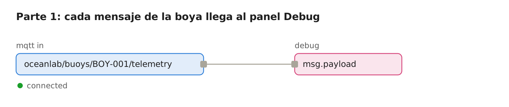
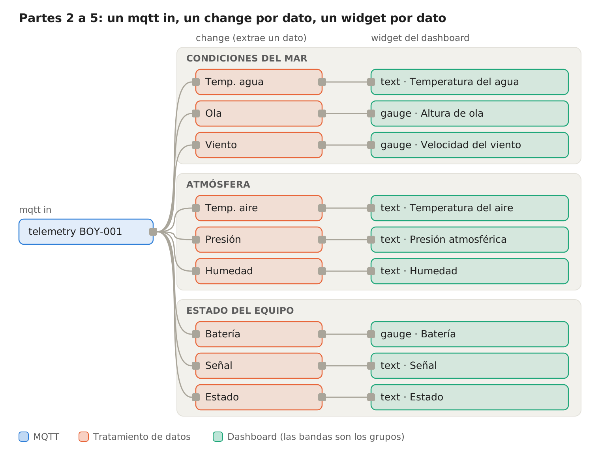
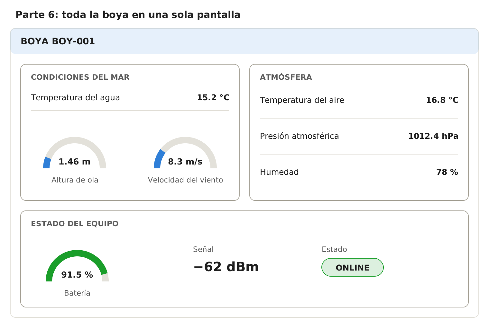
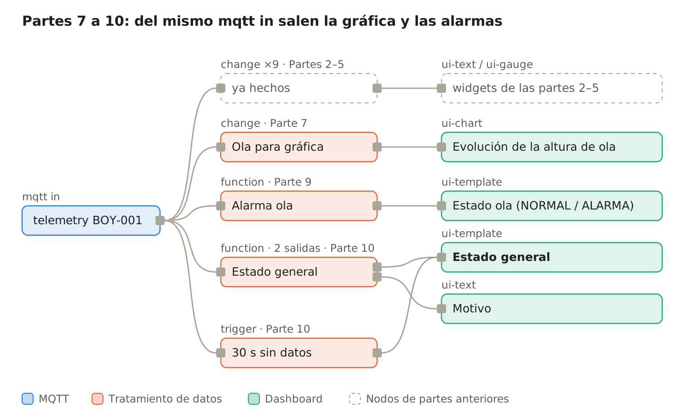
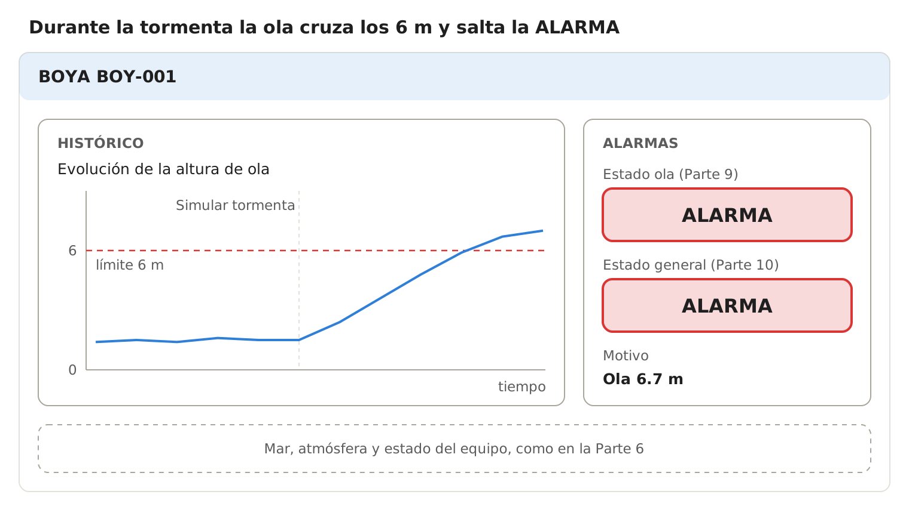
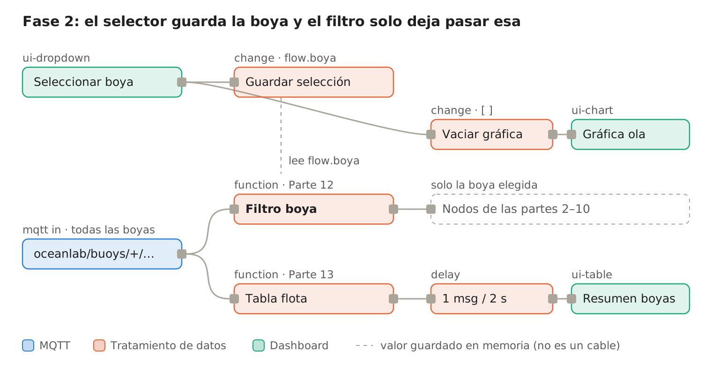
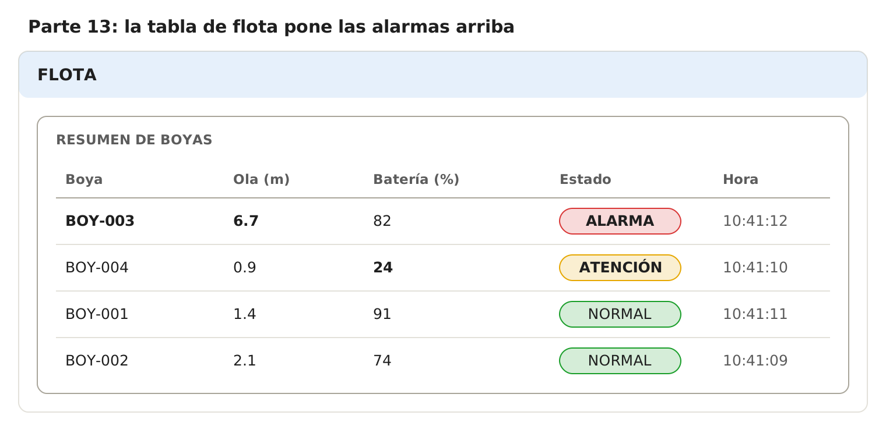

# Práctica: OceanLab con Node-RED (MQTT → Dashboard 2.0)

> Serie **1 · Node-RED + Dashboard**. Versión Markdown de [Practica_OceanLab_NodeRED_ES.docx](Practica_OceanLab_NodeRED_ES.docx). La continuación con ThingsBoard está en [2-thingsboard/oceanlab](../../2-thingsboard/oceanlab/README.md).
>
> Escrita para el entorno Docker del laboratorio (`docker compose up -d` o `start_lab.cmd`). Si trabajas con equipos sueltos, cambia los nombres de servicio (`mosquitto`, `localhost`) por la IP de cada equipo.

## Introducción

Al terminar esta práctica tendrás un dashboard en Node-RED que te dice,
de un vistazo, si una boya de OceanLab funciona bien o si hay que
intervenir. No vas a programar desde cero: cuando haga falta código, lo
tienes preparado en esta guía y solo tendrás que pegarlo y, como mucho,
cambiar un umbral.

**La cadena que vas a construir:**

1.  **OceanLab** simula la boya y publica sus datos.
2.  **MQTT** (broker, puerto `1883`) transporta los mensajes.
3.  **Node-RED** recibe los mensajes y extrae los datos que interesan.
4.  **Dashboard** muestra los datos de forma clara.
5.  **Alarma** convierte muchos datos en un estado sencillo: NORMAL /
    ATENCIÓN / ALARMA.
6.  **Técnico de mantenimiento** decide si hay que intervenir.

**Antes de empezar, comprueba que tienes:**

- [ ] El laboratorio arrancado y Node-RED en `http://localhost:1880`.
- [ ] La paleta `@flowfuse/node-red-dashboard` (Dashboard 2.0), que ya
  viene instalada en el laboratorio. El panel se abre en
  `http://localhost:1880/dashboard`.
- [ ] OceanLab en `http://localhost:8020`, publicando en el broker
  único del laboratorio (**Mosquitto**).

**Cómo es un mensaje de la boya.** Cada pocos segundos la boya envía un
mensaje JSON como este. Fíjate en que los datos están agrupados en
bloques: `location`, `weather` y `device`.

    {
      "buoy_id": "BOY-001",
      "timestamp": "2026-07-13T15:40:20.125Z",
      "sequence": 148,
      "location": { "latitude": 38.12, "longitude": -37.45, "ocean": "Atlántico Norte" },
      "weather": {
        "water_temperature_c": 15.2,
        "air_temperature_c": 16.8,
        "wave_height_m": 1.46,
        "wind_speed_mps": 8.3,
        "wind_direction_deg": 224,
        "pressure_hpa": 1012.4,
        "humidity_pct": 78
      },
      "device": { "battery_pct": 91.5, "signal_rssi_dbm": -62, "status": "online" }
    }

Para llegar a un dato se escribe la “ruta” con puntos:
`msg.payload.weather.water_temperature_c` significa *del mensaje → su
contenido → bloque weather → temperatura del agua*.

La práctica tiene dos fases. En la **Fase 1** trabajas con una sola boya
(`BOY-001`). En la **Fase 2**, solo cuando la Fase 1 esté clara, pasas a
varias boyas.

## Fase 1 — Una sola boya (partes 1 a 6)

En toda la Fase 1 trabajas solo con `BOY-001` y el topic
`oceanlab/buoys/BOY-001/telemetry`. Todavía no se usan comodines.

### Parte 1 — Recibir datos MQTT

Objetivo: comprobar que los mensajes de la boya llegan a Node-RED.

1.  Arrastra al área de trabajo un nodo **mqtt in** y un nodo **debug**.
    Únelos.
2.  Abre el nodo **mqtt in** y pulsa el lápiz junto a *Server* para
    crear el broker:
    - **Server:** `mosquitto` (el broker del laboratorio, donde publica
      OceanLab; con equipos sueltos, la IP del broker).
    - **Port:** `1883`. Protocolo MQTT 3.1.1, sin usuario ni contraseña.
3.  En el nodo **mqtt in** configura:
    - **Topic:** `oceanlab/buoys/BOY-001/telemetry`
    - **QoS:** `0`
    - **Output:** *a parsed JSON object* (un objeto JSON).
4.  Pulsa **Deploy**. Debajo del nodo debe aparecer **connected** en
    verde.
5.  Abre la pestaña **Debug** (icono del insecto, a la derecha) y
    despliega un mensaje.

*Flujo de la Parte 1 (esquema).* El puerto de salida (cuadradito
derecho) del **mqtt in** se une con el de entrada del **debug**. Debajo
del mqtt in debe aparecer *connected*.

**Comprueba.** Localiza en el mensaje cada dato y anota su ruta:

| **Dato**                 | **Ruta en el mensaje**        | **Valor que ves** |
|--------------------------|-------------------------------|-------------------|
| Identificador de la boya | `buoy_id`                     |                   |
| Temperatura del agua     | `weather.water_temperature_c` |                   |
| Temperatura del aire     | `weather.air_temperature_c`   |                   |
| Altura de ola            | `weather.wave_height_m`       |                   |
| Velocidad del viento     | `weather.wind_speed_mps`      |                   |
| Dirección del viento     | `weather.wind_direction_deg`  |                   |
| Presión atmosférica      | `weather.pressure_hpa`        |                   |
| Humedad                  | `weather.humidity_pct`        |                   |
| Batería                  | `device.battery_pct`          |                   |
| Señal RSSI               | `device.signal_rssi_dbm`      |                   |
| Estado                   | `device.status`               |                   |

> Truco: en el panel Debug, al pasar el ratón sobre un dato aparece un
> botón que copia su ruta. Así no tienes que escribirla.

### Parte 2 — Mostrar un único dato

Objetivo: entender el camino **MQTT → dato → widget**.

1.  Entre **mqtt in** y el dashboard añade un nodo **change** llamado
    `Temp. agua`.
2.  Regla: **Set** `msg.payload` **to the value**
    `msg.payload.weather.water_temperature_c` (elige el tipo `msg.` en
    el desplegable).
3.  Conecta la salida a un nodo **text** del dashboard (`ui-text`). La
    primera vez tendrás que crear:
    - una **página** (`ui-page`) llamada `Boya BOY-001`,
    - un **grupo** (`ui-group`) llamado `Pruebas`.
4.  En el nodo **text**: *Label* = `Temperatura del agua (°C)`. (En
    Dashboard 2.0 el nodo **text** no tiene campo *Format*: la unidad va
    en la etiqueta.)
5.  **Deploy** y abre `http://localhost:1880/dashboard`.

Debes ver algo así: **Temperatura del agua (°C) 15.2**, y el valor debe
cambiar cada pocos segundos.

**Comprueba.** Pon un nodo **debug** a la salida del nodo **change**.
¿Qué diferencia hay entre lo que sale del **mqtt in** y lo que sale del
**change**?

### Parte 3 — Condiciones del mar

1.  Crea un grupo nuevo llamado `CONDICIONES DEL MAR`.
2.  Repite la Parte 2 para tres datos (un nodo **change** por dato,
    todos colgando del mismo **mqtt in**):

| **Dato**             | **Ruta**                                  | **Unidad** | **Widget sugerido** |
|----------------------|-------------------------------------------|------------|---------------------|
| Temperatura del agua | `msg.payload.weather.water_temperature_c` | °C         | text o gauge (0–35) |
| Altura de ola        | `msg.payload.weather.wave_height_m`       | m          | gauge (0–12)        |
| Velocidad del viento | `msg.payload.weather.wind_speed_mps`      | m/s        | gauge (0–40)        |

Puedes usar el widget que prefieras. En un **gauge** (`ui-gauge`)
rellena *Min*, *Max* y *Units*.

### Parte 4 — Atmósfera

Crea el grupo `ATMÓSFERA` y muestra:

| **Dato**             | **Ruta**                                | **Unidad** |
|----------------------|-----------------------------------------|------------|
| Temperatura del aire | `msg.payload.weather.air_temperature_c` | °C         |
| Presión atmosférica  | `msg.payload.weather.pressure_hpa`      | hPa        |
| Humedad              | `msg.payload.weather.humidity_pct`      | %          |

### Parte 5 — Estado del equipo

Crea el grupo `ESTADO DEL EQUIPO` y muestra:

| **Dato** | **Ruta**                             | **Unidad** | **Widget sugerido** |
|----------|--------------------------------------|------------|---------------------|
| Batería  | `msg.payload.device.battery_pct`     | %          | gauge (0–100)       |
| Señal    | `msg.payload.device.signal_rssi_dbm` | dBm        | text                |
| Estado   | `msg.payload.device.status`          | —          | text                |

> La señal RSSI es negativa: **cuanto más cerca de 0, mejor**. −60 dBm
> es buena señal; −95 dBm es muy débil.

Así queda el flujo al terminar la Parte 5. Todos los nodos **change**
cuelgan del mismo **mqtt in**; cada banda es un grupo del dashboard.

*Flujo tras las partes 2 a 5 (esquema).*

### Parte 6 — Organizar el dashboard

Todo debe caber en una sola pantalla y leerse en pocos segundos.

1.  Borra el grupo `Pruebas` si ya no lo usas.
2.  En la pestaña del dashboard (a la derecha del editor) ordena los
    grupos y ajusta su **anchura** (el ancho total es 12 columnas):
    - `CONDICIONES DEL MAR`: 6
    - `ATMÓSFERA`: 6
    - `ESTADO DEL EQUIPO`: 12
3.  Pon como título de la página `BOYA BOY-001`.

Layout orientativo (no hace falta copiarlo exactamente):

*Dashboard de la Parte 6 (maqueta con los valores del mensaje de
ejemplo).*

**Comprueba.** Pide a un compañero que mire tu dashboard 5 segundos.
¿Sabe decir cuánto mide la ola y si la boya está online?

## Fase 1 — Histórico, incidencia y alarmas (partes 7 a 10)

### Parte 7 — Añadir un histórico

Objetivo: diferenciar **valor actual** (el gauge) y **evolución en el
tiempo** (la gráfica).

1.  Crea un grupo `HISTÓRICO` de anchura 12.
2.  Añade un nodo **change** `Ola para gráfica` con dos reglas:
    - **Set** `msg.payload` to `msg.payload.weather.wave_height_m`
    - **Set** `msg.topic` to the string `Altura de ola` (es el nombre de
      la línea en la gráfica).
3.  Conéctalo a un nodo **chart** (`ui-chart`):
    - *Label:* `Evolución de la altura de ola`
    - *Type:* **Line**, eje X de tipo **Timescale**
    - *Y-axis label:* `m`
    - Conservar datos: los últimos **15 minutos**.
4.  **Deploy** y deja el sistema funcionando al menos **5 minutos**.

**Comprueba.** Con el gauge, ¿puedes saber si la ola está subiendo o
bajando? ¿Y con la gráfica?

### Parte 8 — Simular una incidencia

1.  Abre OceanLab (`http://localhost:8020`) y selecciona `BOY-001`.
2.  Anota los valores **antes** de la tormenta.
3.  Pulsa **Simular tormenta**.
4.  Observa el dashboard durante 2–3 minutos y anota los valores
    **durante** la tormenta.
5.  Pulsa **Restablecer** y observa cómo vuelven los valores.

| **Variable**               | **Antes** | **Durante la tormenta** | **¿Ha cambiado mucho?** |
|----------------------------|-----------|-------------------------|-------------------------|
| Altura de ola (m)          |           |                         |                         |
| Velocidad del viento (m/s) |           |                         |                         |
| Presión (hPa)              |           |                         |                         |
| Batería (%)                |           |                         |                         |

**Preguntas:**

1.  ¿Qué variable fue la primera en avisarte de que algo pasaba?
2.  ¿La presión sube o baja durante una tormenta?
3.  ¿Qué ves en la gráfica que no veías en el gauge?

### Parte 9 — Primera alarma

Objetivo: entender la idea **ENTRA UN VALOR → SE COMPARA CON UN LÍMITE →
NORMAL / ALARMA**.

1.  Añade un nodo **function** llamado `Alarma ola` conectado al **mqtt
    in**.
2.  Pega este código. **Solo debes tocar el número** `6` si quieres
    cambiar el límite.

<!-- -->

    // ENTRADA: el mensaje completo de la boya (msg.payload)
    // SALIDA:  msg.payload = "NORMAL" o "ALARMA"

    const LIMITE_OLA = 6;   // metros. Puedes cambiar este valor.

    const ola = msg.payload.weather.wave_height_m;

    if (ola > LIMITE_OLA) {
        msg.payload = "ALARMA";
    } else {
        msg.payload = "NORMAL";
    }

    return msg;

3.  Crea un grupo `ALARMAS` y conecta la salida a un nodo **template**
    (`ui-template`) con este código. Pinta el estado con color: verde,
    amarillo o rojo.

<!-- -->

    <template>
      

        {{ msg?.payload || 'SIN DATOS' }}
      

    </template>

    

4.  **Deploy**. Pulsa **Simular tormenta** en OceanLab y espera a que la
    ola pase de 6 m.

**Comprueba.** ¿Cuánto tarda en aparecer ALARMA desde que pulsas el
botón? Cambia el límite a `2` y mira qué pasa. ¿Por qué un límite
demasiado bajo es un problema para el técnico?

### Parte 10 — Estado general de la boya (ampliación)

Un técnico no puede vigilar 11 datos a la vez. Este nodo los resume en
**una sola palabra**: NORMAL, ATENCIÓN o ALARMA, y además dice el
**motivo**.

1.  Añade un nodo **function** `Estado general`. En la pestaña *Setup*
    pon **Outputs: 2**.
2.  Pega este código. Solo cambia los números del bloque de umbrales.

<!-- -->

    // ENTRADA: el mensaje completo de la boya (msg.payload)
    // SALIDA 1: "NORMAL", "ATENCIÓN" o "ALARMA"
    // SALIDA 2: el motivo, en texto

    // ---- UMBRALES (puedes cambiarlos) ----
    const OLA_ATENCION     = 4;    // m
    const OLA_ALARMA       = 6;    // m
    const BATERIA_ATENCION = 30;   // %
    const BATERIA_ALARMA   = 15;   // %
    const RSSI_ATENCION    = -90;  // dBm (más negativo = peor señal)
    // --------------------------------------

    const w = msg.payload.weather;
    const d = msg.payload.device;

    let nivel = 0;            // 0 = NORMAL, 1 = ATENCIÓN, 2 = ALARMA
    const motivos = [];

    function avisar(n, texto) {
        if (n > nivel) nivel = n;
        motivos.push(texto);
    }

    if (d.status !== "online")              avisar(2, "Comunicaciones: " + d.status);
    if (w.wave_height_m > OLA_ALARMA)       avisar(2, "Ola " + w.wave_height_m + " m");
    else if (w.wave_height_m > OLA_ATENCION) avisar(1, "Ola " + w.wave_height_m + " m");
    if (d.battery_pct < BATERIA_ALARMA)     avisar(2, "Batería " + d.battery_pct + " %");
    else if (d.battery_pct < BATERIA_ATENCION) avisar(1, "Batería " + d.battery_pct + " %");
    if (d.signal_rssi_dbm < RSSI_ATENCION)  avisar(1, "Señal " + d.signal_rssi_dbm + " dBm");

    const estados = ["NORMAL", "ATENCIÓN", "ALARMA"];
    return [
        { payload: estados[nivel] },
        { payload: motivos.length ? motivos.join(" · ") : "Sin incidencias" }
    ];

3.  Salida 1 → un **template** como el de la Parte 9 (puedes copiarlo).
    Salida 2 → un **text** con *Label* `Motivo`.
4.  Ensayo: en OceanLab prueba **Simular tormenta**, después
    **Restablecer**, y si está disponible la inyección de **batería
    baja**. Anota qué estado y qué motivo aparecen.

**Detectar que la boya ha dejado de enviar datos (sin código).** Si la
boya se desconecta, ya no llegan mensajes y el dashboard se queda
congelado con el último valor, aunque parezca normal. Para detectarlo:

1.  Añade un nodo **trigger** conectado al **mqtt in**:
    - *Send:* **nothing**
    - *then:* **wait for** `30` seconds
    - *then send:* el texto `ALARMA`
    - Marca **extend delay if new message arrives**.
2.  Conecta su salida al mismo **template** del estado general.
3.  En OceanLab pulsa **Desconectar** y espera 30 s.

Mientras lleguen mensajes, el temporizador se reinicia. Si dejan de
llegar durante 30 s, salta ALARMA.

Así queda el flujo al final de la Fase 1. La salida 1 del **Estado
general** y el **trigger** llegan al mismo template: cualquiera de los
dos puede ponerlo en ALARMA.

*Flujo completo de la Fase 1 (esquema).*

**Comprueba.** ¿Por qué es peligroso un dashboard que sigue mostrando
“ONLINE” cuando la boya ya no transmite?

Así debería verse el dashboard durante la tormenta: la gráfica cruza el
límite y los dos indicadores pasan a rojo.

*Dashboard al final de la Fase 1, durante una tormenta (maqueta; la
curva es ilustrativa).*

## Fase 2 — De una boya a varias (partes 11 a 13)

Empieza esta fase solo cuando tu dashboard de una boya funcione bien.
Antes de tocar nada, **exporta tu flujo** (*Menu → Export*) y guárdalo
como copia de seguridad.

**El comodín** `+`**.** En un topic MQTT, `+` significa *cualquier valor
en ese nivel*. Con una sola suscripción recibes todas las boyas:

| **Topic**                          | **Qué recibes**                     |
|------------------------------------|-------------------------------------|
| `oceanlab/buoys/BOY-001/telemetry` | Solo la boya BOY-001                |
| `oceanlab/buoys/+/telemetry`       | Todas las boyas (OceanLab tiene 96) |

### Parte 11 — Recibir varias boyas

1.  Crea un flujo nuevo de prueba: un **mqtt in** con el topic
    `oceanlab/buoys/+/telemetry` y un **debug**.
2.  En el **debug** elige *Output:* **complete msg object** para ver
    también `msg.topic`.
3.  **Deploy** y observa el panel Debug.

**Comprueba.**

1.  Anota tres valores distintos de `buoy_id` que hayas visto.
2.  En `msg.topic`, ¿qué parte ha sustituido el `+`?
3.  ¿Llegan muchos más mensajes que antes? ¿Por qué?

### Parte 12 — Seleccionar una boya

Ahora recibimos todas las boyas, pero el dashboard solo debe enseñar
una. La idea:

    RECIBIMOS TODAS LAS BOYAS
              ↓
    LEEMOS buoy_id
              ↓
    COMPARAMOS CON LA BOYA SELECCIONADA
              ↓
    MOSTRAMOS SOLO ESA BOYA

**A. El selector**

1.  Añade un nodo **dropdown** (`ui-dropdown`) en un grupo `SELECCIÓN`,
    *Label* `Seleccionar boya`.
2.  Opciones (valor y etiqueta iguales): `BOY-001`, `BOY-002`,
    `BOY-003`, `BOY-004`.
3.  Conecta su salida a un nodo **change**: **Set** `flow.boya` to
    `msg.payload`. Así Node-RED recuerda qué boya has elegido.

**B. El filtro**

1.  En tu flujo principal cambia el topic del **mqtt in** a
    `oceanlab/buoys/+/telemetry`.
2.  Añade un nodo **function** `Filtro boya` y pega este código:

<!-- -->

    // ENTRADA: mensajes de TODAS las boyas
    // SALIDA:  solo los mensajes de la boya seleccionada

    const seleccionada = flow.get("boya") || "BOY-001";  // por defecto BOY-001

    if (msg.payload.buoy_id === seleccionada) {
        return msg;      // es la boya elegida: dejamos pasar el mensaje
    }
    return null;         // es otra boya: descartamos el mensaje

3.  Mueve todos los cables que salían del **mqtt in** para que salgan
    del **Filtro boya** (también el del nodo **trigger** de la Parte
    10).
4.  **Deploy**, abre el dashboard y cambia de boya en el selector.

> Al cambiar de boya, la gráfica mezcla datos de la anterior. Para
> vaciarla, conecta también el **dropdown** a un **change** que haga
> **Set** `msg.payload` to JSON `[]` y llévalo a la gráfica.

**Comprueba.** Pon un **debug** antes y otro después del filtro.
¿Cuántos mensajes pasan por cada uno en 10 segundos?

### Parte 13 — Comparar varias boyas (ampliación final)

Objetivo: supervisar una **flota de equipos** en una sola tabla, como
haría un técnico con muchas máquinas.

1.  Crea una página nueva `FLOTA` y un grupo `RESUMEN DE BOYAS` de
    anchura 12.
2.  Conecta al **mqtt in** (antes del filtro, porque aquí queremos
    todas) un nodo **function** `Tabla flota` con este código:

<!-- -->

    // ENTRADA: mensajes de TODAS las boyas
    // SALIDA:  msg.payload = lista de boyas para la tabla, las alarmas primero

    // ---- UMBRALES (puedes cambiarlos) ----
    const OLA_ATENCION = 4,  OLA_ALARMA = 6;      // m
    const BAT_ATENCION = 30, BAT_ALARMA = 15;     // %
    // Boyas a mostrar. Lista vacía [] = todas.
    const MOSTRAR = ["BOY-001", "BOY-002", "BOY-003", "BOY-004"];
    // --------------------------------------

    const p = msg.payload;
    if (MOSTRAR.length && !MOSTRAR.includes(p.buoy_id)) return null;

    let estado = "NORMAL";
    if (p.device.status !== "online" || p.weather.wave_height_m > OLA_ALARMA || p.device.battery_pct < BAT_ALARMA) {
        estado = "ALARMA";
    } else if (p.weather.wave_height_m > OLA_ATENCION || p.device.battery_pct < BAT_ATENCION) {
        estado = "ATENCIÓN";
    }

    const flota = flow.get("flota") || {};
    flota[p.buoy_id] = {
        "Boya":        p.buoy_id,
        "Ola (m)":     p.weather.wave_height_m,
        "Batería (%)": Math.round(p.device.battery_pct),
        "Estado":      estado,
        "Hora":        new Date(p.timestamp).toLocaleTimeString("es-ES")
    };
    flow.set("flota", flota);

    const orden = { "ALARMA": 0, "ATENCIÓN": 1, "NORMAL": 2 };
    msg.payload = Object.values(flota).sort((a, b) =>
        orden[a.Estado] - orden[b.Estado] || a.Boya.localeCompare(b.Boya));
    return msg;

3.  Añade un nodo **delay** en modo **Rate Limit**: 1 mensaje cada 2
    segundos, marcando **drop intermediate messages**. Evita que la
    tabla se redibuje sin parar.
4.  Conéctalo a un nodo **table** (`ui-table`).
5.  **Deploy**, abre la página `FLOTA` y simula una tormenta en una de
    las cuatro boyas.

Así queda el flujo de la Fase 2. La tabla de flota cuelga directamente
del **mqtt in**, antes del filtro, porque necesita todas las boyas.

*Flujo de la Fase 2 (esquema).*

Resultado esperado:

*Página FLOTA (maqueta con valores de ejemplo).*

**Comprueba.** Cambia `MOSTRAR` por `[]` para ver las 96 boyas. ¿Por qué
es útil que las alarmas salgan arriba?

No se trata de construir un SCADA completo, sino de ver la idea de
**supervisión de flota**: muchos equipos, un solo vistazo.

## Cierre y entrega

> Un sistema de monitorización no sirve solamente para mostrar datos.
> Debe ayudar al técnico a detectar rápidamente si un equipo funciona
> correctamente y si es necesario intervenir.

**Qué entregar:**

- [ ] Flujo de Node-RED exportado en JSON (*Menu → Export → all flows*).
- [ ] Captura del dashboard de una boya en estado NORMAL.
- [ ] Captura del dashboard durante la tormenta, con la gráfica y la
  ALARMA visibles.
- [ ] Tabla de la Parte 8 completada.
- [ ] Captura de la tabla de flota (si has hecho la Parte 13).
- [ ] Respuestas a las preguntas finales.

**Preguntas finales:**

1.  Explica con tus palabras el camino de un dato desde la boya hasta tu
    pantalla.
2.  ¿Qué diferencia hay entre `oceanlab/buoys/BOY-001/telemetry` y
    `oceanlab/buoys/+/telemetry`?
3.  ¿Qué límite de ola elegirías para ATENCIÓN y para ALARMA? ¿Por qué?
4.  Si tuvieras que vigilar 96 boyas, ¿qué pantalla mirarías primero y
    por qué?
5.  Pon un ejemplo de una máquina de tu entorno de trabajo donde
    aplicarías esta misma idea.

**Si algo no funciona:**

| **Síntoma**                                 | **Causa probable**                           | **Qué hacer**                                                                     |
|---------------------------------------------|----------------------------------------------|-----------------------------------------------------------------------------------|
| El **mqtt in** dice *disconnected*          | Dirección del broker incorrecta              | Dentro de Docker el servidor es `mosquitto`, puerto `1883`                        |
| *Connected*, pero no llega nada             | Topic mal escrito                            | Copia el topic exacto, con mayúsculas (`BOY-001`)                                 |
| El widget muestra `[object Object]`         | Llega el mensaje entero, no un dato          | Revisa la regla del **change**: tiene que apuntar a un dato concreto              |
| El widget sale vacío                        | Ruta mal escrita                             | Usa el botón de copiar ruta del panel Debug                                       |
| Error `Cannot read properties of undefined` | El **mqtt in** entrega texto, no JSON        | En el **mqtt in** pon *Output:* *a parsed JSON object*                            |
| La gráfica no dibuja                        | Falta `msg.topic` o el valor no es un número | Revisa las dos reglas del **change** de la Parte 7                                |
| No veo el dashboard                         | Falta la paleta o la página                  | Instala `@flowfuse/node-red-dashboard` y abre `/dashboard`                        |

Referencia: [repositorio
OceanLab](https://github.com/gbellido-dev/Clima-Oce-nico).
