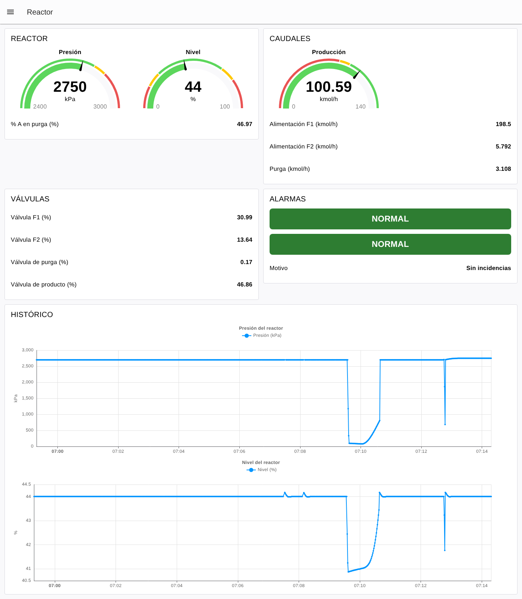
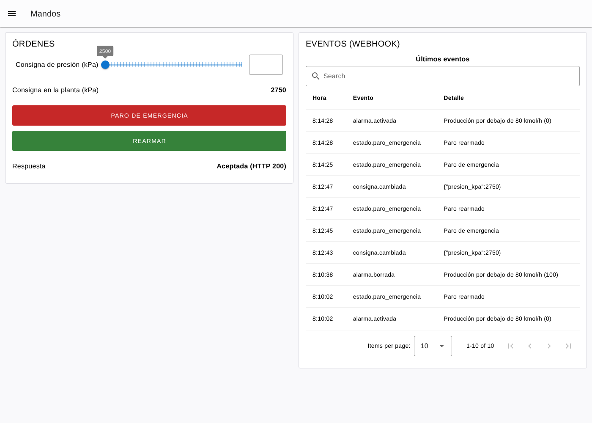
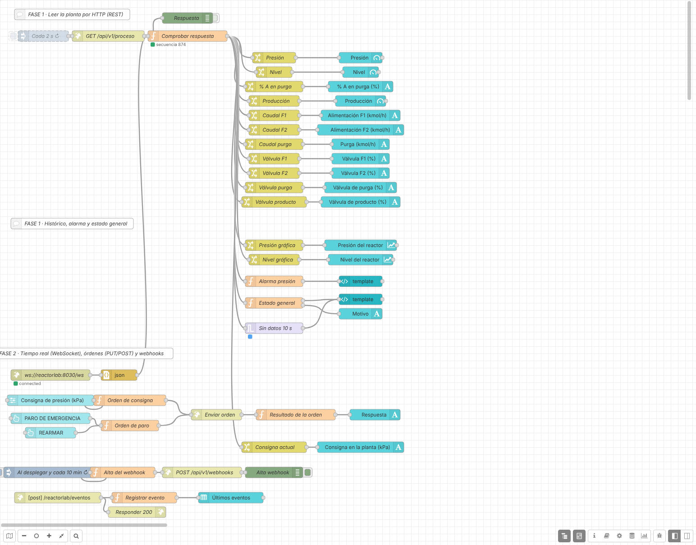

# Práctica: ReactorLab con Node-RED (protocolos web → Dashboard 2.0)

> Serie **1 · Node-RED + Dashboard**. La continuación con ThingsBoard está
> en [2-thingsboard/reactorlab](../../2-thingsboard/reactorlab/README.md).
> Flujo resuelto para el profesorado:
> [flows/reactorlab-dashboard-solucion.json](flows/reactorlab-dashboard-solucion.json).

## Introducción

Al terminar esta práctica tendrás un dashboard en Node-RED que te dice,
de un vistazo, si el reactor químico ReactorLab funciona bien o si hay
que intervenir, y una página desde la que darle órdenes. Esta vez la
máquina **no habla un protocolo industrial**: todo va por la web, como
una página o una aplicación del móvil. No vas a programar desde cero:
cuando haga falta código, lo tienes preparado en esta guía.

**La cadena que vas a construir:**

1.  **ReactorLab** simula un reactor químico continuo: entran dos gases
    (F1 y F2), reaccionan (A + C → D) y salen una purga de gas y el
    producto líquido D.
2.  **HTTP** (servidor web, puerto `8030`) ofrece los datos en formato
    **JSON**.
3.  **Node-RED** pide los datos (o los recibe) y elige los que
    interesan.
4.  **Dashboard** muestra los datos de forma clara.
5.  **Alarma** convierte muchos datos en un estado sencillo: NORMAL /
    ATENCIÓN / ALARMA.
6.  **Técnico** decide si hay que intervenir y, en la Fase 2, envía
    órdenes.

**Antes de empezar, comprueba que tienes:**

- [ ] El laboratorio arrancado (`docker compose up -d` o `start_lab.cmd`).
- [ ] Node-RED en `http://localhost:1880`, con la paleta
  `@flowfuse/node-red-dashboard` (Dashboard 2.0, ya instalada). El panel
  se abre en `http://localhost:1880/dashboard`.
- [ ] ReactorLab en `http://localhost:8030`: debe verse el reactor y los
  caudales.

> Dentro del entorno Docker, Node-RED llega a ReactorLab con la dirección
> `http://reactorlab:8030`. Desde tu navegador es `http://localhost:8030`.

**Cómo da los datos un servidor web.** En la web no hay registros ni
topics: hay **direcciones** (URL). El cliente hace una **petición** con un
**método** y el servidor contesta con un **código de estado** y un
**cuerpo** (aquí, JSON):

| **Método** | **Para qué**              | **Ejemplo en ReactorLab**                |
|------------|---------------------------|------------------------------------------|
| `GET`      | Leer                      | `GET /api/v1/proceso`                    |
| `PUT`      | Cambiar un valor          | `PUT /api/v1/consignas`                  |
| `POST`     | Ejecutar o crear algo     | `POST /api/v1/paro-emergencia`           |

| **Código** | **Significa**                                   |
|------------|-------------------------------------------------|
| `200`      | Correcto                                        |
| `401` / `403` | Falta la clave o no es válida               |
| `404`      | Esa dirección no existe                         |
| `422`      | Los datos enviados no son válidos (fuera de rango) |
| `500`      | Error en el servidor                            |

Haz la prueba: abre `http://localhost:8030/api/v1/proceso` en el
navegador. Verás un JSON como este:

    {
      "planta": "ReactorLab",
      "timestamp": "2026-11-10T02:31:33.326+00:00",
      "secuencia": 1532,
      "estado":  { "modo": "auto", "en_marcha": true, "paro_emergencia": false, "alarmas_activas": 0 },
      "medidas": {
        "presion_kpa": 2700.0,
        "nivel_pct": 44.18,
        "caudal_kmolh": { "f1": 201.43, "f2": 5.62, "purga": 7.05, "producto": 100.0 },
        "composicion_purga_pct": { "A": 47.0, "B": 14.29, "C": 38.71 },
        "coste_relativo": 0.2415
      },
      "valvulas": { "f1": { "posicion_pct": 31.45, "consigna_pct": 31.45 }, … },
      "consignas": { "caudal_producto_kmolh": 100, "presion_kpa": 2700, … }
    }

Para llegar a un dato se escribe la ruta con puntos:
`msg.payload.medidas.caudal_kmolh.producto` significa *del mensaje → su
contenido → medidas → caudales → producto*.

> Truco: `http://localhost:8030/docs` es la documentación interactiva de
> la API (OpenAPI). Puedes probar cada dirección con **Try it out**.

La práctica tiene dos fases. En la **Fase 1** solo lees datos y
construyes el dashboard y las alarmas. En la **Fase 2** usas los otros
protocolos web: **WebSocket**, órdenes con **clave** y **webhooks**.

## Fase 1 — Leer el reactor (partes 1 a 6)

En toda la Fase 1 solo lees, con peticiones `GET`.

### Parte 1 — Primera petición HTTP

Objetivo: comprobar que los datos del reactor llegan a Node-RED.

1.  Arrastra un nodo **inject**, un nodo **http request** y un nodo
    **debug**. Únelos en ese orden.
2.  En el **inject**: **Repeat** `interval` cada `2` seconds y marca
    **Inject once after** `1` second.
3.  En el **http request**:
    - **Method:** `GET`
    - **URL:** `http://reactorlab:8030/api/v1/proceso`
    - **Return:** *a parsed JSON object*
    - **Name:** `GET /api/v1/proceso`
4.  En el **debug** elige *Output:* **complete msg object**.
5.  **Deploy**. Cada 2 segundos llega un mensaje al panel **Debug**.

**Comprueba.** Despliega un mensaje y localiza cada dato:

| **Dato**               | **Ruta en el mensaje**                        | **Valor que ves** |
|------------------------|-----------------------------------------------|-------------------|
| Código de estado HTTP  | `statusCode`                                  |                   |
| Presión del reactor    | `payload.medidas.presion_kpa`                 |                   |
| Nivel de líquido       | `payload.medidas.nivel_pct`                   |                   |
| Producción             | `payload.medidas.caudal_kmolh.producto`       |                   |
| Alimentación F1        | `payload.medidas.caudal_kmolh.f1`             |                   |
| % de A en la purga     | `payload.medidas.composicion_purga_pct.A`     |                   |
| Válvula de producto    | `payload.valvulas.producto.posicion_pct`      |                   |
| Modo                   | `payload.estado.modo`                         |                   |

> En ReactorLab, la sección **Protocolos web** muestra cada petición que
> recibe: busca las tuyas (`GET /api/v1/proceso`) y fíjate en el código
> de estado y los milisegundos que tarda.
>
> ReactorLab tiene también una **vista 3D** de la planta en
> `http://localhost:8030/3d/` (la visualización original de GRFICS): las
> válvulas de la escena muestran las mismas posiciones que vas a leer.

### Parte 2 — Mostrar un único dato

Objetivo: entender el camino **HTTP → dato → widget**.

1.  Conecta al **http request** un nodo **change** llamado `Presión`.
    Regla: **Set** `msg.payload` **to the value**
    `msg.payload.medidas.presion_kpa` (tipo `msg.`).
2.  Conecta la salida a un nodo **text** (`ui-text`). La primera vez
    tendrás que crear una **página** `Reactor` y un **grupo** `Pruebas`.
3.  En el **text**: *Label* = `Presión (kPa)`.
4.  **Deploy** y abre `http://localhost:1880/dashboard`.

> En Dashboard 2.0 (versión 1.36) el nodo **text** ya no tiene campo
> *Format*: pon la unidad en la etiqueta, como aquí.

**Comprueba.** Cambia la URL a `http://reactorlab:8030/api/v1/presion`
y haz Deploy. ¿Qué código de estado llega? ¿Qué muestra el dashboard?
Vuelve a poner la URL correcta.

### Parte 3 — Comprobar la respuesta

Un servidor web puede contestar con un error, o no contestar. Antes de
usar los datos hay que **comprobar la respuesta**.

1.  Entre el **http request** y el **change** añade un **function**
    llamado `Comprobar respuesta` con este código. **No hace falta tocar
    nada.**

<!-- -->

    // ENTRADA: la respuesta de ReactorLab (por HTTP o, más adelante, por WebSocket)
    //   msg.statusCode = código HTTP (200 = correcto). Por WebSocket no existe.
    //   msg.payload    = el estado de la planta en JSON
    // SALIDA:  el mismo mensaje, solo si la respuesta es correcta

    if (msg.statusCode !== undefined && msg.statusCode !== 200) {
        node.status({ fill: "red", shape: "dot", text: "HTTP " + msg.statusCode });
        return null;                          // 404, 500, ECONNREFUSED... no seguimos
    }
    if (typeof msg.payload !== "object" || !msg.payload.medidas) {
        node.status({ fill: "red", shape: "ring", text: "respuesta no válida" });
        return null;
    }
    node.status({ fill: "green", shape: "dot", text: "secuencia " + msg.payload.secuencia });
    return msg;

2.  **Deploy**. Debajo del nodo aparece en verde la secuencia de la
    planta.

**Comprueba.** Pide al profesor que pare ReactorLab un momento (o cambia
el puerto de la URL a `8031`). ¿Qué estado muestra el nodo? ¿Qué pasaría
en el dashboard si no estuviera este nodo?

### Parte 4 — El reactor

A partir de aquí, todos los nodos **change** cuelgan del **Comprobar
respuesta**. Ya puedes borrar el grupo `Pruebas`.

1.  Crea el grupo `REACTOR` y un **change** y un widget por dato:

| **Dato**     | **Ruta**                                      | **Unidad** | **Widget sugerido**   |
|--------------|-----------------------------------------------|------------|-----------------------|
| Presión      | `msg.payload.medidas.presion_kpa`             | kPa        | gauge (2400–3000)     |
| Nivel        | `msg.payload.medidas.nivel_pct`               | %          | gauge (0–100)         |
| % A en purga | `msg.payload.medidas.composicion_purga_pct.A` | %          | text                  |

En el **gauge** (`ui-gauge`) rellena *Min*, *Max*, *Units* y, en
*Segments*, los colores: presión verde desde 2400, amarillo desde 2800 y
rojo desde 2850.

> La presión normal es **2700 kPa** (27 veces la atmosférica). Por
> encima de 2850 kPa la planta tiene una alarma de presión alta; a
> 3000 kPa el reactor ya está fuera de diseño.

### Parte 5 — Caudales y válvulas

1.  Crea el grupo `CAUDALES`:

| **Dato**        | **Ruta**                                  | **Unidad** | **Widget**        |
|-----------------|-------------------------------------------|------------|-------------------|
| Producción      | `msg.payload.medidas.caudal_kmolh.producto` | kmol/h   | gauge (0–140)     |
| Alimentación F1 | `msg.payload.medidas.caudal_kmolh.f1`     | kmol/h     | text              |
| Alimentación F2 | `msg.payload.medidas.caudal_kmolh.f2`     | kmol/h     | text              |
| Purga           | `msg.payload.medidas.caudal_kmolh.purga`  | kmol/h     | text              |

2.  Crea el grupo `VÁLVULAS` con un **text** por válvula:
    `msg.payload.valvulas.f1.posicion_pct`, `…f2…`, `…purga…` y
    `…producto…` (todas en %).

> **¿Por qué mirar las válvulas?** El reactor tiene cuatro **lazos de
> control** que mueven las válvulas solos para mantener la producción, la
> presión, la composición y el nivel. Si una válvula se abre mucho más de
> lo normal, el control está **compensando un problema** aunque las
> medidas parezcan buenas.

| **Válvula** | **La mueve el lazo de…** | **Posición normal** |
|-------------|--------------------------|---------------------|
| F1          | producción               | ~31 %               |
| F2          | % de A en la purga       | ~13 %               |
| Purga       | presión                  | ~0,5 %              |
| Producto    | nivel                    | ~47 %               |

### Parte 6 — Organizar el dashboard

1.  Ancho de los grupos (12 columnas): `REACTOR` 6, `CAUDALES` 6,
    `VÁLVULAS` 6.
2.  Título de la página: `Reactor`.

**Comprueba.** Pide a un compañero que mire tu dashboard 5 segundos.
¿Sabe decir cuánto produce el reactor y si la presión es normal?

## Fase 1 — Histórico, incidencia y alarmas (partes 7 a 10)

### Parte 7 — Añadir un histórico

1.  Crea un grupo `HISTÓRICO` de anchura 12.
2.  Añade un **change** `Presión gráfica` con dos reglas: **Set**
    `msg.payload` to `msg.payload.medidas.presion_kpa` y **Set**
    `msg.topic` to the string `Presión (kPa)`.
3.  Conéctalo a un **chart** (`ui-chart`): *Type* **Line**, eje X
    **Timescale**, *Y-axis label* `kPa`, conservar los últimos
    **15 minutos**. Repite con el nivel.
4.  En la web de ReactorLab (sección **Operación**) sube la consigna de
    **Presión** a `2800` y pulsa **Enviar**. Espera 3 minutos y vuelve a
    `2700`.

**Comprueba.** ¿Cuánto tarda la presión en llegar a la nueva consigna?
¿Lo hace de golpe o poco a poco? Mientras sube, ¿qué válvula se mueve?

> ReactorLab va **120 veces más rápido** que una planta real: 1 segundo
> de reloj son 2 minutos de proceso. Una subida que tarda 3 minutos en
> pantalla serían 6 horas en la planta.

### Parte 8 — Simular una incidencia

1.  Anota los valores **antes** de la incidencia.
2.  El profesor inyecta en ReactorLab la avería **Válvula sucia** en la
    válvula de **producto** (pierde el 40 % de su capacidad).
3.  Observa el dashboard 2 minutos y anota los valores **durante** la
    avería.

| **Variable**                 | **Antes** | **Durante la avería** | **¿Ha cambiado mucho?** |
|------------------------------|-----------|-----------------------|-------------------------|
| Producción (kmol/h)          |           |                       |                         |
| Nivel (%)                    |           |                       |                         |
| Presión (kPa)                |           |                       |                         |
| Válvula de producto (%)      |           |                       |                         |

**Preguntas:**

1.  ¿Ha cambiado la producción? ¿Y el nivel? ¿Por qué no?
2.  ¿Qué variable delata la avería?
3.  Si solo vigilaras las medidas, ¿te habrías enterado?

### Parte 9 — Primera alarma

Objetivo: entender la idea **ENTRA UN VALOR → SE COMPARA CON UN LÍMITE →
NORMAL / ALARMA**.

1.  Añade un **function** `Alarma presión` conectado al **Comprobar
    respuesta** y pega este código. **Solo debes tocar el número.**

<!-- -->

    // ENTRADA: el estado de la planta (msg.payload)
    // SALIDA:  msg.payload = "NORMAL" o "ALARMA"

    const LIMITE_PRESION = 2850;   // kPa. Puedes cambiar este valor.

    const presion = msg.payload.medidas.presion_kpa;

    if (presion > LIMITE_PRESION) {
        msg.payload = "ALARMA";
    } else {
        msg.payload = "NORMAL";
    }
    return msg;

2.  Crea un grupo `ALARMAS` y conecta la salida a un **template**
    (`ui-template`) con este código, que pinta el estado de color:

<!-- -->

    <template>
      

        {{ msg?.payload || 'SIN DATOS' }}
      

    </template>

    

3.  **Deploy**. En la web de ReactorLab sube la consigna de presión a
    `2900` y espera a que pase de 2850 kPa. Después vuelve a `2700`.

**Comprueba.** ¿Cuánto tarda en aparecer ALARMA? ReactorLab también
tiene sus propias alarmas (sección *Alarmas y eventos*): ¿salta la suya
al mismo tiempo que la tuya? Cambia el límite a `2710`: ¿por qué un
límite tan cerca del valor normal es un problema?

### Parte 10 — Estado general y pérdida de comunicación (ampliación)

1.  Añade un **function** `Estado general` conectado al **Comprobar
    respuesta**. En *Setup* pon **Outputs: 2** y pega:

<!-- -->

    // ENTRADA: el estado de la planta (msg.payload)
    // SALIDA 1: "NORMAL", "ATENCIÓN" o "ALARMA"
    // SALIDA 2: el motivo, en texto

    // ---- UMBRALES (puedes cambiarlos) ----
    const PRESION_ATENCION = 2800, PRESION_ALARMA = 2850;   // kPa
    const NIVEL_MIN = 25, NIVEL_MAX = 70;                   // % (fuera: ATENCIÓN)
    const PRODUCCION_MIN = 90;                              // kmol/h
    const VALVULA_PRODUCTO_MAX = 70;                        // % (lo normal es ~47 %)
    // --------------------------------------

    const p = msg.payload;
    const m = p.medidas;

    let nivel = 0;            // 0 = NORMAL, 1 = ATENCIÓN, 2 = ALARMA
    const motivos = [];
    function avisar(n, texto) {
        if (n > nivel) nivel = n;
        motivos.push(texto);
    }

    if (p.estado.paro_emergencia) avisar(2, "Paro de emergencia");
    else if (!p.estado.en_marcha) avisar(1, "Planta parada");
    if (p.estado.modo === "manual") avisar(1, "Modo manual");

    const pres = "Presión " + m.presion_kpa + " kPa";
    if (m.presion_kpa > PRESION_ALARMA) avisar(2, pres);
    else if (m.presion_kpa > PRESION_ATENCION) avisar(1, pres);

    if (m.nivel_pct < NIVEL_MIN || m.nivel_pct > NIVEL_MAX) avisar(1, "Nivel " + m.nivel_pct + " %");
    if (m.caudal_kmolh.producto < PRODUCCION_MIN) avisar(1, "Producción " + m.caudal_kmolh.producto + " kmol/h");

    // un controlador que "tapa" una avería: la válvula se abre mucho más de lo normal
    const vp = p.valvulas.producto.posicion_pct;
    if (vp > VALVULA_PRODUCTO_MAX) avisar(1, "Válvula de producto al " + vp + " %: ¿obstruida?");

    const estados = ["NORMAL", "ATENCIÓN", "ALARMA"];
    return [
        { payload: estados[nivel] },
        { payload: motivos.length ? motivos.join(" · ") : "Sin incidencias" }
    ];

2.  Salida 1 → otro **template** como el de la Parte 9. Salida 2 → un
    **text** con *Label* `Motivo`.
3.  **Detectar que ReactorLab no responde (sin código).** Añade un
    **trigger** conectado al **Comprobar respuesta**: *Send* **nothing**,
    *then* **wait for** `10` seconds, *then send* el texto `ALARMA`,
    marcando **extend delay if new message arrives**. Conéctalo al
    template del estado general.
4.  Ensayos: repite la **válvula sucia** (Parte 8), pulsa **Parar
    planta** en ReactorLab, pon el modo **Manual** y, por último, pide al
    profesor que pare ReactorLab 15 segundos.

**Comprueba.** ¿Qué motivo aparece con la válvula sucia? ¿Por qué el
**Comprobar respuesta** no basta para detectar que el servidor está
caído y hace falta el **trigger**?

Así queda el dashboard al final de la Fase 1:

*Dashboard resuelto (captura real del laboratorio).*

## Fase 2 — Tiempo real, órdenes y webhooks (partes 11 a 13)

Empieza esta fase solo cuando tu dashboard funcione bien. Antes de tocar
nada, **exporta tu flujo** (*Menu → Export*) o haz un snapshot en
`http://localhost:8090`.

**Tres formas de recibir datos por la web:**

| **Forma**     | **Quién inicia**                       | **En ReactorLab**                         |
|---------------|----------------------------------------|-------------------------------------------|
| Polling (REST)| Tú preguntas cada X segundos           | `GET /api/v1/proceso` (Fase 1)            |
| WebSocket     | Abres una conexión y el servidor empuja | `ws://reactorlab:8030/ws` (cada 1 s)     |
| Webhook       | El servidor te llama a ti cuando pasa algo | `POST` a la URL que registres          |

### Parte 11 — Tiempo real con WebSocket

1.  Añade un nodo **websocket in**. En *Type* elige **Connect to** y crea
    la conexión: **URL** `ws://reactorlab:8030/ws`, *Send/Receive*
    **payload**.
2.  Conecta a su salida un nodo **json** (convierte el texto en objeto)
    y la salida del **json** al **Comprobar respuesta**.
3.  Abre el **inject** de la Parte 1 y pulsa el botón **Enabled** para
    dejarlo *Disabled*. **Deploy**.

**Comprueba.** ¿Sigue funcionando todo el dashboard? Mira en ReactorLab
la tabla **Protocolos web**: ¿siguen llegando peticiones `GET`? ¿Qué
aparece ahora? Rellena:

|                                  | **Polling (Fase 1)** | **WebSocket** |
|----------------------------------|----------------------|---------------|
| Mensajes por minuto              |                      |               |
| Peticiones HTTP por minuto       |                      |               |
| Retraso máximo de un cambio      |                      |               |

### Parte 12 — Dar órdenes con PUT y POST

Leer es libre, pero **mandar** exige una **clave**: la cabecera
`X-API-Key` (en el laboratorio vale `reactorlab`).

| **Orden**            | **Método y dirección**             | **Cuerpo JSON**              |
|----------------------|------------------------------------|------------------------------|
| Consigna de presión  | `PUT /api/v1/consignas`            | `{ "presion_kpa": 2750 }`    |
| Paro de emergencia   | `POST /api/v1/paro-emergencia`     | `{ "activo": true }`         |

1.  Crea una página `Mandos` con un grupo `ÓRDENES`.
2.  Añade un **slider** (`ui-slider`): *Label* `Consigna de presión
    (kPa)`, *Min* `2500`, *Max* `2950`, *Step* `10`, *Output* **only on
    release**.
3.  Conéctalo a un **function** `Orden de consigna`:

<!-- -->

    // ENTRADA: el valor del slider (kPa)
    // SALIDA:  una petición HTTP PUT para ReactorLab

    const CLAVE = "reactorlab";            // clave de la API (cabecera X-API-Key)
    const MIN = 2500, MAX = 2950;           // kPa

    const kpa = Math.round(Number(msg.payload));
    if (!Number.isFinite(kpa) || kpa < MIN || kpa > MAX) {
        node.warn("Consigna fuera de rango: " + msg.payload);
        return null;                       // no se envía nada a la planta
    }
    msg.method  = "PUT";
    msg.url     = "http://reactorlab:8030/api/v1/consignas";
    msg.headers = { "X-API-Key": CLAVE, "Content-Type": "application/json" };
    msg.payload = { presion_kpa: kpa };
    return msg;

4.  Añade dos **button** (`ui-button`): `PARO DE EMERGENCIA` (payload
    **boolean** `true`) y `REARMAR` (payload **boolean** `false`).
    Conéctalos a un **function** `Orden de paro`:

<!-- -->

    // ENTRADA: true (botón PARO) o false (botón REARMAR)
    // SALIDA:  una petición HTTP POST para ReactorLab

    const CLAVE = "reactorlab";

    msg.method  = "POST";
    msg.url     = "http://reactorlab:8030/api/v1/paro-emergencia";
    msg.headers = { "X-API-Key": CLAVE, "Content-Type": "application/json" };
    msg.payload = { activo: msg.payload === true };
    return msg;

5.  Las dos funciones van a **un mismo http request** con **Method**
    `- set by msg.method -`, la **URL vacía** y *Return* *a parsed JSON
    object*. Su salida va a un **function** `Resultado de la orden`:

<!-- -->

    // ENTRADA: la respuesta de ReactorLab a una orden
    // SALIDA:  un texto para el dashboard

    if (msg.statusCode === 200) {
        msg.payload = "Aceptada (HTTP 200)";
    } else {
        const detalle = msg.payload && msg.payload.detail ? JSON.stringify(msg.payload.detail) : "";
        msg.payload = "Rechazada (HTTP " + msg.statusCode + ") " + detalle.slice(0, 120);
    }
    return msg;

6.  Muestra el resultado en un **text** `Respuesta`. Añade otro **text**
    `Consigna en la planta (kPa)` que cuelgue del **Comprobar respuesta**
    con la ruta `msg.payload.consignas.presion_kpa`.
7.  **Deploy** y prueba: mueve el slider a 2750; pulsa PARO y después
    REARMAR.

**Comprueba.**

1.  Cambia la clave del código a `hola` y haz Deploy: ¿qué responde
    ReactorLab? Pon la cabecera mal escrita (`X-Api-Kei`): ¿y ahora?
2.  Quita el límite del código y envía 3500: ¿qué código llega? ¿Quién te
    ha protegido?
3.  ¿Por qué se muestra la consigna **leída de la planta** y no la del
    slider?

> En una planta real, una orden desde un dashboard puede parar una
> instalación. Además de la clave hacen falta usuarios con permisos,
> HTTPS y un registro de quién hizo qué.

### Parte 13 — Webhooks: que la planta te avise (ampliación final)

Hasta ahora siempre preguntabas tú o mantenías una conexión abierta. Con
un **webhook** es ReactorLab quien **llama a Node-RED** cuando ocurre algo.
Para eso, Node-RED tiene que **ser servidor web**.

1.  **Recibir avisos.** Añade un nodo **http in**: **Method** `POST`,
    **URL** `/reactorlab/eventos`. Conecta a su salida un **http
    response** con *Status code* `200` (contesta "recibido") y un
    **function** `Registrar evento`:

<!-- -->

    // ENTRADA: el aviso que envía ReactorLab (msg.payload = evento en JSON)
    // SALIDA:  la lista de los últimos 10 eventos, para la tabla

    const ev = msg.payload;
    let detalle = "";
    if (ev.alarma) {
        detalle = ev.alarma.texto + " (" + ev.alarma.valor + ")";
    } else if (ev.consignas) {
        detalle = JSON.stringify(ev.consignas);
    } else if (ev.modo) {
        detalle = "Modo " + ev.modo;
    } else if ("activo" in ev) {
        detalle = ev.activo ? "Paro de emergencia" : "Paro rearmado";
    }

    const lista = flow.get("eventos") || [];
    lista.unshift({
        Hora:    new Date(ev.timestamp).toLocaleTimeString("es-ES"),
        Evento:  ev.evento,
        Detalle: detalle
    });
    flow.set("eventos", lista.slice(0, 10));

    msg.payload = flow.get("eventos");
    return msg;

2.  Crea el grupo `EVENTOS (WEBHOOK)` en la página `Mandos` y conecta el
    **Registrar evento** a un **table** (`ui-table`).
3.  **Darse de alta.** Añade un **inject** (*Inject once after* `3` s y
    *Repeat* cada `10` minutos) → **function** `Alta del webhook` →
    **http request** (*Method* set by msg.method) → **debug**:

<!-- -->

    // SALIDA: una petición HTTP POST que da de alta este Node-RED como webhook

    const CLAVE = "reactorlab";

    msg.method  = "POST";
    msg.url     = "http://reactorlab:8030/api/v1/webhooks";
    msg.headers = { "X-API-Key": CLAVE, "Content-Type": "application/json" };
    msg.payload = {
        url: "http://nodered:1880/reactorlab/eventos",     // dónde nos avisará ReactorLab
        eventos: ["alarma", "estado", "consigna"]          // qué avisos queremos
    };
    return msg;

4.  **Deploy**. En el debug verás la respuesta del alta (`201`, o `200`
    si ya existía). Ahora cambia consignas, pulsa PARO / REARMAR o sube
    la presión hasta que salte una alarma.

> ¿Por qué repetir el alta cada 10 minutos? Si ReactorLab arranca después
> que Node-RED, el primer intento falla. Repetirla no duplica nada:
> ReactorLab reconoce la URL y solo la actualiza (responde `200`, no
> `201`). Una operación que se puede repetir sin efectos extra se llama
> **idempotente**.

**Comprueba.**

1.  ¿Llegan los eventos a la tabla sin que Node-RED pregunte nada?
2.  En ReactorLab, tabla **Protocolos web**: busca las filas de tipo
    `webhook`. ¿Quién es el cliente y quién el servidor en ese caso?
3.  ¿Por qué Node-RED tiene que contestar con un `200`?
4.  Completa: el **polling** sirve para ______, el **WebSocket** para
    ______ y el **webhook** para ______.

Así queda la página de mandos:

*Página de mandos resuelta (captura real del laboratorio).*

Y el flujo completo:

*Flujo resuelto en Node-RED (captura real del laboratorio).*

## Cierre y entrega

> Las máquinas modernas cada vez hablan más «web»: REST para consultar,
> WebSocket para el tiempo real y webhooks para avisar. Son los mismos
> protocolos de cualquier aplicación, con los mismos riesgos: hay que
> comprobar las respuestas y proteger las órdenes.

**Qué entregar:**

- [ ] Flujo de Node-RED exportado en JSON (*Menu → Export → all flows*).
- [ ] Tabla de la Parte 1 completada.
- [ ] Captura del dashboard en estado NORMAL y durante la válvula sucia.
- [ ] Tablas de las partes 8 y 11 completadas.
- [ ] Captura de la página Mandos con eventos recibidos por webhook.
- [ ] Respuestas a las preguntas finales.

**Preguntas finales:**

1.  Explica el camino de un dato desde el reactor hasta tu pantalla con
    polling y con WebSocket.
2.  ¿Qué diferencia hay entre los códigos 401, 403, 404 y 422? Pon un
    ejemplo de cada uno en ReactorLab.
3.  ¿Por qué la clave de la API no debería ir escrita en el flujo en una
    instalación real? ¿Dónde la pondrías?
4.  En la válvula sucia, ¿por qué el lazo de control «tapa» la avería?
    ¿Qué variables vigilarías para descubrirla?
5.  ¿Qué ventaja tiene un webhook frente a preguntar cada 2 segundos?
    ¿Qué inconveniente tiene para la red de una fábrica?

**Si algo no funciona:**

| **Síntoma**                                              | **Causa probable**                                 | **Qué hacer**                                                                       |
|----------------------------------------------------------|----------------------------------------------------|-------------------------------------------------------------------------------------|
| El **http request** da `ECONNREFUSED`                    | Host o puerto mal                                  | Desde Node-RED usa `http://reactorlab:8030`, no `localhost`                         |
| Código `404`                                             | Dirección mal escrita                              | Compárala con `http://localhost:8030/docs`                                          |
| El change da error `Cannot read properties of undefined` | Llega un texto, no un objeto                       | *Return* debe ser **a parsed JSON object**                                          |
| El widget sale vacío                                     | Ruta mal escrita                                   | Usa el botón de copiar ruta del panel Debug                                         |
| El **websocket in** se queda en *connecting*             | URL con `http://`                                  | Debe empezar por `ws://`                                                            |
| Con WebSocket el dashboard no cambia                     | Falta el nodo **json**                             | Por WebSocket llega texto: hay que convertirlo                                      |
| La orden responde `401`                                  | Falta la cabecera                                  | `msg.headers` con `X-API-Key`                                                       |
| La orden responde `422`                                  | Valor fuera de rango o JSON mal formado            | Presión entre 2500 y 2950                                                            |
| El http request de órdenes no hace nada                  | Tiene un método o URL escritos                     | *Method* `- set by msg.method -` y URL vacía                                        |
| No llegan webhooks                                       | El alta apunta a `localhost`                       | La URL del webhook debe ser `http://nodered:1880/...` (la ve ReactorLab, no tú)     |
| ReactorLab marca el webhook con error                    | Falta el **http response**                         | El **http in** siempre necesita su **http response**                                |
