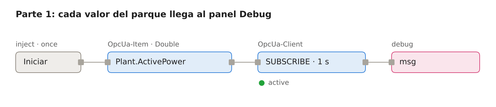
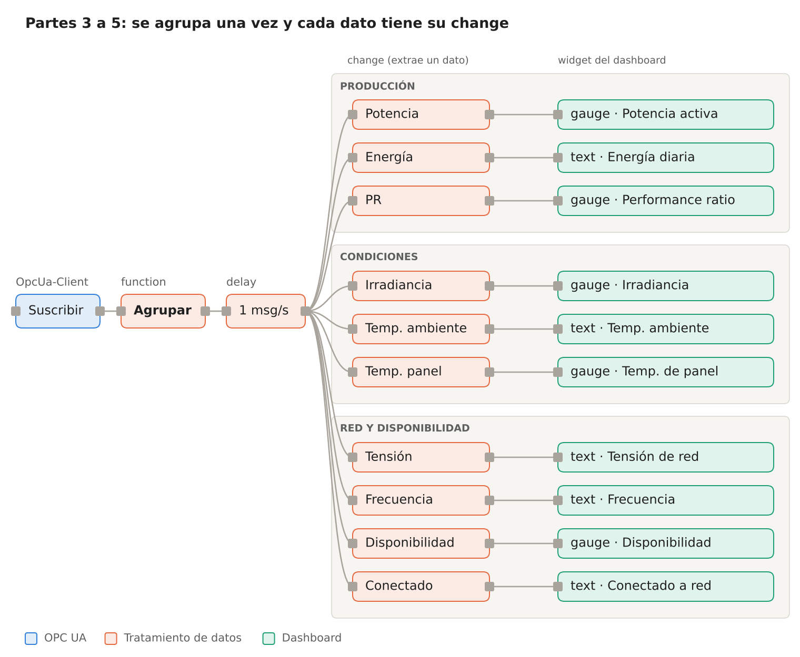
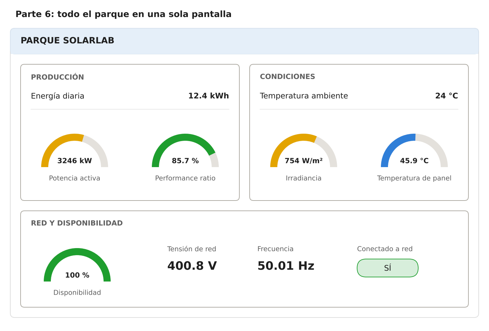
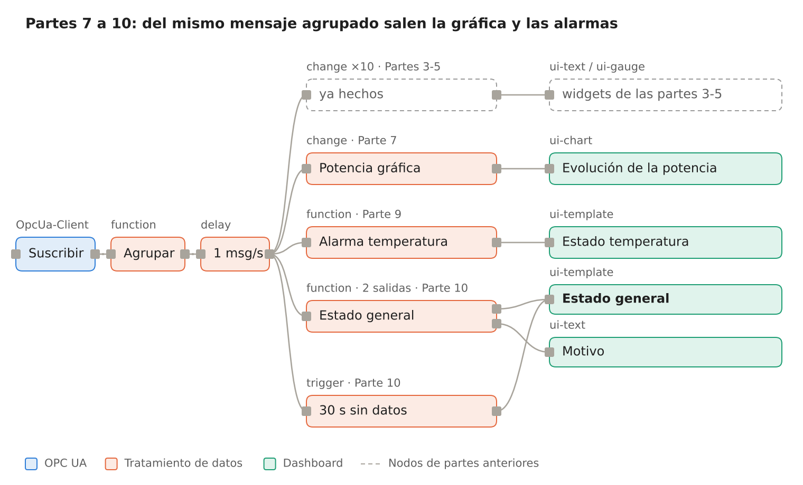
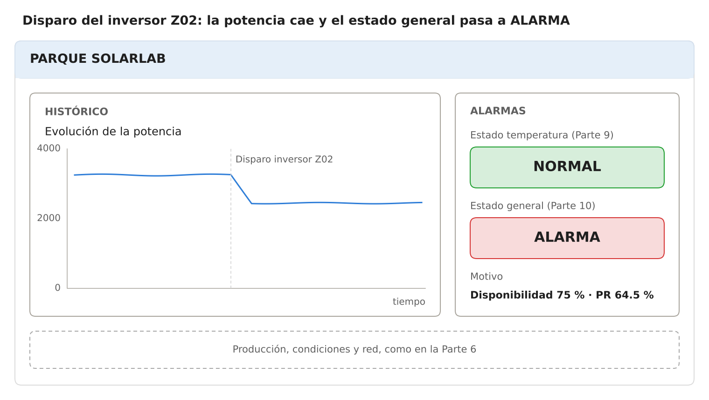
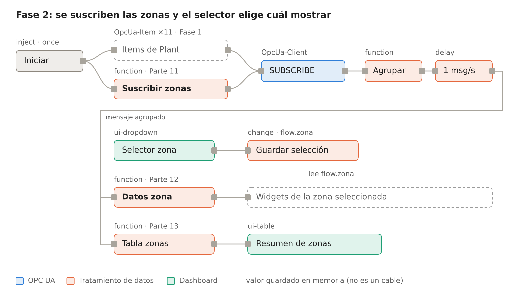
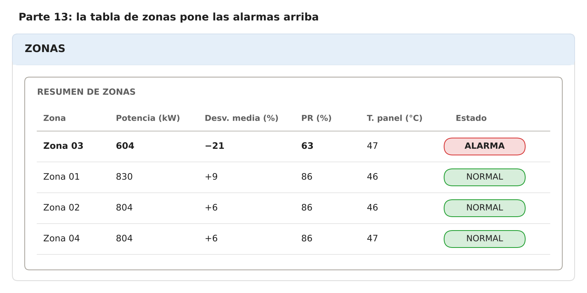

# Práctica: SolarLab con Node-RED (OPC UA → Dashboard 2.0)

> Serie **1 · Node-RED + Dashboard**. Versión Markdown de [Practica_SolarLab_NodeRED_ES.docx](Practica_SolarLab_NodeRED_ES.docx). La continuación con ThingsBoard está en [2-thingsboard/solarlab](../../2-thingsboard/solarlab/README.md).
>
> Escrita para el entorno Docker del laboratorio (`docker compose up -d` o `start_lab.cmd`). Si trabajas con equipos sueltos, cambia los nombres de servicio (`solarlab`, `localhost`) por la IP de cada equipo.

## Introducción

Al terminar esta práctica tendrás un dashboard en Node-RED que te dice,
de un vistazo, si el parque solar SolarLab produce lo que debe o si hay
que intervenir. No vas a programar desde cero: cuando haga falta código,
lo tienes preparado en esta guía y solo tendrás que pegarlo y, como
mucho, cambiar un umbral.

**La cadena que vas a construir:**

1.  **SolarLab** simula un parque fotovoltaico de 5 MWp dividido en
    cuatro zonas.
2.  **OPC UA** (servidor, puerto `4840`) ofrece las variables del
    parque.
3.  **Node-RED** se suscribe a esas variables y las junta en un solo
    mensaje.
4.  **Dashboard** muestra los datos de forma clara.
5.  **Alarma** convierte muchos datos en un estado sencillo: NORMAL /
    ATENCIÓN / ALARMA.
6.  **Técnico de mantenimiento** decide si hay que intervenir.

**Antes de empezar, comprueba que tienes:**

- [ ] El laboratorio arrancado y Node-RED en `http://localhost:1880`.
- [ ] La paleta `@flowfuse/node-red-dashboard` (Dashboard 2.0), que ya
  viene instalada en el laboratorio. El panel se abre en
  `http://localhost:1880/dashboard`.
- [ ] La paleta `node-red-contrib-opcua` (también instalada). Deben
  aparecer los nodos **OpcUa-Item** y **OpcUa-Client**.
- [ ] SolarLab funcionando. Su web se abre en `http://localhost:8000`.
- [ ] El endpoint OPC UA de SolarLab: dentro de Docker,
  `opc.tcp://solarlab:4840/solarlab/server/`.

**Cómo están organizados los datos del parque.** En MQTT el equipo envía
un mensaje JSON con todo dentro. En OPC UA es al revés: el servidor
tiene un **espacio de direcciones**, parecido a un árbol de carpetas, y
cada variable vive en su sitio con un nombre único, el **NodeId**.

    Objects
    └── SolarLab
        ├── Plant        datos de todo el parque
        │   ├── ActivePower          ns=2;s=Plant.ActivePower
        │   ├── Irradiance           ns=2;s=Plant.Irradiance
        │   └── ...
        ├── Zones        las cuatro zonas: Zone01 … Zone04
        │   └── Zone02
        │       ├── ActivePower      ns=2;s=Zone02.ActivePower
        │       └── ...
        └── Controls     órdenes (estas variables se pueden escribir)

Un NodeId se lee así: `ns=2;s=Plant.ActivePower` significa *espacio de
nombres 2 → identificador de texto → bloque Plant → potencia activa*.
Node-RED se **suscribe** a cada variable: cada vez que su valor cambia,
el servidor envía un mensaje con **esa variable sola**.

La práctica tiene dos fases. En la **Fase 1** trabajas con el parque
completo (bloque `Plant`). En la **Fase 2**, solo cuando la Fase 1 esté
clara, bajas al nivel de las cuatro zonas.

## Fase 1 — El parque completo (partes 1 a 6)

En toda la Fase 1 trabajas solo con variables del bloque `Plant`.
Todavía no miras las zonas.

### Parte 1 — Recibir datos OPC UA

Objetivo: comprobar que los valores del parque llegan a Node-RED.

1.  Arrastra al área de trabajo un nodo **inject**, un nodo
    **OpcUa-Item**, un nodo **OpcUa-Client** y un nodo **debug**. Únelos
    en ese orden.
2.  En el nodo **inject**:
    - **Name:** `Iniciar`
    - Marca **Inject once after** `1` seconds. Así la suscripción se
      crea sola cada vez que pulsas Deploy.
3.  En el nodo **OpcUa-Item**:
    - **Item:** `ns=2;s=Plant.ActivePower`
    - **Type:** `Double`
    - **Name:** `Potencia activa`
4.  Abre el nodo **OpcUa-Client** y pulsa el lápiz junto a *Endpoint*
    para crear la conexión:
    - **Endpoint:** `opc.tcp://solarlab:4840/solarlab/server/` (con
      equipos sueltos, la IP del equipo de SolarLab en lugar de
      `solarlab`).
    - **Security policy:** `None`. **Security mode:** `None`. Sin
      usuario ni contraseña.
5.  En el nodo **OpcUa-Client** configura **Action:** `SUBSCRIBE` e
    intervalo de `1` segundo.
6.  En el nodo **debug** elige *Output:* **complete msg object**, para
    ver también `msg.topic`.
7.  Pulsa **Deploy**. Debajo del **OpcUa-Client** debe aparecer un
    estado en verde y en la pestaña **Debug** deben llegar mensajes cada
    segundo.

*Flujo de la Parte 1 (esquema).* El **inject** dispara la suscripción
una vez; a partir de ahí el **OpcUa-Client** envía un mensaje cada vez
que cambia el valor.

Cada mensaje trae una sola variable:

    msg.topic   = "ns=2;s=Plant.ActivePower"
    msg.payload = 3245.73

**Ahora suscríbete al resto.** Copia y pega el **OpcUa-Item** (Ctrl+C,
Ctrl+V) una vez por cada variable de la tabla. Todos cuelgan del mismo
**inject** y van al mismo **OpcUa-Client**.

**Comprueba.** Localiza en el panel Debug cada variable y anota su
valor:

| **Dato**             | **Item (NodeId)**                 | **Type** | **Valor que ves** |
|----------------------|-----------------------------------|----------|-------------------|
| Potencia activa      | `ns=2;s=Plant.ActivePower`        | Double   |                   |
| Energía diaria       | `ns=2;s=Plant.DailyEnergy`        | Double   |                   |
| Irradiancia          | `ns=2;s=Plant.Irradiance`         | Double   |                   |
| Temperatura ambiente | `ns=2;s=Plant.AmbientTemperature` | Double   |                   |
| Temperatura de panel | `ns=2;s=Plant.PanelTemperature`   | Double   |                   |
| Performance ratio    | `ns=2;s=Plant.PerformanceRatio`   | Double   |                   |
| Disponibilidad       | `ns=2;s=Plant.Availability`       | Double   |                   |
| Tensión de red       | `ns=2;s=Plant.GridVoltage`        | Double   |                   |
| Frecuencia de red    | `ns=2;s=Plant.GridFrequency`      | Double   |                   |
| Conectado a red      | `ns=2;s=Plant.Connected`          | Boolean  |                   |
| Alarma activa        | `ns=2;s=Plant.AlarmActive`        | Boolean  |                   |

> Truco: la web de SolarLab tiene un **explorador OPC UA** (sección
> *Explora OPC UA*). Al pulsar una variable ves su NodeId, su tipo y su
> valor actual. Comprueba ahí el número de `ns=`: suele ser 2, pero si
> es otro tienes que cambiarlo en todos los items.

### Parte 2 — Mostrar un único dato

Objetivo: entender el camino **OPC UA → dato → widget**. Como todos los
valores salen por el mismo **OpcUa-Client**, primero hay que quedarse
con el que interesa.

1.  Conecta a la salida del **OpcUa-Client** un nodo **switch** llamado
    `Potencia`:
    - **Property:** `msg.topic`
    - Regla: **==** `ns=2;s=Plant.ActivePower`
2.  Después del **switch** añade un nodo **change** llamado `Redondear`.
    Regla: **Set** `msg.payload` **to the value** `$round(payload, 0)`
    (elige el tipo **J: expression** en el desplegable).
3.  Conecta la salida a un nodo **text** del dashboard (`ui-text`). La
    primera vez tendrás que crear:
    - una **página** (`ui-page`) llamada `Parque SolarLab`,
    - un **grupo** (`ui-group`) llamado `Pruebas`.
4.  En el nodo **text**: *Label* = `Potencia activa (kW)`. (En
    Dashboard 2.0 el nodo **text** no tiene campo *Format*: la unidad va
    en la etiqueta.)
5.  **Deploy** y abre `http://localhost:1880/dashboard`.

Debes ver algo así: **Potencia activa (kW) 3246**, y el valor debe cambiar
cada segundo.

**Comprueba.** Pon un nodo **debug** antes y otro después del
**switch**. ¿Cuántos mensajes llegan a cada uno en 10 segundos? ¿Por
qué?

### Parte 3 — Juntar todos los datos en un mensaje

Con un **switch** por variable el flujo se vuelve enorme. Es mejor
juntar todas las variables en **un solo mensaje**, como el de un equipo
MQTT, y trabajar después con ese mensaje.

1.  Conecta a la salida del **OpcUa-Client** un nodo **function**
    llamado `Agrupar` y pega este código. **No hace falta tocar nada.**

<!-- -->

    // ENTRADA: un mensaje por variable (msg.topic = NodeId, msg.payload = valor)
    // SALIDA:  msg.payload = todas las variables recibidas, agrupadas por bloque

    let valor = msg.payload;
    // algunas versiones envían el valor dentro de { value: ... }
    while (valor !== null && typeof valor === "object" && "value" in valor) {
        valor = valor.value;
    }
    if (typeof valor === "number") {
        valor = Math.round(valor * 100) / 100;       // 2 decimales
    }

    // "ns=2;s=Plant.ActivePower"  →  bloque "Plant", variable "ActivePower"
    const nombre = String(msg.topic).split("s=").pop();
    const [bloque, variable] = nombre.split(".");

    const parque = flow.get("parque") || {};
    parque[bloque] = parque[bloque] || {};
    parque[bloque][variable] = valor;
    parque.timestamp = new Date().toISOString();
    flow.set("parque", parque);

    msg.payload = parque;
    return msg;

2.  Después del **Agrupar** añade un nodo **delay** en modo **Rate
    Limit**: 1 mensaje por segundo, marcando **drop intermediate
    messages**. Sin él saldrían unos 10 mensajes por segundo (uno por
    cada variable que cambia).
3.  Pon un **debug** a la salida del **delay** y haz **Deploy**.

En el panel Debug verás un mensaje como este. Fíjate en que la ruta para
llegar a un dato **repite el NodeId**:

    {
      "Plant": {
        "ActivePower": 3245.73,
        "DailyEnergy": 12.41,
        "Irradiance": 754.2,
        "AmbientTemperature": 24,
        "PanelTemperature": 45.87,
        "PerformanceRatio": 85.65,
        "Availability": 100,
        "GridVoltage": 400.82,
        "GridFrequency": 50.01,
        "Connected": true,
        "AlarmActive": false
      },
      "timestamp": "2026-10-23T09:40:20.125Z"
    }

`msg.payload.Plant.ActivePower` significa *del mensaje → su contenido →
bloque Plant → potencia activa*, igual que el NodeId
`ns=2;s=Plant.ActivePower`.

**Comprueba.** ¿Qué diferencia hay entre lo que sale del
**OpcUa-Client** y lo que sale del **delay**? ¿Qué pasa si borras un
**OpcUa-Item** y haces Deploy?

### Parte 4 — Producción y condiciones

A partir de aquí, todos los nodos **change** cuelgan del **delay** de la
Parte 3. Ya puedes borrar el **switch** y el grupo `Pruebas` de la Parte
2.

1.  Crea un grupo nuevo llamado `PRODUCCIÓN` y repite la idea de la
    Parte 2 con un nodo **change** por dato: **Set** `msg.payload` **to
    the value** de la ruta (tipo `msg.`).

| **Dato**          | **Ruta**                             | **Unidad** | **Widget sugerido** |
|-------------------|--------------------------------------|------------|---------------------|
| Potencia activa   | `msg.payload.Plant.ActivePower`      | kW         | gauge (0–5500)      |
| Energía diaria    | `msg.payload.Plant.DailyEnergy`      | kWh        | text                |
| Performance ratio | `msg.payload.Plant.PerformanceRatio` | %          | gauge (0–100)       |

2.  Crea el grupo `CONDICIONES` y muestra:

| **Dato**             | **Ruta**                               | **Unidad** | **Widget sugerido** |
|----------------------|----------------------------------------|------------|---------------------|
| Irradiancia          | `msg.payload.Plant.Irradiance`         | W/m²       | gauge (0–1200)      |
| Temperatura ambiente | `msg.payload.Plant.AmbientTemperature` | °C         | text                |
| Temperatura de panel | `msg.payload.Plant.PanelTemperature`   | °C         | gauge (0–90)        |

Puedes usar el widget que prefieras. En un **gauge** (`ui-gauge`)
rellena *Min*, *Max* y *Units*.

> El **performance ratio (PR)** compara lo que produce el parque con lo
> que podría producir con el sol que hay. **No depende de si hace sol o
> no**: con nubes baja la potencia, pero el PR se mantiene. Un PR de
> 80–90 % es normal; si baja mucho, algo falla en la instalación.

### Parte 5 — Red y disponibilidad

Crea el grupo `RED Y DISPONIBILIDAD` y muestra:

| **Dato**          | **Ruta**                          | **Unidad** | **Widget sugerido** |
|-------------------|-----------------------------------|------------|---------------------|
| Tensión de red    | `msg.payload.Plant.GridVoltage`   | V          | text                |
| Frecuencia de red | `msg.payload.Plant.GridFrequency` | Hz         | text                |
| Disponibilidad    | `msg.payload.Plant.Availability`  | %          | gauge (0–100)       |
| Conectado a red   | `msg.payload.Plant.Connected`     | —          | text                |

> La **disponibilidad** es el porcentaje de zonas que están funcionando.
> Como el parque tiene cuatro zonas, **75 % significa que una zona está
> parada**. Para que *Conectado a red* muestre SÍ / NO en lugar de true
> / false, usa en el **change** el tipo **J: expression** con
> `payload.Plant.Connected ? "SÍ" : "NO"`.

Así queda el flujo al terminar la Parte 5. Todos los nodos **change**
cuelgan del mismo **delay**; cada banda es un grupo del dashboard.

*Flujo tras las partes 3 a 5 (esquema).*

### Parte 6 — Organizar el dashboard

Todo debe caber en una sola pantalla y leerse en pocos segundos.

1.  Borra el grupo `Pruebas` si ya no lo usas.
2.  En la pestaña del dashboard (a la derecha del editor) ordena los
    grupos y ajusta su **anchura** (el ancho total es 12 columnas):
    - `PRODUCCIÓN`: 6
    - `CONDICIONES`: 6
    - `RED Y DISPONIBILIDAD`: 12
3.  Pon como título de la página `PARQUE SOLARLAB`.

Layout orientativo (no hace falta copiarlo exactamente):

*Dashboard de la Parte 6 (maqueta con los valores del mensaje de
ejemplo).*

**Comprueba.** Pide a un compañero que mire tu dashboard 5 segundos.
¿Sabe decir cuánto produce el parque y si está conectado a la red?

## Fase 1 — Histórico, incidencia y alarmas (partes 7 a 10)

### Parte 7 — Añadir un histórico

Objetivo: diferenciar **valor actual** (el gauge) y **evolución en el
tiempo** (la gráfica).

1.  Crea un grupo `HISTÓRICO` de anchura 12.
2.  Añade un nodo **change** `Potencia gráfica` con dos reglas:
    - **Set** `msg.payload` to `msg.payload.Plant.ActivePower`
    - **Set** `msg.topic` to the string `Potencia activa` (es el nombre
      de la línea en la gráfica).
3.  Conéctalo a un nodo **chart** (`ui-chart`):
    - *Label:* `Evolución de la potencia`
    - *Type:* **Line**, eje X de tipo **Timescale**
    - *Y-axis label:* `kW`
    - Conservar datos: los últimos **15 minutos**.
4.  **Deploy** y deja el sistema funcionando al menos **5 minutos**.
5.  En la web de SolarLab, panel *Control ambiental*, sube la
    **Nubosidad** al 70 % durante un par de minutos y después vuelve a
    dejarla en 18 %.

**Comprueba.** Con el gauge, ¿puedes saber si la potencia sube, baja u
oscila por las nubes? ¿Y con la gráfica? ¿Ha cambiado mucho el PR
mientras había nubes?

### Parte 8 — Simular una incidencia

1.  Abre SolarLab (`http://localhost:8000`) y localiza el
    desplegable **Inyección de avería** en el panel *Control ambiental*.
2.  Anota los valores **antes** de la avería.
3.  Elige **Disparo inversor Z02**.
4.  Observa el dashboard durante 1–2 minutos y anota los valores
    **durante** la avería.
5.  Vuelve a elegir **Sin avería** y observa cómo se recuperan los
    valores.

| **Variable**              | **Antes** | **Durante la avería** | **¿Ha cambiado mucho?** |
|---------------------------|-----------|-----------------------|-------------------------|
| Potencia activa (kW)      |           |                       |                         |
| Performance ratio (%)     |           |                       |                         |
| Disponibilidad (%)        |           |                       |                         |
| Irradiancia (W/m²)        |           |                       |                         |
| Temperatura de panel (°C) |           |                       |                         |

**Preguntas:**

1.  ¿Qué variable fue la primera en avisarte de que algo pasaba?
2.  ¿Por qué la irradiancia no cambia? ¿El problema está en el sol o en
    la instalación?
3.  ¿Qué ves en la gráfica que no veías en el gauge?

### Parte 9 — Primera alarma

Objetivo: entender la idea **ENTRA UN VALOR → SE COMPARA CON UN LÍMITE →
NORMAL / ALARMA**.

1.  Añade un nodo **function** llamado `Alarma temperatura` conectado al
    **delay** de la Parte 3.
2.  Pega este código. **Solo debes tocar el número** `60` si quieres
    cambiar el límite.

<!-- -->

    // ENTRADA: el mensaje agrupado del parque (msg.payload)
    // SALIDA:  msg.payload = "NORMAL" o "ALARMA"

    const LIMITE_TEMP = 60;   // °C. Puedes cambiar este valor.

    const temp = msg.payload.Plant.PanelTemperature;

    if (temp > LIMITE_TEMP) {
        msg.payload = "ALARMA";
    } else {
        msg.payload = "NORMAL";
    }

    return msg;

3.  Crea un grupo `ALARMAS` y conecta la salida a un nodo **template**
    (`ui-template`) con este código. Pinta el estado con color: verde,
    amarillo o rojo.

<!-- -->

    <template>
      

        {{ msg?.payload || 'SIN DATOS' }}
      

    </template>

    

4.  **Deploy**. En SolarLab elige la avería **Punto caliente Z01** y
    espera a que la temperatura de panel pase de 60 °C.

**Comprueba.** ¿Cuánto tarda en aparecer ALARMA desde que eliges la
avería? Cambia el límite a `40` y mira qué pasa. ¿Por qué un límite
demasiado bajo es un problema para el técnico? Vuelve a `60`, quita la
avería y sube la **Temperatura** ambiente a 45 °C: ¿salta la alarma? ¿Es
realmente una avería?

### Parte 10 — Estado general del parque (ampliación)

Un técnico no puede vigilar 11 datos a la vez. Este nodo los resume en
**una sola palabra**: NORMAL, ATENCIÓN o ALARMA, y además dice el
**motivo**.

1.  Añade un nodo **function** `Estado general` conectado al **delay**.
    En la pestaña *Setup* pon **Outputs: 2**.
2.  Pega este código. Solo cambia los números del bloque de umbrales.

<!-- -->

    // ENTRADA: el mensaje agrupado del parque (msg.payload)
    // SALIDA 1: "NORMAL", "ATENCIÓN" o "ALARMA"
    // SALIDA 2: el motivo, en texto

    // ---- UMBRALES (puedes cambiarlos) ----
    const PR_ATENCION   = 80;   // %
    const PR_ALARMA     = 70;   // %
    const IRRAD_MINIMA  = 300;  // W/m². Con poco sol el PR no es fiable
    const TEMP_ATENCION = 55;   // °C
    const TEMP_ALARMA   = 60;   // °C
    // --------------------------------------

    const p = msg.payload.Plant;

    let nivel = 0;            // 0 = NORMAL, 1 = ATENCIÓN, 2 = ALARMA
    const motivos = [];

    function avisar(n, texto) {
        if (n > nivel) nivel = n;
        motivos.push(texto);
    }

    if (p.Connected === false)  avisar(2, "Sin conexión a red");
    if (p.Availability < 100)   avisar(2, "Disponibilidad " + p.Availability + " %");

    const pr = "PR " + p.PerformanceRatio + " %";
    if (p.Irradiance > IRRAD_MINIMA) {
        if (p.PerformanceRatio < PR_ALARMA)        avisar(2, pr);
        else if (p.PerformanceRatio < PR_ATENCION) avisar(1, pr);
    }

    const temp = "Temp. panel " + p.PanelTemperature + " °C";
    if (p.PanelTemperature > TEMP_ALARMA)        avisar(2, temp);
    else if (p.PanelTemperature > TEMP_ATENCION) avisar(1, temp);

    const estados = ["NORMAL", "ATENCIÓN", "ALARMA"];
    return [
        { payload: estados[nivel] },
        { payload: motivos.length ? motivos.join(" · ") : "Sin incidencias" }
    ];

3.  Salida 1 → un **template** como el de la Parte 9 (puedes copiarlo).
    Salida 2 → un **text** con *Label* `Motivo`.
4.  Ensayo: en SolarLab prueba **Disparo inversor Z02**, **Suciedad
    severa** y **Pérdida de red**, volviendo a **Sin avería** entre una
    y otra. Anota qué estado y qué motivo aparecen.

**Detectar que el parque ha dejado de enviar datos (sin código).** Si se
pierde la comunicación con el servidor OPC UA, ya no llegan mensajes y
el dashboard se queda congelado con el último valor, aunque parezca
normal. Para detectarlo:

1.  Añade un nodo **trigger** conectado al **delay**:
    - *Send:* **nothing**
    - *then:* **wait for** `30` seconds
    - *then send:* el texto `ALARMA`
    - Marca **extend delay if new message arrives**.
2.  Conecta su salida al mismo **template** del estado general.
3.  Pide al profesor que detenga SolarLab (o detenlo tú si lo tienes en
    tu equipo) y espera 30 s.

Mientras lleguen mensajes, el temporizador se reinicia. Si dejan de
llegar durante 30 s, salta ALARMA. Cuando SolarLab vuelva a arrancar,
puede que tengas que pulsar **Deploy** para que Node-RED se suscriba de
nuevo.

Así queda el flujo al final de la Fase 1. La salida 1 del **Estado
general** y el **trigger** llegan al mismo template: cualquiera de los
dos puede ponerlo en ALARMA.

*Flujo completo de la Fase 1 (esquema).*

**Comprueba.** ¿Por qué es peligroso un dashboard que sigue mostrando
“Conectado: SÍ” cuando el servidor ya no transmite? SolarLab ya publica
la variable `Plant.AlarmActive`: ¿por qué crees que interesa construir
además tu propio estado general?

Así debería verse el dashboard con el inversor de la zona 02 disparado:
la potencia cae, la temperatura sigue normal y el estado general pasa a
rojo.

*Dashboard al final de la Fase 1, durante el disparo del inversor Z02
(maqueta; la curva es ilustrativa).*

## Fase 2 — Del parque a las zonas (partes 11 a 13)

Empieza esta fase solo cuando tu dashboard del parque funcione bien.
Antes de tocar nada, **exporta tu flujo** (*Menu → Export*) y guárdalo
como copia de seguridad.

**Por qué mirar las zonas.** El parque tiene cuatro zonas, cada una con
su inversor. Hay averías que en el total del parque apenas se notan,
pero que en una zona saltan a la vista. Cada zona tiene sus propias
variables:

| **NodeId**                       | **Qué recibes**                               |
|----------------------------------|-----------------------------------------------|
| `ns=2;s=Plant.ActivePower`       | La potencia de todo el parque                 |
| `ns=2;s=Zone02.ActivePower`      | Solo la potencia de la zona 02                |
| `ns=2;s=Zone02.PerformanceRatio` | El PR de la zona 02                           |
| `ns=2;s=Zone02.PanelTemperature` | La temperatura de panel de la zona 02         |
| `ns=2;s=Zone02.Available`        | Si la zona 02 está funcionando (true / false) |

Cuatro zonas por cuatro variables son 16 suscripciones. En lugar de
crear 16 nodos **OpcUa-Item** a mano, los vas a generar con un nodo
**function**.

### Parte 11 — Recibir las cuatro zonas

1.  Añade un nodo **function** llamado `Suscribir zonas`. Conecta su
    entrada al **inject** `Iniciar` y su salida al mismo
    **OpcUa-Client** de la Fase 1.
2.  Pega este código:

<!-- -->

    // ENTRADA: el mensaje del inject "Iniciar"
    // SALIDA:  un mensaje por cada variable a suscribir (msg.topic = NodeId)

    const ZONAS     = ["Zone01", "Zone02", "Zone03", "Zone04"];
    const VARIABLES = ["ActivePower", "PerformanceRatio",
                       "PanelTemperature", "Available"];

    const mensajes = [];
    for (const zona of ZONAS) {
        for (const variable of VARIABLES) {
            mensajes.push({
                topic: "ns=2;s=" + zona + "." + variable,
                datatype: variable === "Available" ? "Boolean" : "Double"
            });
        }
    }
    // los corchetes hacen que salgan todos, uno detrás de otro
    return [mensajes];

3.  **Deploy** y observa el **debug** que pusiste a la salida del
    **delay** en la Parte 3.

No tienes que cambiar el **Agrupar**: como separa el NodeId en bloque y
variable, las zonas aparecen solas en el mensaje como `Zone01`,
`Zone02`, etc.

**Comprueba.**

1.  Anota la potencia de las cuatro zonas. ¿Suman la potencia del
    parque?
2.  ¿Qué parte del NodeId distingue una zona de otra?
3.  ¿Llegan muchos más mensajes al **Agrupar** que antes? ¿Y a la salida
    del **delay**? ¿Por qué?

### Parte 12 — Seleccionar una zona

Ahora el mensaje trae el parque y las cuatro zonas, pero queremos que
una parte del dashboard enseñe solo la zona que elija el técnico. La
idea:

    RECIBIMOS EL PARQUE Y LAS 4 ZONAS
                  ↓
    LEEMOS QUÉ ZONA HA ELEGIDO EL TÉCNICO
                  ↓
    NOS QUEDAMOS SOLO CON EL BLOQUE DE ESA ZONA
                  ↓
    MOSTRAMOS SUS DATOS

**A. El selector**

1.  Añade un nodo **dropdown** (`ui-dropdown`) en un grupo `SELECCIÓN`,
    *Label* `Seleccionar zona`.
2.  Opciones (valor → etiqueta): `Zone01` → `Zona 01`, `Zone02` →
    `Zona 02`, `Zone03` → `Zona 03`, `Zone04` → `Zona 04`.
3.  Conecta su salida a un nodo **change**: **Set** `flow.zona` to
    `msg.payload`. Así Node-RED recuerda qué zona has elegido.

**B. Los datos de la zona**

1.  Añade un nodo **function** `Datos zona` conectado al **delay** y
    pega este código:

<!-- -->

    // ENTRADA: el mensaje agrupado (parque + 4 zonas)
    // SALIDA:  msg.payload = solo los datos de la zona seleccionada

    const zona = flow.get("zona") || "Zone01";   // por defecto la zona 01
    const datos = msg.payload[zona];

    if (!datos) {
        return null;     // todavía no han llegado datos de esa zona
    }
    msg.payload = datos;
    msg.topic = zona;
    return msg;

2.  Crea un grupo `ZONA SELECCIONADA` y, colgando del **Datos zona**, un
    **change** y un widget por dato: `msg.payload.ActivePower` (kW,
    gauge 0–1400), `msg.payload.PerformanceRatio` (%, gauge 0–100),
    `msg.payload.PanelTemperature` (°C, text) y `msg.payload.Available`
    (text).
3.  **Deploy**, abre el dashboard y cambia de zona en el selector.

> Si añades una gráfica de la zona, al cambiar de zona mezclará datos de
> la anterior. Para vaciarla, conecta también el **dropdown** a un
> **change** que haga **Set** `msg.payload` to JSON `[]` y llévalo a la
> gráfica.

**Comprueba.** Elige en SolarLab **Disparo inversor Z02** y recorre las
cuatro zonas con el selector. ¿En qué zona la potencia cae a 0? ¿Qué
muestra *Available* en esa zona?

### Parte 13 — Comparar las zonas (ampliación final)

Objetivo: supervisar varios **equipos iguales** en una sola tabla y
detectar el que se comporta distinto, como haría un técnico con muchas
máquinas.

1.  Crea una página nueva `ZONAS` y un grupo `RESUMEN DE ZONAS` de
    anchura 12.
2.  Conecta al **delay** un nodo **function** `Tabla zonas` con este
    código:

<!-- -->

    // ENTRADA: el mensaje agrupado (parque + 4 zonas)
    // SALIDA:  msg.payload = lista de zonas para la tabla, las alarmas primero

    // ---- UMBRALES (puedes cambiarlos) ----
    const PR_ATENCION   = 80, PR_ALARMA = 70;   // %
    const TEMP_ALARMA   = 70;                   // °C
    const DESV_ATENCION = -10;                  // % de potencia frente a la media
    // --------------------------------------

    const ZONAS = ["Zone01", "Zone02", "Zone03", "Zone04"];
    const zonas = ZONAS.filter(z => msg.payload[z])
                       .map(z => ({ id: z, ...msg.payload[z] }));
    if (zonas.length === 0) return null;

    const media = zonas.reduce((suma, z) => suma + z.ActivePower, 0) / zonas.length;

    const filas = zonas.map(z => {
        const desviacion = media > 0 ? (z.ActivePower - media) / media * 100 : 0;
        let estado = "NORMAL";
        if (z.Available === false || z.PerformanceRatio < PR_ALARMA ||
            z.PanelTemperature > TEMP_ALARMA) {
            estado = "ALARMA";
        } else if (z.PerformanceRatio < PR_ATENCION || desviacion < DESV_ATENCION) {
            estado = "ATENCIÓN";
        }
        return {
            "Zona":            z.id.replace("Zone", "Zona "),
            "Potencia (kW)":   Math.round(z.ActivePower),
            "Desv. media (%)": Math.round(desviacion),
            "PR (%)":          Math.round(z.PerformanceRatio),
            "T. panel (°C)":   Math.round(z.PanelTemperature),
            "Estado":          estado
        };
    });

    const orden = { "ALARMA": 0, "ATENCIÓN": 1, "NORMAL": 2 };
    msg.payload = filas.sort((a, b) =>
        orden[a.Estado] - orden[b.Estado] || a.Zona.localeCompare(b.Zona));
    return msg;

3.  Conéctalo a un nodo **table** (`ui-table`). Aquí no hace falta otro
    **delay**: el mensaje agrupado ya sale una vez por segundo, así que
    la tabla no se redibuja sin parar.
4.  **Deploy**, abre la página `ZONAS` y prueba en SolarLab la avería
    **String abierto Z03**.

Así queda el flujo de la Fase 2. La función **Suscribir zonas** añade
las suscripciones al mismo cliente, y todo lo nuevo cuelga del mensaje
agrupado.

*Flujo de la Fase 2 (esquema).*

Resultado esperado con un string abierto en la zona 03:

*Página ZONAS (maqueta con valores de ejemplo).*

**Comprueba.** Prueba cada avería y completa la tabla. Vuelve a **Sin
avería** entre una y otra.

| **Avería**           | **Estado general (Parte 10)** | **Zonas en ALARMA o ATENCIÓN** | **¿Afecta a una zona o a todo el parque?** |
|----------------------|-------------------------------|--------------------------------|--------------------------------------------|
| Suciedad severa      |                               |                                |                                            |
| Disparo inversor Z02 |                               |                                |                                            |
| Punto caliente Z01   |                               |                                |                                            |
| String abierto Z03   |                               |                                |                                            |
| Pérdida de red       |                               |                                |                                            |

¿Qué avería casi no se ve en el estado general pero sí en la tabla de
zonas? ¿Por qué es útil que las alarmas salgan arriba?

No se trata de construir un SCADA completo, sino de ver la idea de
**comparar equipos iguales**: si tres zonas se comportan igual y una no,
el problema está en esa zona.

## Cierre y entrega

> Un sistema de monitorización no sirve solamente para mostrar datos.
> Debe ayudar al técnico a detectar rápidamente si un equipo funciona
> correctamente, dónde está el problema y si es necesario intervenir.

**Qué entregar:**

- [ ] Flujo de Node-RED exportado en JSON (*Menu → Export → all flows*).
- [ ] Captura del dashboard del parque en estado NORMAL.
- [ ] Captura del dashboard durante una avería, con la gráfica y la
  ALARMA visibles.
- [ ] Tabla de la Parte 8 completada.
- [ ] Captura de la tabla de zonas y tabla de averías de la Parte 13 (si
  has hecho la Fase 2).
- [ ] Respuestas a las preguntas finales.

**Preguntas finales:**

1.  Explica con tus palabras el camino de un dato desde el parque hasta
    tu pantalla.
2.  ¿Qué diferencia hay entre `ns=2;s=Plant.ActivePower` y
    `ns=2;s=Zone02.ActivePower`?
3.  ¿Qué límites de PR elegirías para ATENCIÓN y para ALARMA? ¿Por qué
    solo se vigila el PR cuando hay suficiente irradiancia?
4.  Una avería de string abierto apenas se nota en el total del parque.
    ¿Qué pantalla mirarías y por qué?
5.  Pon un ejemplo de una instalación de tu entorno de trabajo con
    varios equipos iguales donde aplicarías esta misma idea de
    comparación.

**Si algo no funciona:**

| **Síntoma**                             | **Causa probable**                           | **Qué hacer**                                                                                                                                          |
|-----------------------------------------|----------------------------------------------|--------------------------------------------------------------------------------------------------------------------------------------------------------|
| El **OpcUa-Client** no se pone en verde | Endpoint incorrecto o puerto bloqueado       | Dentro de Docker: `opc.tcp://solarlab:4840/solarlab/server/`, con la barra final; *Security* `None`                                                   |
| Conecta, pero no llega nada             | No se ha creado la suscripción               | Comprueba que el **inject** tiene *Inject once* y que la acción del cliente es `SUBSCRIBE`; pulsa **Deploy** otra vez                                  |
| Error con `BadNodeIdUnknown`            | NodeId mal escrito o `ns` distinto de 2      | Copia el NodeId desde el explorador de la web de SolarLab, con mayúsculas                                                                              |
| El widget muestra `[object Object]`     | Llega el mensaje entero, no un dato          | Revisa la regla del **change**: tiene que apuntar a un dato concreto                                                                                   |
| El widget sale vacío                    | Ruta mal escrita o variable no suscrita      | Usa el botón de copiar ruta del panel Debug y comprueba que existe su **OpcUa-Item**                                                                   |
| Los valores llegan demasiado deprisa    | Falta el **delay**                           | Pon el **delay** de la Parte 3 en *Rate Limit*, 1 msg/s                                                                                                |
| La gráfica no dibuja                    | Falta `msg.topic` o el valor no es un número | Revisa las dos reglas del **change** de la Parte 7                                                                                                     |
| No aparecen las zonas (Parte 11)        | No se generan las suscripciones              | Pon un **debug** a la salida de **Suscribir zonas**: deben salir 16 mensajes. Si tu versión no los acepta, crea los **OpcUa-Item** de las zonas a mano |
| No veo el dashboard                     | Falta la paleta o la página                  | Instala `@flowfuse/node-red-dashboard` y abre `/dashboard`                                                                                             |

Referencia: [repositorio
SolarLab](https://github.com/gbellido-dev/ParqueSolar).
