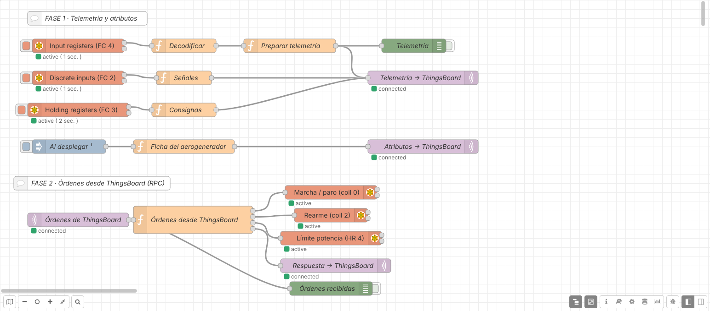
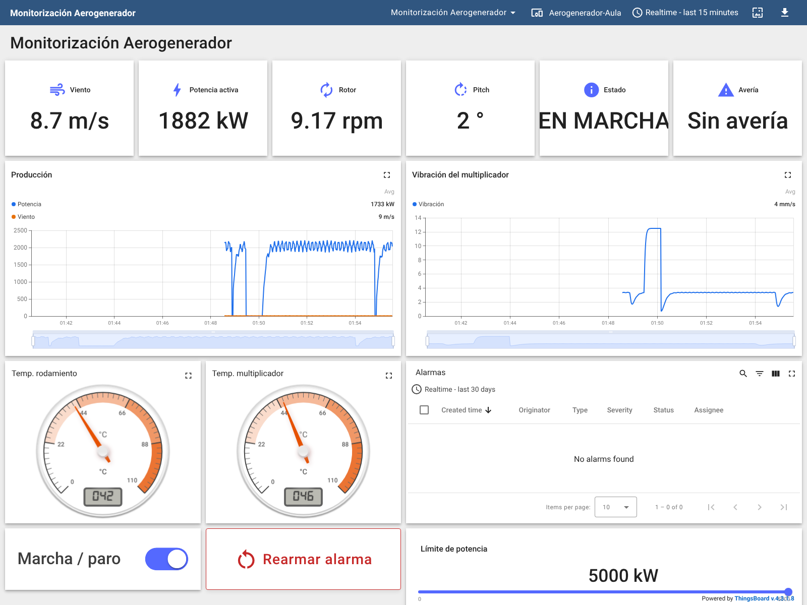

# Práctica: AeroLab con Node-RED y ThingsBoard (Modbus TCP → MQTT → plataforma IIoT)

> Serie **2 · Node-RED + ThingsBoard**. Es la continuación de
> [1-dashboard/aerolab](../../1-dashboard/aerolab/README.md): allí construiste
> un dashboard dentro de Node-RED; aquí Node-RED pasa a ser la **pasarela**
> que lleva los datos a una plataforma IIoT. Flujo resuelto para el
> profesorado: [flows/aerolab-thingsboard-solucion.json](flows/aerolab-thingsboard-solucion.json).
> Panel resuelto: [thingsboard/panel-aerolab.json](thingsboard/panel-aerolab.json).

## Introducción

Al terminar esta práctica, el aerogenerador AeroLab aparecerá en
**ThingsBoard** como un dispositivo más de la empresa: con su histórico
guardado, un panel que cualquiera puede abrir desde el navegador, alarmas
que se crean y se borran solas y, en la Fase 2, mandos para darle órdenes.
No vas a programar desde cero: el código lo tienes preparado en esta guía.

**La cadena que vas a construir:**

1.  **AeroLab** simula un aerogenerador de 5 MW con un servidor
    **Modbus TCP** (puerto `1502`, Unit ID `1`).
2.  **Node-RED** pregunta por los registros cada segundo y los convierte
    a unidades reales. Es la **pasarela** (*edge gateway*).
3.  **MQTT** transporta los datos desde Node-RED hasta ThingsBoard.
4.  **ThingsBoard** guarda el histórico, muestra el panel y vigila las
    alarmas.
5.  **Técnico de mantenimiento** ve el estado desde cualquier sitio y, en
    la Fase 2, envía órdenes que vuelven por el mismo camino.

**¿Qué cambia respecto al dashboard de Node-RED?**

|                          | Dashboard de Node-RED            | ThingsBoard                                   |
|--------------------------|----------------------------------|-----------------------------------------------|
| Dónde viven los datos    | En la memoria de Node-RED        | En una base de datos                          |
| Histórico                | Lo que quepa en la gráfica       | Días o meses, con zoom y medias               |
| Quién lo ve              | Quien abra tu Node-RED           | Usuarios y clientes con su propio acceso      |
| Alarmas                  | Las programas tú con `function`  | Reglas configurables, con avisos y registro   |
| Muchas máquinas          | Un flujo por máquina             | Perfiles: una regla vale para todas           |

**Antes de empezar, comprueba que tienes:**

- [ ] El laboratorio arrancado (`docker compose up -d` o `start_lab.cmd`).
- [ ] Node-RED en `http://localhost:1880`, con la paleta
  `node-red-contrib-modbus` (ya viene instalada en el laboratorio).
- [ ] AeroLab en `http://localhost:8010` con el rotor girando.
- [ ] ThingsBoard en `http://localhost:8080`. Entra con
  `tenant@thingsboard.org` / `tenant` o con la cuenta que te dé el
  profesor.

> En el entorno Docker del laboratorio cada servicio se llama por su
> nombre: AeroLab es `aerolab` y ThingsBoard es `thingsboard`. Si
> trabajas con equipos separados, usa sus IP.

**Cómo habla ThingsBoard por MQTT.** Cada máquina es un **dispositivo**
con un **token de acceso** (*access token*), que funciona como su
contraseña. Node-RED se conecta al MQTT de ThingsBoard usando ese token
como **usuario** y publica en unos *topics* fijos:

| **Topic**                               | **Sentido**              | **Para qué**                                      |
|-----------------------------------------|--------------------------|---------------------------------------------------|
| `v1/devices/me/telemetry`               | Node-RED → ThingsBoard   | Medidas que cambian (se guarda su histórico)      |
| `v1/devices/me/attributes`              | Node-RED → ThingsBoard   | Datos fijos de la máquina (modelo, fabricante…)   |
| `v1/devices/me/rpc/request/+`           | ThingsBoard → Node-RED   | Órdenes enviadas desde un panel (Fase 2)          |
| `v1/devices/me/rpc/response/{id}`       | Node-RED → ThingsBoard   | Respuesta a cada orden (Fase 2)                   |

`me` significa *el dispositivo dueño del token*: no hace falta poner su
nombre en el topic.

La práctica tiene dos fases. En la **Fase 1** solo envías datos a
ThingsBoard y construyes el panel y las alarmas. En la **Fase 2**, solo
cuando la Fase 1 esté clara, das órdenes a la máquina desde ThingsBoard.

## Fase 1 — Del aerogenerador a ThingsBoard (partes 1 a 6)

### Parte 1 — Leer y decodificar los registros

Objetivo: tener en Node-RED los datos del aerogenerador en unidades
reales. Si hiciste la práctica del dashboard, puedes copiar de allí el
**Modbus Read** y el **Decodificar** (selecciónalos, Ctrl+C y Ctrl+V en
una pestaña nueva) y pasar directamente al *Comprueba*.

1.  Crea una pestaña nueva llamada `AeroLab → ThingsBoard`.
2.  Arrastra un nodo **Modbus Read** y crea su servidor (lápiz junto a
    *Server*):
    - **Type:** `TCP`, **Host:** `aerolab`, **Port:** `1502`,
      **Unit-Id:** `1`.
3.  En el **Modbus Read**: **Name** `Input registers (FC 4)`,
    **FC** `FC 4: Read Input Registers`, **Address** `0`,
    **Quantity** `16`, **Poll Rate** cada `1` segundo.
4.  Conecta a su **primera** salida un nodo **function** llamado
    `Decodificar` y pega este código. **No hace falta tocar nada.**

<!-- -->

    // ENTRADA: msg.payload = los 16 input registers (enteros de 0 a 65535)
    // SALIDA:  msg.payload = los datos en unidades reales, agrupados por bloque

    const r = msg.payload;
    if (!Array.isArray(r) || r.length < 16) {
        return null;                      // respuesta incompleta: no seguimos
    }

    const int16  = (v) => v >= 32768 ? v - 65536 : v;  // registros con signo
    const uint32 = (alta, baja) => alta * 65536 + baja; // datos que ocupan 2 registros

    const ESTADOS = ["PARADO", "ARRANCANDO", "EN MARCHA", "FRENANDO", "AVERÍA"];
    const AVERIAS = ["Sin avería", "Sobretemperatura de rodamiento",
                     "Vibración elevada", "Pérdida de red", "Sobrevelocidad"];

    msg.payload = {
        viento: {
            velocidad_mps: r[0] / 10,
            direccion_deg: r[5] / 10
        },
        rotor: {
            rpm:           r[1] / 100,
            pitch_deg:     r[2] / 100,
            yaw_deg:       r[6] / 10,
            generador_rpm: r[10]
        },
        produccion: {
            potencia_kw:   uint32(r[3], r[4]),
            par_nm:        r[11] * 10,
            energia_kwh:   uint32(r[12], r[13]) / 10
        },
        condicion: {
            vibracion_mms:        r[7] / 100,
            temp_rodamiento_c:    int16(r[8]) / 10,
            temp_multiplicador_c: int16(r[9]) / 10
        },
        estado: {
            codigo:        r[14],
            nombre:        ESTADOS[r[14]] ?? "DESCONOCIDO",
            averia_codigo: r[15],
            averia:        AVERIAS[r[15]] ?? "Desconocida"
        }
    };
    return msg;

5.  Pon un **debug** a la salida del **Decodificar** y pulsa **Deploy**.

**Comprueba.** En el panel Debug llega cada segundo un mensaje con los
bloques `viento`, `rotor`, `produccion`, `condicion` y `estado`. Compara
la potencia y el viento con la web de AeroLab.

### Parte 2 — Dar de alta el aerogenerador en ThingsBoard

Objetivo: que ThingsBoard sepa que existe la máquina y darle una
credencial.

1.  En ThingsBoard abre **Entities → Devices** y pulsa **+ → Add new
    device**.
2.  **Name:** `Aerogenerador-Aula`. **Device profile:** `default`. Pulsa
    **Add**.
3.  Abre el dispositivo y pulsa **Copy access token**. También lo ves en
    **Manage credentials** (tipo *Access token*).
4.  Pégalo en un bloc de notas: lo usarás en la Parte 4.

> El token es la **contraseña** del aerogenerador. Quien lo tenga puede
> enviar datos en su nombre. No lo pongas en capturas ni en el JSON que
> entregues, y no lo compartas con otros grupos.

**Comprueba.** En la lista de dispositivos, ¿qué estado muestra
`Aerogenerador-Aula`, *Active* o *Inactive*? ¿Por qué?

### Parte 3 — Preparar la telemetría

ThingsBoard guarda cada dato con un nombre (**clave**) y una hora. El
mensaje decodificado tiene bloques anidados (`produccion.potencia_kw`),
pero ThingsBoard trabaja mejor con **claves planas** (`potencia_kw`).
Además, conviene indicar la hora de la medida.

1.  Conecta a la salida del **Decodificar** un nodo **function** llamado
    `Preparar telemetría` y pega este código:

<!-- -->

    // ENTRADA: el mensaje decodificado (bloques viento, rotor, produccion...)
    // SALIDA:  msg.payload = { ts, values } con claves planas para ThingsBoard

    const p = msg.payload;

    msg.payload = {
        ts: Date.now(),                       // momento de la medida, en milisegundos
        values: {
            viento_mps:           p.viento.velocidad_mps,
            direccion_viento_deg: p.viento.direccion_deg,
            rotor_rpm:            p.rotor.rpm,
            pitch_deg:            p.rotor.pitch_deg,
            yaw_deg:              p.rotor.yaw_deg,
            generador_rpm:        p.rotor.generador_rpm,
            potencia_kw:          p.produccion.potencia_kw,
            par_nm:               p.produccion.par_nm,
            energia_kwh:          p.produccion.energia_kwh,
            vibracion_mms:        p.condicion.vibracion_mms,
            temp_rodamiento_c:    p.condicion.temp_rodamiento_c,
            temp_multiplicador_c: p.condicion.temp_multiplicador_c,
            estado_codigo:        p.estado.codigo,
            estado:               p.estado.nombre,
            averia_codigo:        p.estado.averia_codigo,
            averia:               p.estado.averia
        }
    };
    return msg;

2.  Pon un **debug** a su salida y haz **Deploy**.

Verás un mensaje como este:

    {
      "ts": 1794275402000,
      "values": { "viento_mps": 8.9, "potencia_kw": 2003, "rotor_rpm": 9.12,
                  "vibracion_mms": 3.34, "estado": "EN MARCHA", "averia": "Sin avería", … }
    }

**Comprueba.** ¿Qué es el número de `ts`? (pista: milisegundos desde el
1 de enero de 1970). ¿Por qué es importante que `potencia_kw` sea el
número `2003` y no el texto `"2003 kW"`?

### Parte 4 — Publicar por MQTT en ThingsBoard

1.  Añade un nodo **mqtt out** y conéctalo a la salida del **Preparar
    telemetría**.
2.  Pulsa el lápiz junto a *Server* para crear la conexión:
    - **Name:** `ThingsBoard · Aerogenerador-Aula`
    - **Server:** `thingsboard`. **Port:** `1883`. **Protocol:** MQTT
      V3.1.1.
    - Pestaña **Security**: **Username** = el token de la Parte 2.
      **Password** vacío.
3.  En el **mqtt out**: **Topic** `v1/devices/me/telemetry`, **QoS** `1`,
    **Retain** `false`.
4.  **Deploy**. Debajo del **mqtt out** debe aparecer **connected**.
5.  En ThingsBoard abre el dispositivo → pestaña **Latest telemetry**.
    Deben aparecer 16 claves que se actualizan cada segundo, y el
    dispositivo pasa a **Active**.

**Señales sí / no (FC 2).** Añade un segundo **Modbus Read** con el
mismo servidor: **FC** `FC 2: Read Input Status`, **Address** `0`,
**Quantity** `5`, cada `1` segundo. Conecta su primera salida a un
**function** `Señales` con este código y su salida **al mismo mqtt out**:

    // ENTRADA: los 5 discrete inputs (true / false)
    // SALIDA:  msg.payload = las señales con nombre (ThingsBoard pone la hora)

    const s = msg.payload;
    if (!Array.isArray(s) || s.length < 5) {
        return null;
    }
    msg.payload = {
        preparado:     s[0],
        en_marcha:     s[1],
        alarma:        s[2],
        conectado_red: s[3],
        viento_valido: s[4]
    };
    return msg;

Este mensaje no lleva `ts`: cuando falta, ThingsBoard usa la hora a la
que lo recibe.

**Comprueba.**

1.  ¿Cuántas claves hay ahora en *Latest telemetry*?
2.  Cambia una letra del token en Node-RED y haz Deploy. ¿Qué estado
    muestra el **mqtt out**? Vuelve a poner el token correcto.
3.  Compara tres valores de ThingsBoard con la web de AeroLab. ¿Cuánto
    retraso hay?

### Parte 5 — Atributos: la ficha de la máquina

La **telemetría** cambia continuamente y ThingsBoard guarda su
histórico. Los **atributos** son datos que casi nunca cambian (modelo,
potencia nominal…) y de los que solo interesa el último valor.

1.  Añade un nodo **inject** llamado `Al desplegar` y marca **Inject
    once after** `1` second.
2.  Conéctalo a un **function** `Ficha del aerogenerador` con este
    código:

<!-- -->

    // SALIDA: msg.payload = datos fijos del aerogenerador (atributos de cliente)

    msg.payload = {
        fabricante:          "AeroLab",
        modelo:              "AL-5000",
        potencia_nominal_kw: 5000,
        cut_in_mps:          3,
        cut_out_mps:         25,
        protocolo:           "Modbus TCP",
        unit_id:             1
    };
    return msg;

3.  Conecta la salida a otro **mqtt out** con **el mismo servidor** y
    **Topic** `v1/devices/me/attributes`.
4.  **Deploy** y en ThingsBoard abre el dispositivo → **Attributes** →
    **Client attributes**.

| **Dato**              | **¿Telemetría o atributo?** | **¿Por qué?** |
|-----------------------|-----------------------------|---------------|
| Potencia activa       |                             |               |
| Modelo                |                             |               |
| Temperatura rodamiento|                             |               |
| Potencia nominal      |                             |               |

**Comprueba.** Completa la tabla. ¿Qué pasaría con la base de datos si
enviaras el modelo como telemetría cada segundo durante un año?

Así queda el flujo de la Fase 1 (los nodos de la Fase 2 aparecen en la
parte inferior):

*Flujo resuelto en Node-RED (captura real del laboratorio).*

### Parte 6 — Primer panel en ThingsBoard

1.  Abre **Dashboards** y pulsa **+ → Create new dashboard**. Título:
    `Monitorización Aerogenerador`. Ábrelo.
2.  Pulsa **Edit mode** y después el icono de **Entity aliases**. Crea
    un alias:
    - **Alias name:** `Aerogenerador`
    - **Filter type:** `Single entity`, **Type** `Device`, dispositivo
      `Aerogenerador-Aula`.
3.  Pulsa **Add widget** y elige el paquete **Cards → Value card**. En
    *Datasource* elige el alias `Aerogenerador` y la clave de la tabla.
    Repite para cada dato:

| **Dato**        | **Clave**     | **Unidad** | **Widget**               |
|-----------------|---------------|------------|--------------------------|
| Viento          | `viento_mps`  | m/s        | Value card               |
| Potencia activa | `potencia_kw` | kW         | Value card               |
| Rotor           | `rotor_rpm`   | rpm        | Value card               |
| Pitch           | `pitch_deg`   | °          | Value card               |
| Estado          | `estado`      | —          | Value card               |
| Avería          | `averia`      | —          | Value card               |

4.  Coloca las seis tarjetas en una fila y pulsa **Save** (arriba a la
    derecha).

**Comprueba.** Pide a un compañero que abra tu panel desde **su**
navegador con tu usuario. ¿Ve lo mismo que tú? ¿Podría hacerlo con el
dashboard de Node-RED de la serie 1?

## Fase 1 — Histórico, alarmas y comunicación (partes 7 a 10)

### Parte 7 — Histórico

Objetivo: aprovechar que ThingsBoard **guarda** los datos.

1.  En modo edición añade **Charts → Time series chart** con las claves
    `potencia_kw` y `viento_mps`. Título `Producción`.
2.  Añade otro **Time series chart** con `vibracion_mms`. Título
    `Vibración del multiplicador`.
3.  Añade dos **Analogue gauges → Radial gauge** para
    `temp_rodamiento_c` y `temp_multiplicador_c` (0–110 °C).
4.  Arriba, en la ventana de tiempo, elige **Realtime → last 15
    minutes**. **Save**.
5.  En la web de AeroLab mueve el viento a 5 m/s, después a 12 m/s y
    después a 15 m/s, un minuto cada vez. Vuelve a 9 m/s.

> Potencia (miles de kW) y viento (decenas de m/s) tienen escalas muy
> distintas: en la misma gráfica el viento parece una línea plana. Puedes
> ponerlos en gráficas separadas o darle al viento un segundo eje Y en
> los ajustes de la clave.

**Comprueba.** Cierra el navegador y vuelve a abrir el panel. ¿Sigue ahí
la curva? Cambia la ventana a **last 1 hour** y activa la agregación
**Average**: ¿qué pasa con los picos? Mide en la gráfica cuántos segundos
tarda el rotor en adaptarse a cada cambio de viento.

### Parte 8 — Simular una incidencia

1.  En la web de AeroLab, panel *Control de operación*, elige la avería
    **Vibración elevada**.
2.  Observa el panel 1–2 minutos. Después vuelve a **Sin avería**.
3.  Con el zoom de la gráfica (arrastra sobre ella) localiza los
    instantes exactos.

| **Variable**              | **Antes** | **Durante la avería** | **Hora del cambio** |
|---------------------------|-----------|-----------------------|---------------------|
| Vibración (mm/s)          |           |                       |                     |
| Velocidad del rotor (rpm) |           |                       |                     |
| Potencia activa (kW)      |           |                       |                     |
| Estado                    |           |                       |                     |

**Preguntas:** ¿qué cambió primero? ¿Cuántos segundos pasan entre que
sube la vibración y la máquina empieza a frenar? ¿Habrías podido medirlo
con el gauge?

### Parte 9 — Regla de alarma

En la serie 1 programaste la alarma con un nodo **function**. En
ThingsBoard se **configura** con una regla, sin código, y queda
registrada con su hora de inicio, fin y quién la atendió.

1.  Abre el dispositivo `Aerogenerador-Aula` → pestaña **Alarm rules** →
    **+ → Create new alarm rule**.
2.  **Alarm type:** `Vibración elevada`.
3.  **Arguments → Add argument:** nombre `vibracion_mms`, tipo **Latest
    telemetry**, clave `vibracion_mms`.
4.  **Trigger conditions → Add trigger condition:**
    - **Severity:** `Major`
    - Condición: `vibracion_mms` **greater than** `7`
    - **Condition type:** `Duration`, `5` seconds.
5.  **Clear condition → Add clear condition:** `vibracion_mms` **less
    than** `6` durante `5` seconds.
6.  Pulsa **Add**.
7.  En el panel añade **Alarm widgets → Alarms table** con el alias
    `Aerogenerador`.
8.  En AeroLab inyecta **Vibración elevada**, espera a que salte la
    alarma (verás también la campana de notificaciones) y vuelve a
    **Sin avería**.

**Comprueba.**

1.  ¿Cuánto tarda en aparecer la alarma? ¿Y en borrarse (*Cleared*)?
2.  ¿Para qué sirve exigir que la condición dure 5 segundos?
3.  ¿Por qué se borra por debajo de **6** y no de **7**? (pista: piensa
    en un valor que oscila entre 6,9 y 7,1).
4.  Pulsa **Acknowledge** sobre una alarma. ¿Qué información guarda
    ThingsBoard que no tenía tu alarma de la serie 1?

> **Ampliación.** Crea otra regla `Sobretemperatura rodamiento` con dos
> condiciones de disparo: **Major** si `temp_rodamiento_c > 70` y
> **Critical** si `temp_rodamiento_c > 85`. Pruébala con la avería
> **Sobretemperatura de rodamiento** (tarda un par de minutos).

### Parte 10 — Detectar que el aerogenerador ha dejado de responder

Si Node-RED deja de enviar datos, el panel se queda con el último valor
y parece que todo va bien. ThingsBoard puede detectarlo: si un
dispositivo no envía nada durante un tiempo, lo marca como **inactivo**.

1.  Abre el dispositivo → **Attributes** → **Server attributes** → **+**.
    Clave `inactivityTimeout`, tipo **Integer**, valor `30000` (30 s en
    milisegundos).
2.  Crea una regla de alarma `Sin comunicación`:
    - **Argument:** nombre `active`, tipo **Attribute**, *scope*
      **Server attributes**, clave `active`.
    - **Trigger condition:** **Critical**, `active` **equal** `false`.
    - **Clear condition:** `active` **equal** `true`.
3.  Corta la comunicación: en Node-RED abre los nodos **Modbus Read**,
    pulsa el botón **Enabled** (abajo a la izquierda) para dejarlos en
    *Disabled* y haz **Deploy**. (También puedes pedir al profesor que
    pare AeroLab.)
4.  Espera entre 30 s y 1 minuto. Vuelve a activar los nodos.

**Comprueba.** ¿Cuánto tardó en aparecer la alarma? En la serie 1 lo
resolviste con un nodo **trigger**: ¿qué ventaja tiene que lo vigile la
plataforma y no la propia pasarela? (pista: ¿qué pasa si lo que se
cuelga es el Node-RED?).

Así queda el panel al terminar la Fase 1 (los mandos de abajo son de la
Fase 2):

*Panel resuelto en ThingsBoard (captura real del laboratorio).*

## Fase 2 — Dar órdenes desde ThingsBoard (partes 11 a 13)

Empieza esta fase solo cuando la Fase 1 funcione. Antes de tocar nada,
**guarda una copia**: exporta el flujo (*Menu → Export*) o crea un
snapshot en la web de copias del laboratorio (`http://localhost:8090`).

**Cómo llega una orden.** En ThingsBoard las órdenes se llaman **RPC**
(*Remote Procedure Call*): un widget del panel envía un **método** con
unos **parámetros**, ThingsBoard lo publica en
`v1/devices/me/rpc/request/<número>` y espera una respuesta en
`v1/devices/me/rpc/response/<número>`. Node-RED traduce cada orden a una
escritura Modbus:

| **Método**  | **Parámetros**      | **Qué hace en AeroLab**       | **Escritura Modbus**       |
|-------------|---------------------|-------------------------------|----------------------------|
| `setMarcha` | `true` / `false`    | Marcha o paro                 | Coil 0, FC 5               |
| `rearmar`   | ninguno             | Rearme de alarma              | Coil 2, FC 5               |
| `setLimite` | número (0–5000)     | Límite de potencia, en kW     | Holding register 4, FC 6   |

> En una máquina real, una orden desde un panel web puede parar una
> instalación o poner en riesgo a una persona que esté trabajando en
> ella. Hacen falta usuarios con permisos, confirmación y registro de
> quién hizo qué. Aquí trabajamos con un simulador.

### Parte 11 — Leer las consignas (FC 3)

Antes de escribir conviene **leer** qué tiene guardado la máquina, para
poder comprobar después que la orden se ha cumplido.

1.  Añade un tercer **Modbus Read**: **FC** `FC 3: Read Holding
    Registers`, **Address** `0`, **Quantity** `8`, cada `2` segundos.
2.  Conéctalo a un **function** `Consignas` con este código y su salida
    al **mqtt out** de telemetría:

<!-- -->

    // ENTRADA: los 8 holding registers (consignas guardadas en la máquina)
    // SALIDA:  msg.payload = las consignas que interesan en ThingsBoard

    const h = msg.payload;
    if (!Array.isArray(h) || h.length < 8) {
        return null;
    }
    msg.payload = {
        limite_kw:        h[4],
        averia_inyectada: h[5]
    };
    return msg;

**Comprueba.** En *Latest telemetry* aparecen `limite_kw` y
`averia_inyectada`. Cambia la avería desde la web de AeroLab: ¿cambia
`averia_inyectada`?

### Parte 12 — Recibir órdenes en Node-RED

1.  Añade un nodo **mqtt in** con **el mismo servidor** de ThingsBoard:
    - **Topic:** `v1/devices/me/rpc/request/+`, **QoS** `1`.
    - **Output:** *a parsed JSON object*.
2.  Conecta un **debug** (*Output:* **complete msg object**) y un
    **function** llamado `Órdenes desde ThingsBoard`. En la pestaña
    *Setup* pon **Outputs: 4** y pega este código:

<!-- -->

    // ENTRADA: una orden (petición RPC) enviada desde un panel de ThingsBoard
    //   msg.topic   = "v1/devices/me/rpc/request/15"     (15 = número de petición)
    //   msg.payload = { "method": "setLimite", "params": 3000 }
    // SALIDAS: 1 marcha/paro (coil 0) · 2 rearme (coil 2)
    //          3 límite de potencia (holding register 4) · 4 respuesta a ThingsBoard

    const id     = msg.topic.split("/").pop();
    const metodo = msg.payload.method;
    const valor  = msg.payload.params;

    function respuesta(datos) {
        return { topic: "v1/devices/me/rpc/response/" + id, payload: datos };
    }

    if (metodo === "setMarcha") {
        const marcha = valor === true || valor === "true";
        return [{ payload: marcha }, null, null, respuesta({ ok: true, marcha: marcha })];
    }
    if (metodo === "rearmar") {
        return [null, { payload: true }, null, respuesta({ ok: true })];
    }
    if (metodo === "setLimite") {
        const kw = Math.round(Number(valor));
        if (!Number.isFinite(kw) || kw < 0 || kw > 5000) {
            return [null, null, null, respuesta({ ok: false, error: "Límite fuera de rango (0-5000 kW)" })];
        }
        return [null, null, { payload: kw }, respuesta({ ok: true, limite_kw: kw })];
    }
    return [null, null, null, respuesta({ ok: false, error: "Orden desconocida: " + metodo })];

3.  Conecta las salidas:
    - Salida 1 → **Modbus Write**: **FC** `FC 5: Force Single Coil`,
      **Address** `0`, **Quantity** `1`.
    - Salida 2 → **Modbus Write**: **FC 5**, **Address** `2`.
    - Salida 3 → **Modbus Write**: **FC** `FC 6: Preset Single
      Register`, **Address** `4`, **Quantity** `1`.
    - Salida 4 → un **mqtt out** con el servidor de ThingsBoard y el
      **Topic vacío** (así usa el `msg.topic` que prepara el código).
4.  **Deploy**.
5.  Prueba sin panel: en ThingsBoard añade a tu panel el widget
    **Control widgets → RPC debug terminal** (alias `Aerogenerador`) y
    escribe:
    - `setLimite 3000`
    - `setLimite 9000` (debe responder con un error)
    - `setMarcha false` y después `setMarcha true`

> Si el terminal responde *timeout*, abre sus ajustes y sube el tiempo
> de espera de la petición a `5000` ms.

**Comprueba.** Mira el debug: ¿qué número de petición trae `msg.topic`?
¿Qué responde Node-RED a `setLimite 9000`? ¿Qué valor de `limite_kw`
aparece en ThingsBoard tras `setLimite 3000`?

### Parte 13 — Mandos en el panel (ampliación final)

1.  En el panel, modo edición, añade **Control widgets → Single Switch**
    con *Target device* el alias `Aerogenerador`:
    - **Label:** `Marcha / paro`.
    - **Initial state:** *Get time series* → clave `en_marcha`.
    - **Turn ON:** *Execute RPC*, método `setMarcha`, valor
      (*Constant*) `true`.
    - **Turn OFF:** *Execute RPC*, método `setMarcha`, valor
      (*Constant*) `false`.
2.  Añade **Control widgets → Command button**: etiqueta
    `Rearmar alarma`, **On click:** *Execute RPC*, método `rearmar`.
3.  Añade **Control widgets → Slider**: título `Límite de potencia`,
    mínimo `0`, máximo `5000`, unidades `kW`:
    - **Initial state:** *Get time series* → clave `limite_kw`.
    - **Value change:** *Execute RPC*, método `setLimite`, valor
      (*Value*).
4.  **Save** y prueba los tres mandos. En AeroLab sube el viento a
    12 m/s y completa la tabla:

| **Límite enviado (kW)** | **`limite_kw` leído (FC 3)** | **Potencia (kW)** | **Rotor (rpm)** |
|-------------------------|------------------------------|-------------------|-----------------|
| 5000                    |                              |                   |                 |
| 3000                    |                              |                   |                 |
| 1000                    |                              |                   |                 |

Al terminar, deja el límite en **5000** y el viento en 9 m/s.

**Comprueba.** El interruptor lee su estado de `en_marcha`. Si pulsas
*paro*, ¿cuándo cambia exactamente el interruptor: al pulsar o cuando
llega la lectura de la máquina? ¿Por qué es mejor así? ¿Qué pasa si
alguien vuelve a arrancar la máquina desde la web de AeroLab?

No se trata de construir un SCADA completo, sino de ver la idea de
**supervisión y mando remotos**: leer, decidir, ordenar y comprobar que
la orden se ha cumplido, todo a través de la plataforma.

## Cierre y entrega

> Una plataforma IIoT no solo muestra datos: los guarda, avisa cuando
> algo va mal aunque nadie esté mirando y permite actuar a distancia con
> control de quién hace qué.

**Qué entregar:**

- [ ] Flujo de Node-RED exportado en JSON (*Menu → Export → all flows*).
  **Comprueba que no contiene el token.**
- [ ] Panel de ThingsBoard exportado (en el panel, icono de **Export**).
- [ ] Captura de *Latest telemetry* del dispositivo.
- [ ] Captura del panel durante la avería de vibración, con la gráfica y
  la alarma visibles.
- [ ] Tablas de las partes 5, 8 y 13 completadas.
- [ ] Respuestas a las preguntas finales.

> También puedes entregar un **snapshot** del laboratorio: en
> `http://localhost:8090` crea uno con Node-RED y ThingsBoard y
> descárgalo. Contiene tus flujos, el dispositivo, las alarmas y el panel.
> Ojo: dentro va el token del dispositivo.

**Preguntas finales:**

1.  Dibuja el camino de un dato desde el registro Modbus hasta el panel
    de ThingsBoard. Indica protocolo y puerto en cada tramo.
2.  ¿Qué diferencia hay entre telemetría y atributo? Pon dos ejemplos de
    cada uno en el aerogenerador.
3.  ¿Por qué Node-RED no envía los 16 registros en crudo a ThingsBoard y
    deja que la plataforma los convierta?
4.  ¿Qué ventajas tiene que la alarma la calcule ThingsBoard? ¿Y qué
    ventaja tendría calcularla en Node-RED?
5.  Si ThingsBoard deja de funcionar 10 minutos, ¿qué datos se pierden?
    ¿Cómo lo evitarías? (pista: *buffer* en la pasarela).
6.  ¿Qué controles añadirías antes de permitir órdenes desde la nube en
    una máquina real?

**Si algo no funciona:**

| **Síntoma**                                              | **Causa probable**                              | **Qué hacer**                                                                       |
|----------------------------------------------------------|-------------------------------------------------|-------------------------------------------------------------------------------------|
| El **mqtt out** se queda en *connecting*                 | Host o puerto mal                               | **Server** `thingsboard`, **Port** `1883` (dentro de Docker)                        |
| Pasa a *disconnected* enseguida                          | Token mal copiado                               | Vuelve a copiarlo con **Copy access token**; va en **Username**, no en Password     |
| *Latest telemetry* vacío pero el nodo está *connected*   | Topic mal escrito                               | Exactamente `v1/devices/me/telemetry`                                               |
| Las claves salen como `produccion.potencia_kw` o `[object Object]` | Se envió el mensaje sin aplanar        | El **mqtt out** tiene que colgar del **Preparar telemetría**                        |
| Los números salen con comillas en ThingsBoard            | Se enviaron como texto                          | No añadas unidades al valor; las unidades se ponen en el widget                     |
| La gráfica dibuja escalones o huecos                     | Agregación o ventana de tiempo                  | Ventana *Realtime*, agregación *None* o intervalo pequeño                           |
| La alarma no salta                                       | Argumento con otra clave o sin *Duration*       | El argumento debe usar la clave exacta (`vibracion_mms`)                            |
| La alarma no se borra                                    | Falta la *Clear condition*                      | Añade la condición de borrado                                                       |
| El terminal RPC da *timeout*                             | Falta el **mqtt in** o no está en el mismo servidor | Topic `v1/devices/me/rpc/request/+` en el **mismo** broker de ThingsBoard        |
| La orden responde pero la máquina no cambia              | FC, dirección o tipo de valor                   | Coil con FC 5 y `true`/`false`; registro con FC 6 y un número                        |
