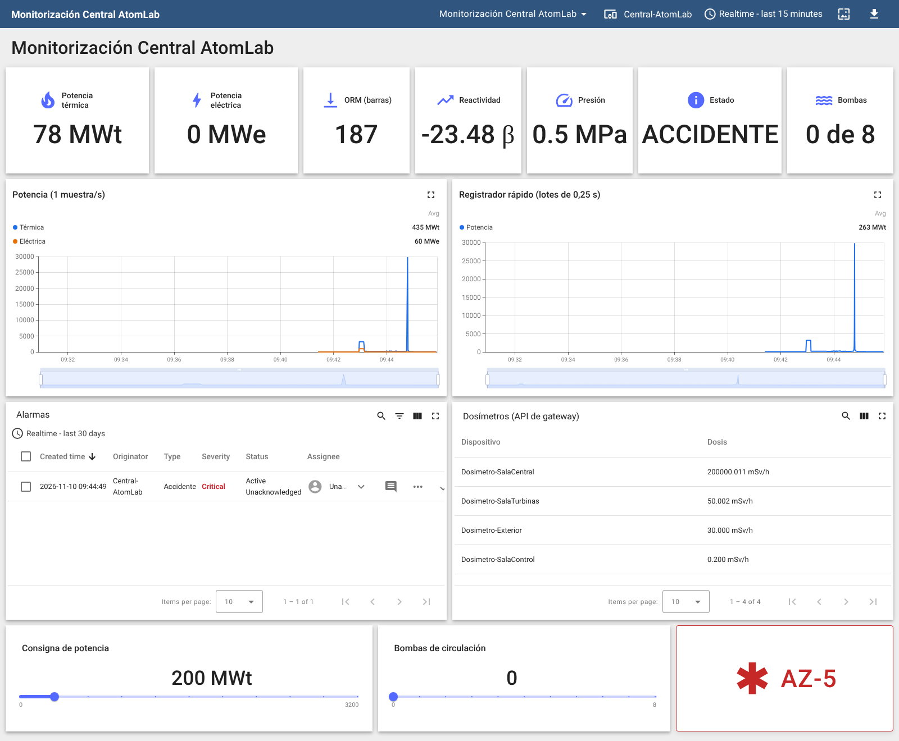
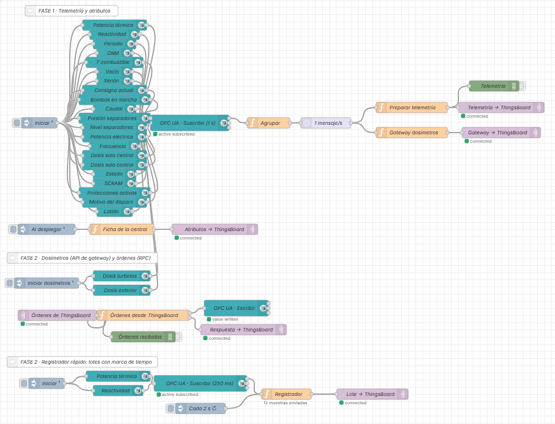

# Práctica: AtomLab con Node-RED y ThingsBoard (OPC UA → MQTT → plataforma IIoT)

> Serie **2 · Node-RED + ThingsBoard**. Es la continuación de
> [1-dashboard/atomlab](../../1-dashboard/atomlab/README.md): allí
> construiste la vigilancia dentro de Node-RED; aquí Node-RED pasa a ser
> la **pasarela** que lleva los datos de la central a una plataforma IIoT.
> Flujo resuelto para el profesorado:
> [flows/atomlab-thingsboard-solucion.json](flows/atomlab-thingsboard-solucion.json).
> Panel resuelto: [thingsboard/panel-atomlab.json](thingsboard/panel-atomlab.json).

## Introducción

Al terminar esta práctica, la central AtomLab aparecerá en
**ThingsBoard** como un dispositivo, con cuatro **dosímetros** como
dispositivos propios: histórico guardado, un panel accesible desde
cualquier navegador, alarmas que se crean y se borran solas, órdenes
desde el panel y un **registrador rápido** que guarda el accidente con la
hora exacta de cada muestra. No vas a programar desde cero: el código lo
tienes preparado en esta guía.

**La cadena que vas a construir:**

1.  **AtomLab** simula una central RBMK-1000 con un servidor **OPC UA**
    (puerto `4842`).
2.  **Node-RED** se suscribe a las variables, las junta y las adapta. Es
    la **pasarela** (*edge gateway*).
3.  **MQTT** transporta los datos desde Node-RED hasta ThingsBoard.
4.  **ThingsBoard** guarda el histórico, muestra el panel y vigila las
    alarmas.
5.  **Jefe de turno** ve la central desde cualquier sitio y, en la Fase
    2, envía órdenes.

**¿Qué cambia respecto al dashboard de Node-RED?**

| | Dashboard de Node-RED | ThingsBoard |
|---|---|---|
| Dónde viven los datos | En la memoria de Node-RED | En una base de datos |
| Histórico | Lo que quepa en la gráfica | Días o meses, con zoom y medias |
| Quién lo ve | Quien abra tu Node-RED | Usuarios con su propio acceso |
| Alarmas | Las programas tú con `function` | Reglas configurables, con registro |
| Dosímetros | Números dentro de un mensaje | Un dispositivo por dosímetro y reglas por perfil |

**Antes de empezar, comprueba que tienes:**

- [ ] El laboratorio arrancado (`docker compose up -d` o `start_lab.cmd`).
- [ ] Node-RED en `http://localhost:1880` con `node-red-contrib-opcua`.
- [ ] AtomLab en `http://localhost:8040` en estado **OPERACION**.
- [ ] ThingsBoard en `http://localhost:8080`. Entra con
  `tenant@thingsboard.org` / `tenant` o con la cuenta que te dé el
  profesor.

> En el entorno Docker cada servicio se llama por su nombre: AtomLab es
> `atomlab` (endpoint `opc.tcp://atomlab:4842/atomlab/`) y ThingsBoard es
> `thingsboard`.

**Cómo habla ThingsBoard por MQTT.** La central será un **dispositivo**
con un **token de acceso**, que funciona como su contraseña. Node-RED se
conecta al MQTT de ThingsBoard usando ese token como **usuario** y
publica en topics fijos:

| **Topic** | **Sentido** | **Para qué** |
|---|---|---|
| `v1/devices/me/telemetry` | Node-RED → ThingsBoard | Medidas que cambian (se guarda su histórico) |
| `v1/devices/me/attributes` | Node-RED → ThingsBoard | Datos fijos de la central |
| `v1/gateway/...` | Node-RED → ThingsBoard | Datos de varios equipos por una conexión (Fase 2) |
| `v1/devices/me/rpc/request/+` | ThingsBoard → Node-RED | Órdenes desde un panel (Fase 2) |
| `v1/devices/me/rpc/response/{id}` | Node-RED → ThingsBoard | Respuesta a cada orden (Fase 2) |

`me` significa *el dispositivo dueño del token*.

## Fase 1 — De la central a ThingsBoard (partes 1 a 6)

### Parte 1 — Suscribirse a la central y agrupar

Si hiciste la práctica del dashboard, copia de allí el **inject**, los
**OpcUa-Item**, el **OpcUa-Client**, el **Agrupar** y el **delay**
(Ctrl+C y Ctrl+V en una pestaña nueva) y pasa al *Comprueba*.

1.  Pestaña nueva `AtomLab → ThingsBoard`.
2.  **inject** `Iniciar` con **Inject once after** `2` seconds.
3.  Un **OpcUa-Item** por variable, todos colgando del **inject**. Son
    los 21 de la serie 1 (tabla de la Parte 1 de
    [1-dashboard/atomlab](../../1-dashboard/atomlab/README.md)),
    **incluido** `ns=2;s=Servidor.Latido` (Int32).
4.  Todos a un **OpcUa-Client**: **Endpoint**
    `opc.tcp://atomlab:4842/atomlab/`, *Security* `None`, **Action**
    `SUBSCRIBE`, `1` segundo.
5.  A su salida, un **function** `Agrupar`:

<!-- -->

    // ENTRADA: un mensaje por variable (msg.topic = NodeId, msg.payload = valor)
    // SALIDA:  msg.payload = todas las variables recibidas, agrupadas por sistema

    if (!String(msg.topic).startsWith("ns=")) {
        return null;          // avisos del propio cliente (p. ej. subscriptionId): no son datos
    }
    let valor = msg.payload;
    // algunas versiones envían el valor dentro de { value: ... }
    while (valor !== null && typeof valor === "object" && "value" in valor) {
        valor = valor.value;
    }
    if (typeof valor === "number") {
        valor = Math.round(valor * 1000) / 1000;      // 3 decimales
    }

    // "ns=2;s=Reactor.PotenciaTermica"  →  ["Reactor", "PotenciaTermica"]
    const partes = String(msg.topic).split("s=").pop().split(".");
    const variable = partes.pop();

    const central = flow.get("central") || {};
    let sitio = central;
    for (const p of partes) {                         // crea Reactor, CircuitoPrimario...
        sitio[p] = sitio[p] || {};
        sitio = sitio[p];
    }
    sitio[variable] = valor;
    central.timestamp = new Date().toISOString();
    flow.set("central", central);

    msg.payload = central;
    return msg;

6.  Un **delay** *Rate Limit* `1` msg/s, **drop intermediate messages**,
    y un **debug** a su salida. **Deploy**.

**Comprueba.** En el debug llega cada segundo un objeto con `Reactor`,
`CircuitoPrimario`, `Generador`, `Radiacion`, `Proteccion` y `Servidor`.

### Parte 2 — Crear el dispositivo

1.  En ThingsBoard: **Entities → Devices → + → Add new device**.
    **Name** `Central-AtomLab`. **Add**.
2.  Abre el dispositivo y pulsa **Copy access token**. Guárdalo: lo
    necesitas en la Parte 4.

> El token es la **contraseña** del dispositivo: no lo publiques ni lo
> dejes en un flujo que vayas a compartir.

### Parte 3 — Preparar la telemetría

ThingsBoard trabaja con claves **planas** (`potencia_mwt`, no
`Reactor.PotenciaTermica`). Conecta al **delay** un **function**
`Preparar telemetría`:

    // ENTRADA: el estado de la central agrupado por sistema
    // SALIDA:  msg.payload = { ts, values } con claves planas para ThingsBoard

    const r = msg.payload.Reactor || {};
    const c = msg.payload.CircuitoPrimario || {};
    const g = msg.payload.Generador || {};
    const rad = msg.payload.Radiacion || {};
    const pr = msg.payload.Proteccion || {};

    msg.payload = {
        ts: Date.now(),
        values: {
            potencia_mwt:      r.PotenciaTermica,
            reactividad_beta:  r.Reactividad,
            periodo_s:         r.Periodo,
            orm_barras:        r.ORM,
            t_combustible_c:   r.TempCombustible,
            vacio_pct:         r.Vacio,
            xenon_rel:         r.Xenon,
            consigna_mwt:      r.ConsignaActual,
            bombas:            c.BombasEnMarcha,
            caudal_kgs:        c.Caudal,
            presion_mpa:       c.Presion,
            nivel_pct:         c.NivelSeparadores,
            potencia_mwe:      g.PotenciaElectrica,
            frecuencia_hz:     g.Frecuencia,
            dosis_central_msvh: rad.SalaCentral,
            estado:            pr.Estado,
            scram:             pr.Scram,
            protecciones:      pr.ProteccionesActivas
        }
    };
    return msg;

**Comprueba.** ¿Por qué se envía `ts` (la hora) en lugar de dejar que la
ponga ThingsBoard? ¿Qué variables de la Parte 1 **no** se envían? ¿Por
qué no hace falta guardar el histórico del **Latido**?

### Parte 4 — Publicar por MQTT en ThingsBoard

1.  **mqtt out** conectado al **Preparar telemetría**. Crea su servidor:
    - **Name:** `ThingsBoard · Central-AtomLab`
    - **Server:** `thingsboard`. **Port:** `1883`. MQTT V3.1.1.
    - Pestaña **Security**: **Username** = el token. **Password** vacío.
2.  **Topic** `v1/devices/me/telemetry`, **QoS** `1`.
3.  **Deploy**. Bajo el nodo aparece **connected**.
4.  En ThingsBoard abre `Central-AtomLab` → **Latest telemetry**: deben
    aparecer 18 claves y el dispositivo pasa a **Active**.

**Comprueba.** Compara potencia térmica, eléctrica y ORM con la web de
AtomLab. Cambia una letra del token y haz Deploy: ¿qué pasa? Vuelve a
ponerlo bien.

### Parte 5 — Atributos: la ficha de la central

1.  **inject** `Al desplegar` (once after 1 s) → **function** `Ficha de
    la central`:

<!-- -->

    // SALIDA: atributos de cliente (datos que casi no cambian)

    msg.payload = {
        tipo_reactor:        "RBMK-1000",
        potencia_nominal_mwt: 3200,
        potencia_nominal_mwe: 1000,
        moderador:           "grafito",
        refrigerante:        "agua ligera en ebullición (circuito único)",
        endpoint_opcua:      "opc.tcp://atomlab:4842/atomlab/",
        pasarela:            "Node-RED"
    };
    return msg;

2.  Su salida a otro **mqtt out** con **el mismo servidor** y topic
    `v1/devices/me/attributes`.
3.  **Deploy** → `Central-AtomLab` → **Attributes** → **Client
    attributes**.

| **Dato** | **¿Telemetría o atributo?** | **¿Por qué?** |
|---|---|---|
| Potencia térmica | | |
| Potencia nominal | | |
| Xenón | | |
| Tipo de reactor | | |

### Parte 6 — Primer panel

1.  **Dashboards → + → Create new dashboard**: `Monitorización Central
    AtomLab`.
2.  **Edit mode → Entity aliases**: alias `Central`, *Filter type*
    **Single entity**, *Device* `Central-AtomLab`.
3.  **Add widget → Cards → Value card** por dato:

| **Dato** | **Clave** | **Unidad** |
|---|---|---|
| Potencia térmica | `potencia_mwt` | MWt |
| Potencia eléctrica | `potencia_mwe` | MWe |
| ORM | `orm_barras` | barras |
| Reactividad | `reactividad_beta` | β |
| Presión | `presion_mpa` | MPa |
| Estado | `estado` | |
| Bombas | `bombas` | de 8 |

4.  **Save**.

**Comprueba.** ¿Podría el jefe de turno ver tu panel desde su casa? ¿Y
el dashboard de la serie 1?

## Fase 1 — Histórico, alarmas y comunicación (partes 7 a 10)

### Parte 7 — Histórico

1.  **Charts → Time series chart** con `potencia_mwt` y
    `potencia_mwe`, ventana **Realtime → last 15 minutes**.
2.  En AtomLab baja la consigna a `1600` MWt (**Fijar**) y, cuando
    llegue, vuelve a `3200`.

**Comprueba.** ¿Baja igual la potencia eléctrica que la térmica? Calcula
el **rendimiento** (MWe / MWt) a 3200 y a 1600 MWt. Cierra el navegador
y vuelve a abrir el panel: ¿sigue ahí la curva?

### Parte 8 — Simular una incidencia

1.  En AtomLab quita dos bombas (de 6 a 4) y, 1 minuto después, pulsa
    **Disparar** en la turbina.
2.  Mira el panel y anota:

| **Variable** | **Antes** | **4 bombas** | **Turbina disparada** | **Hora** |
|---|---|---|---|---|
| Potencia térmica (MWt) | | | | |
| Potencia eléctrica (MWe) | | | | |
| Presión (MPa) | | | | |
| Estado | | | | |

3.  Vuelve a *Escenario → Plena potencia* en AtomLab.

**Preguntas:** ¿qué disparó el reactor? ¿Lo puedes saber solo con este
panel? ¿Qué clave añadirías a la telemetría para saberlo? (Pista: está
en la carpeta `Proteccion`.)

### Parte 9 — Reglas de alarma

En la serie 1 programaste la alarma del ORM con un **function**. En
ThingsBoard se **configura**, sin código, y queda registrada.

1.  `Central-AtomLab` → pestaña **Alarm rules** → **+ → Create new alarm
    rule**. **Alarm type:** `ORM bajo`.
2.  **Arguments:** `orm` (**Latest telemetry**, clave `orm_barras`) y
    `estado` (**Latest telemetry**, clave `estado`).
3.  **Trigger condition:** **Major**; `orm` **less than** `15` **y**
    `estado` **equal** `OPERACION` (texto); *Condition type* **Duration**
    `5` seconds.
4.  **Clear condition:** `orm` **greater or equal** `15`. **Add**.
5.  Crea otra regla `Accidente`: argumento `estado`; **Critical** si
    `estado` **equal** `ACCIDENTE`; se borra si **not equal**.
6.  En el panel: **Alarm widgets → Alarms table** con el alias `Central`.

**Comprueba.**

1.  ¿Por qué la regla del ORM exige además `estado = OPERACION`? (Pista:
    tras un SCRAM todas las barras están dentro; ¿y con la central
    parada?)
2.  ¿Para qué sirve la duración de 5 segundos?
3.  Las dos alarmas las probarás «de verdad» en la Parte 13.

### Parte 10 — Detectar que la central ha dejado de responder

1.  `Central-AtomLab` → **Attributes** → **Server attributes** → **+**:
    clave `inactivityTimeout`, **Integer**, `30000`.
2.  Regla `Sin comunicación`: argumento `active` (**Attribute**,
    **Server attributes**, clave `active`); **Critical** si `active`
    **equal** `false`; se borra si `true`.
3.  En Node-RED deja el **OpcUa-Client** *Disabled*, **Deploy**, espera
    1 minuto y vuelve a activarlo.

**Comprueba.** ¿Cuánto tardó la alarma? ¿Por qué esto funciona aunque
la central esté estable y sus valores no cambien? (Pista: ¿qué variable
cambia siempre y hace que el **delay** siga enviando?)

## Fase 2 — Dosímetros, órdenes y registrador (partes 11 a 13)

Antes, **guarda una copia**: exporta el flujo o crea un snapshot en
`http://localhost:8090`.

### Parte 11 — Los dosímetros como dispositivos (API de gateway)

Cada dosímetro de la central es un equipo distinto: interesa que cada
uno tenga su histórico y sus alarmas. Node-RED se presentará como una
**pasarela** que envía los datos de varios equipos por una sola conexión.

| **Topic** | **Qué envía Node-RED** |
|---|---|
| `v1/gateway/connect` | «Existe `Dosimetro-SalaCentral` y es de tipo `dosimetro`» |
| `v1/gateway/telemetry` | `{ "Dosimetro-SalaCentral": [ { "ts": …, "values": { "dosis_msvh": … } } ] }` |

1.  **Dos dosímetros más.** Añade dos **OpcUa-Item** al cliente de la
    Parte 1: `ns=2;s=Radiacion.SalaTurbinas` y
    `ns=2;s=Radiacion.Exterior` (Double), con su propio **inject**
    `Iniciar dosímetros`.
2.  **La pasarela.** En ThingsBoard crea el dispositivo
    `Pasarela-Dosimetros` marcando **Is gateway** y copia su token.
3.  Conecta al **delay** un **function** `Gateway dosímetros`:

<!-- -->

    // ENTRADA: el estado de la central agrupado por sistema
    // SALIDA:  mensajes para la API de gateway de ThingsBoard (un dispositivo por dosímetro)

    const DOSIMETROS = {
        SalaCentral:  "Dosimetro-SalaCentral",
        SalaControl:  "Dosimetro-SalaControl",
        SalaTurbinas: "Dosimetro-SalaTurbinas",
        Exterior:     "Dosimetro-Exterior"
    };
    const rad = msg.payload.Radiacion || {};
    const ahora = Date.now();

    const telemetria = {};
    for (const [zona, dispositivo] of Object.entries(DOSIMETROS)) {
        if (rad[zona] === undefined) continue;          // aún no ha llegado esa zona
        telemetria[dispositivo] = [{ ts: ahora, values: { dosis_msvh: rad[zona] } }];
    }
    if (Object.keys(telemetria).length === 0) return null;

    const mensajes = [];
    if (!context.get("conectados")) {                   // la primera vez: dar de alta los dosímetros
        context.set("conectados", true);
        for (const dispositivo of Object.values(DOSIMETROS)) {
            mensajes.push({ topic: "v1/gateway/connect", payload: { device: dispositivo, type: "dosimetro" } });
        }
    }
    mensajes.push({ topic: "v1/gateway/telemetry", payload: telemetria });
    return [mensajes];

4.  Su salida a un **mqtt out** con un **servidor nuevo**
    `ThingsBoard · Pasarela-Dosimetros` (usuario = token de la pasarela)
    y **topic vacío** (lo pone el código). **Deploy**.
5.  **Regla por perfil.** **Profiles → Device profiles → dosimetro →
    Alarm rules**: `Radiación alta`, argumento `dosis` (clave
    `dosis_msvh`), **Critical** si `dosis` **greater than** `1`, se borra
    si **less or equal** `1`.
6.  En el panel: alias `Dosímetros` (*Filter type* **Device type**,
    `dosimetro`) y **Tables → Entities table** con la clave `dosis_msvh`.

**Comprueba.** ¿Cuántos dispositivos ha creado ThingsBoard solo? ¿Con
qué perfil? ¿Cuántas conexiones MQTT usa Node-RED para los cuatro?

### Parte 12 — Órdenes desde ThingsBoard (RPC)

| **Método** | **Parámetros** | **Variable OPC UA que se escribe** |
|---|---|---|
| `setPotencia` | 0–3200 | `ns=2;s=Mandos.ConsignaPotencia` (Double) |
| `setBombas` | 0–8 | `ns=2;s=Mandos.Bombas` (Int32) |
| `az5` | — | `ns=2;s=Mandos.AZ5` (Boolean `true`) |

1.  **mqtt in** con el servidor **de la central**, topic
    `v1/devices/me/rpc/request/+`, salida *a parsed JSON object*.
2.  **function** `Órdenes desde ThingsBoard`, **Outputs: 2**:

<!-- -->

    // ENTRADA: una orden (petición RPC) enviada desde el panel de ThingsBoard
    //   msg.topic   = "v1/devices/me/rpc/request/7"
    //   msg.payload = { "method": "setPotencia", "params": 2400 }
    // SALIDAS: 1 escritura OPC UA · 2 respuesta a ThingsBoard

    const id     = msg.topic.split("/").pop();
    const metodo = msg.payload.method;
    const valor  = msg.payload.params;

    function respuesta(datos) {
        return { topic: "v1/devices/me/rpc/response/" + id, payload: datos };
    }

    if (metodo === "setPotencia") {
        const mwt = Number(valor);
        if (!Number.isFinite(mwt) || mwt < 0 || mwt > 3200) {
            return [null, respuesta({ ok: false, error: "Fuera de rango (0-3200 MWt)" })];
        }
        return [{ topic: "ns=2;s=Mandos.ConsignaPotencia", datatype: "Double", payload: mwt },
                respuesta({ ok: true, consigna_mwt: mwt })];
    }
    if (metodo === "setBombas") {
        const n = Number(valor);
        if (!Number.isInteger(n) || n < 0 || n > 8) {
            return [null, respuesta({ ok: false, error: "Bombas: de 0 a 8" })];
        }
        return [{ topic: "ns=2;s=Mandos.Bombas", datatype: "Int32", payload: n },
                respuesta({ ok: true, bombas: n })];
    }
    if (metodo === "az5") {
        return [{ topic: "ns=2;s=Mandos.AZ5", datatype: "Boolean", payload: true },
                respuesta({ ok: true, orden: "AZ-5" })];
    }
    return [null, respuesta({ ok: false, error: "Orden desconocida: " + metodo })];

3.  Salida 1 → **OpcUa-Client** **WRITE** (mismo endpoint). Salida 2 →
    **mqtt out** con el servidor de la central y **topic vacío**.
4.  **Deploy**. En el panel: **Control widgets → RPC debug terminal**
    (alias `Central`). Prueba `setPotencia 2400`, `setPotencia 5000` y
    `setBombas 9`.
5.  Añade **Control widgets → Slider** `Consigna de potencia` (0–3200,
    *Execute RPC* `setPotencia`) y **Command button** `AZ-5` (*Execute
    RPC* `az5`, color rojo).

> En una instalación real **jamás** se permitiría un AZ-5 desde un panel
> web: las protecciones de un reactor están en sistemas aislados,
> cableados y redundantes. Aquí lo hacemos para entender el RPC.

**Comprueba.** ¿Qué responde cada orden? ¿Quién rechaza `setBombas 9`:
Node-RED o AtomLab? ¿Y si escribieras 9 directamente por OPC UA?

### Parte 13 — Registrador rápido y el 26-04-1986 (ampliación final)

La telemetría de la Fase 1 sale a 1 mensaje por segundo. Para guardar
un suceso rápido sin saturar la plataforma, la pasarela **muestrea
deprisa**, guarda las muestras con su **hora real** y las envía **en
lotes**. ThingsBoard acepta una lista de `{ ts, values }`.

1.  **inject** `Iniciar` → dos **OpcUa-Item** (`Reactor.PotenciaTermica`
    y `Reactor.Reactividad`) → **OpcUa-Client** **SUBSCRIBE** cada
    **250 ms**.
2.  Otro **inject** `Cada 2 s` que pone `msg.enviar` = `true`
    (booleano) y se repite cada 2 s.
3.  Los dos van a un **function** `Registrador`:

<!-- -->

    // ENTRADA: PotenciaTermica y Reactividad suscritas cada 0,25 s
    // SALIDA:  cada 2 s, un lote con TODAS las muestras y su hora real
    //          [ { ts, values }, { ts, values }, ... ]  →  v1/devices/me/telemetry

    const lote = context.get("lote") || [];

    if (msg.enviar === true) {               // el inject de cada 2 s: enviar el lote
        context.set("lote", []);
        if (lote.length === 0) return null;
        node.status({ text: lote.length + " muestras enviadas" });
        return { payload: lote };
    }

    // una muestra de OPC UA: guardarla con la hora en que llegó
    if (!String(msg.topic).startsWith("ns=")) return null;   // no es un dato
    let valor = msg.payload;
    while (valor !== null && typeof valor === "object" && "value" in valor) valor = valor.value;
    const clave = String(msg.topic).endsWith("Reactividad") ? "rapida_reactividad_beta" : "rapida_potencia_mwt";
    lote.push({ ts: Date.now(), values: { [clave]: valor } });
    context.set("lote", lote);
    return null;

4.  Su salida → **mqtt out** del servidor de la central, topic
    `v1/devices/me/telemetry`. **Deploy**.
5.  En el panel, una gráfica `Registrador rápido` con
    `rapida_potencia_mwt`.
6.  **El experimento.** En AtomLab: *Escenario* → **26-04-1986 ·
    01:22**; espera 1 minuto; **Prueba de inercia**; unos 35 s después
    pulsa **AZ-5** desde **tu panel de ThingsBoard**.

*Panel resuelto tras el accidente (captura real del laboratorio).*

**Preguntas:**

1.  ¿Qué alarmas saltaron y en qué orden? Mira su hora en la tabla de
    alarmas. ¿Saltó `ORM bajo` antes de la prueba?
2.  Haz zoom en las dos gráficas alrededor del AZ-5. ¿Cuántos puntos
    tiene cada una en esos 3 segundos? ¿Cuál permite ver la subida?
3.  ¿Por qué es importante que el `ts` lo ponga **la pasarela** al
    recibir la muestra y no ThingsBoard al recibir el lote?
4.  ¿Qué pasaría con el registrador si se cortara la red 10 segundos?
    ¿Cómo lo mejorarías?

Para volver a la normalidad: *Escenario* → **Plena potencia**.

Así queda el flujo:

*Flujo resuelto en Node-RED (captura real del laboratorio).*

## Cierre y entrega

> Una plataforma IIoT guarda los datos, avisa aunque nadie esté mirando
> y permite bajar al detalle de cada equipo. Pero no sustituye a los
> sistemas de seguridad: en una central nuclear las protecciones nunca
> dependen de la nube.

**Qué entregar:**

- [ ] Flujo de Node-RED exportado en JSON. **Comprueba que no contiene
  los tokens.**
- [ ] Panel de ThingsBoard exportado (icono **Export** del panel).
- [ ] Captura de *Latest telemetry* y *Client attributes* de la central.
- [ ] Captura del panel tras el experimento de la Parte 13, con las
  alarmas y los dosímetros.
- [ ] Tablas de las partes 5 y 8 completadas.
- [ ] Respuestas a las preguntas finales.

**Preguntas finales:**

1.  Dibuja el camino de una medida desde la variable OPC UA hasta el
    panel. ¿En qué tramo se usa OPC UA y en cuál MQTT? ¿Por qué no
    conectar ThingsBoard directamente por OPC UA?
2.  ¿Qué diferencia hay entre telemetría y atributo? Pon dos ejemplos de
    la central.
3.  ¿Qué ventaja tiene que cada dosímetro sea un dispositivo con una
    regla en su perfil?
4.  Compara el registrador por lotes con enviar cada muestra en un
    mensaje MQTT: ¿qué ganas y qué pierdes?
5.  ¿Qué controles pondrías antes de permitir órdenes desde la nube a
    una instalación crítica?

**Si algo no funciona:**

| **Síntoma** | **Causa probable** | **Qué hacer** |
|---|---|---|
| El **OpcUa-Client** no se pone en verde | Endpoint mal escrito | `opc.tcp://atomlab:4842/atomlab/` (con la barra final) |
| El **mqtt out** pasa a *disconnected* | Token mal copiado o en el campo equivocado | El token va en **Username**; **Password** vacío |
| *Latest telemetry* vacío pero *connected* | Topic mal escrito | Exactamente `v1/devices/me/telemetry` |
| El dispositivo pasa a *Inactive* con todo bien | No llega el **Latido** | Añade el item `ns=2;s=Servidor.Latido` |
| No se crean los dosímetros | La pasarela no está marcada como gateway | Edita el dispositivo y marca **Is gateway** |
| Los dosímetros salen con perfil `default` | Falta el `v1/gateway/connect` | Usa el código sin cambios y haz Deploy |
| La regla de `estado` no salta | Argumento de tipo número | El filtro de `estado` es de tipo **String** |
| El terminal RPC da *timeout* | El **mqtt in** no usa el servidor de la central | El **mqtt in** y el **mqtt out** de respuesta usan el mismo servidor |
| La orden responde *ok* pero AtomLab no cambia | Cliente de escritura sin `WRITE`, o central en SCRAM | Revisa *Accesos de clientes* en AtomLab |
| El registrador no envía nada | El inject no pone `msg.enviar` como **boolean** | Propiedad `enviar`, tipo **boolean**, `true` |
