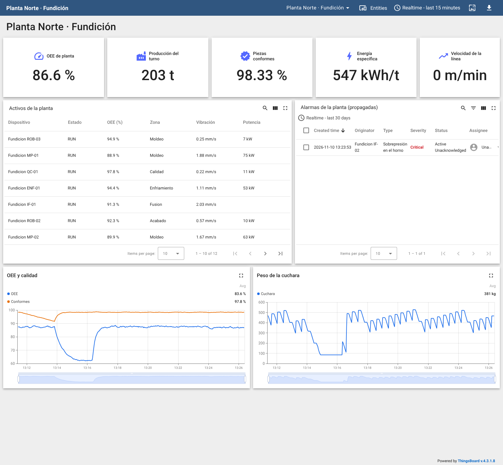
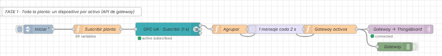

# Práctica: la Fundición en ThingsBoard (OPC UA → API de gateway → jerarquía de activos)

> Serie **2 · Node-RED + ThingsBoard**. Es la continuación de
> [1-dashboard/fundicion](../../1-dashboard/fundicion/README.md).
> Flujo resuelto para el profesorado:
> [flows/fundicion-thingsboard-solucion.json](flows/fundicion-thingsboard-solucion.json).
> Panel resuelto: [thingsboard/panel-fundicion.json](thingsboard/panel-fundicion.json).

## Introducción

Al terminar esta práctica, la Planta Norte estará en ThingsBoard como una
empresa real la tendría: **un dispositivo por máquina** (11), cada uno con
el **perfil** de su tipo (horno, prensa, robot…), organizados en una
**jerarquía de activos** (planta → zonas → máquinas) y con alarmas que
**suben** por esa jerarquía hasta la planta. Una sola conexión MQTT de
Node-RED alimentará todo.

**La cadena que vas a construir:**

1.  **La Fundición** publica 11 activos por **OPC UA** (`4841`).
2.  **Node-RED** se suscribe a toda la planta y actúa como **pasarela**
    con la API de gateway de ThingsBoard.
3.  **ThingsBoard** crea un dispositivo por máquina, los organiza en
    activos y relaciones, vigila con reglas por perfil y propaga las
    alarmas a la planta.
4.  **Responsable de mantenimiento** ve la planta entera, baja al detalle
    de cada máquina y gestiona las alarmas.

**Lo nuevo respecto a las otras prácticas de la serie 2:**

| | Prácticas anteriores | Fundición |
|---|---|---|
| Dispositivos | 1 (más zonas, boyas o dosímetros) | 12, de 7 perfiles distintos |
| Organización | Lista de dispositivos | **Activos** y **relaciones**: planta → zonas → máquinas |
| Alarmas | En el dispositivo o su perfil | En el perfil y **propagadas** a la planta |
| Gestión | Ver la alarma | **Reconocer, comentar, asignar** |

**Antes de empezar, comprueba que tienes:**

- [ ] El laboratorio arrancado y la Fundición en marcha (gemelo 3D en
  `http://localhost:3000`).
- [ ] Node-RED en `http://localhost:1880` y ThingsBoard en
  `http://localhost:8080` (`tenant@thingsboard.org` / `tenant`).
- [ ] La serie 1 de la Fundición hecha (o, al menos, sus partes 1 y 2).

> Endpoint OPC UA desde Node-RED: `opc.tcp://fundicion-opcua:4841/UA/Fundicion`
> (`ns=1`). MQTT de ThingsBoard: host `thingsboard`, puerto `1883`.

## Fase 1 — La planta en ThingsBoard (partes 1 a 6)

### Parte 1 — Suscribirse a toda la planta

1.  Pestaña nueva `Fundición → ThingsBoard`.
2.  **inject** `Iniciar` (once after 2 s) → **function** `Suscribir
    planta` → **OpcUa-Client** `SUBSCRIBE` (1 s):

<!-- -->

    // ENTRADA: el inject "Iniciar"
    // SALIDA:  una suscripción por variable de proceso de los 11 activos, sus estados y los KPI

    const VARIABLES = {
        "IF-01": ["TemperaturaMetal", "PotenciaBobina", "Vibracion", "Presion", "OEE", "NivelCarga", "Fase"],
        "IF-02": ["TemperaturaMetal", "PotenciaBobina", "Vibracion", "Presion", "OEE", "NivelCarga", "Fase"],
        "MP-01": ["TiempoCiclo", "Temperatura", "Potencia", "Vibracion", "Presion", "OEE"],
        "MP-02": ["TiempoCiclo", "Temperatura", "Potencia", "Vibracion", "Presion", "OEE"],
        "ROB-03": ["TiempoCiclo", "Temperatura", "Potencia", "Vibracion", "Presion", "OEE", "MachosColocados"],
        "COL-01": ["TemperaturaColada", "TiempoCiclo", "Potencia", "Vibracion", "PesoCuchara", "CaudalColada", "NivelLlenado", "OEE", "Colando", "MoldeEnPosicion"],
        "ROB-01": ["TiempoCiclo", "Temperatura", "Potencia", "Vibracion", "Presion", "VelocidadTCP", "OEE"],
        "ENF-01": ["TemperaturaMolde", "TiempoResidencia", "Potencia", "Vibracion", "Presion", "VelocidadVentiladores", "OEE"],
        "DES-01": ["TiempoCiclo", "Temperatura", "Potencia", "Vibracion", "Presion", "FrecuenciaVibracion", "OEE", "Marcha"],
        "ROB-02": ["TiempoCiclo", "Temperatura", "Potencia", "Vibracion", "Presion", "CargaUtil", "PiezasManipuladas", "OEE"],
        "QC-01": ["TiempoCiclo", "Temperatura", "Potencia", "Vibracion", "Presion", "DesviacionEscaneo", "PiezasConformes", "OEE"]
    };
    const KPIS = ["OEEPlanta", "ProduccionTurno", "PiezasConformes", "EnergiaEspecifica", "CO2Estimado", "VelocidadLinea"];
    const TEXTO = ["Fase"], BOOL = ["Colando", "MoldeEnPosicion", "Marcha"];

    const m = [];
    for (const k of KPIS) m.push({ topic: "ns=1;s=KPIs." + k, datatype: "Double" });
    for (const [activo, vars] of Object.entries(VARIABLES)) {
        for (const v of vars) {
            const tipo = TEXTO.includes(v) ? "String" : BOOL.includes(v) ? "Boolean" : "Double";
            m.push({ topic: "ns=1;s=" + activo + "." + v, datatype: tipo });
        }
        m.push({ topic: "ns=1;s=" + activo + ".Estado", datatype: "String" });
    }
    node.status({ text: m.length + " variables" });
    return [m];

3.  Después, el **Agrupar** de la serie 1 y un **delay** *Rate Limit* de
    **1 mensaje cada 2 segundos** (con 12 dispositivos, 1 por segundo es
    más de lo que necesita mantenimiento).

**Comprueba.** ¿Cuántas variables se suscriben ahora? ¿Por qué no se
suscriben las de `TagsS7`?

### Parte 2 — La pasarela

1.  En ThingsBoard, **Entities → Devices → + → Add new device**:
    `Pasarela-Fundicion`, marcando **Is gateway**. Copia su token.
2.  No crees nada más a mano: los 12 dispositivos los creará la pasarela.

### Parte 3 — Un dispositivo por máquina

Conecta al **delay** un **function** `Gateway activos`:

    // ENTRADA: la planta agrupada por activo (1 mensaje/s)
    // SALIDA:  mensajes de la API de gateway de ThingsBoard: un dispositivo por activo

    const TIPOS = {"IF": "horno", "MP": "prensa", "ROB": "robot", "COL": "colada", "ENF": "tunel", "DES": "desmoldeo", "QC": "calidad"};      // prefijo del activo → perfil de dispositivo
    const FICHA = {
        "IF-01": ["Horno de inducción 01", "Fusion", "PLC-FUS-01 · S7-1515"],  "IF-02": ["Horno de inducción 02", "Fusion", "PLC-FUS-01 · S7-1515"],
        "MP-01": ["Prensa de moldeo superior", "Moldeo", "PLC-MOL-01 · S7-1512"], "MP-02": ["Prensa de moldeo inferior", "Moldeo", "PLC-MOL-01 · S7-1512"],
        "ROB-03": ["Robot posicionador de machos", "Moldeo", "PLC-MOL-01 · S7-1512"], "COL-01": ["Estación de colada automática", "Colada", "PLC-COL-01 · S7-1516F"],
        "ROB-01": ["Robot de inoculación y escoriado", "Colada", "PLC-COL-01 · S7-1516F"], "ENF-01": ["Túnel de enfriamiento", "Enfriamiento", "PLC-LIN-01 · ET200SP"],
        "DES-01": ["Desmoldeo vibratorio", "Acabado", "PLC-ACA-01 · S7-1512"], "ROB-02": ["Robot de manipulación de piezas", "Acabado", "PLC-ACA-01 · S7-1512"],
        "QC-01": ["Célula de calidad 3D", "Calidad", "PLC-QA-01 · S7-1500"]
    };
    const p = msg.payload, ahora = Date.now();
    const disp = a => "Fundicion " + a;                // nombre del dispositivo en ThingsBoard

    const telemetria = {};
    for (const a of Object.keys(FICHA)) {
        if (!p[a]) continue;
        telemetria[disp(a)] = [{ ts: ahora, values: p[a] }];
    }
    if (p.KPIs) telemetria["Fundicion Planta Norte"] = [{ ts: ahora, values: p.KPIs }];
    if (Object.keys(telemetria).length === 0) return null;

    const mensajes = [];
    if (!context.get("conectados")) {                  // la primera vez: alta con su perfil y su ficha
        context.set("conectados", true);
        const atributos = {};
        for (const [a, [nombre, zona, plc]] of Object.entries(FICHA)) {
            mensajes.push({ topic: "v1/gateway/connect", payload: { device: disp(a), type: TIPOS[a.split("-")[0]] } });
            atributos[disp(a)] = { nombre, zona, plc, activo: a };
        }
        mensajes.push({ topic: "v1/gateway/connect", payload: { device: "Fundicion Planta Norte", type: "planta" } });
        mensajes.push({ topic: "v1/gateway/attributes", payload: atributos });
    }
    mensajes.push({ topic: "v1/gateway/telemetry", payload: telemetria });
    return [mensajes];

Su salida a un **mqtt out** con un servidor nuevo
`ThingsBoard · Pasarela-Fundicion` (host `thingsboard`, puerto `1883`,
*Username* = token de la pasarela) y el **topic vacío**. **Deploy**.

**Comprueba.** En **Entities → Devices**:

| **Pregunta** | **Respuesta** |
|---|---|
| ¿Cuántos dispositivos `Fundicion …` aparecen? | |
| ¿Qué perfiles se han creado solos? | |
| ¿Qué atributos de cliente tiene `Fundicion IF-01`? | |
| ¿Cuántas claves de telemetría tiene `Fundicion COL-01`? | |

### Parte 4 — La jerarquía de activos

Un **activo** (*asset*) es algo que no envía datos por sí mismo pero
agrupa dispositivos: una planta, una zona, una línea.

1.  **Entities → Assets → +**: `Planta Norte` con perfil (tipo) `planta`.
2.  Seis activos más, de tipo `zona`: `Zona Fusion`, `Zona Moldeo`,
    `Zona Colada`, `Zona Enfriamiento`, `Zona Acabado`, `Zona Calidad`.
3.  Abre `Planta Norte` → pestaña **Relations** → **+**: dirección
    **From**, tipo **Contains**, tipo de entidad **Asset**, y selecciona
    las seis zonas (se pueden elegir varias a la vez). Añade otra relación
    **Contains** hacia el dispositivo `Fundicion Planta Norte`.
4.  En cada zona, **Relations → +** (**From**, **Contains**, **Device**)
    con sus máquinas:

| **Zona** | **Dispositivos** |
|---|---|
| Fusion | `Fundicion IF-01`, `Fundicion IF-02` |
| Moldeo | `Fundicion MP-01`, `Fundicion MP-02`, `Fundicion ROB-03` |
| Colada | `Fundicion COL-01`, `Fundicion ROB-01` |
| Enfriamiento | `Fundicion ENF-01` |
| Acabado | `Fundicion DES-01`, `Fundicion ROB-02` |
| Calidad | `Fundicion QC-01` |

**Comprueba.** Abre `Planta Norte` → **Relations**: ¿cuántas relaciones
salen? ¿Y de `Zona Moldeo`? ¿Qué ventaja tiene esto frente a poner la
zona en un atributo?

### Parte 5 — Primer panel

1.  **Dashboards → +**: `Planta Norte · Fundición`.
2.  Alias `KPI de planta` (**Single entity**, dispositivo
    `Fundicion Planta Norte`): tarjetas de OEE, producción del turno,
    piezas conformes, energía específica y velocidad de línea.
3.  Alias `Activos` (**Entity name**, tipo **Device**, nombre que empieza
    por `Fundicion `, *Resolve as multiple entities*) y una
    **Entities table** con `Estado`, `OEE`, el atributo `zona`,
    `Vibracion` y `Potencia`.

### Parte 6 — Histórico

Una gráfica de `OEEPlanta` y `PiezasConformes` y otra del peso de la
cuchara de `Fundicion COL-01`.

## Fase 1 — Reglas, propagación e incidencias (partes 7 a 10)

### Parte 7 — Reglas en los perfiles

Una regla en un **perfil** vale para todas las máquinas de ese tipo (si
mañana se instala un tercer horno, ya está vigilado). En **Profiles →
Device profiles** abre cada perfil → **Alarm rules** → **+**:

| **Perfil** | **Regla** | **Crear** | **Borrar** | **Severidad** |
|---|---|---|---|---|
| `horno` | Sobrepresión en el horno | `Presion` > 0 durante 10 s | `Presion` < −3 | Critical |
| `desmoldeo` | Vibración del desmoldeo | `Vibracion` > 12 **y** `Marcha` = true, 10 s | `Vibracion` < 10 | Major |
| `calidad` | Deriva del escáner | `DesviacionEscaneo` > 0,2 durante 20 s | < 0,12 | Warning |
| `planta` | OEE de planta bajo | `OEEPlanta` < 75 durante 30 s | > 80 | Major |

En cada regla, en sus opciones avanzadas, marca **Propagate alarm to
related entities** con el tipo de relación `Contains`.

> Los hornos trabajan en **depresión** (≈ −10 Pa): el aire entra y los
> humos salen por la extracción. Una presión positiva significa que la
> extracción falla y los humos salen a la nave.

### Parte 8 — Alarmas de la planta

En el panel, una **Alarms table** con un alias al **activo**
`Planta Norte` (**Single entity**, tipo **Asset**). En la configuración
del widget, en el filtro de alarmas, activa **Search propagated alarms**:
sin esa casilla la tabla solo muestra las alarmas creadas en el propio
activo y se queda vacía. Gracias a la propagación, ahí aparecerán las
alarmas de **cualquier** máquina.

### Parte 9 — Incidencias

El profesor inyectará averías desde la página `Mantenimiento` de la
serie 1, desde el gemelo 3D (`http://localhost:3000`) o escribiendo en
`ns=1;s=Mantenimiento.Averia`. Las cuatro reglas de la Parte 7 cubren las
averías 1 a 4. La del rodamiento tarda: el desgaste lleva la vibración en
marcha por encima de 12 mm/s a los ~13 min y la alarma llega a `Planta
Norte` a los ~16 min (comprobado a ×1). Las averías 5, 6 y 7 bajan las
piezas conformes con ~47 min de retraso (lo que tarda el túnel): ¿cuál de
tus reglas las detecta?

> **Planta acelerada y reglas con duración.** El profesor puede acelerar la
> planta (`ns=1;s=Simulacion.Velocidad`), pero las duraciones de las reglas
> de ThingsBoard cuentan **tiempo real**. A ×5, cada marcha del desmoldeo
> (22 s de planta) dura 4,4 s reales y la regla «vibración > 12 y en marcha
> durante 10 s» **no salta nunca**. Prueba esa regla a ×1. ¿Cómo la
> rediseñarías para que no dependa de la velocidad?

| **Avería** | **Alarma** | **Originador** | **¿Llega a Planta Norte?** | **Tiempo** |
|---|---|---|---|---|
| A | | | | |
| B | | | | |
| C | | | | |

*Panel resuelto durante una avería (captura real del laboratorio).*

### Parte 10 — Comunicación

En el dispositivo `Fundicion Planta Norte`: atributo de servidor
`inactivityTimeout` = `30000` y la regla `Sin comunicación` de las
prácticas anteriores. Detén la pasarela (deshabilita el **mqtt out**) 1
minuto.

**Comprueba.** ¿Cuánto tarda en saltar la alarma? ¿Cuándo pasan a
*Inactive* los otros 11 dispositivos? (Pista: sin `inactivityTimeout`,
ThingsBoard usa su valor por defecto de 10 minutos.) ¿Por qué basta con
vigilar uno para saber que la pasarela ha caído?

## Fase 2 — Gestionar y navegar (partes 11 a 13)

### Parte 11 — Gestión de alarmas

Una alarma no es solo una luz roja: tiene un **ciclo de vida**.

1.  Con una avería activa, abre la alarma en la tabla del panel.
2.  **Acknowledge** (reconocer): «la he visto».
3.  Añade un **comentario** con tu diagnóstico.
4.  **Asígnala** a un usuario (si no hay otro, a ti).
5.  Pide que retiren la avería: la alarma pasa a **Cleared**.

**Comprueba.** En **Alarms**, filtra por estado: ¿qué diferencia hay
entre *Active Unacknowledged*, *Active Acknowledged* y *Cleared
Acknowledged*? ¿Por qué no se borra la alarma al reconocerla?

### Parte 12 — Navegar por la jerarquía

Cambia el alias `Activos` por uno de tipo **Relations query**: entidad
raíz `Planta Norte`, dirección **From**, profundidad máxima **2**, filtro
`Contains` → **Device**. La tabla mostrará las mismas máquinas, pero
ahora **por su relación con la planta**.

**Comprueba.** Haz una copia del alias con raíz `Zona Moldeo`: ¿qué
máquinas aparecen? ¿Qué pasaría si moviéramos el robot ROB-03 a otra
zona?

### Parte 13 — Comparar las máquinas (ampliación final)

Añade un **Bar chart** con el último `OEE` de todos los dispositivos del
alias `Activos`, ordenado de menor a mayor.

**Comprueba.** ¿Qué tres máquinas tienen peor OEE? ¿Están en la misma
zona? Propón a qué dedicarías la próxima parada de mantenimiento.

Así queda el flujo:

*Flujo resuelto en Node-RED (captura real del laboratorio).*

## Cierre y entrega

> En una planta real hay cientos de máquinas: los **perfiles** evitan
> repetir reglas, las **relaciones** dan contexto (dónde está cada
> máquina, de quién depende) y la **propagación** hace que nada se
> escape a quien vigila la planta.

**Qué entregar:**

- [ ] Flujo de Node-RED exportado (**sin el token**).
- [ ] Panel exportado.
- [ ] Captura de **Relations** de `Planta Norte` y de una zona.
- [ ] Tablas de las partes 3 y 9 completadas.
- [ ] Captura de una alarma reconocida, comentada y borrada.
- [ ] Respuestas a las preguntas finales.

**Preguntas finales:**

1.  ¿Qué diferencia hay entre un dispositivo y un activo en ThingsBoard?
2.  ¿Por qué es mejor una regla en el perfil `horno` que una regla en
    cada horno?
3.  ¿Qué ventaja tiene propagar las alarmas a `Planta Norte`? ¿Hasta
    dónde las propagarías en una empresa con tres plantas?
4.  La pasarela usa **una** conexión MQTT para 12 dispositivos. ¿Qué
    pasa si esa conexión se cae? ¿Cómo lo detectas?

**Si algo no funciona:**

| **Síntoma** | **Causa probable** | **Qué hacer** |
|---|---|---|
| No se crean los dispositivos | La pasarela no está marcada como gateway | Edita `Pasarela-Fundicion` y marca **Is gateway** |
| Los dispositivos salen con perfil `default` | Falta el `v1/gateway/connect` | Usa el código sin cambios y vuelve a desplegar |
| La alarma está en la máquina pero no en Planta Norte | Falta la propagación o la relación | Marca *Propagate* con `Contains` y revisa las relaciones |
| La tabla de activos sale vacía | El alias no resuelve varias entidades | Marca *Resolve as multiple entities* |
| La regla del desmoldeo no salta | Argumento `Marcha` de tipo número | Filtro **Boolean** igual a `true` |
