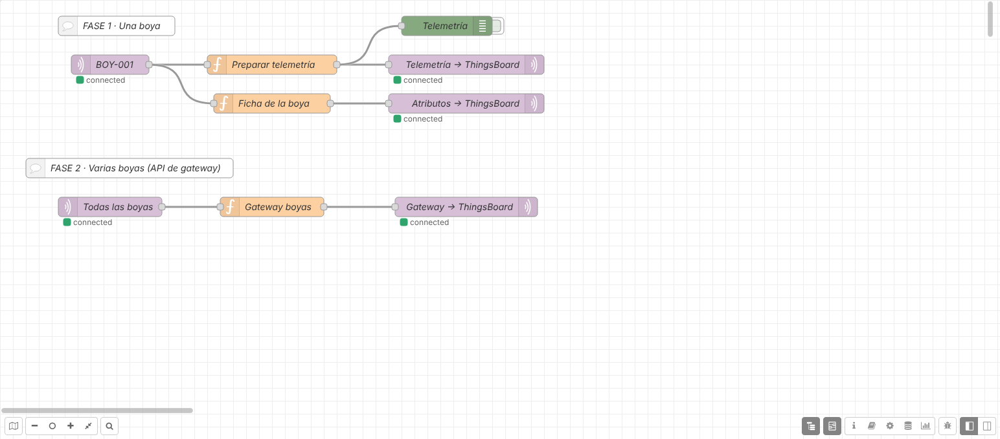
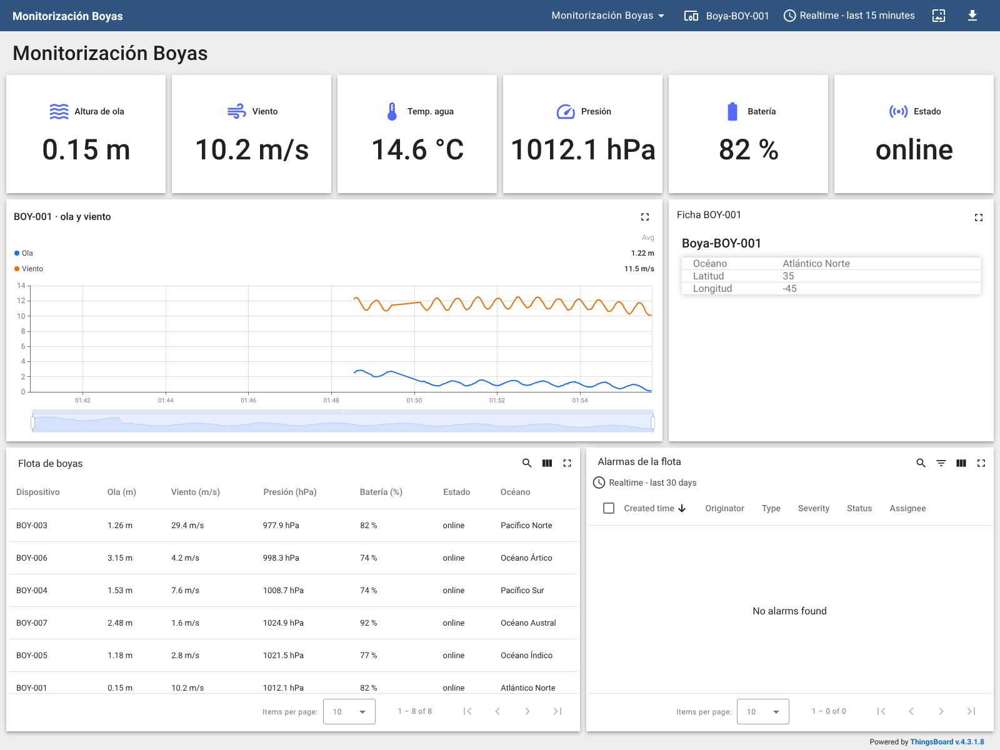

# Práctica: OceanLab con Node-RED y ThingsBoard (MQTT → MQTT → plataforma IIoT)

> Serie **2 · Node-RED + ThingsBoard**. Es la continuación de
> [1-dashboard/oceanlab](../../1-dashboard/oceanlab/README.md): allí
> construiste un dashboard dentro de Node-RED; aquí Node-RED pasa a ser la
> **pasarela** que lleva los datos de las boyas a una plataforma IIoT.
> Flujo resuelto para el profesorado:
> [flows/oceanlab-thingsboard-solucion.json](flows/oceanlab-thingsboard-solucion.json).
> Panel resuelto: [thingsboard/panel-oceanlab.json](thingsboard/panel-oceanlab.json).

## Introducción

Al terminar esta práctica, las boyas de OceanLab aparecerán en
**ThingsBoard** como dispositivos de la empresa: con su histórico
guardado, un panel accesible desde cualquier navegador y alarmas que se
crean y se borran solas. En la Fase 2 pasarás de una boya a una **flota**
con una sola conexión. No vas a programar desde cero: el código lo tienes
preparado en esta guía.

**La cadena que vas a construir:**

1.  **OceanLab** simula las boyas, que publican sus datos.
2.  **Mosquitto** (broker MQTT del laboratorio, puerto `1883`) reparte
    los mensajes.
3.  **Node-RED** se suscribe, elige las boyas que interesan y adapta los
    mensajes. Es la **pasarela** (*edge gateway*).
4.  **ThingsBoard** recibe los datos por **su propio MQTT**, guarda el
    histórico, muestra el panel y vigila las alarmas.
5.  **Técnico de mantenimiento** ve el estado de la flota desde
    cualquier sitio.

> Fíjate en que hay **dos MQTT distintos**. Mosquitto es un broker
> general: cualquiera publica y se suscribe a cualquier topic. El MQTT de
> ThingsBoard **no es un broker**: es la puerta de entrada de la
> plataforma, solo acepta sus topics (`v1/...`) y exige el token de un
> dispositivo. Node-RED hace de puente entre los dos.

**¿Qué cambia respecto al dashboard de Node-RED?**

|                          | Dashboard de Node-RED            | ThingsBoard                                   |
|--------------------------|----------------------------------|-----------------------------------------------|
| Dónde viven los datos    | En la memoria de Node-RED        | En una base de datos                          |
| Histórico                | Lo que quepa en la gráfica       | Días o meses, con zoom y medias               |
| Quién lo ve              | Quien abra tu Node-RED           | Usuarios y clientes con su propio acceso      |
| Alarmas                  | Las programas tú con `function`  | Reglas configurables, con avisos y registro   |
| Muchas boyas             | Filtro y selector en el flujo    | Un dispositivo por boya y reglas por perfil   |

**Antes de empezar, comprueba que tienes:**

- [ ] El laboratorio arrancado (`docker compose up -d` o `start_lab.cmd`).
- [ ] Node-RED en `http://localhost:1880`.
- [ ] OceanLab en `http://localhost:8020` publicando datos.
- [ ] ThingsBoard en `http://localhost:8080`. Entra con
  `tenant@thingsboard.org` / `tenant` o con la cuenta que te dé el
  profesor.

> En el entorno Docker del laboratorio cada servicio se llama por su
> nombre: el broker es `mosquitto` y ThingsBoard es `thingsboard`.

**Cómo habla ThingsBoard por MQTT.** Cada boya será un **dispositivo**
con un **token de acceso** (*access token*), que funciona como su
contraseña. Node-RED se conecta al MQTT de ThingsBoard usando ese token
como **usuario** y publica en topics fijos:

| **Topic**                     | **Para qué**                                                     |
|-------------------------------|------------------------------------------------------------------|
| `v1/devices/me/telemetry`     | Medidas que cambian (ThingsBoard guarda su histórico)            |
| `v1/devices/me/attributes`    | Datos fijos del equipo (océano, posición…)                       |
| `v1/gateway/...`              | Una **pasarela** que envía datos de muchos equipos (Fase 2)      |

`me` significa *el dispositivo dueño del token*: no hace falta poner su
nombre en el topic.

La práctica tiene dos fases. En la **Fase 1** trabajas con una sola boya
(`BOY-001`). En la **Fase 2**, solo cuando la Fase 1 esté clara, envías
varias boyas a la vez.

## Fase 1 — Una boya en ThingsBoard (partes 1 a 6)

### Parte 1 — Recibir la boya en Node-RED

Si hiciste la práctica del dashboard, puedes copiar de allí el **mqtt
in** (Ctrl+C y Ctrl+V en una pestaña nueva) y pasar al *Comprueba*.

1.  Crea una pestaña nueva llamada `OceanLab → ThingsBoard`.
2.  Arrastra un nodo **mqtt in** y crea su servidor (lápiz junto a
    *Server*):
    - **Name:** `Mosquitto (OceanLab)`
    - **Server:** `mosquitto`. **Port:** `1883`. Sin usuario ni
      contraseña.
3.  En el **mqtt in**: **Topic** `oceanlab/buoys/BOY-001/telemetry`,
    **QoS** `0`, **Output** *a parsed JSON object*.
4.  Conecta un **debug** y pulsa **Deploy**.

**Comprueba.** Cada pocos segundos llega un mensaje con los bloques
`location`, `weather` y `device`. ¿Qué campo indica **cuándo** midió la
boya?

### Parte 2 — Dar de alta la boya en ThingsBoard

1.  En ThingsBoard abre **Entities → Devices** y pulsa **+ → Add new
    device**.
2.  **Name:** `Boya-BOY-001`. **Device profile:** `default`. Pulsa
    **Add**.
3.  Abre el dispositivo y pulsa **Copy access token**. Pégalo en un bloc
    de notas.

> El token es la **contraseña** de la boya. No lo pongas en capturas ni
> en el JSON que entregues, y no lo compartas con otros grupos.

**Comprueba.** ¿Qué estado muestra la boya en la lista, *Active* o
*Inactive*? ¿Por qué?

### Parte 3 — Preparar la telemetría

ThingsBoard guarda cada dato con un nombre (**clave**) y una hora. El
mensaje de la boya tiene bloques anidados (`weather.wave_height_m`),
pero ThingsBoard trabaja mejor con **claves planas** (`ola_m`). Y aquí
hay algo importante: la boya **ya dice cuándo midió** (`timestamp`).

1.  Conecta al **mqtt in** un nodo **function** llamado
    `Preparar telemetría` y pega este código:

<!-- -->

    // ENTRADA: el mensaje completo de la boya (msg.payload)
    // SALIDA:  msg.payload = { ts, values } con claves planas para ThingsBoard

    const m = msg.payload;
    const w = m.weather;
    const d = m.device;

    msg.payload = {
        ts: Date.parse(m.timestamp),          // la hora a la que midió la boya
        values: {
            temp_agua_c:    w.water_temperature_c,
            temp_aire_c:    w.air_temperature_c,
            ola_m:          w.wave_height_m,
            viento_mps:     w.wind_speed_mps,
            viento_dir_deg: w.wind_direction_deg,
            presion_hpa:    w.pressure_hpa,
            humedad_pct:    w.humidity_pct,
            bateria_pct:    d.battery_pct,
            rssi_dbm:       d.signal_rssi_dbm,
            estado:         d.status,
            secuencia:      m.sequence
        }
    };
    return msg;

2.  Pon un **debug** a su salida y haz **Deploy**.

Verás un mensaje como este:

    {
      "ts": 1794275402125,
      "values": { "temp_agua_c": 15.2, "ola_m": 1.46, "viento_mps": 8.3,
                  "presion_hpa": 1012.4, "bateria_pct": 91.5, "estado": "online", … }
    }

**Comprueba.** ¿Por qué usamos la hora de la boya (`Date.parse(m.timestamp)`)
y no la hora a la que llega a Node-RED? Piensa en una boya que pierde la
cobertura y envía de golpe los datos de la última hora.

### Parte 4 — Publicar por MQTT en ThingsBoard

1.  Añade un nodo **mqtt out** y conéctalo al **Preparar telemetría**.
2.  Crea un **servidor nuevo** (no reutilices el de Mosquitto):
    - **Name:** `ThingsBoard · Boya-BOY-001`
    - **Server:** `thingsboard`. **Port:** `1883`. **Protocol:** MQTT
      V3.1.1.
    - Pestaña **Security**: **Username** = el token de la Parte 2.
      **Password** vacío.
3.  En el **mqtt out**: **Topic** `v1/devices/me/telemetry`, **QoS** `1`.
4.  **Deploy**. Debajo del nodo debe aparecer **connected**.
5.  En ThingsBoard abre la boya → pestaña **Latest telemetry**. Deben
    aparecer 11 claves y la boya pasa a **Active**.

**Comprueba.**

1.  Ahora tienes dos servidores MQTT en Node-RED. ¿Qué diferencia hay
    entre ellos? ¿Podrías publicar en `v1/devices/me/telemetry` de
    Mosquitto y que llegara a ThingsBoard?
2.  Cambia una letra del token y haz Deploy. ¿Qué pasa? Vuelve a
    ponerlo bien.
3.  Compara tres valores de ThingsBoard con la web de OceanLab.

### Parte 5 — Atributos: la ficha de la boya

La **telemetría** cambia continuamente y ThingsBoard guarda su
histórico. Los **atributos** son datos que casi nunca cambian (océano,
posición fija de la boya…) y de los que solo interesa el último valor.

1.  Conecta al **mqtt in** otro **function** llamado `Ficha de la boya`
    con este código:

<!-- -->

    // ENTRADA: el mensaje completo de la boya (msg.payload)
    // SALIDA:  la ficha de la boya (atributos), solo la primera vez

    if (context.get("enviada")) {
        return null;                          // ya la enviamos: no se repite
    }
    context.set("enviada", true);

    const l = msg.payload.location;
    msg.payload = {
        buoy_id:   msg.payload.buoy_id,
        oceano:    l.ocean,
        latitude:  l.latitude,
        longitude: l.longitude
    };
    return msg;

2.  Conecta su salida a otro **mqtt out** con **el mismo servidor de
    ThingsBoard** y **Topic** `v1/devices/me/attributes`.
3.  **Deploy** y en ThingsBoard abre la boya → **Attributes** → **Client
    attributes**.

> `context` es una pequeña memoria de cada nodo **function**: aquí
> recuerda que la ficha ya se envió. Al hacer Deploy se borra y la ficha
> se envía otra vez.

| **Dato**          | **¿Telemetría o atributo?** | **¿Por qué?** |
|-------------------|-----------------------------|---------------|
| Altura de ola     |                             |               |
| Océano            |                             |               |
| Batería           |                             |               |
| Latitud y longitud|                             |               |

**Comprueba.** Completa la tabla. ¿En qué caso la posición de una boya
debería enviarse como telemetría?

Así queda el flujo (arriba la Fase 1, abajo la Fase 2):

*Flujo resuelto en Node-RED (captura real del laboratorio).*

### Parte 6 — Primer panel en ThingsBoard

1.  Abre **Dashboards** y pulsa **+ → Create new dashboard**. Título:
    `Monitorización Boyas`. Ábrelo.
2.  Pulsa **Edit mode** y después el icono de **Entity aliases**. Crea
    el alias `Boya BOY-001`: **Filter type** `Single entity`, **Type**
    `Device`, dispositivo `Boya-BOY-001`.
3.  Pulsa **Add widget** → **Cards → Value card**, elige el alias y la
    clave. Repite para cada dato:

| **Dato**      | **Clave**     | **Unidad** |
|---------------|---------------|------------|
| Altura de ola | `ola_m`       | m          |
| Viento        | `viento_mps`  | m/s        |
| Temp. agua    | `temp_agua_c` | °C         |
| Presión       | `presion_hpa` | hPa        |
| Batería       | `bateria_pct` | %          |
| Estado        | `estado`      | —          |

4.  Añade **Cards → Attributes card** con `oceano`, `latitude` y
    `longitude`. **Save**.

**Comprueba.** Pide a un compañero que abra tu panel desde **su**
navegador con tu usuario. ¿Podría hacerlo con el dashboard de Node-RED
de la serie 1?

## Fase 1 — Histórico, alarmas y comunicación (partes 7 a 10)

### Parte 7 — Histórico

1.  En modo edición añade **Charts → Time series chart** con `ola_m` y
    `viento_mps`. Título `BOY-001 · ola y viento`.
2.  Arriba, en la ventana de tiempo, elige **Realtime → last 15
    minutes**. **Save**.
3.  Deja el sistema funcionando al menos 5 minutos.

**Comprueba.** Cierra el navegador y vuelve a abrir el panel: ¿sigue ahí
la curva? Cambia la ventana a **last 1 hour** con agregación
**Average**: ¿qué pasa con las oscilaciones? ¿Se vería la misma curva en
el dashboard de Node-RED después de reiniciar Node-RED?

### Parte 8 — Simular una incidencia

1.  En OceanLab selecciona `BOY-001` y pulsa **Simular tormenta**.
2.  Observa el panel 2–3 minutos. Después pulsa **Restablecer**.
3.  Con el zoom de la gráfica localiza el momento exacto del cambio.

| **Variable**               | **Antes** | **Durante la tormenta** | **Hora del cambio** |
|----------------------------|-----------|-------------------------|---------------------|
| Altura de ola (m)          |           |                         |                     |
| Velocidad del viento (m/s) |           |                         |                     |
| Presión (hPa)              |           |                         |                     |

**Preguntas:** ¿qué variable cambió primero? ¿La presión sube o baja?
¿Qué ves en la gráfica de ThingsBoard que no se veía en un gauge?

### Parte 9 — Regla de alarma

En la serie 1 programaste la alarma con un nodo **function**. En
ThingsBoard se **configura** con una regla, sin código, y queda
registrada con su hora de inicio, fin y quién la atendió.

1.  Abre la boya → pestaña **Alarm rules** → **+ → Create new alarm
    rule**.
2.  **Alarm type:** `Oleaje peligroso`.
3.  **Arguments → Add argument:** nombre `ola_m`, tipo **Latest
    telemetry**, clave `ola_m`.
4.  **Trigger conditions → Add trigger condition:** **Severity**
    `Major`; condición `ola_m` **greater than** `6`.
5.  **Clear condition:** `ola_m` **less or equal** `5`.
6.  Pulsa **Add**.
7.  En el panel añade **Alarm widgets → Alarms table** con el alias
    `Boya BOY-001`.
8.  Pulsa **Simular tormenta** en OceanLab, espera a que salte la alarma
    y después **Restablecer**.

**Comprueba.**

1.  ¿Cuánto tarda en aparecer la alarma? ¿Y en borrarse?
2.  ¿Por qué se borra por debajo de **5** y no de **6**? (pista: una ola
    que oscila entre 5,9 y 6,1).
3.  Pulsa **Acknowledge** sobre la alarma. ¿Qué información guarda
    ThingsBoard que no tenía tu alarma de la serie 1?

> **Ampliación.** Crea la regla `Batería baja` con dos condiciones:
> **Major** si `bateria_pct < 30` y **Critical** si `bateria_pct < 15`.
> Pruébala con **Batería baja** en OceanLab.

### Parte 10 — Detectar que la boya ha dejado de transmitir

Cuando una boya pierde la cobertura, **deja de publicar**. El panel se
queda con el último valor y parece que todo va bien. ThingsBoard puede
detectarlo: si un dispositivo no envía nada durante un tiempo, lo marca
como **inactivo**.

1.  Abre la boya → **Attributes** → **Server attributes** → **+**. Clave
    `inactivityTimeout`, tipo **Integer**, valor `30000` (30 s en
    milisegundos).
2.  Crea una regla de alarma `Sin comunicación`:
    - **Argument:** nombre `active`, tipo **Attribute**, *scope*
      **Server attributes**, clave `active`.
    - **Trigger condition:** **Critical**, `active` **equal** `false`.
    - **Clear condition:** `active` **equal** `true`.
3.  En OceanLab pulsa **Desconectar** sobre `BOY-001`. Espera entre 30 s
    y 1 minuto. Después pulsa **Restablecer**.

**Comprueba.** ¿Cuánto tardó la alarma? En la serie 1 lo resolviste con
un nodo **trigger**: ¿qué ventaja tiene que lo vigile la plataforma?
(pista: ¿qué pasa si lo que se cuelga es el Node-RED?). En
**Attributes → Server attributes** busca `lastActivityTime`: ¿qué
indica?

## Fase 2 — De una boya a una flota (partes 11 a 13)

Empieza esta fase solo cuando la Fase 1 funcione. Antes, **guarda una
copia**: exporta el flujo o crea un snapshot en `http://localhost:8090`.

**El problema.** Con la Fase 1, cada boya necesita su dispositivo, su
token y su propia conexión MQTT. Para 96 boyas serían 96 conexiones y 96
tokens en Node-RED. La solución es que Node-RED se presente ante
ThingsBoard como una **pasarela** (*gateway*): **una sola conexión**
que envía los datos de muchos equipos, indicando de cuál es cada dato.

| **Topic de la API de gateway** | **Qué envía Node-RED**                                         |
|--------------------------------|----------------------------------------------------------------|
| `v1/gateway/connect`           | “Existe la boya X y es de tipo `boya`”                         |
| `v1/gateway/attributes`        | `{ "BOY-002": { "oceano": … } }`                               |
| `v1/gateway/telemetry`         | `{ "BOY-002": [ { "ts": …, "values": { … } } ] }`              |

ThingsBoard **crea solo** el dispositivo la primera vez que la pasarela
lo nombra, y le asigna el **perfil** indicado en `type`.

### Parte 11 — Crear la pasarela

1.  En ThingsBoard, **Entities → Devices → + → Add new device**:
    **Name** `Pasarela-Boyas` y marca **Is gateway**. **Add**.
2.  Copia su token.
3.  En Node-RED añade un **mqtt in** con el servidor de Mosquitto y el
    topic `oceanlab/buoys/+/telemetry` (todas las boyas), *a parsed JSON
    object*.
4.  Conecta un **function** llamado `Gateway boyas` con este código:

<!-- -->

    // ENTRADA: mensajes de TODAS las boyas (oceanlab/buoys/+/telemetry)
    // SALIDA:  mensajes para la API de gateway de ThingsBoard (msg.topic ya puesto)

    const BOYAS = ["BOY-001", "BOY-002", "BOY-003", "BOY-004",
                   "BOY-005", "BOY-006", "BOY-007", "BOY-008"];   // boyas que se envían

    const m = msg.payload;
    const boya = m.buoy_id;
    if (!BOYAS.includes(boya)) {
        return null;                          // boya que no nos interesa
    }

    const w = m.weather;
    const d = m.device;
    const mensajes = [];

    // La primera vez que vemos una boya: la damos de alta y enviamos su ficha
    const vistas = context.get("vistas") || {};
    if (!vistas[boya]) {
        vistas[boya] = true;
        context.set("vistas", vistas);
        mensajes.push({ topic: "v1/gateway/connect",
                        payload: { device: boya, type: "boya" } });
        mensajes.push({ topic: "v1/gateway/attributes",
                        payload: { [boya]: { oceano: m.location.ocean,
                                             latitude: m.location.latitude,
                                             longitude: m.location.longitude } } });
    }

    // Siempre: su telemetría
    mensajes.push({ topic: "v1/gateway/telemetry",
                    payload: { [boya]: [ { ts: Date.parse(m.timestamp), values: {
                        temp_agua_c: w.water_temperature_c,
                        ola_m:       w.wave_height_m,
                        viento_mps:  w.wind_speed_mps,
                        presion_hpa: w.pressure_hpa,
                        bateria_pct: d.battery_pct,
                        rssi_dbm:    d.signal_rssi_dbm,
                        estado:      d.status
                    } } ] } });

    return [mensajes];                        // los corchetes: salen uno detrás de otro

5.  Conecta su salida a un **mqtt out** con un **servidor nuevo**:
    `ThingsBoard · Pasarela-Boyas`, **Server** `thingsboard`, **Port**
    `1883`, **Username** = token de la pasarela. Deja el **Topic vacío**:
    cada mensaje lleva su `msg.topic`.
6.  **Deploy**.

**Comprueba.** En **Entities → Devices** aparecen `BOY-001` …
`BOY-008` con el perfil `boya`. Abre una: ¿tiene telemetría y la ficha
en atributos? ¿Cuántas conexiones MQTT usa Node-RED para las 8 boyas?
Añade dos boyas más a la lista `BOYAS` y haz Deploy: ¿qué pasa?

> `BOY-001` aparece dos veces: `Boya-BOY-001` (Fase 1, por su propio
> token) y `BOY-001` (Fase 2, por la pasarela). Para ThingsBoard son dos
> dispositivos distintos. En una instalación real elegirías una sola de
> las dos formas.

### Parte 12 — Una regla para toda la flota

Las reglas de la Fase 1 eran de **un** dispositivo. Si las pones en el
**perfil** `boya`, valen para todas las boyas, también las que se den de
alta mañana.

1.  Abre **Profiles → Device profiles → boya** → pestaña **Alarm rules**
    y crea `Oleaje peligroso` igual que en la Parte 9.
2.  En OceanLab selecciona `BOY-003` y pulsa **Simular tormenta**.
3.  Abre **Alarms**: ¿de qué boya es la alarma?

**Comprueba.** ¿Cuántas reglas habrías tenido que crear sin perfiles
para 96 boyas? ¿Qué pasa si añades la boya `BOY-009` a la pasarela:
tiene ya la regla?

### Parte 13 — Panel de la flota (ampliación final)

Objetivo: supervisar la **flota** en una sola tabla, como haría un
técnico con muchos equipos.

1.  En el panel crea un alias `Boyas`: **Filter type** `Device type`,
    **Device type** `boya`.
2.  Añade **Tables → Entities table** con el alias `Boyas` y las claves
    `ola_m`, `viento_mps`, `presion_hpa`, `bateria_pct`, `estado`
    (telemetría) y `oceano` (atributo).
3.  Añade **Alarm widgets → Alarms table** con el alias `Boyas`. Título
    `Alarmas de la flota`.
4.  **Save** y simula una tormenta en otra boya.

> **Más ampliación: mapa.** Añade **Maps → Map** con el alias `Boyas`:
> usa los atributos `latitude` y `longitude`. Necesita Internet para
> descargar el mapa.

Así queda el panel resuelto:

*Panel resuelto en ThingsBoard (captura real del laboratorio).*

**Comprueba.** En la tabla, pulsa en la cabecera **Ola (m)** para
ordenar. ¿Qué boya tiene más oleaje? ¿Cuánto tardas en encontrar una
boya con la batería baja en la tabla y en el panel de una sola boya?

## Cierre y entrega

> Una plataforma IIoT no solo muestra datos: los guarda, avisa cuando
> algo va mal aunque nadie esté mirando y permite gestionar cientos de
> equipos iguales con las mismas reglas.

**Qué entregar:**

- [ ] Flujo de Node-RED exportado en JSON (*Menu → Export → all flows*).
  **Comprueba que no contiene los tokens.**
- [ ] Panel de ThingsBoard exportado (icono de **Export** del panel).
- [ ] Captura de *Latest telemetry* y *Client attributes* de la boya.
- [ ] Captura del panel durante la tormenta, con la gráfica y la alarma.
- [ ] Tablas de las partes 5 y 8 completadas.
- [ ] Respuestas a las preguntas finales.

> También puedes entregar un **snapshot** del laboratorio: en
> `http://localhost:8090` crea uno con Node-RED y ThingsBoard y
> descárgalo. Ojo: dentro van los tokens.

**Preguntas finales:**

1.  Dibuja el camino de un dato desde la boya hasta el panel de
    ThingsBoard. Indica qué broker MQTT y qué topic se usa en cada tramo.
2.  ¿Qué diferencia hay entre Mosquitto y el MQTT de ThingsBoard?
3.  ¿Qué diferencia hay entre telemetría y atributo? Pon dos ejemplos de
    cada uno en una boya.
4.  ¿Por qué es mejor usar la hora de la boya (`ts`) que la de llegada?
5.  ¿Qué ventajas tiene la API de gateway frente a un token por boya? ¿Y
    qué riesgo tiene que una sola conexión lleve los datos de toda la
    flota?
6.  ¿Qué ventaja tiene poner las reglas de alarma en el perfil en lugar
    de en cada dispositivo?

**Si algo no funciona:**

| **Síntoma**                                              | **Causa probable**                                  | **Qué hacer**                                                                  |
|----------------------------------------------------------|-----------------------------------------------------|--------------------------------------------------------------------------------|
| El **mqtt in** no conecta                                | Host del broker                                     | **Server** `mosquitto`, **Port** `1883`                                        |
| El **mqtt out** pasa a *disconnected* enseguida          | Token mal copiado o en el campo equivocado          | El token va en **Username**; **Password** vacío                                |
| Se envía a Mosquitto en lugar de ThingsBoard             | El **mqtt out** usa el servidor de Mosquitto        | Crea un servidor aparte para ThingsBoard                                       |
| *Latest telemetry* vacío pero *connected*                | Topic mal escrito                                   | Exactamente `v1/devices/me/telemetry`                                          |
| Las horas salen en 1970                                  | `ts` en segundos o vacío                            | `ts` debe ir en **milisegundos**: `Date.parse(...)` ya lo hace                 |
| No se crean las boyas en la Fase 2                       | La pasarela no está marcada como gateway            | Edita el dispositivo y marca **Is gateway**                                    |
| Las boyas se crean con perfil `default`                  | Falta el `v1/gateway/connect` con `type`            | Usa el código de la Parte 11 sin cambios y haz Deploy                          |
| El **mqtt out** de la pasarela no publica                | Tiene un topic escrito                              | Déjalo **vacío** para que use `msg.topic`                                      |
| La alarma no se borra                                    | Falta la *Clear condition*                          | Añádela                                                                        |
