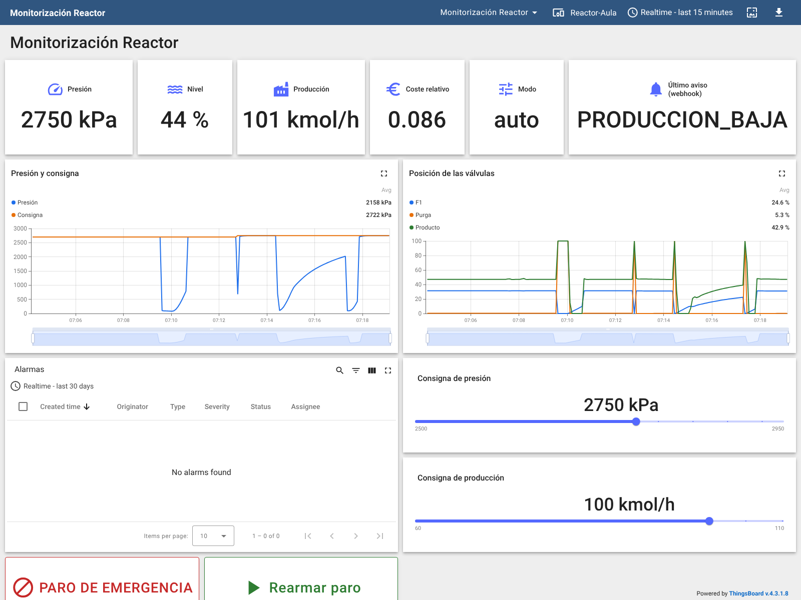
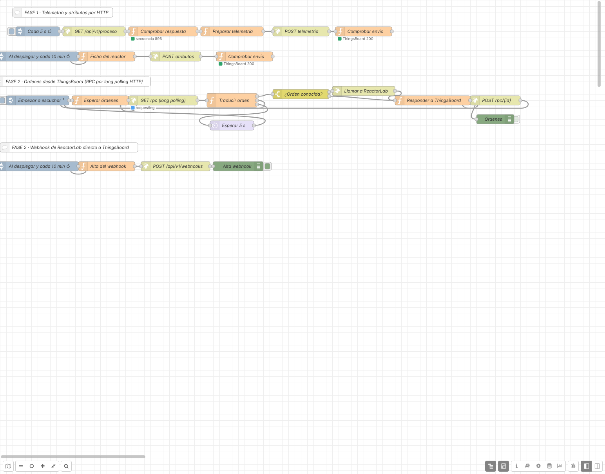

# Práctica: ReactorLab con Node-RED y ThingsBoard (todo por HTTP)

> Serie **2 · Node-RED + ThingsBoard**. Es la continuación de
> [1-dashboard/reactorlab](../../1-dashboard/reactorlab/README.md). Flujo
> resuelto para el profesorado:
> [flows/reactorlab-thingsboard-solucion.json](flows/reactorlab-thingsboard-solucion.json).
> Panel resuelto: [thingsboard/panel-reactorlab.json](thingsboard/panel-reactorlab.json).

## Introducción

Al terminar esta práctica, el reactor químico ReactorLab aparecerá en
**ThingsBoard** con su histórico, un panel, alarmas y mandos. La novedad:
**no usarás MQTT**. Todo el camino, de la máquina a la plataforma y de
vuelta, va por **HTTP**, el protocolo de la web.

**La cadena que vas a construir:**

1.  **ReactorLab** ofrece su estado con una API REST (puerto `8030`).
2.  **Node-RED** lo pide cada 5 segundos y lo adapta. Es la **pasarela**.
3.  **ThingsBoard** recibe los datos por su **API HTTP de dispositivos**
    (puerto `8080`), guarda el histórico, muestra el panel y vigila las
    alarmas.
4.  En la Fase 2, ReactorLab avisa **directamente** a ThingsBoard con un
    **webhook**, y ThingsBoard envía **órdenes** a Node-RED, que las
    traduce a peticiones para la planta.

**La API HTTP de dispositivos de ThingsBoard.** Igual que por MQTT, cada
máquina es un **dispositivo** con un **token**. La diferencia es que en
HTTP **el token va dentro de la URL**:

| **Petición**                                        | **Para qué**                                  |
|-----------------------------------------------------|-----------------------------------------------|
| `POST /api/v1/{TOKEN}/telemetry`                    | Enviar medidas (se guarda su histórico)       |
| `POST /api/v1/{TOKEN}/attributes`                   | Enviar datos fijos del equipo                 |
| `GET  /api/v1/{TOKEN}/rpc?timeout=20000`            | Esperar una orden (*long polling*, Fase 2)    |
| `POST /api/v1/{TOKEN}/rpc/{id}`                     | Responder a una orden (Fase 2)                |

|                           | **MQTT** (serie 2 de los otros simuladores) | **HTTP** (esta práctica)             |
|---------------------------|---------------------------------------------|--------------------------------------|
| Conexión                  | Abierta todo el tiempo                      | Una petición por envío               |
| Token                     | En el usuario de la conexión                | En la URL                            |
| Recibir órdenes           | Suscripción: llegan solas                   | Hay que preguntar (*long polling*)   |
| Atraviesa proxies y cortafuegos | A veces bloqueado (puerto 1883)       | Casi siempre (es la web)             |

**Antes de empezar, comprueba que tienes:**

- [ ] El laboratorio arrancado (`docker compose up -d` o `start_lab.cmd`).
- [ ] Node-RED en `http://localhost:1880`.
- [ ] ReactorLab en `http://localhost:8030` (y, si quieres, su vista 3D
  en `http://localhost:8030/3d/`).
- [ ] ThingsBoard en `http://localhost:8080`, con `tenant@thingsboard.org`
  / `tenant` o la cuenta que te dé el profesor.

> Dentro de Docker, Node-RED llega a la planta en `http://reactorlab:8030`
> y a ThingsBoard en `http://thingsboard:8080`.

La práctica tiene dos fases. En la **Fase 1** envías datos y construyes
el panel y las alarmas. En la **Fase 2** añades el webhook directo y las
órdenes desde ThingsBoard.

## Fase 1 — Del reactor a ThingsBoard por HTTP (partes 1 a 6)

### Parte 1 — Leer el reactor

Si hiciste la práctica del dashboard, copia de allí el **inject**, el
**http request** y el **Comprobar respuesta** y cambia el intervalo a 5 s.

1.  Crea una pestaña `ReactorLab → ThingsBoard`.
2.  **inject** cada `5` segundos (marca *Inject once after* `1` s) →
    **http request** (`GET`, URL `http://reactorlab:8030/api/v1/proceso`,
    *Return* *a parsed JSON object*) → **function** `Comprobar respuesta`:

<!-- -->

    // ENTRADA: la respuesta de ReactorLab (por HTTP o, más adelante, por WebSocket)
    //   msg.statusCode = código HTTP (200 = correcto). Por WebSocket no existe.
    //   msg.payload    = el estado de la planta en JSON
    // SALIDA:  el mismo mensaje, solo si la respuesta es correcta

    if (msg.statusCode !== undefined && msg.statusCode !== 200) {
        node.status({ fill: "red", shape: "dot", text: "HTTP " + msg.statusCode });
        return null;                          // 404, 500, ECONNREFUSED... no seguimos
    }
    if (typeof msg.payload !== "object" || !msg.payload.medidas) {
        node.status({ fill: "red", shape: "ring", text: "respuesta no válida" });
        return null;
    }
    node.status({ fill: "green", shape: "dot", text: "secuencia " + msg.payload.secuencia });
    return msg;

3.  Pon un **debug** a la salida y haz **Deploy**.

**Comprueba.** Cada 5 s llega el estado de la planta. ¿Por qué 5 s y no
2 s, como en el dashboard? (pista: piensa en cuántas filas guardará la
base de datos de ThingsBoard en un año).

### Parte 2 — Dar de alta el reactor y guardar el token

1.  En ThingsBoard: **Entities → Devices → + → Add new device**. **Name**
    `Reactor-Aula`, perfil `default`. Abre el dispositivo y pulsa **Copy
    access token**.
2.  En Node-RED, haz doble clic en la **pestaña** `ReactorLab →
    ThingsBoard` (en la barra de pestañas). En **Environment variables**
    pulsa **+ add**:
    - **Name:** `TB_TOKEN`
    - **Type:** **credential** (el icono de la llave)
    - **Value:** el token
3.  **Done** y **Deploy**.

> ¿Por qué una variable *credential*? En HTTP el token va en la URL, así
> que si lo escribes en un nodo acabará en el JSON que exportes y
> entregues. Las credenciales de Node-RED se guardan cifradas y **no se
> exportan**. Desde un **function** se leen con `env.get("TB_TOKEN")`.

### Parte 3 — Preparar la telemetría

El estado de la planta tiene bloques anidados (`medidas.caudal_kmolh.f1`).
ThingsBoard trabaja mejor con **claves planas**, y además guardaremos las
**válvulas** y las **consignas**: serán la clave para diagnosticar averías.

1.  Conecta al **Comprobar respuesta** un **function** `Preparar
    telemetría`:

<!-- -->

    // ENTRADA: el estado completo de la planta (GET /api/v1/proceso)
    // SALIDA:  msg.payload = { ts, values } y msg.url = API HTTP de ThingsBoard

    const p = msg.payload;
    const m = p.medidas;
    const v = p.valvulas;

    msg.payload = {
        ts: Date.parse(p.timestamp),          // hora de la medida en la planta
        values: {
            presion_kpa:           m.presion_kpa,
            nivel_pct:             m.nivel_pct,
            caudal_f1_kmolh:       m.caudal_kmolh.f1,
            caudal_f2_kmolh:       m.caudal_kmolh.f2,
            caudal_purga_kmolh:    m.caudal_kmolh.purga,
            caudal_producto_kmolh: m.caudal_kmolh.producto,
            a_purga_pct:           m.composicion_purga_pct.A,
            coste_relativo:        m.coste_relativo,
            valvula_f1_pct:        v.f1.posicion_pct,
            valvula_f2_pct:        v.f2.posicion_pct,
            valvula_purga_pct:     v.purga.posicion_pct,
            valvula_producto_pct:  v.producto.posicion_pct,
            sp_presion_kpa:        p.consignas.presion_kpa,
            sp_produccion_kmolh:   p.consignas.caudal_producto_kmolh,
            modo:                  p.estado.modo,
            paro_emergencia:       p.estado.paro_emergencia,
            alarmas_activas:       p.estado.alarmas_activas
        }
    };

    // En la API HTTP de ThingsBoard el token va en la URL. Lo leemos de una
    // variable de entorno de tipo credencial: así no aparece en el flujo exportado.
    msg.method = "POST";
    msg.url = "http://thingsboard:8080/api/v1/" + env.get("TB_TOKEN") + "/telemetry";
    msg.headers = { "Content-Type": "application/json" };
    return msg;

2.  Pon un **debug** a su salida y haz **Deploy**.

**Comprueba.** ¿Qué tres propiedades del mensaje prepara el código además
de `payload`? ¿Qué aparecería en la URL si se te olvida la variable
`TB_TOKEN`?

### Parte 4 — Enviar por HTTP a ThingsBoard

1.  Conecta al **Preparar telemetría** un **http request**:
    - **Method:** `- set by msg.method -`
    - **URL:** vacía (la pone el código)
    - **Return:** *a UTF-8 string* (ThingsBoard contesta con un cuerpo
      vacío)
2.  Conéctalo a un **function** `Comprobar envío`:

<!-- -->

    // ENTRADA: la respuesta de ThingsBoard
    // SALIDA:  nada; solo muestra el resultado debajo del nodo

    if (msg.statusCode === 200) {
        node.status({ fill: "green", shape: "dot", text: "ThingsBoard 200" });
    } else {
        node.status({ fill: "red", shape: "dot", text: "ThingsBoard " + msg.statusCode });
        node.warn("ThingsBoard respondió " + msg.statusCode + " (¿token mal copiado?)");
    }
    return null;

3.  **Deploy**. Debajo del **Comprobar envío** debe aparecer
    `ThingsBoard 200`.
4.  En ThingsBoard abre `Reactor-Aula` → **Latest telemetry**: 17 claves,
    actualizadas cada 5 s.

**Comprueba.**

1.  Cambia una letra del token (en la variable de la pestaña) y haz
    Deploy: ¿qué código devuelve ThingsBoard? Vuelve a ponerlo bien.
2.  ¿Qué hora tienen los datos en ThingsBoard: la de la planta o la de
    llegada? ¿Dónde se decide?
3.  En la sección **Protocolos web** de ReactorLab, ¿ves las peticiones
    de Node-RED? ¿Ves las que Node-RED hace a ThingsBoard? ¿Por qué no?

### Parte 5 — Atributos: la ficha del reactor

1.  Añade un **inject** `Al desplegar y cada 10 min` (*Inject once after*
    `1` s y *Repeat* cada `10` minutos, por si ThingsBoard aún no estaba
    en marcha) → un **function** `Ficha del reactor` → otro **http request** igual que el
    de la Parte 4 → otro **Comprobar envío**:

<!-- -->

    // SALIDA: datos fijos del reactor (atributos de cliente) por HTTP

    msg.payload = {
        proceso:          "Tennessee Eastman simplificado (A + C -> D)",
        volumen_m3:       122,
        volumen_liquido_max_m3: 30,
        protocolo:        "REST / WebSocket / webhooks",
        api:              "http://reactorlab:8030/api/v1/proceso"
    };
    msg.method = "POST";
    msg.url = "http://thingsboard:8080/api/v1/" + env.get("TB_TOKEN") + "/attributes";
    msg.headers = { "Content-Type": "application/json" };
    return msg;

2.  **Deploy** y en ThingsBoard abre el dispositivo → **Attributes** →
    **Client attributes**.

**Comprueba.** ¿Por qué el volumen del reactor es un atributo y el nivel
una telemetría?

### Parte 6 — Primer panel en ThingsBoard

1.  **Dashboards → + → Create new dashboard**: `Monitorización
    Reactor`. **Edit mode** → **Entity aliases**: alias `Reactor`,
    *Single entity*, dispositivo `Reactor-Aula`.
2.  **Cards → Value card** para cada dato:

| **Dato**        | **Clave**               | **Unidad** |
|-----------------|-------------------------|------------|
| Presión         | `presion_kpa`           | kPa        |
| Nivel           | `nivel_pct`             | %          |
| Producción      | `caudal_producto_kmolh` | kmol/h     |
| Coste relativo  | `coste_relativo`        | —          |
| Modo            | `modo`                  | —          |

3.  **Save**.

## Fase 1 — Histórico, diagnóstico y alarmas (partes 7 a 10)

### Parte 7 — Histórico de medidas y de válvulas

1.  **Charts → Time series chart** `Presión y consigna` con
    `presion_kpa` y `sp_presion_kpa`.
2.  Otro **Time series chart** `Posición de las válvulas` con
    `valvula_f1_pct`, `valvula_purga_pct` y `valvula_producto_pct`.
3.  Ventana **Realtime → last 30 minutes**. **Save**.
4.  En la web de ReactorLab sube la consigna de presión a 2800 y, a los
    tres minutos, vuelve a 2700.

**Comprueba.** En la gráfica, ¿cuánto tarda la presión en alcanzar la
consigna? ¿Qué válvula se mueve para conseguirlo?

### Parte 8 — Diagnosticar una avería oculta

1.  El profesor inyecta en ReactorLab un fallo de **sensor**: el
    transmisor de **presión** empieza a **derivar**.
2.  Observa el panel 3 minutos sin tocar nada.

| **Variable**                | **Antes** | **3 min después** | **¿Normal?** |
|-----------------------------|-----------|-------------------|--------------|
| Presión medida (kPa)        |           |                   |              |
| Válvula de purga (%)        |           |                   |              |
| Coste relativo              |           |                   |              |
| Producción (kmol/h)         |           |                   |              |

**Preguntas:**

1.  La presión **medida** sigue en 2700. ¿Está bien el reactor?
2.  ¿Por qué se abre la purga si «la presión es normal»? ¿Qué está
    haciendo el lazo de control con un sensor que miente?
3.  ¿Te habrías dado cuenta sin el histórico de las válvulas?

> Con la avería quitada, mira la vista 3D (`http://localhost:8030/3d/`):
> las válvulas de la escena se mueven con los mismos datos.

### Parte 9 — Reglas de alarma

1.  En el dispositivo → **Alarm rules → + → Create new alarm rule**:
    - **Alarm type:** `Presión alta`
    - **Argument:** `presion_kpa` (*Latest telemetry*)
    - **Trigger:** **Major**, `presion_kpa` **greater than** `2850`,
      **Condition type** *Duration* `30` seconds
    - **Clear:** `presion_kpa` **less than** `2800`
2.  Crea otra regla `Purga anormal`: **Warning** si `valvula_purga_pct`
    **greater than** `3` durante `60` segundos; se borra por debajo de
    `1.5`. (Lo normal es que la purga esté casi cerrada, en torno al
    0,5 %.)
3.  Añade **Alarm widgets → Alarms table** al panel.
4.  Pruebas: sube la consigna de presión a `2900` en ReactorLab; después
    pide al profesor que repita la **deriva** del sensor de presión.

**Comprueba.** ¿Qué regla detecta la deriva del sensor? ¿Por qué una
regla sobre una **válvula** descubre una avería que la regla sobre la
**medida** no ve?

> **Ampliación.** El coste relativo (purga desperdiciada por mol de
> producto) vale unos 0,25 en marcha normal y se dispara con la deriva.
> Crea la regla `Coste anormal`: **Warning** si `coste_relativo` es mayor
> que `1` durante `60` s. ¿Salta antes o después que `Purga anormal`?

### Parte 10 — Detectar que la pasarela ha dejado de enviar

1.  En el dispositivo → **Attributes → Server attributes → +**:
    `inactivityTimeout`, *Integer*, `30000`.
2.  Regla `Sin comunicación`: argumento `active` (*Attribute*, *Server
    attributes*), **Critical** si `active` **equal** `false`; se borra con
    `true`.
3.  Desactiva el **inject** de la Parte 1 (*Disabled*) y haz Deploy.
    Espera hasta un minuto y vuelve a activarlo.

**Comprueba.** ¿Cuánto tarda la alarma? ¿Qué diferencia hay con la
alarma de la Parte 9?

## Fase 2 — Webhook directo y órdenes desde ThingsBoard (partes 11 a 13)

Antes de seguir, **guarda una copia** (*Menu → Export* o snapshot en
`http://localhost:8090`).

### Parte 11 — Webhook: la planta avisa a ThingsBoard sin pasarela

ReactorLab puede llamar a **cualquier URL** cuando salta una alarma. La
API HTTP de ThingsBoard es una URL… así que la planta puede avisar a la
plataforma **sin pasar por Node-RED**. Node-RED solo hace el alta:

1.  Añade un **inject** `Al desplegar y cada 10 min` (*once after* `3` s,
    *Repeat* cada `10` minutos; el alta es idempotente) → **function**
    `Alta del webhook` → **http request** (*set by msg.method*, *a parsed
    JSON object*) → **debug**:

<!-- -->

    // SALIDA: alta de un webhook de ReactorLab que envía las alarmas
    // DIRECTAMENTE a ThingsBoard, sin pasar por Node-RED

    const CLAVE = "reactorlab";

    msg.method  = "POST";
    msg.url     = "http://reactorlab:8030/api/v1/webhooks";
    msg.headers = { "X-API-Key": CLAVE, "Content-Type": "application/json" };
    msg.payload = {
        url: "http://thingsboard:8080/api/v1/" + env.get("TB_TOKEN") + "/telemetry",
        eventos: ["alarma"],
        formato: "plano"                   // claves sin anidar: alarma_codigo, alarma_valor...
    };
    return msg;

2.  **Deploy**: el debug muestra el webhook creado. Fíjate en que
    ReactorLab enseña la URL con el token **oculto** (`/api/v1/••••/`).
3.  Sube la consigna de presión a `2900` en ReactorLab y espera la alarma.
4.  En **Latest telemetry** aparecen `evento`, `alarma_codigo`,
    `alarma_valor`, `alarma_severidad`… Añade al panel una **Value card**
    `Último aviso (webhook)` con `alarma_codigo`.

**Comprueba.**

1.  En ReactorLab, tabla **Protocolos web**: ¿qué fila corresponde al
    aviso? ¿Quién es el cliente?
2.  Las alarmas de la Parte 9 las calcula ThingsBoard; estas, la propia
    planta. ¿Cuál salta antes? ¿Pueden no coincidir?
3.  ¿Qué riesgo tiene darle a la planta una URL con el token? ¿Cómo lo
    limitarías?

### Parte 12 — Recibir órdenes por *long polling*

Por HTTP, ThingsBoard **no puede llamar** a Node-RED: es Node-RED quien
pregunta *«¿hay alguna orden para mí?»*. Para no preguntar cada segundo
se usa **long polling**: la petición se queda abierta hasta 20 s; si
llega una orden, ThingsBoard contesta al instante (**200**); si no, al
acabar el tiempo contesta **408** y se vuelve a preguntar.

    ┌──────────────────────────────────────────────────────────────┐
    │  Esperar órdenes ─▶ GET rpc ─▶ Traducir orden ─┬▶ ReactorLab ─▶ Responder ─▶ POST rpc/{id} ─┐
    │        ▲                                       ├▶ (408) ────────────────────────────────────┤
    │        └───────────────────────────────────────┴▶ (error) Esperar 5 s ─────────────────────┘
    └──────────────────────────────────────────────────────────────┘

| **Método**       | **Parámetros**   | **Petición a ReactorLab**                                 |
|------------------|------------------|-----------------------------------------------------------|
| `setPresion`     | 2500–2950        | `PUT /api/v1/consignas` `{ "presion_kpa": … }`            |
| `setProduccion`  | 60–110           | `PUT /api/v1/consignas` `{ "caudal_producto_kmolh": … }`  |
| `paroEmergencia` | `true` / `false` | `POST /api/v1/paro-emergencia` `{ "activo": … }`          |

1.  **inject** `Empezar a escuchar` (*once after* `2` s) → **function**
    `Esperar órdenes`:

<!-- -->

    // SALIDA: petición GET de "long polling" a ThingsBoard.
    // ThingsBoard mantiene la petición abierta hasta 20 s: si llega una orden,
    // responde 200 con ella; si no, responde 408 y volvemos a preguntar.

    msg.method = "GET";
    msg.url = "http://thingsboard:8080/api/v1/" + env.get("TB_TOKEN") + "/rpc?timeout=20000";
    msg.requestTimeout = 25000;            // ms: algo más que el timeout de ThingsBoard
    delete msg.payload;
    return msg;

2.  → **http request** `GET rpc (long polling)` (*set by msg.method*,
    URL vacía, *Return* **a UTF-8 string**) → **function** `Traducir
    orden` con **Outputs: 3**:

<!-- -->

    // ENTRADA: respuesta de ThingsBoard al long polling
    //   200 -> msg.payload = { "id": 3, "method": "setPresion", "params": 2800 }
    //   408 -> no había órdenes (se vuelve a preguntar)
    //   (el nodo http request devuelve el texto tal cual: lo convertimos aquí)
    //   otro (401, ECONNREFUSED...) -> error: se reintenta dentro de 5 s
    // SALIDAS: 1 petición para ReactorLab · 2 volver a esperar · 3 reintentar más tarde

    const CLAVE = "reactorlab";

    if (msg.statusCode === 408) {
        return [null, { payload: null }, null];          // no había órdenes
    }
    if (msg.statusCode === 200 && typeof msg.payload === "string") {
        msg.payload = JSON.parse(msg.payload);           // ThingsBoard responde texto JSON
    }
    if (msg.statusCode !== 200 || !msg.payload || msg.payload.id === undefined) {
        node.status({ fill: "red", shape: "dot", text: "ThingsBoard " + msg.statusCode });
        return [null, null, { payload: null }];          // error: esperar antes de reintentar
    }
    node.status({ fill: "green", shape: "dot", text: "orden " + msg.payload.method });
    const orden = msg.payload;
    const peticion = {
        rpcId: orden.id,                   // lo necesitaremos para responder
        headers: { "X-API-Key": CLAVE, "Content-Type": "application/json" }
    };

    if (orden.method === "setPresion") {
        peticion.method = "PUT";
        peticion.url = "http://reactorlab:8030/api/v1/consignas";
        peticion.payload = { presion_kpa: Number(orden.params) };
    } else if (orden.method === "setProduccion") {
        peticion.method = "PUT";
        peticion.url = "http://reactorlab:8030/api/v1/consignas";
        peticion.payload = { caudal_producto_kmolh: Number(orden.params) };
    } else if (orden.method === "paroEmergencia") {
        peticion.method = "POST";
        peticion.url = "http://reactorlab:8030/api/v1/paro-emergencia";
        peticion.payload = { activo: orden.params === true || orden.params === "true" };
    } else {
        // orden desconocida: se responde con error sin tocar la planta
        peticion.method = "SKIP";
        peticion.payload = { ok: false, error: "Orden desconocida: " + orden.method };
    }
    return [peticion, null, null];

3.  Salidas del **Traducir orden**:
    - Salida 1 → un **switch** `¿Orden conocida?` sobre `msg.method`:
      regla 1 **!=** `SKIP`, regla 2 **==** `SKIP`. La regla 1 va a un
      **http request** `Llamar a ReactorLab` (*set by msg.method*, *a
      parsed JSON object*); la regla 2, directa al paso siguiente.
    - Salida 2 → de vuelta a la entrada de **Esperar órdenes**.
    - Salida 3 → un **delay** de `5` s → **Esperar órdenes**.
4.  **Llamar a ReactorLab** (y la regla 2 del switch) → **function**
    `Responder a ThingsBoard`:

<!-- -->

    // ENTRADA: la respuesta de ReactorLab a la orden (o una orden desconocida)
    // SALIDA:  POST con el resultado a ThingsBoard (cierra la petición RPC)

    let resultado;
    if (msg.method === "SKIP") {
        resultado = msg.payload;
    } else if (msg.statusCode === 200) {
        resultado = { ok: true, respuesta: msg.payload };
    } else {
        resultado = { ok: false, http: msg.statusCode, error: msg.payload && msg.payload.detail };
    }
    return {
        method: "POST",
        url: "http://thingsboard:8080/api/v1/" + env.get("TB_TOKEN") + "/rpc/" + msg.rpcId,
        headers: { "Content-Type": "application/json" },
        payload: resultado
    };

5.  → **http request** `POST rpc/{id}` (*set by msg.method*, *a UTF-8
    string*) → de vuelta a **Esperar órdenes**.
6.  **Deploy** y prueba con **Control widgets → RPC debug terminal** en
    el panel: `setPresion 2750`, `setPresion 9000`, `setProduccion 95`,
    `abrirTodo 1`.

> Si el terminal da *timeout*, sube su tiempo de espera a `10000` ms: la
> orden tiene que esperar a que Node-RED esté preguntando.

**Comprueba.** ¿Qué responde ReactorLab a `setPresion 9000`? ¿Y Node-RED
a `abrirTodo`? Desactiva el nodo **delay** y apaga ThingsBoard un momento
(o pon un token erróneo): ¿qué pasaría sin la espera de 5 s?

### Parte 13 — Mandos en el panel (ampliación final)

1.  **Control widgets → Slider** `Consigna de presión` (2500–2950, kPa):
    *Initial state* → *Get time series* `sp_presion_kpa`; *Value change*
    → *Execute RPC* `setPresion`, valor *Value*.
2.  Otro **Slider** `Consigna de producción` (60–110, kmol/h) con
    `sp_produccion_kmolh` y `setProduccion`.
3.  Dos **Control widgets → Command button**: `PARO DE EMERGENCIA` (*On
    click* → *Execute RPC* `paroEmergencia`, parámetro *Constant* `true`)
    y `Rearmar paro` (constante `false`).
4.  **Save** y prueba los mandos mirando a la vez la web de ReactorLab y
    su vista 3D.

Así queda el panel resuelto:

*Panel resuelto en ThingsBoard (captura real del laboratorio).*

Y el flujo de Node-RED:

*Flujo resuelto en Node-RED (captura real del laboratorio).*

**Comprueba.** Al mover el slider, ¿cuándo cambia `sp_presion_kpa` en el
panel: al soltar o cuando llega la siguiente lectura? ¿Por qué el slider
lee su valor de la telemetría y no de lo último que enviaste?

## Cierre y entrega

> HTTP sirve para todo el recorrido: leer la máquina, alimentar la
> plataforma, avisar de eventos y dar órdenes. Es universal y atraviesa
> cualquier red, pero exige preguntar (o esperar) y cuidar mucho los
> tokens, que viajan en las URL.

**Qué entregar:**

- [ ] Flujo de Node-RED exportado (*Menu → Export → all flows*). Comprueba
  que **no** aparece el token (búscalo en el JSON).
- [ ] Panel de ThingsBoard exportado.
- [ ] Tabla de la Parte 8 completada y respuesta razonada.
- [ ] Captura de la tabla de alarmas con `Presión alta` y `Purga anormal`.
- [ ] Captura del panel con el último aviso recibido por webhook.
- [ ] Respuestas a las preguntas finales.

**Preguntas finales:**

1.  Dibuja los cuatro caminos de esta práctica (lectura, telemetría,
    webhook, órdenes) indicando quién es cliente y quién servidor en cada
    uno.
2.  ¿Qué ventajas e inconvenientes tiene HTTP frente a MQTT para enviar
    telemetría a ThingsBoard?
3.  ¿Por qué el token no debe ir escrito en un nodo? ¿Qué pasaría en una
    red sin HTTPS?
4.  Explica con tus palabras el *long polling*. ¿Por qué no basta con
    preguntar cada segundo?
5.  En la Parte 8, ¿qué variables vigilarías en una planta real para
    detectar sensores que mienten?

**Si algo no funciona:**

| **Síntoma**                                        | **Causa probable**                                   | **Qué hacer**                                                                 |
|----------------------------------------------------|------------------------------------------------------|-------------------------------------------------------------------------------|
| `Comprobar envío` muestra `ThingsBoard 401`        | Token mal copiado o variable vacía                   | Revisa `TB_TOKEN` en las propiedades de la pestaña (tipo *credential*)        |
| La URL contiene `undefined`                        | La variable no existe en esta pestaña                | Debe estar en la **misma pestaña** que los **function**                       |
| Aviso *JSON parse error*                           | *Return* en *parsed JSON* para ThingsBoard           | ThingsBoard contesta vacío: usa *a UTF-8 string*                              |
| Telemetría vacía pero 200                          | Se envía el estado sin preparar                      | El http request debe colgar del **Preparar telemetría**                        |
| Las horas salen en 1970                            | `ts` en segundos                                     | `Date.parse()` ya da milisegundos                                             |
| No llegan avisos del webhook                       | URL con `localhost`                                  | Quien llama es ReactorLab: la URL debe ser `http://thingsboard:8080/...`      |
| El terminal RPC da *timeout*                       | El bucle de *long polling* no está en marcha         | Mira el estado del **Traducir orden**; pulsa el inject `Empezar a escuchar`   |
| Node-RED hace cientos de peticiones por segundo    | Falta el **delay** en la salida de error             | La salida 3 del **Traducir orden** debe pasar por **Esperar 5 s**             |
| La orden responde `401` de ReactorLab              | Falta la clave de la planta                          | `X-API-Key: reactorlab` en `peticion.headers`                                 |
