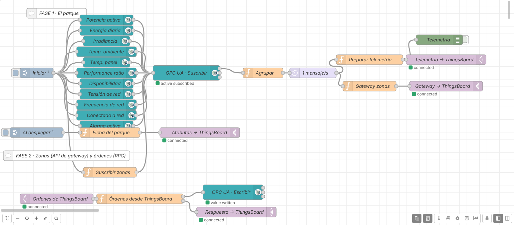
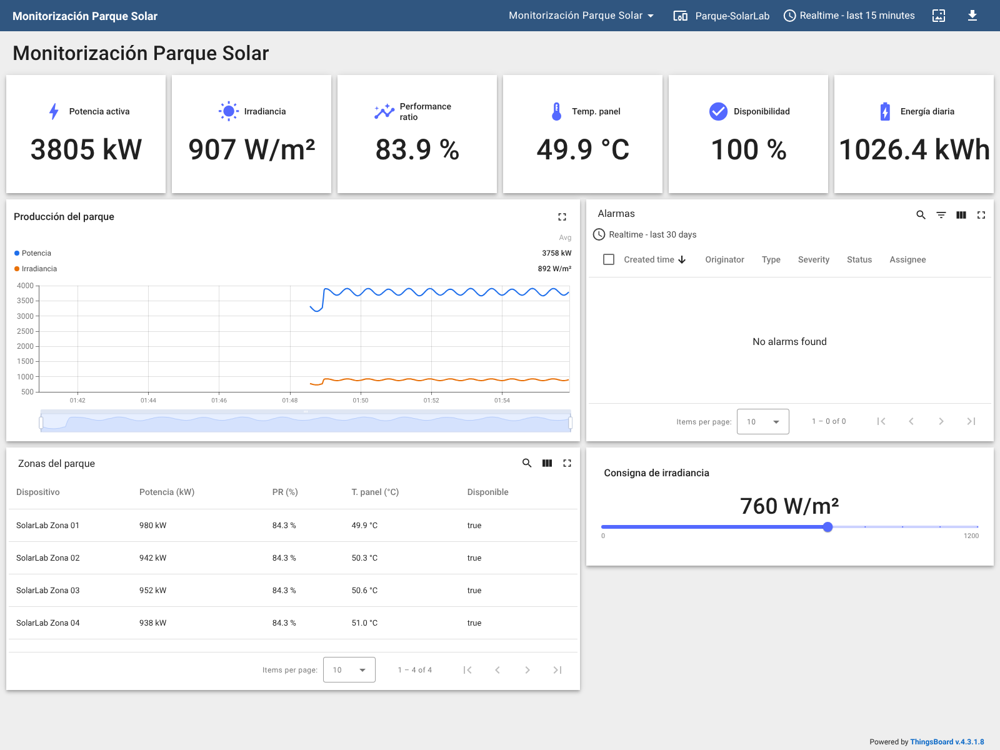

# Práctica: SolarLab con Node-RED y ThingsBoard (OPC UA → MQTT → plataforma IIoT)

> Serie **2 · Node-RED + ThingsBoard**. Es la continuación de
> [1-dashboard/solarlab](../../1-dashboard/solarlab/README.md): allí
> construiste un dashboard dentro de Node-RED; aquí Node-RED pasa a ser la
> **pasarela** que lleva los datos del parque a una plataforma IIoT.
> Flujo resuelto para el profesorado:
> [flows/solarlab-thingsboard-solucion.json](flows/solarlab-thingsboard-solucion.json).
> Panel resuelto: [thingsboard/panel-solarlab.json](thingsboard/panel-solarlab.json).

## Introducción

Al terminar esta práctica, el parque fotovoltaico SolarLab aparecerá en
**ThingsBoard** como un dispositivo de la empresa, con sus cuatro zonas
como dispositivos propios: histórico guardado, un panel accesible desde
cualquier navegador, alarmas que se crean y se borran solas y una
consigna que se puede cambiar desde el panel. No vas a programar desde
cero: el código lo tienes preparado en esta guía.

**La cadena que vas a construir:**

1.  **SolarLab** simula un parque de 5 MWp con un servidor **OPC UA**
    (puerto `4840`).
2.  **Node-RED** se suscribe a las variables, las junta en un mensaje y
    las adapta. Es la **pasarela** (*edge gateway*).
3.  **MQTT** transporta los datos desde Node-RED hasta ThingsBoard.
4.  **ThingsBoard** guarda el histórico, muestra el panel y vigila las
    alarmas.
5.  **Técnico de mantenimiento** ve el parque y sus zonas desde
    cualquier sitio y, en la Fase 2, envía consignas.

**¿Qué cambia respecto al dashboard de Node-RED?**

|                          | Dashboard de Node-RED            | ThingsBoard                                   |
|--------------------------|----------------------------------|-----------------------------------------------|
| Dónde viven los datos    | En la memoria de Node-RED        | En una base de datos                          |
| Histórico                | Lo que quepa en la gráfica       | Días o meses, con zoom y medias               |
| Quién lo ve              | Quien abra tu Node-RED           | Usuarios y clientes con su propio acceso      |
| Alarmas                  | Las programas tú con `function`  | Reglas configurables, con avisos y registro   |
| Zonas                    | Bloques dentro de un mensaje     | Un dispositivo por zona y reglas por perfil   |

**Antes de empezar, comprueba que tienes:**

- [ ] El laboratorio arrancado (`docker compose up -d` o `start_lab.cmd`).
- [ ] Node-RED en `http://localhost:1880`, con la paleta
  `node-red-contrib-opcua` (ya viene instalada en el laboratorio).
- [ ] SolarLab en `http://localhost:8000`.
- [ ] ThingsBoard en `http://localhost:8080`. Entra con
  `tenant@thingsboard.org` / `tenant` o con la cuenta que te dé el
  profesor.

> En el entorno Docker del laboratorio cada servicio se llama por su
> nombre: SolarLab es `solarlab` y ThingsBoard es `thingsboard`.

**Cómo habla ThingsBoard por MQTT.** El parque será un **dispositivo**
con un **token de acceso** (*access token*), que funciona como su
contraseña. Node-RED se conecta al MQTT de ThingsBoard usando ese token
como **usuario** y publica en topics fijos:

| **Topic**                               | **Sentido**              | **Para qué**                                      |
|-----------------------------------------|--------------------------|---------------------------------------------------|
| `v1/devices/me/telemetry`               | Node-RED → ThingsBoard   | Medidas que cambian (se guarda su histórico)      |
| `v1/devices/me/attributes`              | Node-RED → ThingsBoard   | Datos fijos del parque                            |
| `v1/gateway/...`                        | Node-RED → ThingsBoard   | Datos de varios equipos por una conexión (Fase 2) |
| `v1/devices/me/rpc/request/+`           | ThingsBoard → Node-RED   | Órdenes desde un panel (Fase 2)                   |
| `v1/devices/me/rpc/response/{id}`       | Node-RED → ThingsBoard   | Respuesta a cada orden (Fase 2)                   |

`me` significa *el dispositivo dueño del token*.

La práctica tiene dos fases. En la **Fase 1** trabajas con el parque
completo (bloque `Plant`). En la **Fase 2**, solo cuando la Fase 1 esté
clara, bajas a las zonas y envías consignas.

## Fase 1 — Del parque a ThingsBoard (partes 1 a 6)

### Parte 1 — Suscribirse al parque y agrupar

Si hiciste la práctica del dashboard, puedes copiar de allí el
**inject**, los **OpcUa-Item**, el **OpcUa-Client**, el **Agrupar** y el
**delay** (Ctrl+C y Ctrl+V en una pestaña nueva) y pasar al *Comprueba*.

1.  Crea una pestaña nueva llamada `SolarLab → ThingsBoard`.
2.  Añade un **inject** `Iniciar` con **Inject once after** `1` second.
3.  Añade un **OpcUa-Item** por variable, todos colgando del **inject**:

| **Item (NodeId)**                 | **Type** |
|-----------------------------------|----------|
| `ns=2;s=Plant.ActivePower`        | Double   |
| `ns=2;s=Plant.DailyEnergy`        | Double   |
| `ns=2;s=Plant.Irradiance`         | Double   |
| `ns=2;s=Plant.AmbientTemperature` | Double   |
| `ns=2;s=Plant.PanelTemperature`   | Double   |
| `ns=2;s=Plant.PerformanceRatio`   | Double   |
| `ns=2;s=Plant.Availability`       | Double   |
| `ns=2;s=Plant.GridVoltage`        | Double   |
| `ns=2;s=Plant.GridFrequency`      | Double   |
| `ns=2;s=Plant.Connected`          | Boolean  |
| `ns=2;s=Plant.AlarmActive`        | Boolean  |

4.  Llévalos todos a un **OpcUa-Client**:
    - **Endpoint:** `opc.tcp://solarlab:4840/solarlab/server/`,
      **Security policy** y **mode** `None`.
    - **Action:** `SUBSCRIBE`, intervalo `1` segundo.
5.  Conecta a su salida un **function** `Agrupar` con este código:

<!-- -->

    // ENTRADA: un mensaje por variable (msg.topic = NodeId, msg.payload = valor)
    // SALIDA:  msg.payload = todas las variables recibidas, agrupadas por bloque

    let valor = msg.payload;
    // algunas versiones envían el valor dentro de { value: ... }
    while (valor !== null && typeof valor === "object" && "value" in valor) {
        valor = valor.value;
    }
    if (typeof valor === "number") {
        valor = Math.round(valor * 100) / 100;       // 2 decimales
    }

    // "ns=2;s=Plant.ActivePower"  →  bloque "Plant", variable "ActivePower"
    const nombre = String(msg.topic).split("s=").pop();
    const [bloque, variable] = nombre.split(".");

    const parque = flow.get("parque") || {};
    parque[bloque] = parque[bloque] || {};
    parque[bloque][variable] = valor;
    parque.timestamp = new Date().toISOString();
    flow.set("parque", parque);

    msg.payload = parque;
    return msg;

6.  Después del **Agrupar** añade un **delay** en modo **Rate Limit**:
    1 mensaje por segundo, marcando **drop intermediate messages**.
7.  Pon un **debug** a la salida del **delay** y haz **Deploy**.

**Comprueba.** Cada segundo llega un mensaje con el bloque `Plant` y sus
11 variables. ¿Por qué hace falta el **delay**?

### Parte 2 — Dar de alta el parque en ThingsBoard

1.  En ThingsBoard abre **Entities → Devices** y pulsa **+ → Add new
    device**.
2.  **Name:** `Parque-SolarLab`. **Device profile:** `default`. **Add**.
3.  Abre el dispositivo y pulsa **Copy access token**. Pégalo en un bloc
    de notas.

> El token es la **contraseña** del parque. No lo pongas en capturas ni
> en el JSON que entregues, y no lo compartas con otros grupos.

### Parte 3 — Preparar la telemetría

ThingsBoard guarda cada dato con un nombre (**clave**) y una hora. El
mensaje agrupado ya tiene un bloque con las variables del parque, así
que basta con sacar ese bloque y añadir la hora.

1.  Conecta al **delay** un **function** `Preparar telemetría`:

<!-- -->

    // ENTRADA: el mensaje agrupado (bloque Plant y, más adelante, las zonas)
    // SALIDA:  msg.payload = { ts, values } con las variables del parque

    const parque = msg.payload.Plant;
    if (!parque) {
        return null;                          // todavía no ha llegado nada del parque
    }
    msg.payload = {
        ts: Date.now(),
        values: parque                        // claves = nombre del NodeId (ActivePower...)
    };
    return msg;

2.  Pon un **debug** a su salida y haz **Deploy**.

Verás un mensaje como este:

    {
      "ts": 1794275402000,
      "values": { "ActivePower": 3245.73, "Irradiance": 754.2, "PerformanceRatio": 85.65,
                  "Availability": 100, "Connected": true, "AlarmActive": false, … }
    }

**Comprueba.** Las claves de ThingsBoard serán `ActivePower`,
`Irradiance`… ¿De dónde salen esos nombres? ¿Qué ventaja tiene que
coincidan con el NodeId cuando un técnico busque el origen de un dato?

### Parte 4 — Publicar por MQTT en ThingsBoard

1.  Añade un **mqtt out** conectado al **Preparar telemetría** y crea su
    servidor:
    - **Name:** `ThingsBoard · Parque-SolarLab`
    - **Server:** `thingsboard`. **Port:** `1883`. **Protocol:** MQTT
      V3.1.1.
    - Pestaña **Security**: **Username** = el token. **Password** vacío.
2.  **Topic** `v1/devices/me/telemetry`, **QoS** `1`.
3.  **Deploy**. Debajo del nodo debe aparecer **connected**.
4.  En ThingsBoard abre el parque → **Latest telemetry**: deben aparecer
    11 claves y el dispositivo pasa a **Active**.

**Comprueba.** Compara potencia, irradiancia y PR con la web de
SolarLab. Cambia una letra del token y haz Deploy: ¿qué pasa? Vuelve a
ponerlo bien.

### Parte 5 — Atributos: la ficha del parque

La **telemetría** cambia continuamente y ThingsBoard guarda su
histórico. Los **atributos** son datos que casi nunca cambian y de los
que solo interesa el último valor.

1.  Añade un **inject** `Al desplegar` (**Inject once after** `1` s)
    conectado a un **function** `Ficha del parque`:

<!-- -->

    // SALIDA: msg.payload = datos fijos del parque (atributos de cliente)

    msg.payload = {
        potencia_pico_kwp: 5000,
        zonas:             4,
        seguidores:        96,
        protocolo:         "OPC UA",
        endpoint:          "opc.tcp://solarlab:4840/solarlab/server/",
        namespace_uri:     "urn:solarlab:parque-fotovoltaico"
    };
    return msg;

2.  Conecta su salida a otro **mqtt out** con **el mismo servidor** y
    **Topic** `v1/devices/me/attributes`.
3.  **Deploy** y en ThingsBoard abre el parque → **Attributes** →
    **Client attributes**.

| **Dato**            | **¿Telemetría o atributo?** | **¿Por qué?** |
|---------------------|-----------------------------|---------------|
| Potencia activa     |                             |               |
| Potencia pico       |                             |               |
| Temperatura de panel|                             |               |
| Endpoint OPC UA     |                             |               |

**Comprueba.** Completa la tabla. ¿Qué pasaría con la base de datos si
enviaras el endpoint como telemetría cada segundo durante un año?

Así queda el flujo (arriba la Fase 1, abajo la Fase 2):

*Flujo resuelto en Node-RED (captura real del laboratorio).*

### Parte 6 — Primer panel en ThingsBoard

1.  Abre **Dashboards** y pulsa **+ → Create new dashboard**. Título:
    `Monitorización Parque Solar`. Ábrelo.
2.  **Edit mode** → **Entity aliases**: crea el alias `Parque`, **Filter
    type** `Single entity`, **Type** `Device`, dispositivo
    `Parque-SolarLab`.
3.  **Add widget → Cards → Value card** para cada dato:

| **Dato**          | **Clave**          | **Unidad** |
|-------------------|--------------------|------------|
| Potencia activa   | `ActivePower`      | kW         |
| Irradiancia       | `Irradiance`       | W/m²       |
| Performance ratio | `PerformanceRatio` | %          |
| Temp. panel       | `PanelTemperature` | °C         |
| Disponibilidad    | `Availability`     | %          |
| Energía diaria    | `DailyEnergy`      | kWh        |

4.  **Save**.

**Comprueba.** Pide a un compañero que abra tu panel desde **su**
navegador con tu usuario. ¿Podría hacerlo con el dashboard de Node-RED
de la serie 1?

## Fase 1 — Histórico, alarmas y comunicación (partes 7 a 10)

### Parte 7 — Histórico

1.  Añade **Charts → Time series chart** con `ActivePower` e
    `Irradiance`. Título `Producción del parque`.
2.  Ventana de tiempo: **Realtime → last 15 minutes**. **Save**.
3.  En la web de SolarLab cambia la nubosidad y la irradiancia varias
    veces, dejando un minuto entre cambios.

**Comprueba.** Cierra el navegador y vuelve a abrir el panel: ¿sigue ahí
la curva? ¿La potencia sigue a la irradiancia al instante o con retraso?
Cambia la ventana a **last 1 hour** con agregación **Average**.

### Parte 8 — Simular una incidencia

1.  En SolarLab elige la avería **Disparo inversor Z02**.
2.  Observa el panel 1–2 minutos y vuelve a **Sin avería**.

| **Variable**            | **Antes** | **Durante la avería** | **Hora del cambio** |
|-------------------------|-----------|-----------------------|---------------------|
| Potencia activa (kW)    |           |                       |                     |
| Performance ratio (%)   |           |                       |                     |
| Disponibilidad (%)      |           |                       |                     |
| Alarma activa           |           |                       |                     |

**Preguntas:** ¿cuánto baja la potencia? ¿Por qué la disponibilidad
pasa a 75 %? ¿Sabrías decir, solo con el panel del parque, **qué** zona
ha fallado?

### Parte 9 — Regla de alarma

En la serie 1 programaste la alarma con un nodo **function**. En
ThingsBoard se **configura** con una regla, sin código, y queda
registrada con su hora de inicio, fin y quién la atendió.

1.  Abre el parque → pestaña **Alarm rules** → **+ → Create new alarm
    rule**.
2.  **Alarm type:** `Rendimiento bajo`.
3.  **Arguments → Add argument:** nombre `PerformanceRatio`, tipo
    **Latest telemetry**, clave `PerformanceRatio`.
4.  **Trigger condition:** **Severity** `Major`; `PerformanceRatio`
    **less than** `75`; **Condition type** `Duration`, `10` seconds.
5.  **Clear condition:** `PerformanceRatio` **greater or equal** `78`
    durante `10` seconds. **Add**.
6.  En el panel añade **Alarm widgets → Alarms table** con el alias
    `Parque`.
7.  Repite la avería **Disparo inversor Z02** y después quítala.

**Comprueba.**

1.  ¿Cuánto tarda en aparecer la alarma? ¿Y en borrarse?
2.  ¿Para qué sirve exigir 10 segundos? (pista: una nube que pasa).
3.  ¿Por qué se borra por encima de **78** y no de **75**?
4.  Por la noche la irradiancia es 0: ¿qué pasaría con esta regla? ¿Cómo
    la mejorarías? (pista: un segundo argumento con `Irradiance`).

### Parte 10 — Detectar que el parque ha dejado de responder

Si Node-RED deja de enviar datos, el panel se queda con el último valor.
ThingsBoard puede detectarlo: si un dispositivo no envía nada durante un
tiempo, lo marca como **inactivo**.

1.  Abre el parque → **Attributes** → **Server attributes** → **+**.
    Clave `inactivityTimeout`, tipo **Integer**, valor `30000`.
2.  Crea la regla `Sin comunicación`:
    - **Argument:** nombre `active`, tipo **Attribute**, *scope*
      **Server attributes**, clave `active`.
    - **Trigger condition:** **Critical**, `active` **equal** `false`.
    - **Clear condition:** `active` **equal** `true`.
3.  Corta la comunicación: en Node-RED abre el **OpcUa-Client**, pulsa
    **Enabled** para dejarlo *Disabled* y haz **Deploy**. Espera entre
    30 s y 1 minuto y vuelve a activarlo.

**Comprueba.** ¿Cuánto tardó la alarma? ¿Qué ventaja tiene que lo
vigile la plataforma y no la propia pasarela?

## Fase 2 — Zonas y consignas (partes 11 a 13)

Empieza esta fase solo cuando la Fase 1 funcione. Antes, **guarda una
copia**: exporta el flujo o crea un snapshot en `http://localhost:8090`.

**Por qué las zonas como dispositivos.** En la Parte 8 viste que el
panel del parque no dice **qué** zona falla. Si cada zona es un
dispositivo de ThingsBoard, cada una tiene su histórico y sus alarmas.
Para no crear cuatro tokens y cuatro conexiones, Node-RED se presentará
como una **pasarela** (*gateway*): una sola conexión que envía los datos
de varios equipos indicando de cuál es cada dato.

| **Topic de la API de gateway** | **Qué envía Node-RED**                                                |
|--------------------------------|-----------------------------------------------------------------------|
| `v1/gateway/connect`           | “Existe la `SolarLab Zona 02` y es de tipo `zona-fv`”                 |
| `v1/gateway/telemetry`         | `{ "SolarLab Zona 02": [ { "ts": …, "values": { … } } ] }`            |

ThingsBoard **crea solo** cada zona la primera vez que la pasarela la
nombra, con el **perfil** indicado en `type`.

### Parte 11 — Las zonas como dispositivos

1.  **Suscribir las zonas.** Añade un **function** `Suscribir zonas`,
    con la entrada en el **inject** `Iniciar` y la salida en el mismo
    **OpcUa-Client**:

<!-- -->

    // ENTRADA: el mensaje del inject "Iniciar"
    // SALIDA:  un mensaje por cada variable a suscribir (msg.topic = NodeId)

    const ZONAS     = ["Zone01", "Zone02", "Zone03", "Zone04"];
    const VARIABLES = ["ActivePower", "PerformanceRatio",
                       "PanelTemperature", "Available"];

    const mensajes = [];
    for (const zona of ZONAS) {
        for (const variable of VARIABLES) {
            mensajes.push({
                topic: "ns=2;s=" + zona + "." + variable,
                datatype: variable === "Available" ? "Boolean" : "Double"
            });
        }
    }
    // los corchetes hacen que salgan todos, uno detrás de otro
    return [mensajes];

2.  **Crear la pasarela.** En ThingsBoard, **Entities → Devices → + →
    Add new device**: **Name** `Pasarela-Zonas`, marca **Is gateway**.
    Copia su token.
3.  Conecta al **delay** un **function** `Gateway zonas`:

<!-- -->

    // ENTRADA: el mensaje agrupado (parque + 4 zonas)
    // SALIDA:  mensajes para la API de gateway de ThingsBoard (una zona = un dispositivo)

    const ZONAS = { Zone01: "SolarLab Zona 01", Zone02: "SolarLab Zona 02",
                    Zone03: "SolarLab Zona 03", Zone04: "SolarLab Zona 04" };

    const ahora = Date.now();
    const telemetria = {};
    for (const [zona, dispositivo] of Object.entries(ZONAS)) {
        if (msg.payload[zona]) {
            telemetria[dispositivo] = [ { ts: ahora, values: msg.payload[zona] } ];
        }
    }
    if (Object.keys(telemetria).length === 0) {
        return null;                          // todavía no han llegado datos de las zonas
    }

    const mensajes = [];
    // La primera vez: dar de alta las zonas con el perfil "zona-fv"
    if (!context.get("conectadas")) {
        context.set("conectadas", true);
        for (const dispositivo of Object.values(ZONAS)) {
            mensajes.push({ topic: "v1/gateway/connect",
                            payload: { device: dispositivo, type: "zona-fv" } });
        }
    }
    mensajes.push({ topic: "v1/gateway/telemetry", payload: telemetria });
    return [mensajes];

4.  Su salida va a un **mqtt out** con un **servidor nuevo**
    `ThingsBoard · Pasarela-Zonas` (**Server** `thingsboard`, **Port**
    `1883`, **Username** = token de la pasarela) y el **Topic vacío**.
5.  **Deploy**.

**Comprueba.** En **Entities → Devices** aparecen `SolarLab Zona 01` …
`Zona 04` con el perfil `zona-fv`. ¿Suman sus potencias la del parque?
¿Cuántas conexiones MQTT usa Node-RED para las cuatro zonas?

### Parte 12 — Una regla para todas las zonas y su tabla

Si la regla se pone en el **perfil** `zona-fv`, vale para todas las
zonas.

1.  Abre **Profiles → Device profiles → zona-fv** → pestaña **Alarm
    rules** y crea `Zona fuera de servicio`:
    - **Argument:** `Available`, tipo **Latest telemetry**.
    - **Trigger condition:** **Critical**, `Available` **equal**
      `false`.
    - **Clear condition:** `Available` **equal** `true`.
2.  En el panel crea el alias `Zonas`: **Filter type** `Device type`,
    **Device type** `zona-fv`.
3.  Añade **Tables → Entities table** con el alias `Zonas` y las claves
    `ActivePower`, `PerformanceRatio`, `PanelTemperature` y `Available`.
4.  Elige en SolarLab **Disparo inversor Z02**.

**Comprueba.** ¿En qué zona aparece la alarma? ¿Lo sabías antes de
mirar la tabla? Prueba **String abierto Z03** y **Punto caliente Z01**: ¿qué
zona se ve afectada en cada caso? ¿Salta la alarma? ¿Por qué?

### Parte 13 — Consignas desde ThingsBoard (ampliación final)

En ThingsBoard las órdenes se llaman **RPC**: un widget envía un
**método** con unos **parámetros**, ThingsBoard lo publica en
`v1/devices/me/rpc/request/<número>` y espera la respuesta en
`v1/devices/me/rpc/response/<número>`. Node-RED lo traduce a una
escritura OPC UA:

| **Método**       | **Parámetros** | **Variable OPC UA que se escribe**     |
|------------------|----------------|----------------------------------------|
| `setIrradiancia` | 0–1200         | `ns=2;s=Controls.IrradianceSetpoint`   |
| `setAveria`      | 0–5            | `ns=2;s=Controls.FaultCode`            |

> En una instalación real, una consigna desde un panel web puede afectar
> a la producción o a la seguridad. Hacen falta usuarios con permisos,
> confirmación y registro. Aquí trabajamos con un simulador.

1.  Añade un **mqtt in** con el servidor **del parque**
    (`ThingsBoard · Parque-SolarLab`): **Topic**
    `v1/devices/me/rpc/request/+`, **Output** *a parsed JSON object*.
2.  Conéctalo a un **function** `Órdenes desde ThingsBoard` con
    **Outputs: 2**:

<!-- -->

    // ENTRADA: una orden (petición RPC) enviada desde un panel de ThingsBoard
    //   msg.topic   = "v1/devices/me/rpc/request/7"
    //   msg.payload = { "method": "setIrradiancia", "params": 900 }
    // SALIDAS: 1 escritura OPC UA · 2 respuesta a ThingsBoard

    const id     = msg.topic.split("/").pop();
    const metodo = msg.payload.method;
    const valor  = Number(msg.payload.params);

    function respuesta(datos) {
        return { topic: "v1/devices/me/rpc/response/" + id, payload: datos };
    }

    if (metodo === "setIrradiancia") {
        if (!Number.isFinite(valor) || valor < 0 || valor > 1200) {
            return [null, respuesta({ ok: false, error: "Fuera de rango (0-1200 W/m²)" })];
        }
        return [{ topic: "ns=2;s=Controls.IrradianceSetpoint", datatype: "Double", payload: valor },
                respuesta({ ok: true, irradiancia: valor })];
    }
    if (metodo === "setAveria") {
        if (!Number.isInteger(valor) || valor < 0 || valor > 5) {
            return [null, respuesta({ ok: false, error: "Código de avería 0-5" })];
        }
        return [{ topic: "ns=2;s=Controls.FaultCode", datatype: "Int32", payload: valor },
                respuesta({ ok: true, averia: valor })];
    }
    return [null, respuesta({ ok: false, error: "Orden desconocida: " + metodo })];

3.  Salida 1 → un **OpcUa-Client** con el mismo endpoint y **Action**
    `WRITE`. Salida 2 → un **mqtt out** con el servidor del parque y el
    **Topic vacío**.
4.  **Deploy** y en el panel añade **Control widgets → RPC debug
    terminal** (alias `Parque`). Prueba `setIrradiancia 900`,
    `setIrradiancia 5000` (debe dar error) y `setAveria 2` / `setAveria 0`.
5.  Añade **Control widgets → Slider**: título `Consigna de
    irradiancia`, mínimo `0`, máximo `1200`, unidades `W/m²`; **Value
    change:** *Execute RPC*, método `setIrradiancia`, valor (*Value*).

> Si el terminal responde *timeout*, sube el tiempo de espera de la
> petición a `5000` ms en sus ajustes.

Así queda el panel resuelto:

*Panel resuelto en ThingsBoard (captura real del laboratorio).*

**Comprueba.** Mueve el slider a 400 W/m² y mira la gráfica: ¿cuánto
tarda la potencia en bajar? ¿Por qué es buena práctica confirmar una
consigna con una lectura y no fiarse de haberla enviado? Al terminar,
deja la irradiancia en **760 W/m²** y sin avería.

## Cierre y entrega

> Una plataforma IIoT no solo muestra datos: los guarda, avisa cuando
> algo va mal aunque nadie esté mirando, permite bajar al detalle de
> cada equipo y actuar a distancia con control.

**Qué entregar:**

- [ ] Flujo de Node-RED exportado en JSON (*Menu → Export → all flows*).
  **Comprueba que no contiene los tokens.**
- [ ] Panel de ThingsBoard exportado (icono de **Export** del panel).
- [ ] Captura de *Latest telemetry* y *Client attributes* del parque.
- [ ] Captura del panel durante el disparo del inversor, con la gráfica,
  la tabla de zonas y las alarmas.
- [ ] Tablas de las partes 5 y 8 completadas.
- [ ] Respuestas a las preguntas finales.

> También puedes entregar un **snapshot** del laboratorio: en
> `http://localhost:8090` crea uno con Node-RED y ThingsBoard y
> descárgalo. Ojo: dentro van los tokens.

**Preguntas finales:**

1.  Dibuja el camino de un dato desde la variable OPC UA hasta el panel
    de ThingsBoard. Indica protocolo y puerto en cada tramo.
2.  OPC UA ya organiza los datos en un árbol con nombres. ¿Por qué hace
    falta Node-RED entre SolarLab y ThingsBoard?
3.  ¿Qué diferencia hay entre telemetría y atributo? Pon dos ejemplos de
    cada uno en el parque.
4.  ¿Qué ventaja tiene que cada zona sea un dispositivo? ¿Y la API de
    gateway frente a un token por zona?
5.  ¿Qué ventaja tiene poner la regla en el perfil `zona-fv`?
6.  ¿Qué controles añadirías antes de permitir consignas desde la nube
    en una instalación real?

**Si algo no funciona:**

| **Síntoma**                                              | **Causa probable**                                  | **Qué hacer**                                                                  |
|----------------------------------------------------------|-----------------------------------------------------|--------------------------------------------------------------------------------|
| El **OpcUa-Client** no se pone en verde                  | Endpoint mal escrito                                | `opc.tcp://solarlab:4840/solarlab/server/` (con la barra final)                |
| Llegan mensajes pero falta alguna variable               | Item o tipo mal escrito                             | Revisa el NodeId y el *Type* (Double / Boolean)                                |
| El **mqtt out** pasa a *disconnected* enseguida          | Token mal copiado o en el campo equivocado          | El token va en **Username**; **Password** vacío                                |
| *Latest telemetry* vacío pero *connected*                | Topic mal escrito                                   | Exactamente `v1/devices/me/telemetry`                                          |
| Las claves salen como `Plant`                            | Se envió el mensaje agrupado sin preparar           | El **mqtt out** tiene que colgar del **Preparar telemetría**                   |
| No se crean las zonas                                    | La pasarela no está marcada como gateway            | Edita el dispositivo y marca **Is gateway**                                    |
| Las zonas se crean con perfil `default`                  | Falta el `v1/gateway/connect`                       | Usa el código de la Parte 11 sin cambios y haz Deploy                          |
| El terminal RPC da *timeout*                             | El **mqtt in** no usa el servidor del parque        | El **mqtt in** de órdenes y el **mqtt out** de respuesta usan el mismo servidor |
| La consigna responde pero SolarLab no cambia             | El **OpcUa-Client** de escritura no está en `WRITE` | **Action** `WRITE` y el mismo endpoint                                         |
