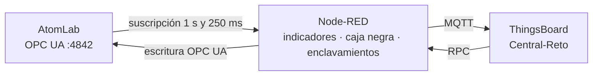

# Reto: un sistema de aviso anticipado para la central AtomLab

## Ficha del reto

| Campo | Valor |
|---|---|
| Asignatura | Monitorización de Máquinas |
| Especialización | Digitalización del Mantenimiento |
| Duración estimada | 3–4 horas (2 sesiones) |
| Agrupamiento | Parejas |
| Nivel | Avanzado (después de las series 1 y 2 de AtomLab) |
| Protocolos | OPC UA y MQTT |
| Software | Laboratorio Docker: AtomLab, Node-RED y ThingsBoard CE 4.3 |
| Producto final | Pasarela en Node-RED con indicadores anticipados, caja negra y órdenes con enclavamientos; panel y reglas en ThingsBoard; informe de evaluación con el escenario del 26-04-1986 |

## Situación profesional

Tras el accidente, la explotación de una central RBMK encarga a vuestro equipo un **sistema de aviso anticipado**: no basta con avisar cuando algo ya va mal (potencia alta, presión alta); hay que avisar **cuando la central se está metiendo en una zona peligrosa**, registrar con detalle lo que pase si dispara y **impedir desde el sistema** las órdenes que no deberían darse en esas condiciones.

El sistema se evaluará reproduciendo la secuencia de la noche del 26 de abril de 1986. La pregunta del informe final es: **¿habría avisado vuestro sistema a tiempo? ¿Habría impedido la prueba?**

## Resultados de aprendizaje

1. Calcular en la pasarela indicadores derivados y **tendencias** a partir de datos OPC UA.
2. Diseñar alarmas que se anticipen al suceso (tendencia, zona de operación, configuración insegura).
3. Construir un registro de sucesos con **memoria previa al disparo** y enviarlo en lotes con marca de tiempo.
4. Implementar **enclavamientos** (*interlocks*) en órdenes remotas, sin bloquear nunca la parada de emergencia.
5. Evaluar un sistema de monitorización frente a un escenario real y argumentar sus límites.

## Material necesario

- El laboratorio arrancado: AtomLab, Node-RED y ThingsBoard.
- Flujo inicial [`flows/atomlab-starter-flow.json`](flows/atomlab-starter-flow.json) (también en **Import → Local → LabMonitorizacion → alumnado**): trae la suscripción OPC UA a 21 variables y el **Agrupar** de la serie 1.
- La web de AtomLab (`http://localhost:8040`), con su tarjeta **Servidor OPC UA** (espacio de direcciones y accesos de clientes).

| Parámetro | Valor en el laboratorio |
|---|---|
| Endpoint OPC UA (desde Node-RED) | `opc.tcp://atomlab:4842/atomlab/`, *Security* `None`, `ns=2` |
| Mandos que se pueden escribir | `Mandos.ConsignaPotencia` (Double), `Mandos.Bombas` (Int32), `Mandos.AZ5`, `Mandos.PruebaInercia` (Boolean, pulsadores) |
| MQTT de ThingsBoard (desde Node-RED) | host `thingsboard`, puerto `1883`, token como *Username* |
| Dispositivo | `Central-Reto` |

## Requisitos

### R1 · Telemetría básica

Publica en `Central-Reto`, a 1 mensaje por segundo, como mínimo: potencias térmica y eléctrica, reactividad, periodo, ORM, xenón, vacío, caudal, presión, nivel, bombas, estado, SCRAM y protecciones activas.

### R2 · Indicadores anticipados (calculados en Node-RED)

| Indicador | Clave | Definición |
|---|---|---|
| Rendimiento | `rendimiento_pct` | MWe / MWt × 100 |
| Tendencia del ORM | `orm_tendencia_barras_min` | Pendiente del ORM en los últimos 3 minutos (barras por minuto de reloj) |
| Tiempo hasta ORM 15 | `minutos_hasta_orm15` | Si el ORM baja, minutos hasta llegar a 15 al ritmo actual; si no, `9999` |
| Zona inestable | `zona_inestable` | `true` si la central está en operación por debajo de 700 MWt |

> La tendencia se calcula con el reloj, no con el tiempo de la planta: con la escala ×60 de AtomLab, un minuto de reloj es una hora de planta. Tenlo en cuenta al fijar umbrales.

### R3 · Reglas de alarma en ThingsBoard

Al menos cinco reglas, con severidad, duración y borrado justificados:

1. **ORM bajo** (operación con ORM < 15).
2. **Agotamiento del margen**: el ORM llegará a 15 en menos de un tiempo que tú decidas.
3. **Zona inestable** mantenida.
4. **Protecciones anuladas**.
5. **Accidente** y **sin comunicación**.

### R4 · Caja negra con disparo

- Suscripción aparte cada **250 ms** a la potencia térmica, la reactividad y el estado de protección.
- Memoria circular de los últimos **20 s** en Node-RED.
- Cuando el estado pasa de `OPERACION` a `SCRAM` o `ACCIDENTE`, envía a ThingsBoard **un único lote** con las muestras desde **10 s antes** hasta **10 s después** del disparo, cada una con su `ts`, y un registro del suceso (tipo y número de muestras).
- En el panel, una gráfica de la caja negra separada de la telemetría normal.

### R5 · Órdenes con enclavamientos

Desde el panel (RPC) se pueden dar tres órdenes:

| Método | Efecto | Enclavamiento |
|---|---|---|
| `setPotencia` (MWt) | Consigna de potencia | Rango 0–3200; prohibido operar entre 1 y 699 MWt; con ORM < 15 no se puede **subir** |
| `pruebaInercia` | Prueba de inercia del turbogenerador | Solo con la central en operación, potencia ≥ 700 MWt, ORM ≥ 15 y protecciones activas |
| `az5` | Parada de emergencia | **Ninguno**: la parada nunca se bloquea |

- La respuesta al panel dice **qué condición falta** cuando se rechaza.
- Cada orden, aceptada o rechazada, queda registrada en ThingsBoard (método, valor, resultado).

### R6 · Panel

Panel `Central · aviso anticipado` con: estado y alarmas; potencia y ORM con su tendencia; indicadores de R2; caja negra; mandos y registro de órdenes.

### R7 · Evaluación con el 26-04-1986

1. Con todo funcionando, en AtomLab: *Escenario* → **Plena potencia**. Baja la potencia a 1600 MWt desde **tu panel** y pon la escala de tiempo **×60**. Observa durante 5 minutos el ORM, su tendencia y tus alarmas. Vuelve a ×1.
2. *Escenario* → **26-04-1986 · 01:22**. Anota qué alarmas están activas en el primer minuto.
3. Intenta la **prueba de inercia desde tu panel**. ¿Qué responde tu sistema?
4. Haz la prueba desde la web de AtomLab (como hicieron los operadores, saltándose el procedimiento) y, unos 35 s después, pulsa **AZ-5 desde tu panel**.
5. Recupera la caja negra en ThingsBoard.

## Entrega

1. Flujo de Node-RED exportado **sin el token**.
2. Panel de ThingsBoard exportado.
3. Informe (máximo cuatro páginas) con: la definición y justificación de cada indicador y regla; las capturas de R7; la cronología del 26-04-1986 según **tu** sistema (hora de cada alarma, respuesta a la prueba, lote de la caja negra); y la respuesta a las preguntas.

### Preguntas finales

1. ¿Cuánto tiempo antes de la prueba avisó tu sistema? ¿Qué regla fue la primera?
2. ¿Habrían evitado el accidente tus enclavamientos? ¿Qué pasa si el operador da la orden por otro camino (la web, el panel local)? ¿Dónde tendría que estar realmente un enclavamiento?
3. ¿Por qué la caja negra necesita guardar datos **antes** del disparo?
4. ¿Qué pico de potencia registra tu caja negra frente al real (`Reactor.PicoPotencia`)? ¿Qué limita la resolución?
5. ¿Qué riesgos tiene calcular la tendencia con una recta de 3 minutos? Propón una mejora.

## Criterios de evaluación

| Criterio | Peso | Excelente | Suficiente | Insuficiente |
|---|---:|---|---|---|
| Telemetría e indicadores (R1, R2) | 20 % | Indicadores correctos y robustos (reinicios, disparos) | Indicadores calculados con algún fallo | Faltan indicadores |
| Reglas de alarma (R3) | 20 % | Cinco reglas que se anticipan, umbrales justificados con datos | Reglas que funcionan sin justificar | Solo alarmas de valor alto |
| Caja negra (R4) | 20 % | Lote único con pre y post disparo y suceso registrado | Graba, pero sin memoria previa | No funciona |
| Enclavamientos y auditoría (R5) | 20 % | Todas las condiciones, motivo claro, AZ-5 nunca bloqueado, auditoría completa | Enclavamientos parciales | Sin enclavamientos o AZ-5 bloqueable |
| Evaluación y respuestas (R6, R7) | 20 % | Cronología completa y crítica razonada de los límites | Cronología con lagunas | Sin evaluación |

## Criterios de aceptación técnicos

- `Latest telemetry` de `Central-Reto` muestra las claves de R1 y R2 y se actualiza cada segundo.
- `setPotencia 500` se rechaza con el motivo; `setPotencia 2400` se acepta y AtomLab muestra la consigna.
- En el escenario de 1986, `pruebaInercia` se rechaza indicando las condiciones que faltan; `az5` se acepta.
- Tras el accidente, ThingsBoard tiene un único registro de suceso y más de 100 muestras de caja negra en 20 s.
