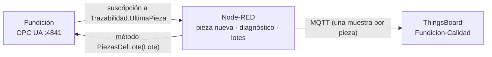

# Reto: trazabilidad y diagnóstico de calidad en la Fundición

## Ficha del reto

| Campo | Valor |
|---|---|
| Asignatura | Monitorización de Máquinas |
| Especialización | Digitalización del Mantenimiento |
| Duración estimada | 3–4 horas (2 sesiones) |
| Agrupamiento | Parejas |
| Nivel | Avanzado (después de las series 1 y 2 de la Fundición) |
| Protocolos | OPC UA (suscripción y **métodos**) y MQTT |
| Software | Laboratorio Docker: Fundición, Node-RED y ThingsBoard CE 4.3 |
| Producto final | Pasarela en Node-RED que registra cada pieza con su historia, diagnostica la causa de los rechazos y pone en cuarentena las coladas sospechosas; dispositivo, panel y reglas en ThingsBoard; informe de diagnóstico de una avería oculta |

## Situación profesional

El cliente principal de la Planta Norte ha devuelto un camión de piezas. El jefe de calidad necesita saber, **de cada
pieza**, de qué colada salió, en qué molde, a qué temperatura se coló, con qué humedad de arena, cuánto se enfrió y qué
midió el escáner. Y quiere dos cosas más:

- que el sistema **proponga una causa** cuando una pieza se rechaza, para no esperar al laboratorio;
- que cuando una colada acumule rechazos, el sistema **localice todas sus piezas** para retirarlas (cuarentena).

El sistema se evaluará con una **avería oculta** que el profesor inyectará sin decir cuál es. La pregunta del informe
final es: **¿qué ha pasado, desde cuándo, qué piezas están afectadas y qué haríais en la planta?**



## Resultados de aprendizaje

1. Convertir un flujo de **eventos** (una pieza cada ~50 s) en registros completos y únicos, aunque sus campos lleguen
   por separado.
2. Diseñar reglas de **diagnóstico por causas** a partir de los límites del proceso, y reconocer sus límites.
3. Llamar a un **método OPC UA** desde Node-RED y usar su respuesta.
4. Modelar la calidad en ThingsBoard: telemetría por pieza, atributos de cuarentena y reglas.
5. Investigar una avería con datos de trazabilidad, teniendo en cuenta el **retraso** entre causa y efecto (el túnel).

## Material necesario

- El laboratorio arrancado: Fundición (`fundicion-opcua`, gemelo 3D en `http://localhost:3000`), Node-RED y ThingsBoard.
- Flujo inicial: **Import → Local → LabMonitorizacion → alumnado → Reto Fundicion Trazabilidad - inicial** (o
  [flows/fundicion-trazabilidad-starter-flow.json](flows/fundicion-trazabilidad-starter-flow.json)). Ya trae la
  suscripción a la última pieza y el agrupado.
- En ThingsBoard, un dispositivo `Fundicion-Calidad` y su token.

| Dónde | Qué hay |
|---|---|
| `ns=1;s=Trazabilidad.UltimaPieza.*` | `Id`, `Molde`, `Prensa`, `Lote`, `TemperaturaColada`, `HumedadArena`, `Inoculada`, `TiempoEnfriamiento`, `TemperaturaDesmoldeo`, `Desviacion`, `Resultado`, `Defecto` |
| `ns=1;s=Trazabilidad.ConsultarPieza(Id)` | Método: la historia de una de las últimas 500 piezas (JSON) |
| `ns=1;s=Trazabilidad.PiezasDelLote(Lote)` | Método: las piezas de una colada y cuántas se rechazaron |
| `ns=1;s=KPIs.PiezasConformes` | Media móvil de piezas conformes |

**Límites del proceso** (los da el jefe de calidad):

| Condición | Límite | Riesgo si se supera |
|---|---|---|
| Temperatura de colada | ≥ 1405 °C | unión fría |
| Humedad de la arena | ≤ 4,3 % | porosidad |
| Inoculación | siempre | fundición blanca |
| Temperatura al desmoldear | ≤ 700 °C | deformación |
| Desviación del escáner | ≤ 0,25 mm | fuera de tolerancia |

## Requisitos

### R1 · Una muestra por pieza

La suscripción entrega un mensaje por **campo** que cambia: los doce campos de una pieza llegan en varios mensajes
seguidos. Construye una *function* `Pieza nueva` que emita **un solo mensaje por pieza**, con todos sus campos, cuando
cambie `Id` y ya hayan llegado los demás.

> Pista: guarda el último `Id` en el contexto del nodo y espera unos cientos de milisegundos antes de emitir.

### R2 · Diagnóstico

Una *function* `Diagnóstico` que añada a la pieza `causa`: las condiciones fuera de límite (pueden ser varias). Si la
pieza se rechaza **con todas las condiciones en orden**, distingue dos casos: el defecto es «Fuera de tolerancia» (¿es la
pieza o es la medida?) o hay otro defecto sin causa aparente.

### R3 · ThingsBoard

Envía cada pieza como **una** muestra de telemetría de `Fundicion-Calidad` con claves planas (`pieza`, `lote`,
`t_colada`, `humedad`, `inoculada`, `t_enfriamiento`, `t_desmoldeo`, `desviacion`, `resultado`, `defecto`, `causa`,
`rechazo` 0/1) y un indicador `rechazos_ultimas_20`.

### R4 · Reglas

En el dispositivo:

- **Racha de rechazos**: `rechazos_ultimas_20` ≥ 3; se borra por debajo de 2. En los detalles de la alarma, la última
  `causa`.
- **Colada en cuarentena**: cuando aparezca el atributo `lote_cuarentena` (R5).

### R5 · Cuarentena por colada

Lleva la cuenta de piezas y rechazos **por colada** (`Lote`). Cuando una colada llegue a 3 rechazos (solo la primera
vez), llama al método OPC UA `Trazabilidad.PiezasDelLote` con un **OpcUa-Client** en modo `METHOD`:

```javascript
msg.objectId = "ns=1;s=Trazabilidad";
msg.methodId = "ns=1;s=Trazabilidad.PiezasDelLote";
msg.inputArguments = [{ dataType: "String", value: lote }];
// la respuesta llega en msg.payload = [ [piezas…], rechazadas ]
```

y publica como **atributos** de `Fundicion-Calidad`: `lote_cuarentena`, `cuarentena_piezas`, `cuarentena_rechazadas`,
`cuarentena_causa` (la causa más frecuente de sus rechazos) y `cuarentena_lista`.

### R6 · Panel

Un panel `Calidad · Planta Norte` con: última pieza y su causa, tabla de las últimas piezas (telemetría con histórico),
rechazos por causa, `PiezasConformes` y los atributos de cuarentena.

### R7 · La avería oculta

El profesor inyectará una avería **sin decir cuál**, normalmente con la planta acelerada (×5). Con vuestro sistema:

1. ¿Desde qué pieza (y qué hora) empieza el problema? ¿Cuándo creéis que empezó **de verdad** en la planta?
2. ¿Qué causa propone vuestro diagnóstico? ¿Afecta a todas las coladas o a una?
3. ¿Qué piezas retiraríais? ¿Retiraríais una colada entera?
4. ¿Qué miraríais **antes** del escáner para confirmarlo (y qué variable de la planta lo demostraría)?

## Entrega

- [ ] Flujo de Node-RED exportado (**sin el token**).
- [ ] Panel de ThingsBoard exportado y captura con una colada en cuarentena.
- [ ] Informe de la avería oculta (R7) con capturas.

### Preguntas finales

1. ¿Por qué no se puede enviar a ThingsBoard cada mensaje de la suscripción tal cual llega?
2. Una pieza rechazada con todas las condiciones en orden, ¿qué te dice? ¿Qué te dicen muchas?
3. Las averías de moldeo y colada aparecen en calidad ~47 min después. ¿Qué consecuencias tiene para el diagnóstico y
   para el número de piezas afectadas?
4. ¿Qué otras variables guardaríais en la historia de cada pieza para una auditoría de un cliente del automóvil?

## Criterios de evaluación

| Criterio | Peso | Nivel alto |
|---|---|---|
| R1 · Una muestra por pieza | 15 % | Exactamente una muestra por pieza, sin campos de la pieza anterior |
| R2 · Diagnóstico | 20 % | Causas múltiples, distingue medida y pieza, límites como constantes |
| R3–R4 · ThingsBoard | 20 % | Claves planas, reglas con borrado y detalle útil |
| R5 · Cuarentena por método OPC UA | 20 % | Una sola llamada por colada, atributos completos |
| R6 · Panel | 10 % | Legible para un jefe de calidad |
| R7 · Informe | 15 % | Causa correcta, explica el retraso del túnel y propone acciones |

## Criterios de aceptación técnicos

- Durante 10 minutos normales, el número de muestras en ThingsBoard coincide con el de piezas de QC-01
  (`Trazabilidad.PiezasInspeccionadas`).
- Una colada con 3 rechazos genera **una** llamada al método y sus atributos.
- El flujo no contiene tokens.
