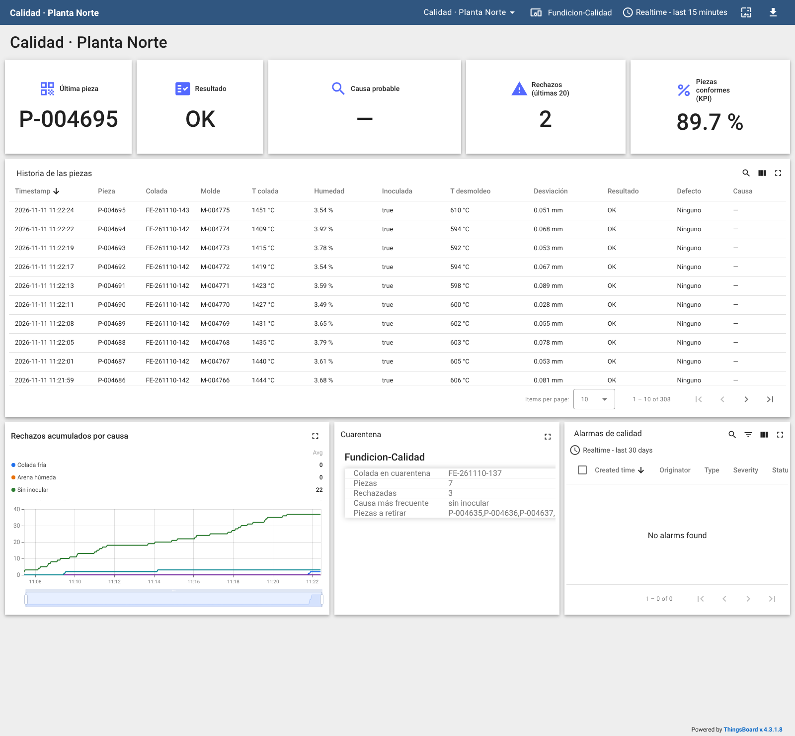

# Solución docente: reto de trazabilidad de la Fundición

Flujo resuelto: [flows/fundicion-trazabilidad-flow.json](flows/fundicion-trazabilidad-flow.json) (en la biblioteca de
Node-RED: **soluciones → Reto Fundicion Trazabilidad - solucion**).

## Preparación del aula

1. En ThingsBoard, un dispositivo `Fundicion-Calidad` por pareja (o uno por equipo si comparten el laboratorio) y su
   token pegado en el broker del flujo.
2. Comprobar que llegan piezas: una cada 50–60 s a ×1 (`Trazabilidad.PiezasInspeccionadas`).
3. Para la avería oculta (R7) acelerar la planta: `ns=1;s=Simulacion.Velocidad` = `5` (o desde el gemelo 3D). Las
   averías de moldeo y colada tardan **~47 min simulados** (~9–10 min reales a ×5) en llegar al escáner.

> Ojo con las reglas de ThingsBoard con duración: cuentan **tiempo real**. Con la planta acelerada, una condición
> que dura 22 s simulados dura 4,4 s reales. Las reglas de este reto no tienen duración, así que no les afecta.

## R1 · Una muestra por pieza

Los campos de la pieza llegan como varios cambios OPC UA en el mismo ciclo de publicación. La solución espera 300 ms
desde el cambio de `Id` y emite la pieza completa, leída del contexto de flujo:

```javascript
// ENTRADA: la planta agrupada (un mensaje por cada variable que cambia)
// SALIDA:  la pieza, una sola vez, cuando QC-01 inspecciona una nueva y ya han llegado todos sus campos

const p = (msg.payload.Trazabilidad || {}).UltimaPieza;
if (!p || !p.Id) return null;
// los campos de una pieza llegan como varios cambios OPC UA seguidos: esperamos a que esté completa
if (p.Id === context.get("ultima")) return null;
const campos = ["Lote", "TemperaturaColada", "HumedadArena", "Inoculada", "TiempoEnfriamiento",
                "TemperaturaDesmoldeo", "Desviacion", "Resultado", "Defecto"];
if (campos.some(c => p[c] === undefined)) return null;
clearTimeout(context.get("t"));
context.set("t", setTimeout(() => {               // 300 ms: que lleguen todos los campos de la misma pieza
    const actual = flow.get("planta").Trazabilidad.UltimaPieza;
    if (actual.Id === context.get("ultima")) return;
    context.set("ultima", actual.Id);
    node.send({ payload: Object.assign({}, actual), contexto: flow.get("planta") });
}, 300));
return null;
```

Errores típicos: emitir en cuanto cambia `Id` (llegan campos de la pieza anterior) o emitir con cada mensaje (doce
muestras por pieza).

## R2 · Diagnóstico

```javascript
// ENTRADA: una pieza inspeccionada
// SALIDA:  la pieza con su causa probable (reglas del jefe de calidad)

// ---- límites del proceso ----
const COLADA_MIN = 1405;      // °C: por debajo, riesgo de unión fría
const HUMEDAD_MAX = 4.3;      // %: por encima, riesgo de porosidad
const DESMOLDEO_MAX = 700;    // °C: por encima, riesgo de deformación
// ------------------------------

const p = msg.payload;
const causas = [];
if (p.TemperaturaColada < COLADA_MIN) causas.push("colada fría");
if (p.HumedadArena > HUMEDAD_MAX) causas.push("arena húmeda");
if (p.Inoculada === false) causas.push("sin inocular");
if (p.TemperaturaDesmoldeo > DESMOLDEO_MAX) causas.push("desmoldeo en caliente");

let causa = causas.join(" + ");
if (p.Resultado === "RECHAZO" && !causas.length) {
    // rechazada con todas las condiciones en orden: ¿es la pieza o es la medida?
    causa = p.Defecto === "Fuera de tolerancia" ? "revisar el escáner (medida)" : "sin causa aparente";
}
p.causa = causa || "—";
p.condiciones_ok = causas.length === 0;
return msg;
```

## R3 · Telemetría

```javascript
// ENTRADA: la pieza diagnosticada
// SALIDA:  { ts, values } para el dispositivo Fundicion-Calidad (una muestra por pieza)

const p = msg.payload;
// racha: rechazos entre las últimas 20 piezas
const ult = context.get("ultimas") || [];
ult.push(p.Resultado === "RECHAZO" ? 1 : 0);
while (ult.length > 20) ult.shift();
context.set("ultimas", ult);

msg.payload = {
    ts: Date.now(),
    values: {
        pieza: p.Id, lote: p.Lote, molde: p.Molde, prensa: p.Prensa,
        t_colada: p.TemperaturaColada, humedad: p.HumedadArena, inoculada: p.Inoculada,
        t_enfriamiento: p.TiempoEnfriamiento, t_desmoldeo: p.TemperaturaDesmoldeo,
        desviacion: p.Desviacion, resultado: p.Resultado, defecto: p.Defecto,
        rechazo: p.Resultado === "RECHAZO" ? 1 : 0, causa: p.causa,
        rechazos_ultimas_20: ult.reduce((a, b) => a + b, 0),
        piezas_conformes: ((flow.get("planta") || {}).KPIs || {}).PiezasConformes
    }
};
// rechazos acumulados por causa (una pieza con dos causas cuenta en las dos)
const CLAVES = { "colada fría": "rech_colada_fria", "arena húmeda": "rech_arena_humeda",
                 "sin inocular": "rech_sin_inocular", "desmoldeo en caliente": "rech_desmoldeo",
                 "revisar el escáner (medida)": "rech_escaner", "sin causa aparente": "rech_sin_causa" };
const cuenta = context.get("por_causa") || Object.fromEntries(Object.values(CLAVES).map(k => [k, 0]));
if (p.Resultado === "RECHAZO") p.causa.split(" + ").forEach(c => { if (CLAVES[c]) cuenta[CLAVES[c]]++; });
context.set("por_causa", cuenta);
Object.assign(msg.payload.values, cuenta);
return msg;
```

## R4 · Reglas de referencia

| Regla | Condición | Borrado | Gravedad | Detalle |
|---|---|---|---|---|
| Racha de rechazos | `rechazos_ultimas_20` ≥ 3 | < 2 | Major | `${causa}` |
| Colada en cuarentena | atributo de cliente `lote_cuarentena` no vacío | (manual, al liberar la colada) | Critical | `${lote_cuarentena}: ${cuarentena_causa}` |

## R5 · Cuarentena por colada

```javascript
// ENTRADA: la pieza diagnosticada
// SALIDA:  una llamada al método PiezasDelLote cuando una colada acumula 3 rechazos (una vez por colada)

const UMBRAL = 3;
const p = msg.payload;
const lotes = flow.get("lotes") || {};
const l = lotes[p.Lote] || { piezas: 0, rechazos: 0, causas: {}, avisado: false };
l.piezas++;
if (p.Resultado === "RECHAZO") { l.rechazos++; l.causas[p.causa] = (l.causas[p.causa] || 0) + 1; }
lotes[p.Lote] = l;
flow.set("lotes", lotes);
if (l.rechazos < UMBRAL || l.avisado) return null;
l.avisado = true;
// método OPC UA: Trazabilidad.PiezasDelLote(Lote) → [piezas[], rechazadas]
return {
    lote: p.Lote, causas: l.causas,
    topic: "ns=1;s=Trazabilidad",            // el nodo OPC UA no acepta un msg.topic vacío, ni en METHOD
    objectId: "ns=1;s=Trazabilidad",
    methodId: "ns=1;s=Trazabilidad.PiezasDelLote",
    inputArguments: [{ dataType: "String", value: p.Lote }]
};
```

**OpcUa-Client** en acción `METHOD` (el mismo endpoint). La respuesta llega en `msg.payload` como
`[ [ids…], rechazadas ]`:

```javascript
// ENTRADA: la respuesta del método PiezasDelLote (msg.payload = [piezas, rechazadas])
// SALIDA:  la colada en cuarentena, para ThingsBoard (atributos de cliente)

const [piezas, rechazadas] = msg.payload;
const causa = Object.entries(msg.causas).sort((a, b) => b[1] - a[1])[0][0];
node.warn(`Colada ${msg.lote} en cuarentena: ${piezas.length} piezas inspeccionadas, ${rechazadas} rechazadas · ${causa}`);
msg.payload = {
    lote_cuarentena: msg.lote,
    cuarentena_piezas: piezas.length,
    cuarentena_rechazadas: rechazadas,
    cuarentena_causa: causa,
    cuarentena_lista: piezas.join(",")
};
return msg;
```

## R6 · Panel de referencia

Para importar: [thingsboard/panel-calidad-planta-norte.json](thingsboard/panel-calidad-planta-norte.json)
(**Dashboards → + → Import dashboard**; el alias busca el dispositivo `Fundicion-Calidad`).



*Panel durante la campaña con las averías 5, 6 y 7 (captura real): historia de cada pieza, rechazos acumulados por
causa (`rech_*`, una clave por causa: las calcula la *function* de telemetría) y la última colada en cuarentena.*

> Los rechazos por causa se dibujan como líneas acumuladas con el widget estándar de series temporales. El widget
> de barras «Bars» de ThingsBoard está obsoleto en la 4.3 y carga una librería de internet: en un aula sin
> conexión no se muestra.

## R7 · Qué se ve con cada avería oculta

Simulación de 2 h de planta (semilla fija) con el diagnóstico de la solución:

| Avería oculta | Piezas (2 h) | Rechazos | Defectos reales | Causa que propone el diagnóstico | Primera colada en cuarentena |
|---|---|---|---|---|---|
| 0 · ninguna | 120 | 1 | 1 | colada fría (1) | — |
| 4 · deriva del escáner | 120 | 10 | 1 | **revisar el escáner (medida)** (9), colada fría (1) | ninguna: los rechazos se reparten entre coladas |
| 5 · humedad de arena | 123 | 27 | 30 | **arena húmeda** (22), sin causa aparente (4), colada fría (1) | a los 64 min |
| 6 · inoculación intermitente | 114 | 12 | 18 | **sin inocular** (6), sin causa aparente (6) | a los 60 min |
| 7 · termopar de IF-01 | 126 | 20 | 20 | **colada fría** (17), sin causa aparente (3) | a los 78 min |

«Defectos reales» viene de `ns=1;s=Simulacion.DefectoRealUltimaPieza` (la verdad de la simulación): con la avería 4 el
escáner rechaza 9 piezas **buenas**; con las averías 5 y 6 algunas piezas defectuosas no se rechazan (el escáner no ve
todos los defectos).

Lectura para el informe:

- **5 · Humedad de arena**: los rechazos se concentran en «arena húmeda» (porosidad) y afectan a **todas** las
  coladas: la causa no es el metal sino el moldeo. Comprobar `MP-01.HumedadArena` / `MP-02.HumedadArena`. Los primeros
  rechazos llegan casi una hora después de la avería: todas las piezas de ese intervalo están en riesgo.
- **6 · Inoculación intermitente**: «sin inocular» (fundición blanca), uno de cada tres moldes; no depende de la
  colada. Revisar ROB-01 (estado `WARN`).
- **7 · Termopar de IF-01**: «colada fría» **con el horno marcando 1490 °C**. La pista que lo delata es comparar
  `IF-01.TemperaturaMetal` con `COL-01.TemperaturaColada` (pirómetro): ~60 °C de diferencia en lugar de ~20. Solo
  afecta a las coladas de IF-01: las cuarentenas por colada lo muestran.
- **4 · Escáner**: rechazos «revisar el escáner (medida)» con todas las condiciones en orden, repartidos entre coladas
  (por eso **no** salta ninguna cuarentena). Las piezas probablemente están bien: recalibrar antes de retirar nada.
- Siempre hay algún rechazo de fondo («sin causa aparente» o una unión fría con el metal justo por encima del límite):
  un diagnóstico por reglas no explica el 100 % de los rechazos.

## Verificación en el laboratorio

Con el flujo resuelto desplegado, la planta a ×10 y la avería oculta 7 (termopar de IF-01):

- **R1–R3**: una muestra por pieza en `Fundicion-Calidad` con las 15 claves; en 25 min reales (≈ 4 h de planta),
  253 piezas y 51 rechazos, 42 diagnosticados como «colada fría» y 9 «sin causa aparente».
- La planta lo confirma: `IF-01.TemperaturaMetal` = 1492 °C mientras `Simulacion.TemperaturaRealIF01` = 1431 °C y
  `COL-01.TemperaturaColada` = 1401 °C.
- **R5**: la colada `FE-261110-106` llegó a 3 rechazos; Node-RED llamó a `PiezasDelLote` y publicó los atributos
  `lote_cuarentena` = `FE-261110-106`, `cuarentena_piezas` = 7, `cuarentena_rechazadas` = 3,
  `cuarentena_causa` = «colada fría» y la lista de las 7 piezas.
- **R4**: la regla «Racha de rechazos» saltó con el detalle «Última causa: colada fría».

> El nodo OPC UA de Node-RED exige un `msg.topic` no vacío también en modo `METHOD`: sin él avisa «can't work without
> OPC UA NodeId» y no llama al método. La solución pone en `msg.topic` el objeto del método.

## Preguntas finales · Orientación

1. Porque cada pieza llegaría partida en doce mensajes, con campos de piezas distintas mezclados.
2. Una: ruido o un límite demasiado permisivo. Muchas: el problema está en la **medida** (escáner) o en una variable que
   no estamos mirando.
3. El diagnóstico llega tarde y el número de piezas afectadas es grande (todo lo que había en el túnel); por eso
   interesa vigilar las causas (humedad, temperatura de colada) en la propia línea, no solo el resultado.
4. Por ejemplo: composición química de la colada, operario y turno, número de macho, receta de arena, temperatura
   ambiente, versión del programa del escáner.
