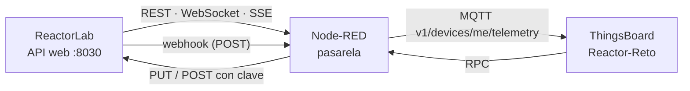

# Reto: una planta química con API web hacia ThingsBoard

## Ficha del reto

| Campo | Valor |
|---|---|
| Asignatura | Monitorización de Máquinas |
| Especialización | Digitalización del Mantenimiento |
| Duración estimada | 3 horas (2 sesiones de 90 minutos) |
| Agrupamiento | Parejas |
| Nivel | Avanzado (después de las series 1 y 2 de ReactorLab) |
| Protocolos | REST, WebSocket, webhooks y MQTT |
| Software | Laboratorio Docker: ReactorLab, Node-RED y ThingsBoard CE 4.3 |
| Producto final | Flujo de Node-RED, dispositivo y panel en ThingsBoard, reglas de alarma, órdenes auditadas y diagnóstico de una avería oculta |

## Situación profesional

Una empresa química ha comprado un reactor continuo cuyo sistema de control **solo ofrece una API web**: no hay Modbus ni OPC UA. El departamento de mantenimiento quiere tenerlo en ThingsBoard, como el resto de sus máquinas, con histórico, alarmas que avisen **antes** de que el proceso se salga de rango y la posibilidad de cambiar consignas desde el panel, **sin poner en riesgo la planta**.

Te encargan la pasarela en Node-RED. Esta vez nadie te dice qué mecanismo usar: tienes que elegirlo y justificarlo.

## Resultados de aprendizaje

Al terminar, el alumnado será capaz de:

1. Elegir entre polling REST, WebSocket, SSE y webhooks según latencia, tráfico y robustez, y justificarlo.
2. Comprobar las respuestas HTTP y descartar datos no válidos antes de publicarlos.
3. Publicar telemetría con la **hora de la planta** y atributos con la ficha del equipo.
4. Integrar eventos asíncronos de la planta (alarmas, cambios de consigna) en la plataforma.
5. Diseñar reglas de alarma que detecten **averías ocultas** que el control automático compensa.
6. Exponer órdenes desde ThingsBoard con validación, clave fuera del código y registro de auditoría.
7. Diagnosticar una avería sin información previa a partir de datos.

## Material necesario

- El laboratorio arrancado (`docker compose up -d` o `start_lab.cmd`): ReactorLab, Node-RED y ThingsBoard.
- Node-RED en `http://localhost:1880`; ThingsBoard en `http://localhost:8080`.
- Flujo inicial [`flows/reactorlab-starter-flow.json`](flows/reactorlab-starter-flow.json) (también en **Import → Local → LabMonitorizacion → alumnado**): solo una lectura REST de prueba.
- La documentación de la API: `http://localhost:8030/docs`.

| Parámetro | Valor en el laboratorio |
|---|---|
| API de ReactorLab (desde Node-RED) | `http://reactorlab:8030` · `ws://reactorlab:8030/ws` · `http://reactorlab:8030/api/v1/stream` |
| Clave para las órdenes | cabecera `X-API-Key`, valor `reactorlab` |
| URL de Node-RED vista desde ReactorLab | `http://nodered:1880/...` |
| MQTT de ThingsBoard (desde Node-RED) | host `thingsboard`, puerto `1883`, token como *Username* |
| Escala de tiempo | 1 s real = 2 min de proceso |

## Requisitos

Cada requisito se demuestra con una **evidencia** (captura, tabla o fragmento del flujo).

### R1 · Adquisición (elige el mecanismo)

- Retraso máximo entre un cambio en la planta y su llegada a ThingsBoard: **3 s**.
- Como mucho **1 petición HTTP por segundo** contra ReactorLab de forma continua.
- Justifica por escrito tu elección frente a las otras tres opciones (polling, WebSocket, SSE, webhook). Rellena:

| Mecanismo | Retraso típico | Peticiones/min | ¿Qué pasa si ReactorLab se reinicia? | ¿Lo eliges? ¿Por qué? |
|---|---|---|---|---|
| Polling REST | | | | |
| WebSocket | | | | |
| SSE | | | | |
| Webhook | | | | |

> Truco: la tabla **Protocolos web** de la web de ReactorLab muestra cada petición y conexión que recibe de tu Node-RED.

### R2 · Calidad del dato

- Nada que no sea una respuesta correcta (código `200` o mensaje de WebSocket con `medidas`) llega a ThingsBoard.
- El instante de cada medida es el **`timestamp` de la planta**, no la hora de llegada.
- Si ReactorLab deja de responder, ThingsBoard lo detecta en menos de 1 minuto (dispositivo inactivo y una alarma).

### R3 · Dispositivo, telemetría y atributos

- Dispositivo `Reactor-Reto` en ThingsBoard, alimentado por **MQTT** (la serie 2 usó HTTP: aquí cambia el transporte).
- Telemetría con claves planas y números (no texto con unidades). Como mínimo: presión, nivel, los cuatro caudales, % de A en la purga, coste relativo, las cuatro posiciones de válvula, las cuatro consignas, modo, en marcha, paro de emergencia y alarmas activas.
- Atributos de cliente con la ficha de la planta a partir de `GET /api/v1/info`.

### R4 · Eventos de la planta

- Las alarmas, cambios de consigna y cambios de estado de ReactorLab aparecen en ThingsBoard **con su hora**, aunque la telemetría periódica no los refleje. Usa un **webhook** o **SSE** y justifica la elección.
- El alta del mecanismo debe resistir que ReactorLab arranque después que Node-RED (operación **idempotente** que se repite).

### R5 · Panel

Panel `Reactor químico` con tres zonas: **proceso** (presión con su consigna, nivel, producción), **esfuerzo del control** (posición de las cuatro válvulas y coste relativo) y **operación** (estado, alarmas, últimos eventos, mandos).

### R6 · Alarmas que se adelantan

Además de una alarma de **presión alta** (con duración e histéresis), diseña al menos **dos** reglas que detecten problemas que el control automático **tapa**: las medidas siguen en consigna, pero algo en el esfuerzo del control o en el coste delata la avería. Justifica umbrales, duración y condición de borrado.

### R7 · Órdenes seguras

- Desde el panel se puede cambiar la consigna de **presión** (2500–2950 kPa) y de **producción** (60–110 kmol/h) y activar o rearmar el **paro de emergencia**.
- La pasarela **valida** el rango antes de llamar a ReactorLab y responde al panel en todos los casos (aceptada, rechazada por rango, rechazada por la planta, orden desconocida).
- La clave de la API **no aparece** en el flujo exportado.
- Cada orden queda **registrada** en ThingsBoard: qué se pidió, con qué valor y con qué resultado.

### R8 · Diagnóstico de una avería oculta

El profesor inyectará una avería sin decir cuál (válvula sucia, atascada o lenta, o un sensor en deriva o congelado). Con tu panel:

1. Detecta que algo va mal y anota cuándo y con qué indicio.
2. Si las medidas no lo delatan, **provoca** una respuesta (cambia una consigna) y observa qué lazo no responde como debe.
3. Identifica el equipo afectado y el tipo de fallo con al menos tres variables.
4. Redacta la orden de trabajo.

## Entrega

1. Flujo de Node-RED exportado **sin credenciales** (ni token ni clave).
2. Panel de ThingsBoard exportado.
3. Tabla de R1 completa y justificación.
4. Evidencias de R2 a R7 (capturas de *Latest telemetry*, atributos, eventos, alarmas y del registro de órdenes).
5. Informe del diagnóstico de R8 (máximo dos páginas).

### Preguntas finales

1. ¿Por qué es mejor usar el `timestamp` de la planta que la hora de llegada? Pon un ejemplo en que la diferencia importe.
2. ¿Qué ventaja tiene un webhook frente a SSE para los eventos? ¿Y qué inconveniente para la red de una fábrica?
3. ¿Por qué tus alarmas de R6 avisan antes que la de presión alta?
4. ¿Dónde guardarías la clave de la API en una instalación real? ¿Quién debería poder ver el registro de órdenes?
5. ReactorLab valida los rangos. ¿Por qué validarlos también en la pasarela?

## Criterios de evaluación

| Criterio | Peso | Excelente | Suficiente | Insuficiente |
|---|---:|---|---|---|
| Adquisición y elección justificada (R1, R2) | 20 % | Cumple retraso y tráfico; justificación comparada y medida | Funciona con alguna limitación | Polling excesivo o sin comprobar respuestas |
| Modelo de datos en ThingsBoard (R3, R4) | 20 % | Claves planas, hora de la planta, atributos y eventos completos | Telemetría correcta, eventos parciales | Faltan claves o hay texto con unidades |
| Panel (R5) | 10 % | Las tres zonas responden a preguntas reales del técnico | Legible | Desordenado o incompleto |
| Alarmas (R6) | 20 % | Dos o más reglas que se adelantan, con histéresis justificada | Una regla útil | Solo presión alta o reglas que no funcionan |
| Órdenes seguras (R7) | 15 % | Validación, respuesta en todos los casos, clave fuera del flujo, auditoría | Funciona sin auditoría | Clave en el código o sin validación |
| Diagnóstico (R8) y respuestas | 15 % | Causa correcta con tres variables y una prueba provocada | Causa razonable | Sin evidencias |

## Criterios de aceptación técnicos

- `Latest telemetry` de `Reactor-Reto` se actualiza cada segundo y la hora coincide con la de la planta (±1 s).
- La tabla **Protocolos web** de ReactorLab no muestra más de 60 peticiones HTTP por minuto de tu Node-RED.
- Un cambio de consigna hecho desde la web de ReactorLab aparece como **evento** en ThingsBoard.
- `setPresion 3200` desde el panel se rechaza sin llegar a ReactorLab; `setPresion 2750` se acepta y queda registrado.
- El JSON exportado no contiene `reactorlab` como valor de la clave ni el token del dispositivo.
