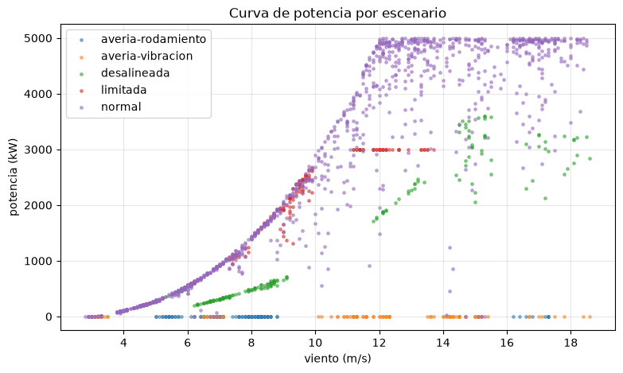
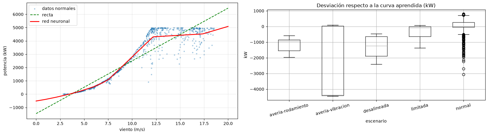
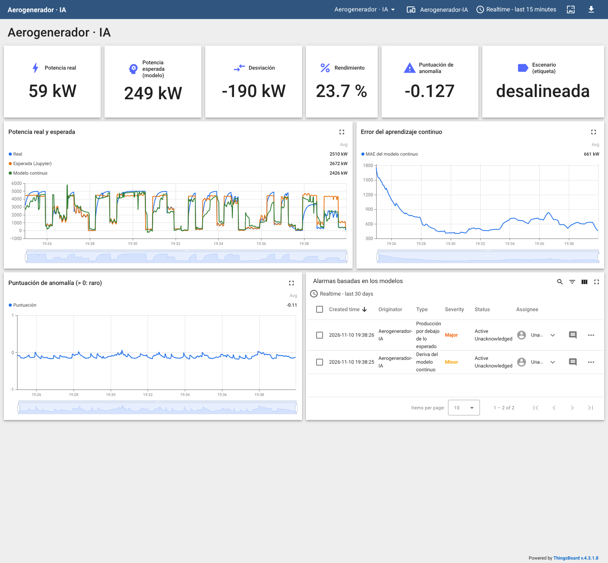
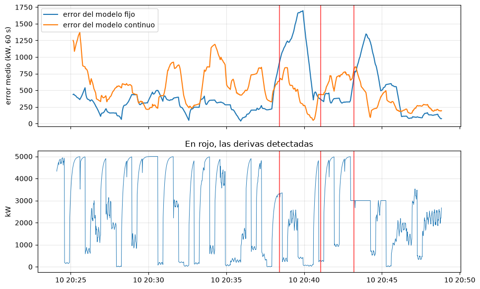

# Serie 4 · Analítica e IA con AeroLab

**De los datos al modelo y del modelo a la planta**

| | |
|---|---|
| **Simulador** | AeroLab (aerogenerador de 5 MW, Modbus TCP) |
| **Herramientas** | Node-RED (nodos **IA**), Jupyter, ThingsBoard |
| **Duración orientativa** | 3 sesiones de 2 h |
| **Requisitos** | Series 1 y 2 de AeroLab (leer Modbus, enviar telemetría a ThingsBoard, reglas de alarma) |

## Objetivos

Al terminar sabrás:

- preparar una **campaña de recogida de datos** con su **etiqueta** (lo que pasaba de verdad);
- explorar unos datos y decidir con cuáles se entrena;
- entrenar en Jupyter una **red neuronal** (curva de potencia) y un **detector de anomalías**, y evaluarlos
  (error, falsas alarmas, detección);
- **publicar** un modelo y usarlo en **tiempo real** desde Node-RED;
- crear alarmas en ThingsBoard **sobre lo que dice un modelo**;
- usar **aprendizaje continuo** y reconocer una **deriva**, con sus ventajas y sus riesgos.

## Cómo encaja todo

```
 AeroLab ──Modbus──► Node-RED ──ia registrar──► datos/aerolab.csv ──► Jupyter (entrenar)
                        │                                                  │ guardar(...)
                        │                                                  ▼
                        ├──ia predecir──────────────────────────────► modelos/aerolab-curva
                        │      (cada segundo)                                modelos/aerolab-anomalias
                        ├──ia aprender (aprendizaje continuo, sin Jupyter)
                        ▼
                   ThingsBoard (panel y alarmas basadas en los modelos)
```

**Jupyter no se conecta a la máquina**: trabaja con los ficheros que Node-RED ha ido escribiendo, igual que en una
empresa se analiza un histórico. El servicio de IA (`ia`) y Jupyter comparten la carpeta `/lab`.

## Preparación

1. Arranca la capa de IA (solo hace falta una vez):

   ```bash
   docker compose --profile ia up -d
   ```

2. Comprueba que responden:

   | Qué | Dirección |
   |---|---|
   | Jupyter | <http://localhost:8888/?token=lab> |
   | Servicio de IA (documentación de la API) | <http://localhost:8100/docs> |
   | Node-RED | <http://localhost:1880> — en la paleta aparece la categoría **IA** |

3. En la web de AeroLab (<http://localhost:8010>) comprueba que la máquina está **en marcha** y en modo **automático**.

---

## Sesión 1 · Recoger los datos

### Parte 1 — Importar el flujo de recogida

**Menú → Import → Local → LabMonitorizacion → alumnado → Serie 4 AeroLab - Recoger datos** y **Deploy**.

El flujo hace tres cosas:

| Bloque | Qué hace |
|---|---|
| Lectura | Lee los 16 *input registers* cada segundo, los decodifica (como en la serie 1) y forma una **fila plana** |
| **ia registrar** | Envía cada fila al servicio de IA, que la añade a `datos/aerolab.csv` |
| Campaña de viento | Cada 20 s escribe un viento (3–18 m/s) y una turbulencia nuevos, para recorrer **toda** la curva de potencia |
| Escenarios | Cinco botones que provocan una situación y la apuntan como **etiqueta** |

La fila que se guarda:

```javascript
// ENTRADA: el mensaje decodificado (bloques viento, rotor, produccion...)
// SALIDA:  msg.payload = una fila plana: una columna por medida + la etiqueta

const p = msg.payload;
msg.payload = {
    viento:             p.viento.velocidad_mps,
    potencia:           p.produccion.potencia_kw,
    rotor_rpm:          p.rotor.rpm,
    pitch:              p.rotor.pitch_deg,
    vibracion:          p.condicion.vibracion_mms,
    temp_rodamiento:    p.condicion.temp_rodamiento_c,
    temp_multiplicador: p.condicion.temp_multiplicador_c,
    estado:             p.estado.codigo,
    averia:             p.estado.averia_codigo,
    // etiqueta: lo que está pasando DE VERDAD (lo fija el botón de escenario)
    escenario:          flow.get("escenario") || "normal"
};
return msg;
```

Los escenarios (escritura de *holding registers*):

```javascript
// ENTRADA: msg.payload = nombre del escenario (botones de la izquierda)
// SALIDA:  escrituras Modbus (holding registers) para provocarlo
//   HR0 modo (0 auto, 1 manual) · HR3 consigna de yaw (0,1°) · HR4 límite (kW) · HR5 avería

const escenario = msg.payload;
const PLANES = {
    "normal":       { 0: 0, 4: 5000, 5: 0 },
    // modo manual con la góndola fija 35° fuera del viento (235°): produce menos, sin alarma
    "desalineada":  { 0: 1, 2: 200, 3: 2000, 4: 5000, 5: 0 },
    // un operador de red limita la potencia (curtailment): cambio de régimen legítimo
    "limitada":     { 0: 0, 4: 3000, 5: 0 },
    "averia-vibracion":  { 0: 0, 4: 5000, 5: 2 },
    "averia-rodamiento": { 0: 0, 4: 5000, 5: 1 }
};
const plan = PLANES[escenario];
if (!plan) {
    node.warn("Escenario desconocido: " + escenario);
    return null;
}
flow.set("escenario", escenario);
node.status({ fill: escenario === "normal" ? "green" : "orange", shape: "dot", text: escenario });

return [Object.entries(plan).map(([adr, valor]) => ({
    payload: { value: valor, fc: 6, unitid: 1, address: Number(adr), quantity: 1 }
}))];
```

> **Por qué la etiqueta.** En una planta real casi nunca se sabe con certeza qué pasaba en cada instante.
> El simulador sí lo sabe, y eso permite **medir** si un modelo acierta. Fíjate en que la góndola desalineada
> **no activa ninguna alarma de la máquina**: es el tipo de problema que un modelo puede ver y el PLC no.

### Parte 2 — La campaña

1. Deja el flujo en **Normal** al menos **12 minutos** (unas 700 filas). Son los datos con los que se entrenará.
2. Pulsa cada escenario durante 2–3 minutos, volviendo a **Normal** entre uno y otro:
   *Góndola desalineada* → *Normal* → *Límite 3000 kW* → *Normal* → *Avería: vibración* → *Normal* →
   *Avería: rodamiento* → *Normal*.
3. El estado del nodo **ia registrar** muestra las filas que lleva el conjunto.

Mientras tanto, mira el fichero en Jupyter: **datos → aerolab.csv** se puede abrir con doble clic.

### Parte 3 — Explorar (cuaderno 01)

Abre **cuadernos → 01-aerolab-explorar.ipynb** y ejecútalo celda a celda (**Mayús + Intro**).



*Curva de potencia por escenario (datos reales de la campaña).*

Responde a las preguntas del final del cuaderno en tu informe.

---

## Sesión 2 · Entrenar, publicar y usar los modelos

### Parte 4 — Entrenar (cuaderno 02)

Abre **02-aerolab-entrenar.ipynb**. Entrenarás con los datos **normales**:

| Modelo | Tipo | Entradas | Qué responde |
|---|---|---|---|
| `aerolab-curva` | regresión (red neuronal 32 + 32) | `viento` | ¿Cuánto debería producir con este viento? |
| `aerolab-anomalias` | anomalías (Isolation Forest) | `viento`, `potencia`, `vibracion`, `temp_rodamiento` | ¿Es habitual esta combinación? |

Resultados obtenidos con una campaña de 1722 filas:

| Modelo | Resultado (datos de prueba) |
|---|---|
| Curva: recta | MAE = 516 kW, R² = 0,87 |
| Curva: **red neuronal** | **MAE = 223 kW, R² = 0,97** |
| Detector de anomalías | 1,1 % de falsas alarmas |

| Escenario | Desviación mediana respecto a la curva | Filas marcadas por el detector de anomalías |
|---|---|---|
| Normal | +7 kW | 1 % |
| Góndola desalineada | **−1240 kW** | **0 %** |
| Límite 3000 kW | −75 kW | 0 % |
| Avería: vibración | −4365 kW | 100 % |
| Avería: rodamiento | −924 kW | 100 % |

Las dos herramientas se **complementan**: el detector de anomalías ve las averías (vibración y temperatura fuera de lo
habitual) pero no la góndola desalineada, porque cada valor por separado es normal; la curva sí la ve, porque
compara la potencia con lo que *debería* ser. El límite de potencia solo se nota con vientos altos.



*Curva aprendida (izquierda) y desviación por escenario (derecha), del cuaderno 02.*

La función `guardar(...)` **publica** el modelo: queda en `modelos/` con una ficha (tipo, entradas, métricas,
versión). Compruébalo en <http://localhost:8100/modelos>.

### Parte 5 — Usar los modelos en Node-RED

Añade al flujo, a la salida de **Fila plana**:

1. Un nodo **ia predecir** con modelo `aerolab-curva` y *Resultado* = **solo en msg.prediccion**.
2. Una *function* que compara lo real con lo esperado:

   ```javascript
   // ENTRADA: la fila plana + msg.prediccion (lo que el modelo espera producir)
   // SALIDA:  la fila con la potencia esperada y la desviación

   const p = msg.payload;
   p.potencia_esperada = Math.max(0, Math.round(msg.prediccion.prediccion));
   p.desviacion_kw     = Math.round(p.potencia - p.potencia_esperada);
   // rendimiento solo tiene sentido si se espera producir algo
   p.rendimiento_pct   = p.potencia_esperada > 200
       ? Math.round(1000 * p.potencia / p.potencia_esperada) / 10
       : null;
   return msg;
   ```

3. Otro **ia predecir** con modelo `aerolab-anomalias`.
4. Una *function* que prepara la telemetría:

   ```javascript
   // ENTRADA: la fila con las predicciones de los dos modelos
   // SALIDA:  { ts, values } para ThingsBoard

   const p = msg.payload;
   msg.payload = {
       ts: Date.now(),
       values: {
           viento:              p.viento,
           potencia:            p.potencia,
           potencia_esperada:   p.potencia_esperada,
           desviacion_kw:       p.desviacion_kw,
           rendimiento_pct:     p.rendimiento_pct,
           anomalia:            msg.prediccion.anomalia,
           puntuacion_anomalia: msg.prediccion.puntuacion,
           escenario:           p.escenario
       }
   };
   return msg;
   ```

5. Un **mqtt out** a ThingsBoard (`v1/devices/me/telemetry`) con el token de un dispositivo nuevo,
   `Aerogenerador-IA`.
6. Un nodo **catch** limitado a los dos **ia predecir**, con un *debug*: si el modelo no existe o falta una
   entrada, el servicio responde con un error claro (`404` o `422`).

El estado de cada **ia predecir** muestra el modelo, su versión y el último resultado.

> Si vuelves a entrenar en Jupyter y guardas con el mismo nombre, Node-RED usa la **versión nueva** en el
> siguiente mensaje, sin desplegar nada.

### Parte 6 — Panel y alarmas sobre los modelos

1. Importa el panel [thingsboard/panel-aerolab-ia.json](thingsboard/panel-aerolab-ia.json)
   (**Dashboards → + → Import dashboard**).
2. En el dispositivo `Aerogenerador-IA` → **Alarm rules**, crea:

| Regla | Condición | Se borra | Gravedad |
|---|---|---|---|
| Producción por debajo de lo esperado | `desviacion_kw` < −600 durante 30 s | > −200 durante 10 s | Major |
| Comportamiento anómalo | `anomalia` = true durante 30 s | false durante 30 s | Warning |

3. Prueba cada escenario y rellena:

| Escenario | ¿Alarma de la máquina? | ¿Producción por debajo? | ¿Anomalía? | Tiempo hasta la alarma |
|---|---|---|---|---|
| Góndola desalineada | | | | |
| Límite 3000 kW | | | | |
| Avería: vibración | | | | |
| Avería: rodamiento | | | | |



*Panel con la góndola desalineada: la máquina no avisa, el modelo sí (captura real del laboratorio).*

---

## Sesión 3 · Aprendizaje continuo y deriva

### Parte 7 — Un modelo que aprende solo

El nodo **ia aprender** no necesita Jupyter: el modelo se crea con el primer mensaje y **aprende de cada
lectura**. Con cada una, primero **predice** y luego aprende, así que el error que publica es siempre sobre datos
nuevos.

1. Desde **Fila plana**, un **switch** `¿Sin avería?` (`payload.averia` == 0): no queremos que aprenda de una
   máquina averiada.
2. Un **ia aprender**: modelo `aerolab-continuo`, tipo **regresión**, objetivo `potencia`, entradas `viento`,
   prefijo `continuo_`.
3. Un **ia registrar** al conjunto `aerolab-continuo` (lote 10), para analizarlo después en Jupyter.
4. Una *function* de telemetría y el **mqtt out** a ThingsBoard:

   ```javascript
   // ENTRADA: la fila + el resultado del modelo continuo (msg.prediccion)
   // SALIDA:  { ts, values } para ThingsBoard

   const r = msg.prediccion;
   msg.payload = {
       ts: Date.now(),
       values: {
           continuo_prediccion: r.prediccion,
           continuo_mae:        r.mae,
           continuo_deriva:     r.deriva,
           continuo_derivas:    r.derivas,
           continuo_aprendidas: r.aprendidas
       }
   };
   return msg;
   ```

5. Una regla más en ThingsBoard: **Deriva del modelo continuo** cuando `continuo_deriva` = true; se borra tras
   5 minutos sin deriva.

### Parte 8 — Provocar una deriva

1. Deja que aprenda en **Normal** unos 12 minutos (vigila la deriva a partir de 600 lecturas) (el estado del nodo muestra lecturas aprendidas y MAE).
2. Pulsa **Límite 3000 kW** y observa en el panel: el MAE sube, salta la **deriva**, y el modelo se adapta.
3. Repite con **Góndola desalineada**.
4. Abre **03-aerolab-deriva.ipynb** y compara el modelo continuo con el modelo fijo de Jupyter.

Lo que se obtuvo en el laboratorio (12 minutos de aprendizaje en normal y después los escenarios):

| Momento | Deriva detectada | Alarma «Producción por debajo de lo esperado» (modelo fijo) |
|---|---|---|
| 12 min en normal | ninguna | ninguna |
| Góndola desalineada | a los 72 s | a los 73 s |
| Vuelta a normal | a los 36 s | se borra |
| Límite 3000 kW | a los 14 s | a los 30 s |



*Arriba, error medio de los dos modelos; abajo, la potencia. En rojo, las derivas (cuaderno 03).*

Fíjate en la gráfica de arriba: durante la desalineación el error del **modelo fijo** se dispara y se queda alto,
porque compara siempre con la máquina sana; el del **modelo continuo** sube un momento y vuelve a bajar, porque
**aprende la avería como si fuera lo normal**. La deriva avisa del cambio, pero después el modelo continuo ya no lo ve.

> La deriva se vigila sobre el error **con signo** (real − predicho): si la máquina empieza a producir
> sistemáticamente menos (o más) de lo que el modelo espera, salta, aunque el error medio absoluto apenas cambie.

### Parte 9 — Anomalías que se aprenden solas (ampliación)

Añade un **ia aprender** de tipo **anomalías** con entradas `viento,potencia,vibracion,temp_rodamiento`.
Este detector solo aprende de lo que considera normal: la puntuación 1 equivale al 1 % más raro de lo visto, y
avisa por encima del **umbral** (1,5 por defecto). Compáralo con el Isolation Forest de Jupyter.

---

## Entrega

- [ ] Informe con las respuestas de los cuadernos 01, 02 y 03 y la tabla de la parte 6.
- [ ] Cuadernos con sus resultados (**File → Download**).
- [ ] Flujo de Node-RED exportado (**sin el token**).
- [ ] Captura del panel durante un escenario.
- [ ] O bien una **copia** del laboratorio desde <http://localhost:8090> (incluye Node-RED y ThingsBoard).

## Preguntas finales

1. ¿Por qué se entrena solo con datos normales? ¿Qué harías si tuvieras muchos ejemplos de averías?
2. La regla «producción por debajo de lo esperado» y la de anomalía, ¿detectan lo mismo? ¿Cuál explicarías mejor
   a un operador?
3. ¿Qué pasaría con el modelo `aerolab-curva` si la máquina se repotencia a 6 MW? ¿Y con el continuo?
4. El modelo continuo se adapta a la góndola desalineada. ¿Es un fallo del modelo o de cómo lo usamos?
5. ¿Qué datos añadirías a la fila para detectar la desalineación directamente? ¿Existen en un aerogenerador real?

## Rúbrica

| Criterio | Peso | Nivel alto |
|---|---|---|
| Recogida de datos | 15 % | Campaña completa, etiquetas correctas, más de 700 filas normales |
| Exploración | 15 % | Respuestas razonadas con gráficas, identifica qué escenarios son visibles y cuáles no |
| Entrenamiento y evaluación | 25 % | Compara modelos, explica MAE, falsas alarmas y detección; prueba variantes |
| Despliegue en tiempo real | 20 % | Flujo con control de errores, telemetría y panel funcionando |
| Alarmas sobre modelos | 10 % | Reglas con duración y borrado, tabla de escenarios completa |
| Aprendizaje continuo | 15 % | Provoca y explica la deriva; discute cuándo debe aprender un modelo |
