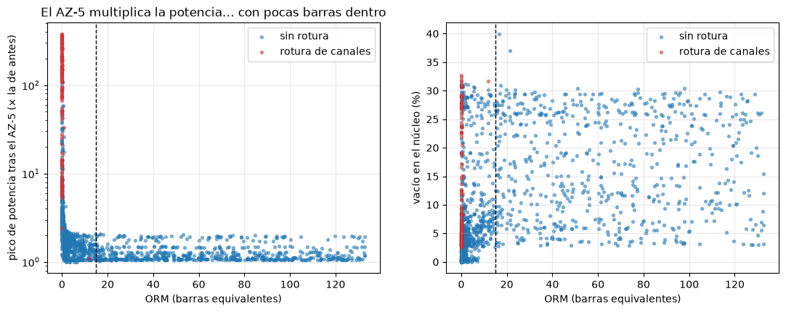
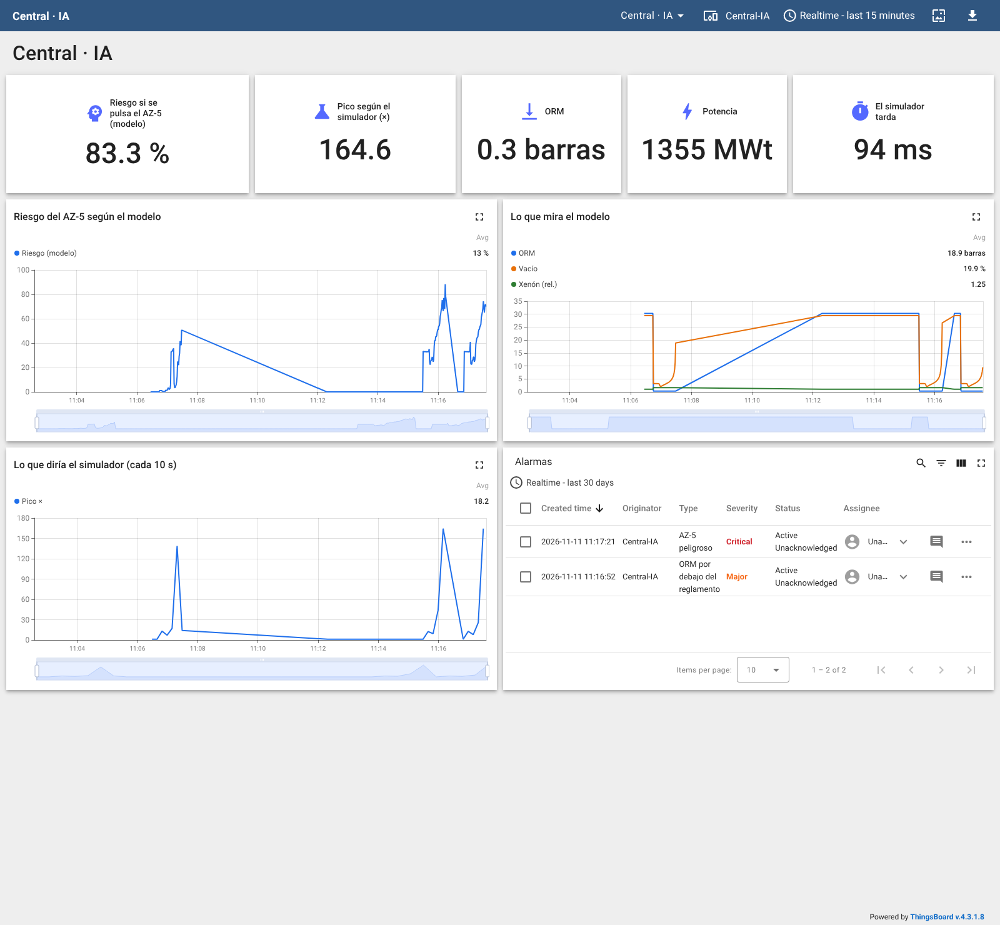

# Serie 4 · IA con AtomLab: un modelo sustituto del AZ-5

**¿Es seguro pulsar el botón de emergencia ahora?**

| | |
|---|---|
| **Simulador** | AtomLab (central RBMK-1000, OPC UA y API REST) |
| **Herramientas** | Node-RED (nodos **IA**), Jupyter (cuaderno 08), ThingsBoard |
| **Duración orientativa** | 2 sesiones de 2 h |
| **Requisitos** | Práctica de la serie 4 con AeroLab y las prácticas de AtomLab (series 1 y 2) |

## Objetivos

Al terminar sabrás:

- generar datos con un **gemelo digital** cuando la realidad no los puede dar (nadie provoca accidentes para
  aprender de ellos);
- entrenar un **modelo sustituto** (*surrogate*) que responde cientos de veces más rápido que el simulador (y un
  código de cálculo industrial tarda minutos);
- comparar un modelo con un **reglamento de seguridad** y explicar por qué el reglamento es conservador;
- desplegar el modelo en **tiempo real** y comprobarlo contra el simulador.

## La idea

En el RBMK, el AZ-5 podía **subir** la potencia unos segundos antes de bajarla: las barras llevaban un
desplazador de grafito que, al entrar, expulsaba agua de la parte baja del núcleo. Con pocas barras dentro
(ORM bajo), mucho vapor y xenón alto, ese empujón bastaba para que el reactor se volviera crítico inmediato.

```
 Fase 1 (datos)    Node-RED ──POST /api/v1/simulacion/lote──► AtomLab simula N estados al azar
                      │                                        y pulsa el AZ-5 en cada uno (en copias)
                      └──ia registrar──► datos/atomlab-az5.csv ──► Jupyter: modelo atomlab-az5

 Fase 2 (uso)      GET /api/v1/medidas (cada 1 s) ──► ia predecir ──► riesgo del AZ-5 ──► ThingsBoard
                   POST /api/v1/simulacion/que-pasaria (cada 10 s) ──► lo que pasaría de verdad ──┘
```

Los dos endpoints de simulación **no tocan** la central de la sala de control: trabajan con copias.

---

## Sesión 1 · Generar los datos y entrenar

### Parte 1 — Generar los datos

**Menú → Import → Local → LabMonitorizacion → alumnado → Serie 4 AtomLab - Generar datos** y **Deploy**.

```javascript
// ENTRADA: el número de casos (botón)
// SALIDA:  POST /api/v1/simulacion/lote: AtomLab inventa estados de operación al azar y pulsa el AZ-5 en cada uno
// No toca la central de la sala de control: cada caso es una central nueva. 500 casos tardan unos 20 s.

const lotes = (flow.get("lotes") || 0) + 1;
flow.set("lotes", lotes);
msg.method = "POST";
msg.url = "http://atomlab:8040/api/v1/simulacion/lote";
msg.headers = { "Content-Type": "application/json" };
msg.payload = { casos: Number(msg.payload), semilla: lotes };     // otra semilla en cada lote: casos distintos
msg.requestTimeout = 120000;
node.status({ fill: "yellow", shape: "ring", text: `lote ${lotes}: simulando ${msg.payload.casos} casos…` });
return msg;
```

```javascript
// ENTRADA: la respuesta del lote { casos: [ { escenario, medidas, az5_pico_mwt, az5_pico_rel, az5_danado } ] }
// SALIDA:  msg.payload = una lista de filas planas para el conjunto "atomlab-az5"

const r = msg.payload;
msg.payload = r.casos.map(c => ({
    ...c.medidas,                                  // lo que se veía en la sala de control antes del AZ-5
    // la etiqueta: lo que pasó al pulsar el AZ-5
    az5_pico_rel: c.az5_pico_rel,                  // pico de potencia / potencia antes del AZ-5
    az5_danado: c.az5_danado ? 1 : 0               // rotura de canales
}));
const n = msg.payload.filter(f => f.az5_danado).length;
node.status({ fill: "green", shape: "dot", text: `${r.casos.length} casos en ${r.segundos_cpu} s · ${n} explosiones` });
return msg;
```

Pulsa **50 casos (prueba)** y mira el *debug*. Después pulsa **500 casos** cuatro veces (unos 40 s cada lote; espera a que termine uno antes de pulsar
el siguiente): 2000 casos en total.

> Cada caso es una central distinta: potencia entre 200 y 3200 MWt, barras más o menos dentro, xenón, 6–8
> bombas, agua de entrada más o menos subenfriada y, la mitad de las veces, la **prueba de inercia** de la
> turbina. El simulador la lleva al estado pedido, pulsa el AZ-5 y deja pasar 20 s.

### Parte 2 — Entrenar (cuaderno 08)

Abre **cuadernos → 08-atomlab.ipynb**.



*Pico de potencia tras el AZ-5 frente al ORM: las roturas (rojo) solo aparecen con muy pocas barras dentro. La
línea discontinua es el mínimo del reglamento, 15 barras (cuaderno 08).*

Resultados con los datos del laboratorio (30 % de los casos para la prueba):

| Quién avisa | Precisión | Detección | AUC |
|---|---|---|---|
| Reglamento: ORM < 15 | 4,9 % | 100 % | — |
| Árbol (profundidad 3) | 76,9 % | 62,5 % | 0,864 |
| **Bosque aleatorio** | **81,8 %** | 56,2 % | **0,965** |

Solo el 2,7 % de los casos acaban en rotura: es un **suceso raro**. El reglamento lo detecta todo a costa de
avisar en casi todos los estados con pocas barras; el bosque ordena muy bien el riesgo (AUC 0,965), pero con el
umbral de 0,5 se le escapan casi la mitad de las roturas. En seguridad, el umbral se baja (Tu turno 1).

El modelo responde **unas 500 veces más rápido** que el simulador: 0,04 ms por caso frente a 29 ms.

> **Lo que aprendimos al prepararla.** Con una primera campaña (todos los grupos de barras a la misma altura)
> el modelo no avisaba en el escenario de 1986 hasta que ya era tarde: ese estado (cada grupo a una altura,
> agua casi saturada) apenas estaba en los datos. Variando cada grupo por separado y con más casos de agua
> casi saturada, el aviso llega ~10 s antes. Un modelo solo sabe de lo que ha visto.

El modelo se publica como `atomlab-az5`.

---

## Sesión 2 · Tiempo real

### Parte 3 — El riesgo en la sala de control

Importa **soluciones → Serie 4 AtomLab - IA** o añade a tu flujo:

1. **inject** cada 1 s → **http request** `GET http://atomlab:8040/api/v1/medidas`.
2. *function* `¿Aún no se ha pulsado?`:

   ```javascript
   // ENTRADA: GET /api/v1/medidas (la sala de control, cada segundo)
   // SALIDA:  la misma fila (las entradas del modelo tienen los mismos nombres que en el lote)

   const m = msg.payload;
   if (m.proteccion_danado || m.proteccion_scram) {
       node.status({ fill: "grey", shape: "ring", text: m.proteccion_danado ? "central dañada" : "SCRAM: ya se pulsó" });
       return null;                                   // el modelo responde a «¿y si lo pulso AHORA?»
   }
   return msg;
   ```

3. **ia predecir** modelo `atomlab-az5`, resultado **solo en msg.prediccion**, y la *function* `Riesgo`:

   ```javascript
   // ENTRADA: las medidas + msg.prediccion = { clase, probabilidad } del modelo atomlab-az5
   // SALIDA:  telemetría para ThingsBoard

   const m = msg.payload, r = msg.prediccion;
   const riesgo = r.clase === 1 ? r.probabilidad : 1 - r.probabilidad;     // probabilidad de rotura de canales
   flow.set("riesgo_modelo", riesgo);
   node.status({ fill: riesgo >= 0.5 ? "red" : "green", shape: "dot", text: `riesgo AZ-5 ${(100 * riesgo).toFixed(0)} %` });
   msg.payload = { ts: Date.now(), values: {
       potencia_mwt: m.reactor_potencia_mwt, orm: m.reactor_orm_barras, xenon: m.reactor_xenon_rel,
       vacio_pct: m.reactor_vacio_pct, reactividad_beta: m.reactor_reactividad_beta,
       riesgo_az5_pct: Math.round(1000 * riesgo) / 10, az5_peligroso: riesgo >= 0.5,
       orm_bajo: m.reactor_orm_barras < 15           // la regla del reglamento del RBMK
   } };
   return msg;
   ```

4. Cada 10 s, `POST http://atomlab:8040/api/v1/simulacion/que-pasaria` y la *function* `Lo que habría pasado`:

   ```javascript
   // ENTRADA: POST /api/v1/simulacion/que-pasaria (el simulador lo calcula en una copia de la central)
   // SALIDA:  telemetría: lo que habría pasado de verdad, para compararlo con el modelo

   const v = msg.payload;
   const modelo = flow.get("riesgo_modelo");
   node.status({ fill: v.az5_danado ? "red" : "green", shape: "dot",
                 text: `simulador: pico ×${v.az5_pico_rel} en ${v.ms} ms` });
   msg.payload = { ts: Date.now(), values: {
       simulador_pico_rel: v.az5_pico_rel, simulador_danado: v.az5_danado, simulador_ms: v.ms,
       modelo_acierta: modelo === undefined ? null : (modelo >= 0.5) === v.az5_danado } };
   return msg;
   ```

5. **mqtt out** a ThingsBoard con el token de un dispositivo nuevo, `Central-IA`.

### Parte 4 — Panel y alarmas

1. Importa [thingsboard/panel-atomlab-ia.json](thingsboard/panel-atomlab-ia.json).
2. En `Central-IA` → **Alarm rules**:

| Regla | Condición | Se borra | Gravedad |
|---|---|---|---|
| AZ-5 peligroso | `az5_peligroso` = true | false | Critical |
| ORM por debajo del reglamento | `orm` < 15 | ≥ 15 | Major |

3. En la sala de control (<http://localhost:8040>): **Escenario → 26-04-1986 · 01:22**, espera unos segundos,
   lanza la **prueba de inercia** y mira el panel **antes** de pulsar el AZ-5. Ojo: si esperas más de ~30 s,
   la central se desboca sola.

Lo que se vio en el laboratorio:

| Momento | Riesgo (modelo) | Simulador: pico si se pulsa | Alarmas |
|---|---|---|---|
| Plena potencia | 0 % | ×1,06 | ninguna |
| 1986, antes de la prueba de inercia | 33 % | ×12,5 (sin rotura) | ORM por debajo del reglamento |
| 10 s después de la prueba | 26 % | ×9,3 | ORM |
| 20 s después | **54 %** | ×44 (aún sin rotura) | ORM + **AZ-5 peligroso** |
| 30 s después | 77 % | **×165, rotura de canales** | ORM + AZ-5 peligroso |

El modelo avisa **unos 10 s antes** de que el simulador diga que el AZ-5 rompería los canales. El reglamento del ORM
avisa desde el principio (desde horas antes, en la noche real).



*Panel con el escenario de 1986 antes de pulsar el AZ-5 (captura real del laboratorio).*

---

## Entrega

- [ ] Cuaderno 08 con sus resultados y las respuestas de **Tu turno**.
- [ ] Flujo de Node-RED exportado (**sin el token**).
- [ ] Captura del panel con el escenario de 1986 y la tabla de la parte 4.

## Preguntas finales

1. ¿Por qué hay que generar los datos con un simulador? ¿Qué limitaciones tiene un modelo aprendido así?
2. El reglamento del ORM avisa muchas más veces que el modelo. ¿Es un defecto del reglamento?
3. Si el modelo dice 2 % de riesgo y el reglamento avisa, ¿a quién harías caso? ¿Y al revés?
4. ¿Qué pasa si se usa el modelo en un estado que no vio al entrenar (con el regulador automático, o tras un
   cambio de combustible)? ¿Cómo lo detectarías?
5. En 1986 no había forma de saber lo que haría el AZ-5. ¿Qué le habría hecho falta a un sistema como este para
   evitar el accidente (técnica y organizativamente)?

## Rúbrica

| Criterio | Peso | Nivel alto |
|---|---|---|
| Datos simulados | 15 % | Lotes generados, explica qué es cada caso y por qué hacen falta simulaciones |
| Modelo sustituto | 30 % | Compara reglamento, árbol y bosque; interpreta precisión, detección y AUC |
| Seguridad | 20 % | Argumenta el umbral y el papel del reglamento frente al modelo |
| Tiempo real | 25 % | Modelo cada segundo, comprobación con el simulador y alarmas funcionando |
| Escenario de 1986 | 10 % | Captura y lectura del panel antes del AZ-5 |
