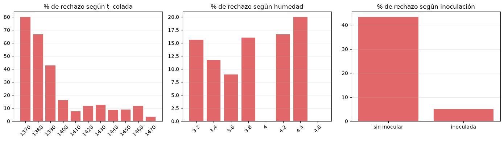
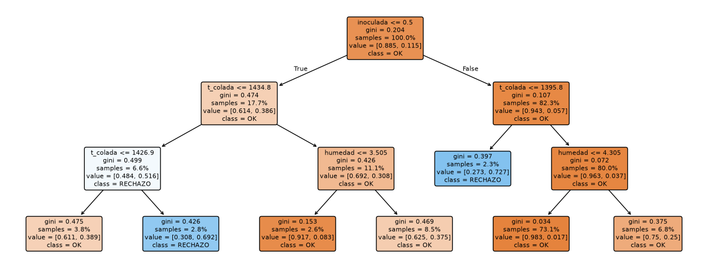
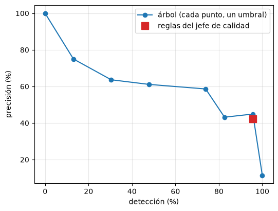
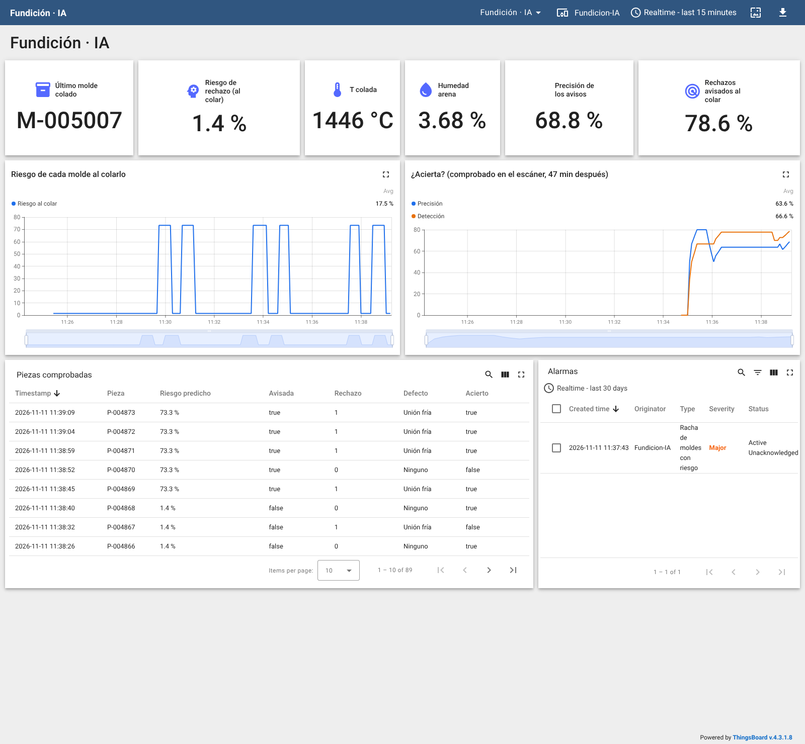

# Serie 4 · IA con la Fundición: riesgo de rechazo al colar

**Saber 47 minutos antes qué piezas van a salir mal**

| | |
|---|---|
| **Simulador** | Fundición (OPC UA, gemelo digital de una planta de fundición de hierro) |
| **Herramientas** | Node-RED (nodos **IA**), Jupyter (cuaderno 07), ThingsBoard |
| **Duración orientativa** | 2 sesiones de 2 h |
| **Requisitos** | Práctica de la serie 4 con AeroLab y el reto de trazabilidad de la Fundición |

## Objetivos

Al terminar sabrás:

- montar una **campaña** de datos con averías y reconocer cuándo una etiqueta **engaña** (el retraso del túnel);
- comparar las **reglas de un experto** con un modelo aprendido de los datos (precisión y detección);
- leer un **árbol de decisión** y ver qué límites ha aprendido;
- elegir un **umbral** de aviso a partir de una probabilidad, pensando en lo que cuesta cada error;
- usar el modelo en **tiempo real** en el momento en que sirve (al colar) y **comprobar en producción** si acierta.

## La idea

```
 COL-01 cuela un molde ──► Trazabilidad.UltimaColada ──► ia predecir ──► riesgo del molde ──► ThingsBoard
   (temperatura, humedad,                                  (Node-RED guarda el riesgo de cada molde)
    inoculación)                     ~47 min en el túnel
                                            ▼
 QC-01 inspecciona su pieza ──► Trazabilidad.UltimaPieza ──► ¿acertó el riesgo? ──► precisión y detección
```

El servidor OPC UA publica el **último molde colado** (`Trazabilidad.UltimaColada`): sus condiciones se
conocen casi una hora antes de que su pieza llegue al escáner. El campo `Molde` une las dos cosas.

## Preparación

1. Comprueba Jupyter (<http://localhost:8888/?token=lab>) y el servicio de IA (<http://localhost:8100/docs>).
2. En el gemelo 3D (<http://localhost:3000>): planta en marcha y **sin avería**.
3. Si tienes el flujo del reto de trazabilidad desplegado, puedes dejarlo: no molesta.

---

## Sesión 1 · Recoger los datos y entrenar

### Parte 1 — El flujo de recogida

**Menú → Import → Local → LabMonitorizacion → alumnado → Serie 4 Fundicion - Recoger datos** y **Deploy**.

| Bloque | Qué hace |
|---|---|
| Suscripción | La última pieza inspeccionada, el último molde colado y la avería activa |
| **Pieza nueva** | Una sola fila por pieza (la del reto de trazabilidad) |
| **Fila plana** + **ia registrar** | Añade cada pieza a `datos/fundicion.csv` |
| **Campaña de averías** | Acelera la planta a ×20 y alterna sin avería y las averías 5, 6 y 7 (3 minutos cada tramo) |

```javascript
// ENTRADA: la pieza inspeccionada (msg.payload) y la planta (msg.contexto)
// SALIDA:  msg.payload = una fila plana para el conjunto "fundicion"

const p = msg.payload;
msg.payload = {
    pieza:          p.Id,
    molde:          p.Molde,
    lote:           p.Lote,
    // condiciones que se conocen AL COLAR (47 min antes de la inspección)
    t_colada:       p.TemperaturaColada,
    humedad:        p.HumedadArena,
    inoculada:      p.Inoculada ? 1 : 0,
    // lo que se sabe después
    t_enfriamiento: p.TiempoEnfriamiento,
    t_desmoldeo:    p.TemperaturaDesmoldeo,
    desviacion:     p.Desviacion,
    // la etiqueta: lo que dijo el escáner
    rechazo:        p.Resultado === "RECHAZO" ? 1 : 0,
    defecto:        p.Defecto,
    // la avería activa EN EL MOMENTO DE LA INSPECCIÓN (no cuando se coló la pieza)
    averia:         (msg.contexto.Mantenimiento || {}).Averia ?? 0
};
node.status({ fill: msg.payload.rechazo ? "red" : "green", shape: "dot", text: `${p.Id} · ${p.Resultado}` });
return msg;
```

```javascript
// ENTRADA: "empezar" o "parar" (botones)
// SALIDA:  escrituras OPC UA: velocidad ×20 y la avería de cada tramo
// Cada tramo dura 3 min reales = 1 h de planta. 7 tramos ≈ 21 min ≈ 430 piezas.

const TRAMOS = [0, 5, 0, 6, 0, 7, 0];     // 5 humedad de arena · 6 inoculación · 7 termopar de IF-01
const MINUTOS = 3;
const escribir = (id, tipo, valor) => ({ topic: "ns=1;s=" + id, datatype: tipo, payload: valor });
const fin = [escribir("Mantenimiento.Averia", "Int32", 0), escribir("Simulacion.Velocidad", "Double", 1)];

clearInterval(context.get("reloj"));
if (msg.payload !== "empezar") {
    node.status({ fill: "grey", shape: "dot", text: "campaña parada" });
    return [fin];
}
let paso = 0;
const tramo = () => {
    if (paso >= TRAMOS.length) {
        clearInterval(context.get("reloj"));
        node.status({ fill: "grey", shape: "dot", text: "campaña terminada" });
        node.send([fin]);
        return;
    }
    node.status({ fill: TRAMOS[paso] ? "orange" : "green", shape: "dot",
                  text: `tramo ${paso + 1}/${TRAMOS.length} · avería ${TRAMOS[paso]}` });
    const ordenes = [escribir("Mantenimiento.Averia", "Int32", TRAMOS[paso])];
    if (paso === 0) ordenes.push(escribir("Simulacion.Velocidad", "Double", 20));
    node.send([ordenes]);
    paso++;
};
tramo();
context.set("reloj", setInterval(tramo, MINUTOS * 60 * 1000));
return null;
```

### Parte 2 — La campaña

Pulsa **Empezar campaña** y espera **unos 21 minutos** (7 tramos). Al final la planta vuelve a ×1 y sin
avería. El estado de **ia registrar** muestra las piezas que lleva (unas 670).

> **No despliegues nada en Node-RED durante la campaña.** Un *Deploy* completo reinicia todos los nodos, también
> el reloj de la campaña, que se queda parado en el tramo en que estuviera.

> A ×20 una hora de planta dura 3 minutos. Mientras tanto, mira en el gemelo 3D cómo cambian la humedad de
> la arena (avería 5), la inoculación de ROB-01 (avería 6) y la temperatura de colada (avería 7).

### Parte 3 — Entrenar (cuaderno 07)

Abre **cuadernos → 07-fundicion.ipynb** y ejecútalo celda a celda.

**La etiqueta engaña.** La columna `averia` es la avería activa **cuando se inspecciona** la pieza, no cuando se
coló. Resultado de la campaña del laboratorio:

| Tramo | Avería en la inspección | Piezas | Rechazo |
|---|---|---|---|
| 1 | 0 · sin avería | 58 | 3,4 % |
| 2 | **5** · humedad de arena | 61 | **0,0 %** |
| 3 | 0 · sin avería | 63 | **15,9 %** |
| 4 | 6 · inoculación ¹ | 365 | 11,8 % |
| 5 | 7 · termopar de IF-01 | 60 | 16,7 % |
| 6 | 0 · sin avería | 64 | 18,8 % |

¹ En el laboratorio este tramo se alargó: un *Deploy* paró el reloj de la campaña (ver el aviso de la parte 2).

Los tramos «sin avería» después de una avería siguen teniendo rechazos: sus piezas se colaron durante la avería.
Por eso el modelo aprende de las condiciones de **cada molde**, no de la avería.



*Porcentaje de rechazo según la temperatura de colada, la humedad y la inoculación (cuaderno 07).*

**Reglas frente a árbol.** El árbol de decisión (profundidad 3) aprende solo con `t_colada`, `humedad` e
`inoculada`. Evaluación con el 30 % final de las piezas:

| Quién avisa | Moldes avisados | Precisión | Detección |
|---|---|---|---|
| Reglas del jefe de calidad | 52 | 42,3 % | **95,7 %** |
| Árbol, umbral 0,15 | 44 | 43,2 % | 82,6 % |
| Árbol, umbral 0,50 | 11 | **63,6 %** | 30,4 % |



*El árbol aprendido: cada caja dice la proporción de piezas buenas y rechazadas que vio.*

El árbol separa primero por **inoculación** y encuentra, sin que nadie se lo diga, una colada fría por debajo de
**1396 °C** y una humedad alta por encima de **4,31 %**. El jefe de calidad usa 1405 °C y 4,3 %: los mismos
límites, con algo de margen en la colada. Las reglas del experto quedan **sobre** la curva del árbol: ya eran
buenas. Lo que aporta el modelo es haberlas aprendido de los datos y dar un riesgo graduado.



*Cada punto azul es un umbral del árbol; el cuadrado rojo, las reglas del jefe de calidad.*

El modelo se publica como `fundicion-riesgo` con el umbral elegido (`UMBRAL = 0.15`).

---

## Sesión 2 · Tiempo real

### Parte 4 — El riesgo al colar

**Menú → Import → … → soluciones → Serie 4 Fundicion - IA**, o añade tú a tu flujo:

1. *function* `Colada nueva` a la salida de **Agrupar**: un mensaje por molde colado.

   ```javascript
   // ENTRADA: la planta agrupada (un mensaje por cada variable que cambia)
   // SALIDA:  el molde recién colado, una sola vez, con sus condiciones (las entradas del modelo)

   const c = (msg.payload.Trazabilidad || {}).UltimaColada;
   if (!c || !c.Molde || c.Molde === context.get("ultimo")) return null;
   clearTimeout(context.get("t"));
   context.set("t", setTimeout(() => {               // 300 ms: que lleguen todos los campos del mismo molde
       const a = flow.get("planta").Trazabilidad.UltimaColada;
       if (a.Molde === context.get("ultimo")) return;
       context.set("ultimo", a.Molde);
       node.send({ payload: { molde: a.Molde, lote: a.Lote, t_colada: a.TemperaturaColada,
                              humedad: a.HumedadArena, inoculada: a.Inoculada ? 1 : 0 } });
   }, 300));
   return null;
   ```

2. **ia predecir** `Riesgo de rechazo`, modelo `fundicion-riesgo`, resultado **solo en msg.prediccion**.
3. *function* `Riesgo del molde`: convierte la respuesta en la probabilidad de **rechazo**, guarda el riesgo de
   cada molde hasta que llegue su pieza y cuenta los moldes con riesgo de los últimos 10:

   ```javascript
   // ENTRADA: el molde + msg.prediccion = { clase, probabilidad } del modelo fundicion-riesgo
   // SALIDA:  telemetría del molde para ThingsBoard; guarda el riesgo para compararlo con su pieza
   // UMBRAL: el que elegiste en el cuaderno 07 (a partir de qué riesgo avisar)

   const UMBRAL = 0.15;
   const m = msg.payload, r = msg.prediccion;
   // probabilidad de RECHAZO (el servicio da la probabilidad de la clase elegida)
   const riesgo = r.clase === 1 ? r.probabilidad : 1 - r.probabilidad;
   const pendientes = flow.get("pendientes") || {};
   pendientes[m.molde] = riesgo;
   const claves = Object.keys(pendientes);
   if (claves.length > 200) delete pendientes[claves[0]];      // el túnel tiene ~55 moldes: sobra
   flow.set("pendientes", pendientes);
   // cuántos de los últimos 10 moldes colados tienen riesgo: una cuenta de moldes, no de segundos,
   // así la regla de ThingsBoard funciona igual a ×1 que a ×20
   const ult = context.get("ultimos") || [];
   ult.push(riesgo >= UMBRAL ? 1 : 0);
   while (ult.length > 10) ult.shift();
   context.set("ultimos", ult);
   node.status({ fill: riesgo >= UMBRAL ? "red" : "green", shape: "dot", text: `${m.molde} · riesgo ${(100 * riesgo).toFixed(0)} %` });
   msg.payload = { ts: Date.now(), values: {
       molde: m.molde, lote: m.lote, t_colada: m.t_colada, humedad: m.humedad, inoculada: m.inoculada,
       riesgo_pct: Math.round(1000 * riesgo) / 10, aviso: riesgo >= UMBRAL,
       moldes_riesgo_ultimos_10: ult.reduce((x, y) => x + y, 0) } };
   return msg;
   ```

4. **mqtt out** a ThingsBoard con el token de un dispositivo nuevo, `Fundicion-IA`.

### Parte 5 — ¿Acierta en producción?

A la salida de **Fila plana**, la *function* `Comprobar en el escáner`: cuando la pieza de un molde llega a QC-01
busca el riesgo que se le dio al colarlo y lleva la cuenta de aciertos.

```javascript
// ENTRADA: la fila plana de una pieza inspeccionada
// SALIDA:  la telemetría de la pieza con el riesgo que se le predijo al colarla y el balance de aciertos

const UMBRAL = 0.15;                              // el mismo que en «Riesgo del molde»
const p = msg.payload;
const pendientes = flow.get("pendientes") || {};
const riesgo = pendientes[p.molde];
if (riesgo === undefined) return null;            // se coló antes de desplegar el flujo
delete pendientes[p.molde];
flow.set("pendientes", pendientes);

const aviso = riesgo >= UMBRAL;
const b = flow.get("balance") || { avisos: 0, avisos_bien: 0, rechazos: 0, rechazos_avisados: 0, piezas: 0 };
b.piezas++;
if (aviso) { b.avisos++; if (p.rechazo) b.avisos_bien++; }
if (p.rechazo) { b.rechazos++; if (aviso) b.rechazos_avisados++; }
flow.set("balance", b);
const pct = (a, n) => n ? Math.round(1000 * a / n) / 10 : null;
msg.payload = { ts: Date.now(), values: {
    pieza: p.pieza, molde: p.molde, rechazo: p.rechazo, defecto: p.defecto,
    riesgo_predicho_pct: Math.round(1000 * riesgo) / 10, avisada: aviso,
    acierto: aviso === (p.rechazo === 1),
    precision_pct: pct(b.avisos_bien, b.avisos),             // de los moldes avisados, cuántos salieron mal
    deteccion_pct: pct(b.rechazos_avisados, b.rechazos),     // de los rechazos, cuántos se avisaron al colar
    piezas_comprobadas: b.piezas } };
return msg;
```

> Las primeras comprobaciones llegan **47 minutos de planta** después de desplegar (2,4 min a ×20): antes, las
> piezas que salen del túnel se colaron sin que el flujo estuviera mirando.

### Parte 6 — Panel y alarma

1. Importa [thingsboard/panel-fundicion-ia.json](thingsboard/panel-fundicion-ia.json).
2. En `Fundicion-IA` → **Alarm rules**: **Racha de moldes con riesgo**, `moldes_riesgo_ultimos_10` ≥ 3, se borra
   por debajo de 2, Major, detalle `${n} de los últimos 10 moldes tienen riesgo alto`.

> La regla cuenta **moldes**, no segundos: funciona igual a ×1 que a ×20 (una regla «riesgo alto durante 30 s»
> serían 8 moldes a ×20 y menos de uno a ×1).

3. Pide al profesor una avería oculta (5, 6 o 7) con la planta a ×10. ¿Cuánto tarda la alarma? ¿Cuánto habría
   tardado en notarse en el escáner?

Resultados en el laboratorio (modelo del cuaderno 07, avería inyectada con la planta a ×10):

| Qué | Cuándo (tiempo real, planta a ×10) |
|---|---|
| Se inyecta la avería 7 (termopar de IF-01, sin decirlo) | 11:26:22 |
| Alarma **Racha de moldes con riesgo** (al colar) | 11:30:03 (+3 min 41 s) |
| Primeros rechazos por colada fría en el escáner | 11:35:03 (+8 min 41 s) |
| Balance tras 82 piezas comprobadas | precisión de los avisos 63,6 % · rechazos avisados 77,8 % |

La IA avisó **5 minutos reales antes** que el escáner: 50 minutos de planta en los que, sin ella, se habrían seguido
colando moldes fríos.



*Panel con una avería oculta: el riesgo sube al colar, mucho antes de que el escáner rechace (captura real).*

---

## Entrega

- [ ] Cuaderno 07 con sus resultados y las respuestas de **Tu turno**.
- [ ] Flujo de Node-RED exportado (**sin el token**).
- [ ] Captura del panel con la avería oculta y los tiempos de la parte 6.

## Preguntas finales

1. ¿Por qué no se puede entrenar con la columna `averia` como etiqueta? ¿Qué pasaría si se hiciera?
2. Las reglas del jefe de calidad y el árbol aciertan parecido. ¿Para qué sirve entonces el modelo?
3. Un riesgo del 12 % y uno del 70 % activan el mismo aviso con `UMBRAL = 0.15`. ¿Qué harías distinto con cada
   uno en la planta?
4. El modelo no ve la deriva del escáner (avería 4) ni el rodamiento del desmoldeo (avería 1). ¿Por qué? ¿Qué
   otro modelo o regla los vigilaría?
5. Si mañana cambia la arena de proveedor, ¿seguiría valiendo el árbol? ¿Cómo te darías cuenta (pista: el
   balance de aciertos de la parte 5)?

## Rúbrica

| Criterio | Peso | Nivel alto |
|---|---|---|
| Campaña y datos | 15 % | Campaña completa; explica el retraso del túnel con la tabla de tramos |
| Reglas frente a modelo | 25 % | Precisión y detección bien interpretadas; lee los límites del árbol |
| Umbral | 15 % | Elige el umbral con un argumento de costes (Tu turno 4) |
| Tiempo real | 30 % | Riesgo al colar, comprobación en el escáner y regla por moldes funcionando |
| Avería oculta | 15 % | Tiempos medidos y comparación con lo que habría dicho el escáner |
