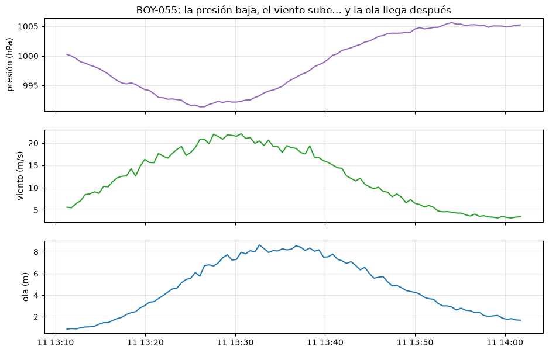
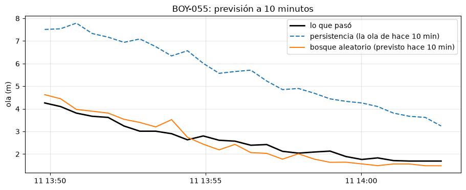
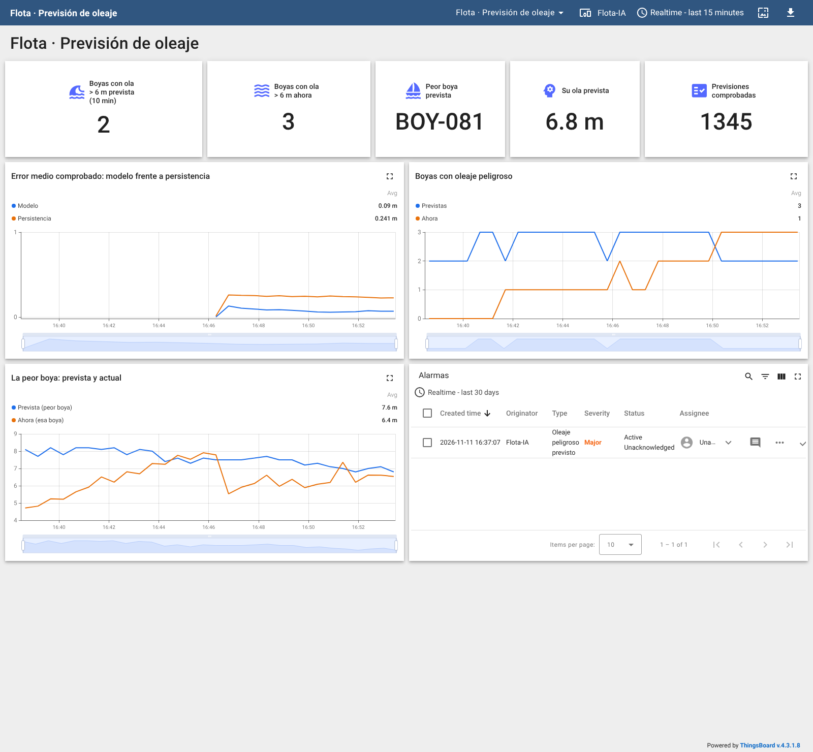

# Serie 4 · IA con OceanLab: previsión del oleaje

**¿Qué ola habrá dentro de 10 minutos?**

| | |
|---|---|
| **Simulador** | OceanLab (96 boyas meteorológicas, MQTT) |
| **Herramientas** | Node-RED (nodos **IA**), Jupyter (cuaderno 09), ThingsBoard |
| **Duración orientativa** | 2 sesiones de 2 h |
| **Requisitos** | Práctica de la serie 4 con AeroLab y las prácticas de OceanLab (series 1 y 2) |

## Objetivos

Al terminar sabrás:

- recoger datos de una **flota** de equipos sin ahogarte en ellos (submuestrear);
- preparar un problema de **previsión**: alinear el pasado y el futuro de cada boya en el tiempo;
- comparar un modelo con la **persistencia** («igual que ahora») y saber cuándo gana cada uno;
- leer los coeficientes de un modelo lineal como lo haría un meteorólogo;
- desplegar la previsión en **tiempo real** y comprobarla 10 minutos después.

## El tiempo de OceanLab

El tiempo de OceanLab está **acoplado**, como el de verdad:

| Variable | De qué depende |
|---|---|
| Presión | La de su latitud (altas subtropicales, bajas subpolares) menos la de las **borrascas** que pasan cerca |
| Viento | El de fondo (alisios, ponientes) más el que generan las borrascas: más fuerte cuanto más brusco el cambio de presión, girando alrededor del centro |
| Oleaje | Tiende al de un mar desarrollado para ese viento (≈ 0,0214·U²) más el mar de fondo, **con horas de retraso** |
| Temperatura del aire, humedad | El ciclo del día (hora solar de cada boya) y la tormenta |
| Batería | Carga solar de día, consumo siempre |

A la escala del simulador **1 s real = 1 min de mar**: 10 minutos de clase son 10 horas. Una borrasca tarda unas
decenas de minutos en cruzar una zona.

```
 OceanLab ──MQTT oceanlab/buoys/+/telemetry──► Node-RED ──una muestra cada 30 s──► datos/oceanlab.csv ──► Jupyter
                                                  │                                                     │
                                                  └──ventana de 10 min──► ia predecir ◄── modelo oceanlab-oleaje
                                                                              │
                                                     previsión de cada boya ──┴──► resumen de la flota ──► ThingsBoard
```

---

## Sesión 1 · Recoger y entrenar

### Parte 1 — Recoger los datos

**Menú → Import → Local → LabMonitorizacion → alumnado → Serie 4 OceanLab - Recoger datos** y **Deploy**.

```javascript
// ENTRADA: la telemetría de una boya (cada 2 s, las 96 boyas)
// SALIDA:  una fila por boya cada 30 s para el conjunto "oceanlab"
// Con 96 boyas cada 2 s serían 2880 filas por minuto: para el oleaje basta una muestra cada 30 s.

const p = msg.payload;
if (!p || !p.weather || p.device.status !== "online") return null;
const ultimas = context.get("ultimas") || {};
const ahora = Date.now();
if (ahora - (ultimas[p.buoy_id] || 0) < 30000) return null;
ultimas[p.buoy_id] = ahora;
context.set("ultimas", ultimas);
msg.payload = {
    boya:    p.buoy_id,
    latitud: p.location.latitude,
    ola:     p.weather.wave_height_m,
    viento:  p.weather.wind_speed_mps,
    presion: p.weather.pressure_hpa,
    humedad: p.weather.humidity_pct
};
return msg;
```

Déjalo **al menos 40 minutos** (en el laboratorio: 9600 muestras en 50 minutos). Mientras tanto,
en la web de OceanLab (<http://localhost:8020>) busca una boya con viento fuerte y mira cómo cambian juntas la
presión, el viento y la ola.

> No pulses **Simular tormenta** durante la recogida: es un salto artificial (8,4 m de golpe) que no sigue la
> física del mar y estropearía el entrenamiento. Úsalo en la parte 4.

### Parte 2 — Entrenar (cuaderno 09)

Abre **cuadernos → 09-oceanlab.ipynb**.



*Una boya del laboratorio al paso de una borrasca: la presión baja, el viento sube y la ola llega después
(cuaderno 09).*

Para cada muestra, el cuaderno busca en la misma boya la ola de **10 minutos después** (lo que se quiere prever)
y la presión y el viento de **10 minutos antes** (`dp`, `dv`: si están cambiando).

Resultados con los datos del laboratorio (40 % final del tiempo como prueba):

| Previsión | Error medio |
|---|---|
| Persistencia («la misma ola que ahora») | 0,260 m |
| Regresión lineal | 0,240 m |
| **Bosque aleatorio** | **0,177 m** |

| | Persistencia | Lineal | Bosque | Muestras |
|---|---|---|---|---|
| El mar casi no cambia | **0,086 m** | 0,158 m | 0,106 m | 2096 |
| La ola cambia más de 0,5 m | 1,271 m | 0,715 m | **0,593 m** | 361 |

La persistencia **gana con el mar en calma**, que es casi siempre: ningún modelo acierta mejor que «igual que
ahora» cuando nada cambia. Cuando la ola sube o baja, la persistencia llega 10 minutos tarde y el modelo reduce el
error a menos de la mitad. Los coeficientes del lineal se leen como un meteorólogo: lo que más pesa es la ola de
ahora; un viento que **aumenta** (`dv` > 0) y una presión que **baja** (`dp` < 0) suben la previsión. El cuaderno
publica el bosque, que es el que mejor resulta en la prueba.



*Previsión a 10 minutos en la misma boya: lo que pasó (negro), la persistencia (discontinua) y el modelo.*

El modelo se publica como `oceanlab-oleaje`.

---

## Sesión 2 · Tiempo real

### Parte 3 — La previsión de la flota

**soluciones → Serie 4 OceanLab - IA**, o añade a tu flujo, a la salida de **Una muestra cada 30 s**:

1. *function* `Ventana de 10 min`: guarda 10 minutos de historia de cada boya y calcula `dp` y `dv` como el
   cuaderno.

   ```javascript
   // ENTRADA: la muestra de una boya (cada 30 s)
   // SALIDA:  las entradas del modelo: lo de ahora y cuánto han cambiado la presión y el viento en 10 min
   // IMPORTANTE: el cuaderno 09 calcula dp y dv igual (la muestra más cercana a 10 min antes)

   const HORIZONTE = 10 * 60 * 1000;
   const p = msg.payload, ahora = Date.now();
   const hist = flow.get("historial") || {};
   const h = hist[p.boya] || [];
   h.push({ t: ahora, presion: p.presion, viento: p.viento, ola: p.ola });
   while (h.length && ahora - h[0].t > HORIZONTE + 60000) h.shift();      // guarda poco más de 10 min
   hist[p.boya] = h;
   flow.set("historial", hist);
   // la muestra más cercana a 10 min antes (tolerancia: 1 min)
   const antes = h.reduce((mejor, x) => Math.abs(ahora - x.t - HORIZONTE) < Math.abs(ahora - mejor.t - HORIZONTE) ? x : mejor, h[0]);
   if (Math.abs(ahora - antes.t - HORIZONTE) > 60000) {
       node.status({ fill: "yellow", shape: "ring", text: `${p.boya}: llenando 10 min de historia` });
       return null;
   }
   msg.boya = p.boya;
   msg.actual = p;
   msg.payload = { ola: p.ola, viento: p.viento, presion: p.presion,
                   dp: Math.round((p.presion - antes.presion) * 100) / 100,
                   dv: Math.round((p.viento - antes.viento) * 100) / 100 };
   return msg;
   ```

2. **ia predecir** `Ola dentro de 10 min`, modelo `oceanlab-oleaje`, resultado **solo en msg.prediccion**.
3. *function* `Previsión de la flota`: guarda la previsión de cada boya, la **comprueba** cuando han pasado
   10 minutos (frente a la persistencia) y cada 5 s envía un resumen:

   ```javascript
   // ENTRADA: msg.prediccion.prediccion = ola prevista dentro de 10 min (m) para msg.boya
   // SALIDA:  cada 5 s, un resumen de la flota para ThingsBoard; comprueba las previsiones de hace 10 min

   const HORIZONTE = 10 * 60 * 1000, PELIGRO = 6;
   const ahora = Date.now(), boya = msg.boya, ola = msg.actual.ola;
   const prevista = Math.max(0.1, msg.prediccion.prediccion);
   const flota = flow.get("prevision") || {};
   const pend = flow.get("pendientes") || [];
   // ¿hay previsiones de esta boya hechas hace ~10 min? Compararlas con lo que mide ahora
   const b = flow.get("balance") || { n: 0, err_modelo: [], err_persistencia: [] };
   for (let i = pend.length - 1; i >= 0; i--) {
       const x = pend[i];
       if (x.boya !== boya || ahora - x.t < HORIZONTE) continue;
       pend.splice(i, 1);
       if (ahora - x.t > HORIZONTE + 60000) continue;               // demasiado vieja
       b.err_modelo.push(Math.abs(ola - x.prevista));
       b.err_persistencia.push(Math.abs(ola - x.ola_entonces));     // «mañana igual que hoy»
       if (b.err_modelo.length > 300) { b.err_modelo.shift(); b.err_persistencia.shift(); }
       b.n++;
   }
   pend.push({ boya, t: ahora, prevista, ola_entonces: ola });
   flow.set("pendientes", pend.slice(-2000));
   flow.set("balance", b);
   flota[boya] = { prevista, ola };
   flow.set("prevision", flota);

   if (ahora - (context.get("ultimo") || 0) < 5000) return null;    // un resumen cada 5 s
   context.set("ultimo", ahora);
   const filas = Object.entries(flota);
   const peor = filas.reduce((m, f) => f[1].prevista > m[1].prevista ? f : m, filas[0]);
   const media = a => a.length ? Math.round(1000 * a.reduce((s, x) => s + x, 0) / a.length) / 1000 : null;
   node.status({ text: `${filas.length} boyas · peor ${peor[0]} ${peor[1].prevista.toFixed(1)} m` });
   msg.payload = { ts: ahora, values: {
       boyas_con_prevision: filas.length,
       boyas_peligro_previsto: filas.filter(f => f[1].prevista > PELIGRO).length,
       boyas_peligro_ahora: filas.filter(f => f[1].ola > PELIGRO).length,
       peor_boya: peor[0], peor_ola_prevista_m: Math.round(10 * peor[1].prevista) / 10, peor_ola_ahora_m: peor[1].ola,
       mae_modelo_m: media(b.err_modelo), mae_persistencia_m: media(b.err_persistencia), comprobadas: b.n } };
   return msg;
   ```

4. **mqtt out** a ThingsBoard con el token de un dispositivo nuevo, `Flota-IA`.

### Parte 4 — Panel y alarma

1. Importa [thingsboard/panel-oceanlab-ia.json](thingsboard/panel-oceanlab-ia.json).
2. En `Flota-IA` → **Alarm rules**: **Oleaje peligroso previsto**, `boyas_peligro_previsto` ≥ 1, se borra cuando
   vale 0, Major, detalle `${n} boya(s) con más de 6 m previstos (peor: ${b}, ${o} m)`.
3. Espera 10 minutos a que lleguen las primeras comprobaciones y compara en el panel el error del modelo con el
   de la persistencia.

Lo que se vio en el laboratorio tras 25 minutos en tiempo real:

| | Valor |
|---|---|
| Previsiones comprobadas 10 min después | 1345 |
| Error medio del modelo | **0,09 m** |
| Error medio de la persistencia | 0,24 m |
| Alarma «Oleaje peligroso previsto» | 16:37, con **ninguna** boya por encima de 6 m en ese momento |
| Primera boya por encima de 6 m de verdad | 16:41 |

La alarma de la previsión llegó **4 minutos (4 horas de mar) antes** que el oleaje peligroso.



*Panel de la flota (captura real del laboratorio).*

---

## Entrega

- [ ] Cuaderno 09 con sus resultados y las respuestas de **Tu turno**.
- [ ] Flujo de Node-RED exportado (**sin el token**).
- [ ] Captura del panel con las previsiones comprobadas.

## Preguntas finales

1. ¿Por qué hay que separar los datos de prueba **en el tiempo** y no al azar?
2. La persistencia acierta casi siempre. ¿Para qué sirve entonces un modelo de previsión?
3. ¿Qué le falta al modelo para prever la **llegada** de una borrasca a una boya en calma? ¿De dónde sacarías esa
   información?
4. Un barco necesita saber si podrá descargar dentro de 10 horas. ¿Le darías la previsión del modelo, la de la
   persistencia o las dos? ¿Con qué incertidumbre?
5. El simulador tiene las borrascas «dentro»; los meteorólogos usan modelos físicos del océano y la atmósfera.
   ¿Qué ventajas e inconvenientes tiene un modelo aprendido de los datos frente a uno físico?

## Rúbrica

| Criterio | Peso | Nivel alto |
|---|---|---|
| Recogida | 15 % | Submuestreo justificado, recogida suficiente |
| Preparación | 25 % | Futuro y pasado de cada boya bien alineados; prueba separada en el tiempo |
| Evaluación | 25 % | Compara con la persistencia, también cuando el mar cambia; lee los coeficientes |
| Tiempo real | 25 % | Ventana igual que en el cuaderno, comprobación a 10 minutos y alarma |
| Reflexión | 10 % | Respuestas razonadas a las preguntas finales |
