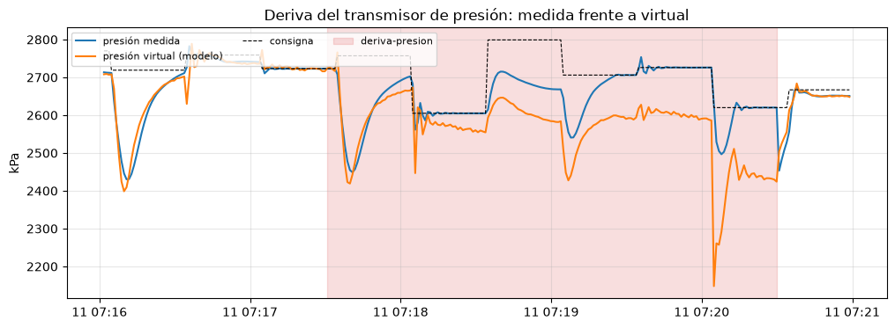
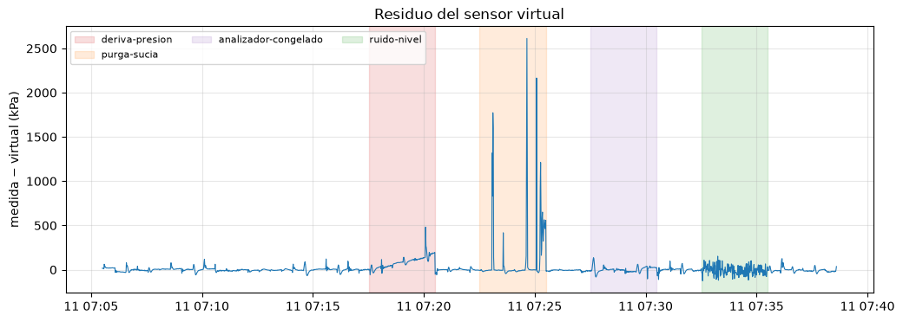
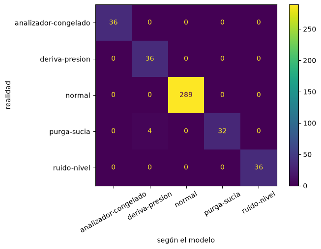
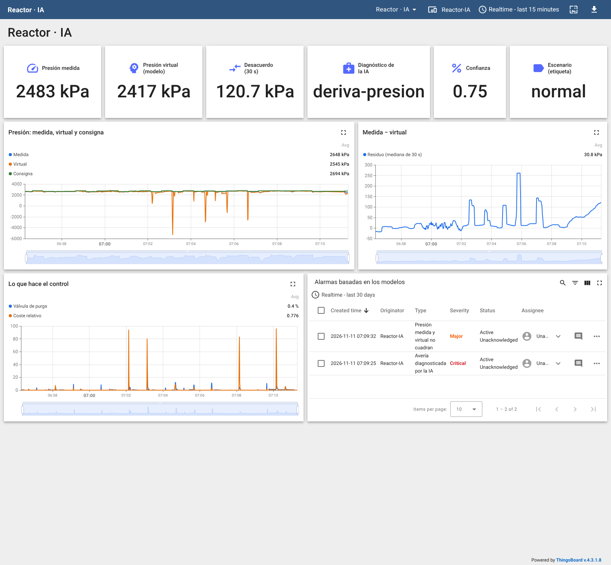

# Serie 4 · IA con ReactorLab: sensor virtual y diagnóstico de averías

**Cuando el control automático tapa la avería**

| | |
|---|---|
| **Simulador** | ReactorLab (reactor químico Tennessee Eastman simplificado, API REST) |
| **Herramientas** | Node-RED (nodos **IA**), Jupyter (cuaderno 06), ThingsBoard |
| **Duración orientativa** | 2 sesiones de 2 h |
| **Requisitos** | Práctica de la serie 4 con AeroLab (recorrido datos → Jupyter → Node-RED) y el reto web de ReactorLab (API REST con `X-API-Key`) |

## Objetivos

Al terminar sabrás:

- explicar por qué en una planta con **lazos de control** las averías no se ven en las medidas principales;
- **excitar** una planta (campaña de consignas) para que los datos tengan algo que enseñar;
- entrenar un **sensor virtual** (regresión) y usar su **residuo** para vigilar un instrumento;
- calcular **indicadores de ventana** en Node-RED y entrenar con ellos un **clasificador de averías**;
- desplegar los dos modelos en **tiempo real** y crear alarmas en ThingsBoard sobre lo que dicen.

## La idea

ReactorLab tiene cuatro lazos de control: la purga controla la **presión**, la alimentación F1 la
**producción**, la F2 la **composición** y la válvula de producto el **nivel**. Si el transmisor de presión
empieza a marcar de más, el lazo abre la purga para «bajar» una presión que en realidad ya es correcta: la
**medida** sigue en la consigna, la presión **real** baja y la planta pierde dinero. Ninguna alarma salta.

```
                       ┌─ válvulas, caudales, nivel, composición ─► sensor virtual ─► presión calculada
 ReactorLab ──REST──►  │                                                                   │
  GET /proceso         └─ presión medida ──────────────────────────────────────────► residuo = medida − calculada
                                                                                           │
                         ventana de 30 s: residuo, analizador, nivel, válvulas ─► clasificador ─► diagnóstico
```

Si la presión medida y la calculada con **las demás** medidas no cuadran, uno de los dos miente.

## Preparación

1. La capa de IA arranca con el laboratorio. Comprueba <http://localhost:8888/?token=lab> (Jupyter) y
   <http://localhost:8100/docs> (servicio de IA).
2. En la web de ReactorLab (<http://localhost:8030>): planta **en marcha**, modo **automático**, sin averías.
3. La clave de las órdenes de ReactorLab (`reactorlab`) **no se escribe en el flujo**: va en una variable de
   entorno de la pestaña de tipo **credencial**, como en el reto web.

---

## Sesión 1 · Recoger los datos y entrenar

### Parte 1 — Importar el flujo de recogida

**Menú → Import → Local → LabMonitorizacion → alumnado → Serie 4 ReactorLab - Recoger datos**. Antes de
desplegar, doble clic en la pestaña → **Environment variables**: `REACTORLAB_KEY`, tipo **credential**, valor
`reactorlab`. **Deploy**.

| Bloque | Qué hace |
|---|---|
| Lectura | `GET /api/v1/proceso` cada segundo y una **fila plana** con medidas, válvulas y consignas |
| **ia registrar** | Añade cada fila a `datos/reactorlab.csv` |
| Campaña de consignas | Cada 30 s, `PUT /api/v1/consignas` con valores nuevos al azar |
| Escenarios | Cinco botones: quitan la avería anterior (`DELETE /api/v1/averias`), inyectan la nueva (`POST`) y fijan la **etiqueta** |

La fila:

```javascript
// ENTRADA: msg.payload = GET /api/v1/proceso (medidas, válvulas y consignas)
// SALIDA:  msg.payload = una fila plana para el conjunto "reactorlab" + la etiqueta

const p = msg.payload, m = p.medidas, v = p.valvulas, c = p.consignas;
if (!p.estado.en_marcha || p.estado.paro_emergencia) {
    node.status({ fill: "grey", shape: "ring", text: "planta parada: no se registra" });
    return null;
}
msg.payload = {
    // medidas (lo que dicen los instrumentos)
    presion:         m.presion_kpa,
    nivel:           m.nivel_pct,
    caudal_f1:       m.caudal_kmolh.f1,
    caudal_f2:       m.caudal_kmolh.f2,
    caudal_purga:    m.caudal_kmolh.purga,
    caudal_producto: m.caudal_kmolh.producto,
    a_purga:         m.composicion_purga_pct.A,
    b_purga:         m.composicion_purga_pct.B,
    c_purga:         m.composicion_purga_pct.C,
    coste:           m.coste_relativo,
    // posiciones de las válvulas (lo que hace el control)
    v_f1:            v.f1.posicion_pct,
    v_f2:            v.f2.posicion_pct,
    v_purga:         v.purga.posicion_pct,
    v_producto:      v.producto.posicion_pct,
    // consignas (lo que se le pide a la planta)
    sp_presion:      c.presion_kpa,
    sp_producto:     c.caudal_producto_kmolh,
    sp_nivel:        c.nivel_pct,
    sp_a:            c.a_purga_pct,
    // etiqueta: lo que está pasando DE VERDAD (lo fija el botón de escenario)
    escenario:       flow.get("escenario") || "normal"
};
node.status({ text: `${msg.payload.presion} kPa · ${msg.payload.escenario}` });
return msg;
```

¿Por qué una **campaña**? Mira la planta sin ella: todas las medidas están **quietas** en su consigna.
Un modelo entrenado con datos quietos no aprende ninguna relación entre variables.

```javascript
// ENTRADA: un pulso cada 30 s
// SALIDA:  PUT /api/v1/consignas con consignas nuevas al azar
// En régimen estacionario los lazos de control dejan las medidas QUIETAS en la consigna:
// sin cambios no hay nada que aprender. La campaña "excita" la planta.
// La clave NO está en el código: variable de entorno REACTORLAB_KEY de la pestaña (tipo credencial)

const azar = (min, max, dec = 0) => Number((min + Math.random() * (max - min)).toFixed(dec));
msg.method  = "PUT";
msg.url     = "http://reactorlab:8030/api/v1/consignas";
msg.headers = { "X-API-Key": env.get("REACTORLAB_KEY"), "Content-Type": "application/json" };
msg.payload = {
    presion_kpa:           azar(2600, 2800),
    caudal_producto_kmolh: azar(90, 110),
    nivel_pct:             azar(40, 50),
    a_purga_pct:           azar(45, 50, 1)
};
node.status({ text: `${msg.payload.presion_kpa} kPa · ${msg.payload.caudal_producto_kmolh} kmol/h` });
return msg;
```

Los escenarios:

```javascript
// ENTRADA: msg.payload = nombre del escenario (botones de la izquierda)
// SALIDA:  DELETE /api/v1/averias (quita la avería anterior); msg.plan = averías del escenario nuevo

const PLANES = {
    "normal":               [],
    // el transmisor de presión deriva 30 kPa/h (1 kPa por segundo real a la escala 120)
    "deriva-presion":       [{ tipo: "sensor", objetivo: "presion", modo: "deriva", valor: 30 }],
    // la válvula de purga pierde la mitad de su capacidad: el lazo la abre más para compensar
    "purga-sucia":          [{ tipo: "valvula_sucia", objetivo: "purga", valor: 0.5 }],
    // el analizador se queda con su último valor
    "analizador-congelado": [{ tipo: "sensor", objetivo: "analizador", modo: "congelado" }],
    // el transmisor de nivel mete ±3 % de ruido
    "ruido-nivel":          [{ tipo: "sensor", objetivo: "nivel", modo: "ruido", valor: 3 }]
};
const escenario = msg.payload;
if (!(escenario in PLANES)) {
    node.warn("Escenario desconocido: " + escenario);
    return null;
}
flow.set("escenario", escenario);
node.status({ fill: escenario === "normal" ? "green" : "orange", shape: "dot", text: escenario });

msg.plan    = PLANES[escenario];
msg.method  = "DELETE";
msg.url     = "http://reactorlab:8030/api/v1/averias";
msg.headers = { "X-API-Key": env.get("REACTORLAB_KEY") };
msg.payload = "";
return msg;
```

```javascript
// ENTRADA: la respuesta del DELETE, con msg.plan
// SALIDA:  un POST /api/v1/averias por cada avería del plan

const headers = { "X-API-Key": env.get("REACTORLAB_KEY"), "Content-Type": "application/json" };
return [msg.plan.map(a => ({ method: "POST", url: "http://reactorlab:8030/api/v1/averias", headers, payload: a }))];
```

> El nodo **http request** de las órdenes tiene el método en **«- set by msg.method -»**: así el mismo nodo
> sirve para `PUT`, `POST` y `DELETE`.

### Parte 2 — La campaña

1. Deja el flujo en **Normal** **12 minutos** (unas 700 filas).
2. Pulsa cada avería durante **3 minutos**, con 2 minutos de **Normal** entre una y otra:
   *Deriva del sensor de presión* → *Normal* → *Válvula de purga sucia* → *Normal* → *Analizador congelado* →
   *Normal* → *Ruido en el nivel* → *Normal*.
3. Mientras tanto, en la web de ReactorLab, mira el **sinóptico** con la deriva: ¿se nota algo?

### Parte 3 — Entrenar (cuaderno 06)

Abre **cuadernos → 06-reactorlab.ipynb** y ejecútalo celda a celda.



*Campaña real: durante la deriva (rojo) la presión medida vuelve a la consigna tras cada cambio; la que calculan
las demás medidas (sensor virtual) se va alejando (cuaderno 06).*

**A · Sensor virtual.** Regresión de la presión con las 12 medidas restantes. Resultados con la campaña del
laboratorio (1986 filas, último 25 % de lo normal como prueba):

| Modelo | MAE en prueba |
|---|---|
| **Lineal** | **13,6 kPa** |
| Red neuronal (32 + 16) | 73,0 kPa |
| Bosque aleatorio | 41,3 kPa |

El modelo **lineal** gana: la presión de un gas depende casi linealmente de lo que entra y sale, y un
bosque aleatorio no sabe **extrapolar** (y una avería lleva la planta fuera de lo visto).

| Escenario | Residuo: mediana (kPa) | Media (kPa) | Máximo (kPa) |
|---|---|---|---|
| Normal | −3,0 | −2,1 | 121 |
| Deriva del sensor de presión | **109,5** | 116,0 | 481 |
| Válvula de purga sucia | −5,6 | **135,2** | **2612** |
| Analizador congelado | 1,5 | 1,5 | 61 |
| Ruido en el nivel | −16,3 | −10,3 | 101 |



*Residuo del sensor virtual durante la campaña: con la deriva crece; con la válvula de purga sucia da picos enormes
en cada transitorio; con el nivel ruidoso se agita.*

**B · Diagnóstico.** Una fila sola dice poco: el cuaderno calcula **6 indicadores de los últimos 30 s** y
entrena un **bosque aleatorio** de clasificación. Acierto en prueba: **99,1 %**.

| Indicador | Qué mide | Delata |
|---|---|---|
| `res_mediana` | el desvío entre presión medida y virtual que **se mantiene** | deriva del transmisor |
| `res_pendiente` | si ese desvío crece (kPa/s) | deriva del transmisor |
| `res_pico` | el pico más alto por encima de la mediana | válvula de purga sucia (no cuadra en los transitorios) |
| `a_variacion` | cuánto se mueve el analizador | analizador congelado |
| `nivel_salto` | salto medio del nivel de un segundo a otro | ruido en el nivel |
| `vprod_salto` | salto medio de la válvula de producto | ruido en el nivel (el lazo lo persigue) |

> **Mediana, no media.** La primera versión de este cuaderno usaba la media y la desviación típica del residuo y
> confundía la deriva con la válvula sucia (72 % de las ventanas de deriva en la prueba): los picos de la válvula
> sucia disparan la media igual que una deriva grande. Separar «desvío que se mantiene» (mediana) de «picos»
> resolvió la confusión. Es la pregunta 1 de **Tu turno**.



*Matriz de confusión (30 % final de cada escenario).*

Todas las ventanas normales, de deriva, de analizador congelado y de nivel ruidoso se clasifican bien; 4 de 36
ventanas de la válvula sucia salen como deriva (cuando un transitorio deja un desvío que dura casi toda la
ventana). En la prueba no hay ni una falsa alarma.

Los dos modelos se publican con `guardar(...)`: `reactorlab-presion` y `reactorlab-averias`.

---

## Sesión 2 · Tiempo real y alarmas

### Parte 4 — Los modelos en Node-RED

A la salida de **Fila plana**:

1. **ia predecir** `Presión virtual`, modelo `reactorlab-presion`, resultado **solo en msg.prediccion**.
2. *function* `Residuo y ventana de 30 s`: guarda las últimas 30 filas en el contexto del nodo y calcula los
   **mismos** indicadores que el cuaderno (si los calculas distinto, el clasificador recibe otra cosa de la que
   aprendió):

   ```javascript
   // ENTRADA: la fila plana + msg.prediccion (la presión que el modelo calcula con las demás medidas)
   // SALIDA:  msg.payload = los 6 indicadores de los últimos 30 s (las entradas del clasificador)
   //          msg.fila    = la fila con la presión virtual y el residuo
   // IMPORTANTE: el cuaderno 06 calcula los indicadores EXACTAMENTE igual (función ventanas)

   const N = 30;                                    // filas de la ventana (una por segundo)
   const p = msg.payload;
   p.presion_virtual = Math.round(msg.prediccion.prediccion * 10) / 10;
   p.residuo = Math.round((p.presion - p.presion_virtual) * 10) / 10;
   msg.fila = p;

   let v = context.get("ventana") || [];
   const ahora = Date.now();
   if (v.length && ahora - v[v.length - 1].t > 5000) v = [];   // hueco en los datos: se empieza de cero
   v.push({ t: ahora, residuo: p.residuo, a_purga: p.a_purga, nivel: p.nivel, v_producto: p.v_producto });
   if (v.length > N) v.shift();
   context.set("ventana", v);
   if (v.length < N) {
       node.status({ fill: "yellow", shape: "ring", text: `llenando la ventana ${v.length}/${N}` });
       return null;
   }

   const r = v.map(x => x.residuo);
   // mediana: el desvío que se mantiene (no le afectan los picos sueltos)
   const ord = [...r].sort((a, b) => a - b);
   const mediana = (ord[N / 2 - 1] + ord[N / 2]) / 2;
   // pendiente de la recta de mínimos cuadrados (kPa por segundo)
   const tm = (N - 1) / 2;
   let num = 0, den = 0;
   r.forEach((x, i) => { num += (i - tm) * x; den += (i - tm) ** 2; });
   // suma y media de los saltos entre filas consecutivas
   const saltos = k => v.slice(1).map((x, i) => Math.abs(x[k] - v[i][k]));
   const suma = a => a.reduce((s, x) => s + x, 0);

   msg.payload = {
       res_mediana:   mediana,                                        // ¿la presión medida se aparta de la virtual?
       res_pendiente: num / den,                                      // ¿se aparta cada vez más?
       res_pico:      Math.max(...r) - mediana,                       // ¿hay picos (transitorios que no cuadran)?
       a_variacion:   suma(saltos("a_purga")),                        // ¿se mueve el analizador?
       nivel_salto:   suma(saltos("nivel")) / (N - 1),                // ¿salta el nivel de un segundo a otro?
       vprod_salto:   suma(saltos("v_producto")) / (N - 1)            // ¿persigue el lazo de nivel ese ruido?
   };
   node.status({ text: `residuo (mediana) ${mediana.toFixed(1)} kPa` });
   return msg;
   ```

3. **ia predecir** `¿Qué avería?`, modelo `reactorlab-averias`: devuelve `clase` y `probabilidad`.
4. *function* `Diagnóstico`: un clasificador se equivoca de vez en cuando, así que el diagnóstico es la clase
   **más votada** en los últimos 15 s:

   ```javascript
   // ENTRADA: msg.prediccion = { clase, probabilidad } del clasificador, msg.fila, msg.payload (indicadores)
   // SALIDA:  la telemetría para ThingsBoard
   // Un clasificador se equivoca de vez en cuando: el diagnóstico es la clase más votada de los últimos 15 s.

   const VOTOS = 15;
   let h = context.get("historial") || [];
   h.push(msg.prediccion.clase);
   if (h.length > VOTOS) h.shift();
   context.set("historial", h);
   const cuenta = {};
   h.forEach(c => cuenta[c] = (cuenta[c] || 0) + 1);
   const [diagnostico, votos] = Object.entries(cuenta).sort((a, b) => b[1] - a[1])[0];

   const f = msg.fila, ind = msg.payload;
   node.status({ fill: diagnostico === "normal" ? "green" : "red", shape: "dot", text: `${diagnostico} (${votos}/${h.length})` });
   msg.payload = {
       ts: Date.now(),
       values: {
           presion:          f.presion,
           presion_virtual:  f.presion_virtual,
           sp_presion:       f.sp_presion,
           residuo:          f.residuo,
           residuo_30s:      Math.round(ind.res_mediana * 10) / 10,
           desacuerdo_kpa:   Math.round(Math.abs(ind.res_mediana) * 10) / 10,
           v_purga:          f.v_purga,
           coste:            f.coste,
           clase_ia:         msg.prediccion.clase,
           probabilidad:     msg.prediccion.probabilidad,
           diagnostico:      diagnostico,
           averia_ia:        diagnostico !== "normal",
           escenario:        f.escenario              // la etiqueta: solo para comprobar al profesor
       }
   };
   return msg;
   ```

5. **mqtt out** a ThingsBoard con el token de un dispositivo nuevo, `Reactor-IA`, y un **catch** para los dos
   **ia predecir**.

### Parte 5 — Panel y alarmas

1. Importa [thingsboard/panel-reactorlab-ia.json](thingsboard/panel-reactorlab-ia.json).
2. En `Reactor-IA` → **Alarm rules**:

| Regla | Condición | Se borra | Gravedad | Detalle |
|---|---|---|---|---|
| Presión medida y virtual no cuadran | `desacuerdo_kpa` > 30 durante 20 s | < 15 durante 20 s | Major | `${des} kPa` |
| Avería diagnosticada por la IA | `averia_ia` = true durante 10 s | false durante 30 s | Critical | `Diagnóstico: ${diag}` |

3. Desactiva el nodo **ia registrar** (si no, la avería oculta quedaría en `reactorlab.csv` con la etiqueta
   «normal» y estropearía el siguiente entrenamiento).
4. Pide al profesor una **avería oculta** (la inyecta por la API, sin pasar por tus botones: la etiqueta seguirá
   diciendo «normal»). Con el panel, responde: ¿qué avería es?, ¿cuánto tardó cada regla?, ¿qué habría visto el
   operador **sin** la IA?

Resultados en el laboratorio (modelos del cuaderno 06, averías inyectadas por la API con la campaña en marcha):

| Avería oculta | «No cuadran» | «Avería diagnosticada» | Diagnóstico |
|---|---|---|---|
| Deriva del sensor de presión | 70 s | 60 s | `deriva-presion` (43 de 60 lecturas) |
| Válvula de purga sucia (3 min) | no salta | no salta | `normal` (60 de 60) |
| Válvula de purga sucia (5 min, repetición) | 42 s | — ¹ | `purga-sucia` (63 de 100), a ratos `deriva-presion` o `normal` |
| Analizador congelado | no salta (no afecta a la presión) | 42 s | `analizador-congelado` (49 de 60) |
| Ruido en el nivel | no salta | 30 s | `ruido-nivel` (54 de 60) |

¹ La alarma de la avería anterior aún no se había borrado.

La válvula sucia es la avería difícil: mientras el lazo tiene margen la compensa abriendo más, y solo se nota en
los transitorios grandes (los picos del residuo). En la primera prueba no hubo ninguno en 3 minutos.



*Panel con una deriva del sensor de presión (captura real del laboratorio).*

---

## Entrega

- [ ] Cuaderno 06 con sus resultados y las respuestas de **Tu turno**.
- [ ] Flujo de Node-RED exportado (la clave está en una credencial: **no** se exporta).
- [ ] Captura del panel con la avería oculta y la tabla de la parte 5.

## Preguntas finales

1. ¿Por qué la presión medida no delata la deriva de su propio transmisor? ¿Qué variables sí lo hacen?
2. El sensor virtual usa la posición de la válvula de purga. Si la válvula se ensucia, ¿quién «miente», el
   transmisor o el modelo? ¿Cómo lo distinguirías?
3. ¿Qué pasa con el diagnóstico si se para la campaña de consignas? ¿Es aceptable en una planta real mover las
   consignas para poder diagnosticar? ¿Qué alternativas hay?
4. El clasificador solo conoce 4 averías. Propón cómo avisar de una avería que **no** conoce.
5. Un sensor virtual también sirve para **sustituir** un instrumento caro o averiado. ¿Qué haría falta para
   fiarse de él?

## Rúbrica

| Criterio | Peso | Nivel alto |
|---|---|---|
| Recogida y campaña | 15 % | Campaña completa, explica por qué hay que excitar la planta |
| Sensor virtual | 25 % | Compara modelos con una prueba temporal, explica por qué gana el lineal, interpreta el residuo |
| Diagnóstico | 25 % | Indicadores bien calculados, matriz de confusión interpretada, variantes de «Tu turno» |
| Tiempo real | 20 % | Indicadores idénticos a los del cuaderno, votación, catch, panel funcionando |
| Avería oculta | 15 % | Identifica la avería con datos y razona qué habría visto el operador sin la IA |
