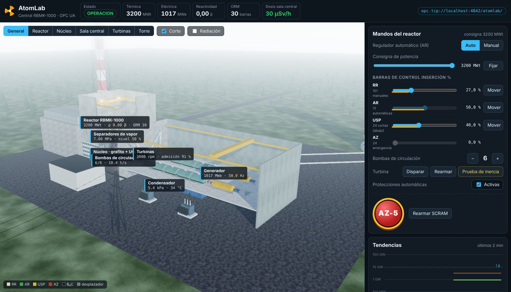
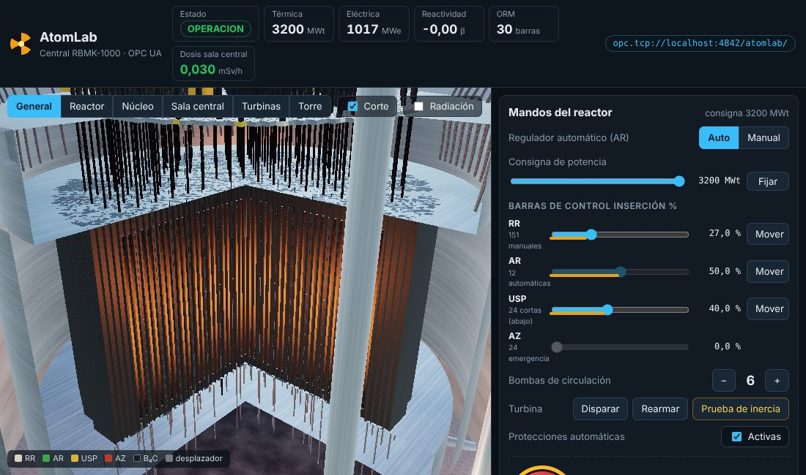
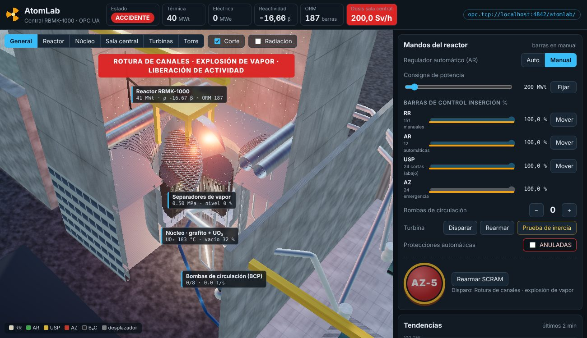

# AtomLab · Central nuclear RBMK (tipo Chernóbil) con OPC UA

AtomLab simula una central **RBMK-1000** completa (reactor de grafito y agua en ebullición, el tipo de la unidad 4 de Chernóbil) y publica todos sus datos y mandos en un **servidor OPC UA**. Su sala de control web incluye una **vista 3D realista** (Three.js) del edificio del reactor en corte, la sala de turbinas y la torre de refrigeración, que se mueve con los datos de la simulación.



> Es un modelo **didáctico**: reproduce de forma cualitativa los fenómenos que se estudian en clase con órdenes de magnitud realistas. No es un código de seguridad nuclear.

## La central

El RBMK es de **circuito único**: el agua hierve en los canales del núcleo y el vapor va directamente a las turbinas. No hay generador de vapor.

```
 canales de combustible ──▶ separadores de vapor ──▶ turbinas (2 × 500 MWe) ──▶ generadores ──▶ red
        ▲   (1661 + grafito)          │                     │
        │                             ▼                     ▼
 bombas de circulación ◀── bajantes ◀─┘          condensador ──▶ torre de refrigeración
   (BCP, 8; 6 en servicio)   ◀── agua de alimentación ◀──┘
```

| Sistema | Qué se modela |
|---|---|
| Núcleo | Cinética puntual con 6 grupos de neutrones retardados; reactividad de barras, **vacío (positivo)**, Doppler, grafito y xenón; calor residual |
| Barras | 4 grupos: RR (manuales), AR (regulador automático), USP (cortas, entran por abajo) y AZ (emergencia). Las que entran por arriba llevan **desplazador de grafito**: al empezar a entrar añaden reactividad (el *efecto positivo del SCRAM*) |
| ORM | Margen operativo de reactividad en barras equivalentes. Con pocas barras dentro, el coeficiente de vacío crece |
| Xenón | Yodo-135 / xenón-135: tras bajar la potencia el reactor se envenena durante horas |
| Termohidráulica | Caudal según las bombas, subenfriamiento, título y fracción de vapor, presión de separadores (regulador PI con la turbina o la descarga al condensador), nivel y agua de alimentación |
| Turbogenerador | Válvulas de admisión, disparo, velocidad, potencia eléctrica y la **prueba de inercia** (4 bombas alimentadas por el generador que se frena) |
| Protecciones | AZ-5 por potencia > 110 %, periodo < 20 s, presión > 8 MPa y nivel bajo. Se pueden anular |
| Daños y radiación | Rotura de canales si se deposita demasiada energía, fusión del combustible, incendio del grafito; tasas de dosis en sala de control, sala central, sala de turbinas y exterior |

### El escenario del 26-04-1986

En **Escenario → 26-04-1986 · 01:22** la central arranca como estaba aquella noche: 200 MWt, xenón alto tras horas a media potencia, casi todas las barras fuera (ORM ≈ 0), las 8 bombas en marcha, el agua de entrada casi saturada y las protecciones anuladas. Para reproducir el accidente:

1. Esperar a que la potencia se estabilice (unos segundos).
2. **Prueba de inercia** de la turbina: el caudal cae, aumenta el vapor y la reactividad sube.
3. Pulsar **AZ-5** unos 30-40 s después: los desplazadores expulsan el agua de la parte baja del núcleo, la reactividad supera 1 β (crítico inmediato), la potencia se multiplica por más de 100 en un segundo, los canales revientan y la losa superior sale despedida.

Con **Plena potencia** se vuelve a la operación normal (3200 MWt, 1000 MWe). Un SCRAM desde ahí apaga el reactor sin daños: la diferencia está en el ORM, el xenón y el vacío.

La **escala de tiempo** (×1 a ×60) permite ver en minutos la intoxicación por xenón o el calor residual; con ×1 la física va en tiempo real.

## OPC UA

| | |
|---|---|
| Endpoint | `opc.tcp://localhost:4842/atomlab/` (desde otro contenedor: `opc.tcp://atomlab:4842/atomlab/`) |
| Seguridad | `None` (sin certificados ni usuario) |
| Namespace | `urn:atomlab:rbmk` (normalmente `ns=2`) |
| NodeId | de tipo cadena: `ns=2;s=Reactor.PotenciaTermica` |

Espacio de direcciones (la tabla completa, con unidades, está en la web, tarjeta *Servidor OPC UA*, y en `GET /api/v1/opcua`):

| Carpeta | Variables (lectura) |
|---|---|
| `Reactor` | `PotenciaTermica` MWt, `PotenciaPct`, `CalorResidual`, `Reactividad` β, `ReactividadPcm`, `Periodo` s, `ORM`, `CoeficienteVacio`, `TempCombustible`, `TempGrafito`, `Xenon`, `Vacio` %, `PicoPotencia` MWt, `ConsignaActual`, `RegulacionAuto` |
| `Reactor/Barras` | `RR`, `AR`, `USP`, `AZ` (inserción %) — NodeId `Reactor.Barras.RR` |
| `CircuitoPrimario` | `BombasEnMarcha`, `Caudal` kg/s, `CaudalPct`, `TempEntrada`, `Subenfriamiento`, `CalidadVapor`, `CaudalVapor`, `Presion` MPa, `NivelSeparadores`, `AguaAlimentacion` |
| `Turbina` | `ValvulaAdmision` %, `Bypass` %, `Velocidad` rpm, `Disparada` |
| `Generador` | `PotenciaElectrica` MWe, `Frecuencia` Hz, `Acoplado`, `Rendimiento` |
| `Condensador` | `Temperatura`, `Presion` kPa, `CalorEvacuado` MW |
| `Refrigeracion` | `TempAguaFria`, `TempAguaCaliente`, `Penacho` % |
| `Radiacion` | `SalaControl`, `SalaCentral`, `SalaTurbinas`, `Exterior` (mSv/h) |
| `Servidor` | `Latido`: contador que cambia en cada ciclo (≈ 20 por segundo). OPC UA solo notifica los **cambios**: con la central estable muchas variables no cambian, y el latido permite saber que la comunicación sigue viva |
| `Proteccion` | `Scram`, `Motivo`, `ProteccionesActivas`, `Danado`, `CombustibleFundido`, `AlarmasActivas`, `Estado` (`OPERACION`, `PARADA`, `SCRAM`, `ACCIDENTE`) |

Mandos (escritura) en `Mandos`: `ConsignaPotencia` (0-3200 MWt), `RegulacionAuto`, `InsercionRR`, `InsercionUSP`, `InsercionAR` (solo en manual), `Bombas` (0-8), `Protecciones`, y los pulsadores `AZ5`, `DispararTurbina` y `PruebaInercia` (escribir `true`). Una escritura no válida se rechaza y el nodo vuelve a su valor real; el motivo aparece en *Accesos de clientes*.

Métodos en `Mandos` (devuelven `ok` o `rechazado: motivo`): `AZ5Pulsar`, `Rearmar`, `DispararTurbinaMetodo`, `RearmarTurbina`, `PruebaTurbina`, `EscenarioNormal`, `EscenarioChernobil`.

Prueba rápida con Python:

```python
import asyncio
from asyncua import Client

async def main():
    async with Client("opc.tcp://localhost:4842/atomlab/") as c:
        ns = await c.get_namespace_index("urn:atomlab:rbmk")
        print(await c.get_node(f"ns={ns};s=Reactor.PotenciaTermica").read_value())
        await c.get_node(f"ns={ns};s=Mandos.ConsignaPotencia").write_value(2400.0)

asyncio.run(main())
```

## Alarmas

| Código | Condición | Severidad |
|---|---|---|
| `ORM_BAJO` / `ORM_MUY_BAJO` | ORM < 15 / < 8 barras con el reactor en marcha | MAJOR / CRITICAL |
| `POTENCIA_ALTA` | > 105 % | MAJOR |
| `PERIODO_CORTO` | periodo < 60 s | MAJOR |
| `BAJA_POTENCIA` | < 700 MWt (zona inestable por el vacío positivo) | WARNING |
| `PRESION_ALTA` | separadores > 7,5 MPa | MAJOR |
| `NIVEL_BAJO` | separadores < 30 % | MAJOR |
| `CAUDAL_BAJO` | < 70 % del nominal | MAJOR |
| `TURBINA_DISPARADA` | válvulas de parada cerradas | WARNING |
| `PROTECCIONES_ANULADAS` | disparos automáticos desconectados | CRITICAL |
| `SCRAM` | AZ-5 activo | CRITICAL |
| `RADIACION_ALTA` | sala central > 1 mSv/h | MAJOR |
| `ACCIDENTE` | rotura de canales | CRITICAL |

Una alarma se borra cuando su condición lleva 3 s sin cumplirse.

## Sala de control web y vista 3D

`http://localhost:8040`

- **Vista 3D** con materiales PBR, cielo físico con iluminación basada en imagen, sombras, oclusión ambiental (GTAO) y *bloom*. Botones de cámara: general, reactor, núcleo, sala central, turbinas y torre; las etiquetas también llevan a su vista.
- **Corte**: elimina un cuadrante del edificio del reactor y se ve el apilamiento de grafito, los canales de combustible brillando según su potencia (reparto radial y axial) y su temperatura, las barras de B₄C con sus desplazadores moviéndose, el agua y las burbujas de vapor, los separadores con su nivel, las bombas girando y los tubos de vapor-agua.
- **Radiación**: esferas de tasa de dosis por zona (verde → rojo, escala logarítmica) e ionización en la sala central.
| Núcleo en corte | Tras la explosión |
|---|---|
|  |  |

- Accidente: explosión, losa superior de canto, escombros sobre la sala de turbinas, incendio del grafito y penacho de humo.
- Calidad: `?calidad=alta` (por defecto en escritorio), `media` (por defecto en móvil) o `baja` (sin GTAO ni sombras finas, para equipos modestos).
- Panel de mandos, tendencias (potencia en escala log, reactividad y vacío), sistemas, alarmas, eventos y la tabla del espacio de direcciones OPC UA.

Three.js (MIT) se instala con npm al construir la imagen y se sirve desde `/vendor/three`; no hace falta Internet en el aula.

La API REST de la web está documentada en `http://localhost:8040/docs` (`GET /api/v1/planta`, `/medidas`, `/historico`, `/alarmas`, `/eventos`, `/opcua` y los mandos en `/api/v1/mandos/...`). El protocolo de las prácticas es OPC UA.

## Simulación rápida (serie 4 · IA)

Dos endpoints que **no tocan** la central de la sala de control (trabajan con copias):

| Endpoint | Qué hace |
|---|---|
| `POST /api/v1/simulacion/lote` `{"casos": 500, "semilla": 1}` | Inventa `casos` estados de operación al azar (potencia, cada grupo de barras, xenón, bombas, subenfriamiento, prueba de inercia), pulsa el AZ-5 en cada uno y devuelve las medidas de antes (las mismas claves que `GET /api/v1/medidas`) y el resultado: `az5_pico_mwt`, `az5_pico_rel`, `az5_danado`. ~0,04 s de CPU por caso, en un proceso aparte (la sala de control no se frena). Máximo 1000 casos por petición |
| `POST /api/v1/simulacion/que-pasaria` | Lo mismo desde el estado **actual**: «¿qué pasaría si pulso el AZ-5 ahora?» (unas decenas de milisegundos) |

Con ellos se entrena y se comprueba el modelo sustituto de [`practicas/4-ia/atomlab`](../../practicas/4-ia/atomlab/README.md).

## Puesta en marcha

Con el laboratorio completo: `docker compose up -d atomlab` desde la raíz del repositorio.

Por separado:

```bash
cd simuladores/atomlab
(cd frontend && npm install && npm run vendor)        # copia Three.js a frontend/vendor
python -m venv .venv && . .venv/bin/activate
pip install -r backend/requirements-dev.txt
python -m uvicorn app.main:app --app-dir backend --port 8040
python -m pytest backend/tests                          # física, escenario, API y OPC UA
```

Variables de entorno: `ATOMLAB_OPCUA_PORT` (4842), `ATOMLAB_OPCUA_HOST` (nombre que se anuncia en el endpoint), `ATOMLAB_ESCALA_TIEMPO` (1), `ATOMLAB_OPCUA=0` para desactivar el servidor OPC UA.
