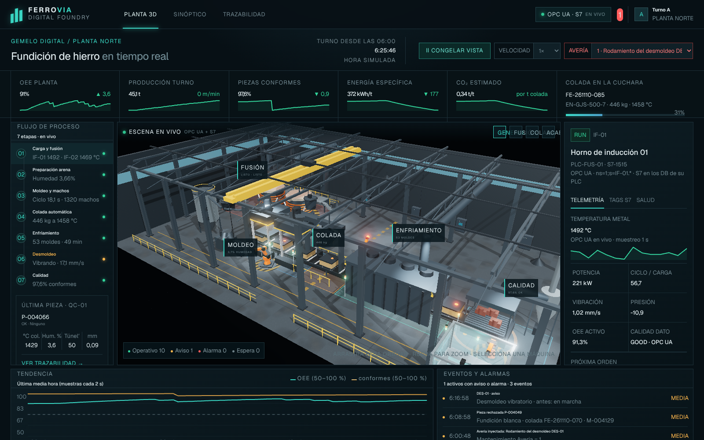
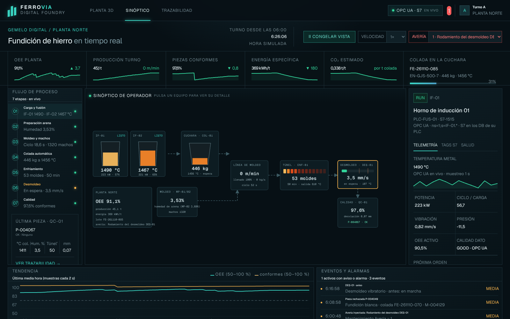
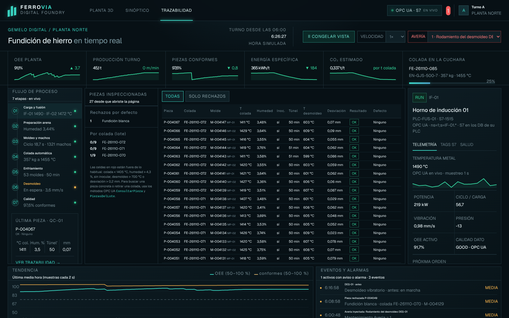

# Fundición · Gemelo digital de una planta de fundición con OPC UA

La Fundición simula la **Planta Norte** de una fundición de hierro completa: dos hornos de inducción, moldeo, colada automática, túnel de enfriamiento, desmoldeo, robots y control de calidad. Publica **11 activos y 172 variables** (con trazabilidad pieza a pieza) en un servidor **OPC UA** y tiene un **gemelo digital 3D** en el navegador que se mueve con esos datos.

Es el simulador con más activos del laboratorio: sirve para practicar el **descubrimiento** de un espacio de direcciones grande, el modelado de una planta como **jerarquía de activos** y los indicadores de planta (OEE, producción, energía).



## El gemelo digital (http://localhost:3000)

Todo lo que se ve sale del motor de proceso por OPC UA (a través del puente WebSocket); no hay valores fijos.

| Vista | Qué muestra |
|---|---|
| **Planta 3D** | La escena se mueve con el proceso: los hornos **se inclinan al sangrar** (`Inclinacion`) y el color del baño sigue su temperatura; la **grúa** va al horno que sangra, baja la cuchara, la llena, la lleva a la colada y la vacía (`CambioCuchara`); la cuchara de colada muestra su peso y la temperatura del metal; el desmoldeo vibra con una amplitud proporcional a su vibración; el escáner destella en verde o rojo con cada pieza; un **anillo en el suelo** pulsa en rojo (`ALARM`) o ámbar (`WARN`). Vistas de cámara: general, fusión, colada y acabado |
| **Sinóptico** | Esquema de operador con hornos, cuchara, línea, moldeo, túnel, desmoldeo (barra de vibración con umbrales 12 y 18 mm/s), calidad y KPIs; cada equipo se enmarca en ámbar o rojo según su estado |
| **Trazabilidad** | Las piezas inspeccionadas con su colada, molde, temperatura de colada, humedad, inoculación, tiempo de túnel, temperatura de desmoldeo y desviación; las condiciones fuera de lo habitual en rojo; rechazos por defecto y por colada |

En la cabecera: **velocidad** de la simulación (×1–×20) y **avería** (0–7), que el puente escribe en
`Simulacion.Velocidad` y `Mantenimiento.Averia` (solo esas dos variables: lista cerrada). Abajo, la tendencia de la
última media hora y los **eventos** detectados (cambios de estado, averías y piezas rechazadas).

 

## Servicios

| Servicio (compose) | Puerto | Qué hace |
|---|---|---|
| `fundicion-opcua` | `4841` | Servidor OPC UA: `opc.tcp://localhost:4841/UA/Fundicion` (desde otro contenedor, `opc.tcp://fundicion-opcua:4841/UA/Fundicion`) |
| `fundicion-bridge` | `8081` | Puente OPC UA → WebSocket: se suscribe a las variables y envía una instantánea cada segundo al gemelo digital; acepta las órdenes de velocidad y avería |
| `fundicion-web` | `3000` | Gemelo digital 3D: `http://localhost:3000` |
| `fundicion-s7` | `102` | PLC Siemens S7 simulado (S7comm): las `TagsS7` en sus DB, y DB100 para órdenes (ver [docs/S7_INTEGRATION.md](docs/S7_INTEGRATION.md)) |

Seguridad `None` y acceso anónimo (también admite las políticas seguras por defecto de node-opcua).

## El proceso

```
 Fusión            Moldeo                 Colada            Enfriamiento     Acabado            Calidad
 IF-01, IF-02  →   MP-01, MP-02, ROB-03 → COL-01, ROB-01 →  ENF-01       →   DES-01, ROB-02  →  QC-01
 (hornos)          (prensas, machos)      (cuchara)         (túnel)          (desmoldeo)        (escáner 3D)
```

Los valores los calcula un **motor de proceso causal** ([`opcua/motor.mjs`](opcua/motor.mjs)): nada es ruido
alrededor de un nominal, cada cifra sale de lo que pasa en la planta.

| Etapa | Qué se simula |
|---|---|
| **Fusión** | Hornos de 3 t (3,2 y 2,8 MW) con balance de energía: `CARGA` de chatarra → `FUSION` → `AFINO` → `LISTO`; cada horno da dos sangrados de 1 t y deja 1 t de pie. La temperatura la mide un termopar (que puede descalibrarse) |
| **Colada** | La grúa cambia la cuchara por una llena de un horno `LISTO` (25 s; con avería, minutos). El metal se enfría en la cuchara (~3,6 °C/min) y se cuela molde a molde con *interlock* (`MoldeEnPosicion`, `Colando`, `CaudalColada`, `NivelLlenado`) |
| **Moldeo** | Cada molde (90 kg) nace en una prensa con su **humedad de arena** y lleva macho (ROB-03); la línea va a la cadencia de las prensas (52 s, con micro-paradas) |
| **Enfriamiento** | Los moldes recorren el túnel (FIFO de 54 moldes, ≈ 47 min) y se enfrían según su edad; los ventiladores regulan la salida a ~610 °C |
| **Desmoldeo** | DES-01 vibra cada molde que sale (22 s); su **rodamiento se desgasta** y, si se rompe, la protección lo para y el túnel se llena hasta bloquear la línea |
| **Calidad** | QC-01 mide cada pieza. El **defecto real** depende de las causas: colada fría → unión fría, arena húmeda → porosidad, desmoldeo caliente → deformación, sin inocular → fundición blanca. La **medida** incluye además la deriva del escáner |
| **KPIs** | OEE = disponibilidad × rendimiento × calidad (medias de ~10 min); energía por tonelada colada; CO₂; producción del turno; lote activo (la colada de la cuchara) |

La planta arranca «en caliente» (túnel lleno), así que desde el primer minuto salen piezas. Valores normales: OEE
85–90 %, ~60 piezas/h, 98 % de conformes, 550–700 kWh/t.

## Espacio de direcciones

```
Objects
├── PlantaNorte
│   ├── KPIs                OEEPlanta, ProduccionTurno, PiezasConformes, EnergiaEspecifica,
│   │                       CO2Estimado, VelocidadLinea, PosicionLinea, LoteActivo
│   ├── Fusion   ─ IF-01, IF-02
│   ├── Moldeo   ─ MP-01, MP-02, ROB-03
│   ├── Colada   ─ COL-01, ROB-01
│   ├── Enfriamiento ─ ENF-01
│   ├── Acabado  ─ DES-01, ROB-02
│   └── Calidad  ─ QC-01
├── Trazabilidad            UltimaPieza (Id, Molde, Prensa, Lote, TemperaturaColada, HumedadArena, Inoculada,
│                           TiempoEnfriamiento, TemperaturaDesmoldeo, Desviacion, Resultado, Defecto),
│                           PiezasInspeccionadas, PiezasRechazadas
├── Mantenimiento           Averia (escribible), AveriaNombre
└── Simulacion              Velocidad (escribible, ×1–×20), TiempoSimulado y la «verdad» que una planta real
                            no tendría: DesgasteRodamiento, DerivaEscaner, TemperaturaRealIF01, DefectoRealUltimaPieza
```

Cada activo tiene `Nombre`, `Estado` (`RUN`, `IDLE`, `WARN`, `ALARM`), `PLC`, `Zona`, sus variables de proceso,
sus señales (`Fase`, `Colando`, `CambioCuchara`, `Marcha`…) y una carpeta `TagsS7` con las señales de su PLC
Siemens: el **mismo dato** que leería un cliente S7 en esa dirección (ver [docs/S7_INTEGRATION.md](docs/S7_INTEGRATION.md)).
Variables nuevas respecto a la versión anterior: `IF-0x.Inclinacion`, `IF-0x.EnergiaConsumida`,
`MP-0x.HumedadArena`, `ENF-01.MoldesEnTunel` y `COL-01.CambioCuchara`.

**NodeId**: `ns=1;s=<ACTIVO>.<Variable>`, por ejemplo `ns=1;s=IF-01.TemperaturaMetal`, `ns=1;s=COL-01.PesoCuchara`,
`ns=1;s=KPIs.OEEPlanta`, `ns=1;s=Trazabilidad.UltimaPieza.Lote`. Las carpetas de zona son `ns=1;s=Zona.Fusion`, etc.

## OPC UA avanzado

| Función | Dónde | Qué ofrece |
|---|---|---|
| **Alarmas y condiciones** | `ExclusiveLimitAlarm` en los activos; eventos al objeto `Server` (`i=2253`) | `IF-01.AlarmaTemperatura` (> 1530 / 1550 °C), `IF-02.AlarmaSobrepresion` (> 0 / 4 Pa), `COL-01.AlarmaColadaFria` (< 1405 / 1390 °C), `DES-01.AlarmaVibracion` (> 12 / 18 mm/s), `QC-01.AlarmaDesviacion` (> 0,2 / 0,3 mm), `KPIs.AlarmaOEE` (< 75 / 60 %). El servidor las activa y desactiva solo y cada cambio es un evento con mensaje y severidad |
| **Métodos** | `Mantenimiento`, `Trazabilidad` | `InyectarAveria(Codigo)`, `Reparar()`, `ConsultarPieza(Id)` → JSON con la historia de la pieza, `PiezasDelLote(Lote)` → piezas de una colada y cuántas se rechazaron |
| **Histórico** | HistoryRead | 2 h a 1 Hz de `KPIs.OEEPlanta`, `KPIs.EnergiaEspecifica`, `IF-01.TemperaturaMetal`, `COL-01.TemperaturaColada`, `DES-01.Vibracion`, `QC-01.DesviacionEscaneo` |

## Averías (para las prácticas)

Escribiendo un `Int32` en `ns=1;s=Mantenimiento.Averia` (un valor fuera de 0–7 se rechaza con `BadOutOfRange`).
Las averías de moldeo y colada tardan **~47 min** en verse en calidad: es lo que tardan las piezas afectadas en
cruzar el túnel (por eso importa la trazabilidad).

| Código | Avería | Qué pasa (cadena causal) |
|---|---|---|
| 0 | Sin avería | — (al pasar a 0 desde la 1, el rodamiento se considera cambiado) |
| 1 | Rodamiento del desmoldeo DES-01 | El desgaste crece: vibración en marcha > 12 mm/s a los ~13 min, `WARN` a los ~17, la protección **dispara** a los ~32 (`ALARM`); el túnel se llena y la línea se para |
| 2 | Extracción de humos IF-02 | La presión del recinto pasa de ≈ −9 Pa a ≈ +6 Pa en ~2 min; `Estado` `ALARM` |
| 3 | Retraso de la grúa de cuchara | El cambio de cuchara tarda 4–6 min: la línea espera metal y el OEE cae a ≈ 60 %; el metal llega más frío (algunas uniones frías) |
| 4 | Deriva del escáner 3D QC-01 | La medida se desvía hasta +0,16 mm: el escáner **rechaza piezas buenas** (falsos rechazos; el defecto real no cambia) |
| 5 | Humedad de arena alta | La humedad de las prensas sube ~0,8 puntos → **porosidad** en las piezas de esos moldes (~47 min después) |
| 6 | Inoculación intermitente (ROB-01) | ~1 de cada 3 moldes sin inocular → **fundición blanca** |
| 7 | Termopar de IF-01 descalibrado | El termopar lee hasta 60 °C de más: el horno parece estar a 1490 °C pero está más frío, el metal sale frío y aparecen **uniones frías**. `COL-01.TemperaturaColada` (pirómetro) sí lo delata |

`Simulacion.Velocidad` acelera la planta (por ejemplo ×10 para ver en 5 minutos lo que pasaría en 50).
`SIM_VELOCIDAD` y `SIM_SEMILLA` fijan la velocidad inicial y la semilla aleatoria.

## Puesta en marcha

Con el laboratorio completo: `docker compose up -d fundicion-opcua fundicion-bridge fundicion-web fundicion-s7`.

Por separado (Node.js ≥ 22.13):

```bash
cd simuladores/fundicion
npm install
npm run opcua          # servidor OPC UA (variable OPCUA_PORT, por defecto 4840)
npm run opcua:bridge   # puente WebSocket en el puerto 8081 (OPCUA_ENDPOINT)
npm run dev            # gemelo digital 3D en desarrollo
npm run opcua:test     # cliente de prueba
node --test tests/motor.test.mjs   # pruebas del motor de proceso
```

`OPCUA_ALTERNATE_HOSTNAME` admite varios nombres separados por comas: son los que el servidor anuncia en sus endpoints (en el compose, `localhost` y `fundicion-opcua`).

## Prácticas

- Serie 1 · Node-RED + Dashboard: [`practicas/1-dashboard/fundicion`](../../practicas/1-dashboard/fundicion/README.md)
- Serie 2 · Node-RED + ThingsBoard: [`practicas/2-thingsboard/fundicion`](../../practicas/2-thingsboard/fundicion/README.md)
